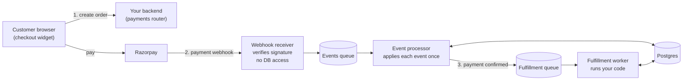

# Razorpay Payment Integration

Accept Razorpay payments in your app without losing a payment or processing one twice.

## What it is

A ready-made payment backend plus a checkout button:

- **Python library** (`razorpay_checkout/`): a FastAPI router that creates orders, receives Razorpay webhooks and runs your fulfillment code once a payment succeeds.
- **Checkout widget** (`packages/checkout-widget/`): a React component or plain-JS button that opens Razorpay's payment window.
- **AWS infrastructure** (`infra/`): CDK code to run it serverless on Lambda + SQS.

One deployment can serve several stores (tenants), each with its own Razorpay keys.

## Why use it

Wiring Razorpay's checkout is easy. Handling what happens after the payment is where things go wrong. This project handles that part:

- **No double processing.** Razorpay retries webhooks. Each event is applied exactly once, even under concurrent retries.
- **No lost payments.** Events go through queues with automatic retries and dead-letter queues, plus a reconcile endpoint to catch anything missed.
- **Secure by default.** Every webhook signature is verified, and the public-facing webhook receiver has no database access at all.
- **Testable on your laptop.** The whole flow runs locally with Docker. No AWS account needed.
- **Ready to operate.** Runbooks, dashboards and a security-checked CI pipeline are included.

## How it works



1. The customer pays through the widget, using an order your backend created.
2. Razorpay sends a webhook. The receiver checks the signature and queues it.
3. The processor updates the order once, then the fulfillment worker calls your code (ship the item, grant access, and so on).

Failed steps retry automatically. Anything that keeps failing lands in a dead-letter queue for review.

## How to use it

### 1. Try it locally

Requires Docker, [uv](https://docs.astral.sh/uv/) and Node 20+.

```bash
docker compose up -d postgres localstack
cd razorpay_checkout && uv sync --extra dev && uv run alembic upgrade head && cd ..

# Terminal A: backend
cd example/backend && uv run --project ../../razorpay_checkout uvicorn main:app --reload --port 8000

# Terminal B: queue worker
uv run --project razorpay_checkout python scripts/local-pump.py
```

Open <http://localhost:8000/dev/dashboard> and click **▶ Run All** to watch payments flow end to end. Full walkthrough: [docs/QUICKSTART.md](docs/QUICKSTART.md).

### 2. Add it to your app

**Backend.** Mount the router and supply your fulfillment logic:

```python
from fastapi import FastAPI
from razorpay_checkout import payments_router

class GrantAccess:
    """Called once per successful payment. Must be safe to retry."""

    async def fulfill(self, order_id: str, tenant_id: str, amount: int, metadata: dict) -> None:
        ...  # e.g. mark the order paid in your system, send the receipt

app = FastAPI(lifespan=lifespan)  # lifespan sets up DB, Razorpay client, queues and app.state.hook = GrantAccess()
app.include_router(payments_router, prefix="/payments")
```

[example/backend/main.py](example/backend/main.py) has the complete `lifespan` wiring. Settings come from `RAZORPAY_*` environment variables; see [.env.example](.env.example).

**Frontend.** Drop in the button:

```tsx
import { RazorpayCheckout } from "@akhiljoe/checkout-widget";

<RazorpayCheckout
  orderEndpoint="/payments/orders"
  receipt={cartId}
  onSuccess={(result) => showThankYou(result.orderId)}
  onFailure={(error) => showError(error.description)}
  onDismiss={() => {}}
/>
```

The amount always comes from your server, never from the browser. The library and widget aren't published to PyPI or npm yet, so install them from this repo.

### 3. Deploy to AWS

`infra/` deploys the queues, Lambdas and alarms with CDK. Account IDs and domains in `infra/cdk.json` are placeholders; see [infra/README.md](infra/README.md#context-overrides) for supplying real values.

## Status

The application is complete and tested locally: 240+ Python tests, chaos tests and 15 widget tests. The AWS rollout is in progress ([tracker](docs/deployment-progress.md)).

## Learn more

- [Architecture](docs/ARCHITECTURE.md): design overview and the guarantees it relies on
- [Diagrams](docs/diagrams/): webhook sequence, order state machine, AWS topology
- [Runbooks](docs/runbooks/): what to do when something breaks
- [Full design spec](designs/DESIGN_v6.md) and [all docs](docs/README.md)

## Authorship

Designed and architected by [Akhil Joe](https://github.com/akhiljoe): the system design, architecture, security model and the trade-offs in [`designs/`](designs/) are my decisions. Built with [Claude Code](https://claude.com/claude-code) as a pair programmer; its project rules live in [`CLAUDE.md`](CLAUDE.md) and [`.claude/`](.claude/).

## License

[MIT](LICENSE)
