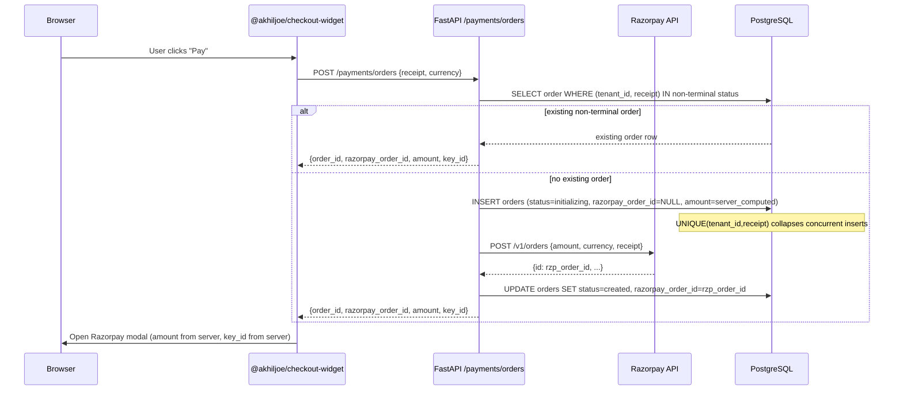
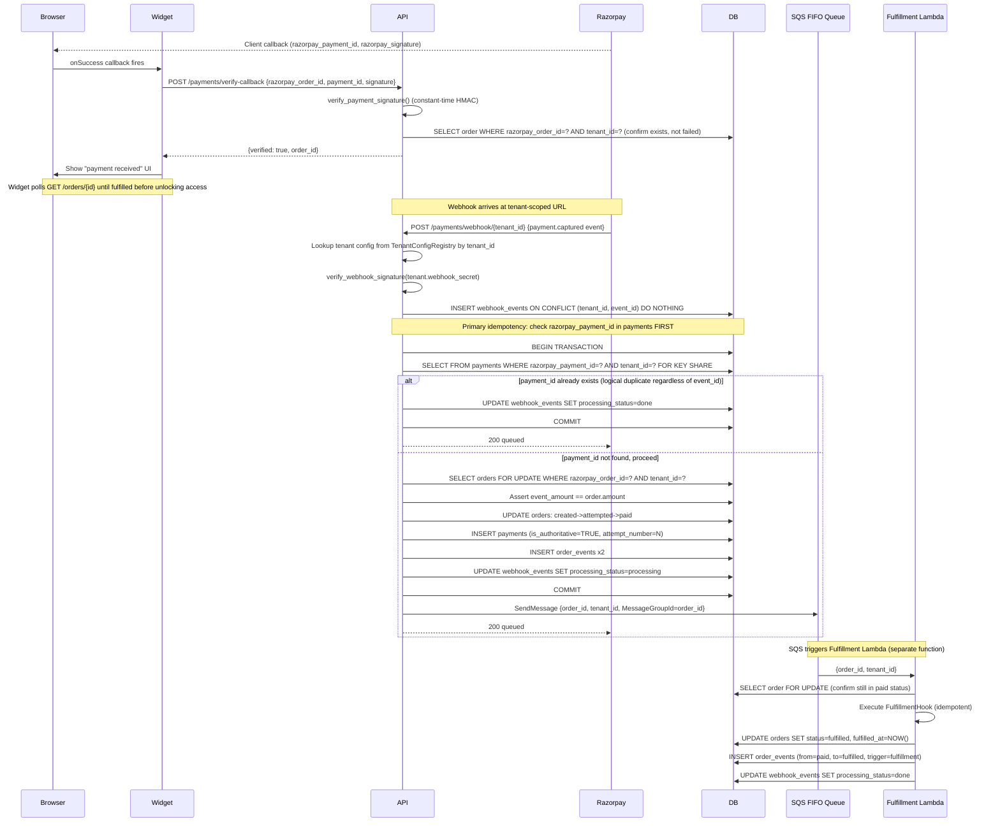
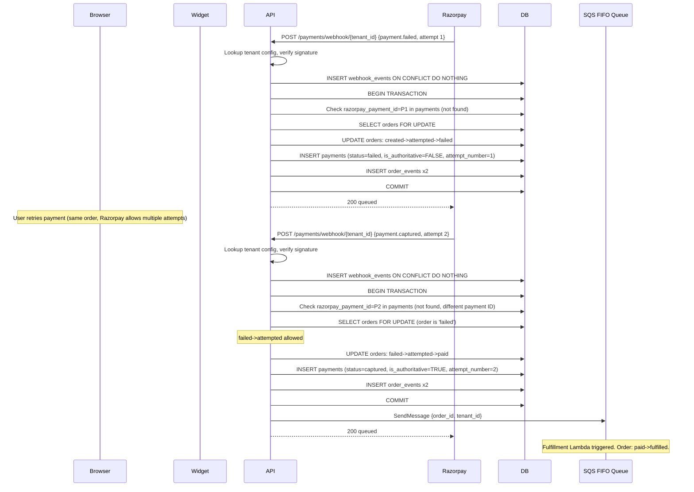
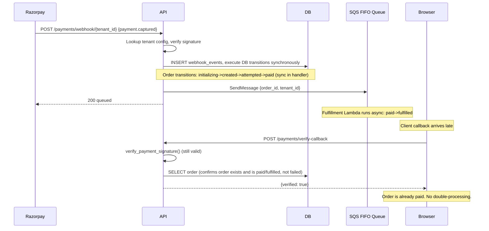
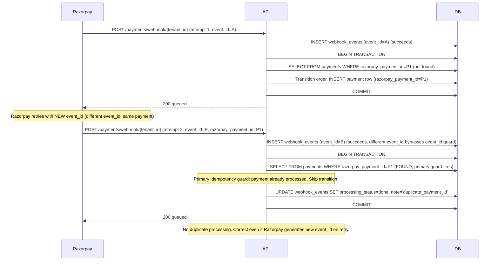
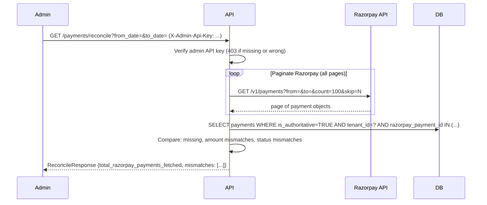
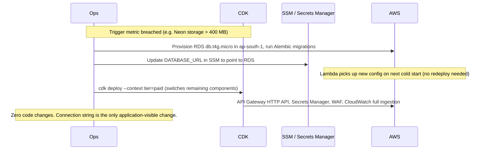

# DESIGN_v4.md: Razorpay Payment Integration Layer

Authoritative technical specification. Single source of truth.

## Table of Contents

1. [Repository Layout](#1-repository-layout)
2. [Public API Surface](#2-public-api-surface)
3. [DB Schema](#3-db-schema)
4. [Order State Machine](#4-order-state-machine)
5. [Sequence Diagrams](#5-sequence-diagrams)
6. [Failure Modes and Handling](#6-failure-modes-and-handling)
7. [Webhook and Fulfillment Architecture](#7-webhook-and-fulfillment-architecture)
8. [Free Track Capacity Model](#8-free-track-capacity-model)
9. [Paid Track API Layer Decision](#9-paid-track-api-layer-decision)
10. [OpenTelemetry Exporter Strategy](#10-opentelemetry-exporter-strategy)
11. [Fulfillment Hook Contract](#11-fulfillment-hook-contract)
12. [Operational Runbooks](#12-operational-runbooks)
13. [Monitoring and Alerts](#13-monitoring-and-alerts)
14. [Test Strategy](#14-test-strategy)
15. [Out of Scope for v1](#15-out-of-scope-for-v1)

---

## 1. Repository Layout

```
razorpay-payment-integration/
├── razorpay_checkout/
│   ├── pyproject.toml
│   ├── razorpay_checkout/
│   │   ├── __init__.py
│   │   ├── client.py           # Async Razorpay HTTP client
│   │   ├── models.py           # Pydantic v2 models
│   │   ├── orders.py           # OrderService, state machine, transition guard
│   │   ├── webhooks.py         # Webhook handler and processor
│   │   ├── signatures.py       # HMAC verification utilities
│   │   ├── router.py           # FastAPI router, mountable at /payments
│   │   ├── telemetry.py        # OTel setup, pluggable exporter
│   │   └── migrations/         # Alembic env and versions
│   └── tests/
│
├── packages/
│   └── checkout-widget/        # @akhiljoe/checkout-widget
│       ├── package.json
│       ├── tsconfig.json
│       ├── src/
│       │   ├── core.ts         # Shared logic: fetch order, load checkout.js, open modal
│       │   ├── react.tsx       # <RazorpayCheckout /> component
│       │   └── vanilla.ts      # mountCheckout() adapter
│       └── dist/               # ESM, CJS, .d.ts (generated)
│
├── example/
│   ├── backend/
│   └── frontend/
│
├── infra/                      # AWS CDK TypeScript
│   ├── bin/app.ts
│   ├── lib/free-stack.ts       # SQS FIFO queue and Fulfillment Lambda
│   ├── lib/paid-stack.ts
│   └── README.md
│
├── DESIGN_v4.md
├── TEST_PLAN.md
└── SCALE_PLAN.md
```

---

## 2. Public API Surface

### 2.1 Backend Python Package (`razorpay_checkout`)

#### Router

```python
from razorpay_checkout import payments_router

app.include_router(payments_router, prefix="/payments")
```

All routes require the calling app to provide a `RazorpayConfig` dependency at mount time.

#### `RazorpayConfig`

Injected via FastAPI `Depends`.

```python
class RazorpayConfig(BaseSettings):
    tenant_id: str                          # Identifies the tenant in shared DB deployments
    key_id: str                             # RAZORPAY_KEY_ID env var
    key_secret: SecretStr                   # RAZORPAY_KEY_SECRET env var
    webhook_secret: SecretStr               # RAZORPAY_WEBHOOK_SECRET env var
    webhook_secret_previous: SecretStr | None = None  # Zero-downtime rotation
    mode: Literal["test", "live"] = "test"
    db_dsn: PostgresDsn                     # DATABASE_URL env var
    pool_min_size: int = 2
    pool_max_size: int = 10
    razorpay_api_timeout: float = 10.0      # seconds
    otel_exporter: Literal["stdout", "xray", "otlp"] = "stdout"
    otel_endpoint: str | None = None        # Required when exporter=otlp
    admin_api_key: SecretStr | None = None  # If None, admin routes return 403
```

**Tenant isolation.** `tenant_id` is injected into every query via the config dependency. No query against `orders`, `payments`, `webhook_events`, or `order_events` may omit a `tenant_id` filter. This is enforced by the `OrderService` and `WebhookProcessor` classes, not by the caller.

**Multi-tenant webhook secret lookup.** In shared-service deployments where multiple tenants are served by one process, the webhook route receives the `tenant_id` in the URL path (see route below). The router uses this to look up the correct `RazorpayConfig` from a `TenantConfigRegistry`, a dict of `tenant_id` to `RazorpayConfig` registered at application startup. Signature verification uses the tenant-specific `webhook_secret`. The tenant is known before the secret is needed.

```python
class TenantConfigRegistry:
    """Registered at app startup. Maps tenant_id to RazorpayConfig."""
    def get(self, tenant_id: str) -> RazorpayConfig | None: ...
    def register(self, config: RazorpayConfig) -> None: ...
```

Single-tenant deployments register one config and still use the `/{tenant_id}` URL. The contract is uniform across deployment modes.

#### Route: `POST /payments/orders`

Creates a Razorpay order server-side. The frontend never sets the amount.

The server derives the amount from its own pricing logic, keyed on `receipt`. This eliminates the price-tampering surface entirely.

```python
class CreateOrderRequest(BaseModel):
    currency: str = "INR"
    receipt: str          # Caller-supplied idempotency key (e.g. cart_id or invoice_id)
    notes: dict[str, str] = {}

class CreateOrderResponse(BaseModel):
    order_id: str         # Internal UUID
    razorpay_order_id: str
    amount: int           # In paise; set server-side from pricing logic, never from client
    currency: str
    key_id: str           # Public key; safe to expose; needed to init checkout.js
```

**Order creation sequence:**

1. Check for an existing non-terminal order with the same `(tenant_id, receipt)`. If found, return it. Non-terminal statuses are `initializing`, `created`, `attempted`, `paid`, and `fulfilled`. `failed` and `refunded` are terminal and do not match.
2. If not found, INSERT an `orders` row with `status=initializing`, `razorpay_order_id=NULL`, and the server-computed `amount`. The `UNIQUE(tenant_id, receipt)` constraint collapses any concurrent inserts to a single row.
3. Call the Razorpay API to create the order.
4. On success, UPDATE the row with `razorpay_order_id` and set `status=created`.
5. On Razorpay API failure, the row stays in `initializing`. A cleanup job, or the next request with the same receipt, can detect and retry. Return 503 to the client.

Razorpay is never ahead of the local DB.

#### Route: `POST /payments/webhook/{tenant_id}`

Razorpay calls this. Must return `200` in under 500 ms (warm invocation target). The `tenant_id` path parameter is included in the URL registered with Razorpay's dashboard per tenant, allowing the handler to resolve the correct `webhook_secret` from `TenantConfigRegistry` before attempting signature verification.

```python
# No request model exposed; raw bytes are read and verified before deserialization
class WebhookAckResponse(BaseModel):
    status: Literal["queued"]
```

**Internal pipeline:**

1. Look up `RazorpayConfig` from `TenantConfigRegistry` by the `tenant_id` path parameter. Return `400 Bad Request` if the tenant is unknown. The multi-tenant URL space is publicly enumerable; returning 400 (not 404) avoids leaking tenant existence.
2. Verify `X-Razorpay-Signature` using the tenant's `webhook_secret`, falling back to `webhook_secret_previous` if set. Both checks use `hmac.compare_digest`. Return `400` on mismatch.
3. INSERT into `webhook_events` with `ON CONFLICT (tenant_id, event_id) DO NOTHING`. Increment the `webhook_duplicate_count` metric on conflict. On exact `event_id` duplicate, return `200 queued` immediately.
4. Begin the DB transaction. Check `razorpay_payment_id` existence in `payments` for this tenant with `SELECT ... FOR KEY SHARE`. This is the primary idempotency guard. If found, mark the event `done`, commit, and return `200 queued`. This catches Razorpay retries that arrive with a new `event_id` for the same payment.
5. Acquire `SELECT ... FOR UPDATE` on the `orders` row to serialize concurrent processors for the same order.
6. Assert `event_amount == order.amount`. On mismatch, set `processing_status='failed'`, alert, and return `200 queued`. Do not return 500. Razorpay must not retry an amount mismatch indefinitely.
7. Execute all DB state transitions synchronously: order status updates, payment row insert, `order_events` inserts. Commit the transaction.
8. On a successful `paid` transition, publish a message to the `fulfillment-queue.fifo` SQS FIFO queue with `MessageGroupId=order_id`. The Webhook Lambda does not perform fulfillment.
9. Return `200 queued`.

The Webhook Lambda's responsibility ends at the SQS publish. The Fulfillment Lambda (Section 7) consumes from SQS and invokes the `FulfillmentHook` (Section 11).

#### Route: `GET /payments/orders/{order_id}`

Fetch order status. The intended polling mechanism for the frontend to confirm fulfillment.

```python
class OrderStatusResponse(BaseModel):
    order_id: str
    razorpay_order_id: str
    status: OrderStatus
    amount: int
    currency: str
    created_at: datetime
    paid_at: datetime | None
    fulfilled_at: datetime | None
```

Recommended frontend pattern: poll every 2s with a 30s timeout, transition UI on `fulfilled`. This is the authoritative signal for unlocking access, provisioning, or downloads. Do not use `verify-callback` for this purpose.

#### Route: `POST /payments/verify-callback`

Called by the frontend after Razorpay's client-side success callback to verify the signature and check order status. This is a hint, not the fulfillment signal.

The endpoint:
- Verifies the HMAC signature.
- Looks up the `razorpay_order_id` in `orders` (filtered by `tenant_id`) and confirms the order exists and is not in a terminal failed state.
- Returns `{verified: true}` when both checks pass. The order may still be `created` or `attempted`; webhook processing is asynchronous.
- Does not unlock access, trigger fulfillment, or grant entitlements. Only the `fulfilled` status transition (from webhook plus fulfillment processing) is authoritative for fulfillment.
- Consumer apps must not treat `{verified: true}` as permission to provision paid features.

```python
class VerifyCallbackRequest(BaseModel):
    razorpay_order_id: str
    razorpay_payment_id: str
    razorpay_signature: str

class VerifyCallbackResponse(BaseModel):
    verified: bool
    order_id: str             # Internal UUID
    reason: str | None        # Set when verified=False: "signature_invalid", "order_not_found", "order_in_terminal_state"
```

#### Route: `GET /payments/reconcile`

Admin-only. Pulls Razorpay's payments API for a date range with full cursor-based pagination and flags mismatches against the local DB.

**Auth.** Requires `X-Admin-Api-Key` header matching `RazorpayConfig.admin_api_key`. If `admin_api_key` is `None`, this route returns `403`. Consuming apps must explicitly set a key to enable this route.

**Pagination.** Iterates all pages from Razorpay using `count`/`skip` parameters until an empty page is returned. `total_razorpay_payments_fetched` is included in the response so callers can detect truncation. A warning is logged if page count exceeds 1.

```python
class ReconcileRequest(BaseModel):
    from_date: date
    to_date: date

class ReconcileMismatch(BaseModel):
    razorpay_payment_id: str
    reason: Literal[
        "missing_in_local_db",
        "amount_mismatch",
        "status_mismatch",
    ]
    razorpay_amount: int | None
    local_amount: int | None
    razorpay_status: str | None
    local_status: str | None

class ReconcileResponse(BaseModel):
    from_date: date
    to_date: date
    total_razorpay_payments_fetched: int
    total_local_payments: int
    mismatches: list[ReconcileMismatch]
```

#### Route: `POST /payments/admin/events/{event_id}/replay`

Admin-only. Resets a `failed` or `dead` webhook event to `pending` for reprocessing. Requires the same admin API key as reconcile.

```python
class ReplayEventResponse(BaseModel):
    event_id: str
    previous_status: str
    new_status: Literal["pending"]
```

#### Route: `POST /payments/admin/orders/{order_id}/retry-fulfillment`

Admin-only. Re-enqueues an SQS message for an order that is `paid` but not `fulfilled`. Used when a fulfillment message ended up in the DLQ or was lost between DB commit and SQS publish.

```python
class RetryFulfillmentResponse(BaseModel):
    order_id: str
    sqs_message_id: str
```

#### Signature Utilities

Importable directly.

```python
# razorpay_checkout.signatures

def verify_webhook_signature(
    raw_body: bytes,
    header_signature: str,
    webhook_secret: str,
    webhook_secret_previous: str | None = None,
) -> bool:
    """
    Tries the current secret first. Falls back to webhook_secret_previous if set.
    HMAC-SHA256, constant-time comparison via hmac.compare_digest.
    """
    ...

def verify_payment_signature(
    order_id: str,
    payment_id: str,
    signature: str,
    key_secret: str,
) -> bool:
    """HMAC-SHA256 of 'order_id|payment_id', constant-time comparison."""
    ...
```

---

### 2.2 Frontend npm Package (`@akhiljoe/checkout-widget`)

#### React Component

```typescript
export interface RazorpayCheckoutProps {
    currency?: string;           // Default: "INR"
    orderEndpoint: string;       // POST endpoint that returns CreateOrderResponse
    receipt: string;             // Passed to orderEndpoint; caller's idempotency key
    buttonLabel?: string;        // Default: "Pay"
    theme?: { color?: string };  // Passed to checkout.js options

    onSuccess: (result: PaymentResult) => void;
    onFailure: (error: PaymentError) => void;
    onDismiss: () => void;
}

export function RazorpayCheckout(props: RazorpayCheckoutProps): JSX.Element;
```

There is no `amount` prop. The server returns the authoritative amount in the `CreateOrderResponse`. Any display of the amount before the modal opens must be obtained from the server response, never a client-side value.

#### Vanilla Adapter

```typescript
export interface CheckoutOptions extends RazorpayCheckoutProps {}

// Mounts a trigger button into `element`; shares the same internal core as the React component
export function mountCheckout(element: HTMLElement, options: CheckoutOptions): () => void;
// Returns an unmount/cleanup function
```

#### Typed Event Shapes

Internal details do not leak.

```typescript
export interface PaymentResult {
    orderId: string;          // Internal order ID from orderEndpoint response
    razorpayOrderId: string;
    razorpayPaymentId: string;
    razorpaySignature: string;
}

export interface PaymentError {
    code: string;
    description: string;
    reason: string;
    source: string;
    step: string;
    metadata: {
        orderId: string;
        paymentId: string;
    };
}
```

#### Internal Core Flow

Not exported.

1. Call `orderEndpoint` via `fetch` POST with `{ receipt, currency }`. Receive `{ order_id, razorpay_order_id, amount, currency, key_id }`.
2. Dynamically inject `https://checkout.razorpay.com/v1/checkout.js` if not already present (idempotent). After injection, verify `window.Razorpay` is defined within 3s; call `onFailure` with `code: "csp_blocked"` if not.
3. Construct `Razorpay(options)` using `key_id` and the server-returned `amount`.
4. Open the modal. On handler callbacks, map the raw Razorpay response to `PaymentResult` or `PaymentError` and call the appropriate prop.

**Amount safety.** The widget uses the `amount` returned by the server, not any client-side value. No client-set amount ever reaches Razorpay.

**Post-payment flow.** After `onSuccess` fires and `verify-callback` returns `{verified: true}`, the widget polls `GET /payments/orders/{order_id}` until `status === 'fulfilled'` (recommended timeout 30s, interval 2s) before the consumer app unlocks access. This contract is documented in the README and must not be bypassed.

**Required CSP directives.** Consumer apps must add to their Content-Security-Policy:

```
script-src https://checkout.razorpay.com;
frame-src https://api.razorpay.com;
```

---

## 3. DB Schema

All schema lives in Alembic migrations. No `metadata.create_all()` in application code. Migrations run identically against Neon (Free Track) and RDS (Paid Track). No Neon-specific SQL.

### Tables

#### `tenants`

```sql
CREATE TABLE tenants (
    id          TEXT PRIMARY KEY,              -- e.g. "site-a", "site-b"
    name        TEXT NOT NULL,
    created_at  TIMESTAMPTZ NOT NULL DEFAULT NOW()
);
```

All other tables reference `tenant_id TEXT NOT NULL`, a logical FK to `tenants.id`. No hard FK constraint is declared, to avoid cross-tenant join overhead. Application logic enforces correctness.

---

#### `orders`

```sql
CREATE TABLE orders (
    id                  UUID PRIMARY KEY DEFAULT gen_random_uuid(),
    tenant_id           TEXT NOT NULL,
    receipt             TEXT NOT NULL,
    razorpay_order_id   TEXT UNIQUE,                          -- Null until Razorpay API returns
    amount              INTEGER NOT NULL CHECK (amount > 0),  -- In paise; server-set
    currency            TEXT NOT NULL DEFAULT 'INR' CHECK (char_length(currency) <= 3),
    status              TEXT NOT NULL DEFAULT 'initializing',
    notes               JSONB NOT NULL DEFAULT '{}',
    correlation_id      TEXT NOT NULL,
    created_at          TIMESTAMPTZ NOT NULL DEFAULT NOW(),
    attempted_at        TIMESTAMPTZ,
    paid_at             TIMESTAMPTZ,
    fulfilled_at        TIMESTAMPTZ,
    failed_at           TIMESTAMPTZ,
    refunded_at         TIMESTAMPTZ,
    updated_at          TIMESTAMPTZ NOT NULL DEFAULT NOW()
);
```

`updated_at` is maintained by a DB-level `BEFORE UPDATE` trigger, never by application code. See Alembic Notes.

**Indexes and rationale:**

| Index | Column(s) | Type | Reason |
|---|---|---|---|
| `orders_pkey` | `id` | B-tree (PK) | Primary lookup by internal ID |
| `orders_razorpay_order_id_key` | `razorpay_order_id` | Unique B-tree | Webhook lookup; uniqueness at DB level |
| `orders_tenant_receipt_unique` | `(tenant_id, receipt)` | Unique B-tree | Collapses concurrent create races; idempotency at DB level |
| `orders_tenant_status_idx` | `(tenant_id, status)` | B-tree | Reconciliation and admin queries filtered by tenant |
| `orders_created_at_idx` | `created_at` | B-tree | Reconciliation date-range scans |

**Constraints:**

- `UNIQUE(tenant_id, receipt)` is the primary idempotency constraint. Concurrent inserts with the same `(tenant_id, receipt)` are collapsed to one row via `INSERT ... ON CONFLICT DO NOTHING RETURNING *`.
- `status` is validated by the application-level state machine (`OrderService.transition()`). Not a DB enum, to avoid Alembic migration pain on additions.
- `amount > 0` CHECK constraint.
- `currency` length CHECK `<= 3`.

---

#### `payments`

```sql
CREATE TABLE payments (
    id                  UUID PRIMARY KEY DEFAULT gen_random_uuid(),
    tenant_id           TEXT NOT NULL,
    order_id            UUID NOT NULL REFERENCES orders(id),
    razorpay_payment_id TEXT NOT NULL UNIQUE,
    razorpay_order_id   TEXT NOT NULL,
    razorpay_signature  TEXT,
    amount              INTEGER NOT NULL,                     -- In paise; from Razorpay event
    currency            TEXT NOT NULL,
    method              TEXT,
    status              TEXT NOT NULL,                        -- captured, failed, refunded
    attempt_number      INTEGER NOT NULL DEFAULT 1,
    is_authoritative    BOOLEAN NOT NULL DEFAULT FALSE,       -- TRUE only on payment.captured
    captured_at         TIMESTAMPTZ,
    created_at          TIMESTAMPTZ NOT NULL DEFAULT NOW()
);
```

`attempt_number` tracks which retry sequence this payment represents. `is_authoritative` is set to `TRUE` only on `payment.captured`. Reconciliation queries only authoritative payments, avoiding false positives from failed attempts.

**Indexes and rationale:**

| Index | Column(s) | Type | Reason |
|---|---|---|---|
| `payments_pkey` | `id` | B-tree (PK) | Primary lookup |
| `payments_razorpay_payment_id_key` | `razorpay_payment_id` | Unique B-tree | Primary idempotency guard, checked before any state transition |
| `payments_order_id_idx` | `order_id` | B-tree | FK join from orders |
| `payments_razorpay_order_id_idx` | `razorpay_order_id` | B-tree | Webhook event join |
| `payments_tenant_idx` | `tenant_id` | B-tree | Tenant-scoped queries |

---

#### `webhook_events`

```sql
CREATE TABLE webhook_events (
    id                  UUID PRIMARY KEY DEFAULT gen_random_uuid(),
    tenant_id           TEXT NOT NULL,
    event_id            TEXT NOT NULL,                              -- Razorpay event ID
    event               TEXT NOT NULL,                              -- e.g. payment.captured
    payload             JSONB NOT NULL,
    received_at         TIMESTAMPTZ NOT NULL DEFAULT NOW(),
    processed_at        TIMESTAMPTZ,
    processing_status   TEXT NOT NULL DEFAULT 'pending',            -- pending, processing, done, failed, dead
    error               TEXT,
    attempts            INTEGER NOT NULL DEFAULT 0,
    max_attempts        INTEGER NOT NULL DEFAULT 5,
    UNIQUE(tenant_id, event_id)
);
```

After `attempts >= max_attempts`, `processing_status` is set to `dead` and processing stops. A CloudWatch alert fires on any `dead` event. `UNIQUE(tenant_id, event_id)` scopes idempotency per tenant.

**Indexes and rationale:**

| Index | Column(s) | Type | Reason |
|---|---|---|---|
| `webhook_events_pkey` | `id` | B-tree (PK) | Internal |
| `webhook_events_tenant_event_id_key` | `(tenant_id, event_id)` | Unique B-tree | Tenant-scoped fast-path idempotency |
| `webhook_events_tenant_status_idx` | `(tenant_id, processing_status)` | B-tree | Processor polls per tenant |
| `webhook_events_received_at_idx` | `received_at` | B-tree | Replay and ordering |

**Processor behavior:**

- Poll condition for retry of `failed` events: `WHERE tenant_id=? AND processing_status='failed' AND attempts < max_attempts ORDER BY received_at LIMIT 10 FOR UPDATE SKIP LOCKED`.
- `IllegalTransitionError` where the event is `payment.failed` and the order is already `paid` or `fulfilled`: mark the event `done` with a note. This is a valid no-op, not a failure.
- Before any state transition, check whether `razorpay_payment_id` exists in `payments` for this tenant. If yes, the event is a logical duplicate regardless of `event_id`. Mark `done`.
- `SELECT ... FOR UPDATE` on the `orders` row inside the processor transaction serializes concurrent transitions for the same order.
- The DB transaction commits before any side effect (SQS publish, fulfillment, log).
- During processing, assert `event_amount == order.amount`. On mismatch, set `processing_status='failed'` and alert.

---

#### `order_events`

Immutable audit trail. One row per state transition.

```sql
CREATE TABLE order_events (
    id               UUID PRIMARY KEY DEFAULT gen_random_uuid(),
    order_id         UUID NOT NULL REFERENCES orders(id),
    tenant_id        TEXT NOT NULL,
    from_status      TEXT NOT NULL,
    to_status        TEXT NOT NULL,
    trigger          TEXT NOT NULL,   -- 'webhook', 'reconcile', 'manual', 'fulfillment', 'initializing'
    webhook_event_id UUID REFERENCES webhook_events(id),
    metadata         JSONB NOT NULL DEFAULT '{}',
    created_at       TIMESTAMPTZ NOT NULL DEFAULT NOW()
);

CREATE INDEX ON order_events(order_id);
CREATE INDEX ON order_events(tenant_id, created_at);
```

Every call to `OrderService.transition()` inserts a row here. One extra INSERT per transition. The `webhook_event_id` links the transition to the raw event that caused it.

---

### Alembic Notes

`updated_at` is maintained by a DB-level `BEFORE UPDATE` trigger. asyncpg supports triggers without issue. This removes the risk of stale `updated_at` from direct SQL operations or admin fixes.

```sql
CREATE OR REPLACE FUNCTION set_updated_at()
RETURNS TRIGGER AS $$
BEGIN
  NEW.updated_at = NOW();
  RETURN NEW;
END;
$$ LANGUAGE plpgsql;

CREATE TRIGGER orders_updated_at
BEFORE UPDATE ON orders
FOR EACH ROW EXECUTE FUNCTION set_updated_at();
```

---

## 4. Order State Machine

```mermaid
stateDiagram-v2
    [*] --> initializing : POST /payments/orders (local row inserted before Razorpay call)

    initializing --> created : Razorpay API returns rzp_order_id
    initializing --> initializing : Razorpay call failed; row retained for retry

    created --> attempted : First payment event received (any outcome)
    created --> failed : Razorpay order expired with no attempt

    attempted --> paid : webhook payment.captured verified
    attempted --> failed : webhook payment.failed verified

    failed --> attempted : New payment attempt on same order (payment retry)

    paid --> fulfilled : fulfillment side-effect complete
    paid --> failed : fulfillment exhausted max retries

    fulfilled --> refunded : refund.processed webhook received

    failed --> [*]
    refunded --> [*]
```



Orders enter `initializing` when the local row is inserted, before the Razorpay API call. This ensures the DB is never behind Razorpay. The `failed` to `attempted` edge allows a payment retry to recover an order that failed a previous attempt; without it, a `payment.captured` event after a `payment.failed` event would hit `IllegalTransitionError` and leave a captured payment unprocessed.

**Illegal transition guard.** `OrderService.transition(order, new_status)` raises `IllegalTransitionError` for any edge not in the table below. Special case: if the event is `payment.failed` and the order is already `paid` or `fulfilled`, this is treated as a stale event (valid no-op); the event is marked `done`, not `failed`.

**Allowed transitions:**

| From | To | Trigger |
|---|---|---|
| `initializing` | `created` | Razorpay API returns `rzp_order_id` |
| `created` | `attempted` | First payment event (any outcome) |
| `created` | `failed` | Order expiry |
| `attempted` | `paid` | `payment.captured` webhook |
| `attempted` | `failed` | `payment.failed` webhook |
| `failed` | `attempted` | New `payment.captured` or `payment.failed` event for the same order |
| `paid` | `fulfilled` | Fulfillment complete |
| `paid` | `failed` | Fulfillment exhausted retries |
| `fulfilled` | `refunded` | `refund.processed` webhook |

---

## 5. Sequence Diagrams

### 5.1 Order Creation



### 5.2 Successful Payment



### 5.3 Failed Payment With Successful Retry



### 5.4 Webhook Before Client Callback



### 5.5 Webhook Retry With New `event_id`



### 5.6 Reconciliation



### 5.7 Free-to-Paid Migration Per Component



---

## 6. Failure Modes and Handling

| Failure | Detection | Handling | Recovery |
|---|---|---|---|
| **Razorpay API timeout during order creation** | `httpx.TimeoutException` | Exponential backoff with 3 retries (1s, 2s, 4s). After exhaustion, return `503`. Local `orders` row stays in `initializing`. | Client retries with same receipt. `UNIQUE(tenant_id, receipt)` returns the `initializing` row. Retry calls Razorpay again and updates the row. |
| **Duplicate webhook (same tenant_id + event_id)** | `UNIQUE` constraint on `(tenant_id, event_id)` | `INSERT ... ON CONFLICT DO NOTHING`. Increment `webhook_duplicate_count` metric. Return `200 queued`. | Transparent. |
| **Duplicate webhook (different event_id, same payment)** | `razorpay_payment_id` already in `payments` (checked before transition) | Mark event `done`. No state transition. Log at INFO with correlation ID. | Transparent. |
| **Webhook signature mismatch** | `hmac.compare_digest` returns `False` for both current and previous secret | Return `400`. Log at WARN. Do not persist. | Razorpay retries. If retries fail, investigate via dashboard. |
| **Payment.failed then payment.captured** | Second event is `payment.captured`, order is `failed` | `failed -> attempted -> paid` transition allowed. Processor continues normally. | Fulfillment runs. User's captured payment results in fulfillment. |
| **Payment.failed for already-paid order** | `IllegalTransitionError` on stale failed event | If event is `payment.failed` and order is `paid` or `fulfilled`: mark event `done` with note. Not a failure. | No action needed. |
| **Concurrent processor for same order** | `SELECT ... FOR UPDATE` on `orders` row inside processor transaction | Second processor blocks until first commits. No race condition. | Transparent. |
| **Amount mismatch (event amount != order amount)** | Assertion in processor | Set event `processing_status='failed'`, log at ERROR, alert. | Manual review. Razorpay is authoritative. Admin may trigger reconcile-patch. |
| **Webhook event processing fails repeatedly** | `attempts >= max_attempts` | Set `processing_status='dead'`. Emit metric. CloudWatch alert fires. | Admin calls `POST /admin/events/{id}/replay` after root cause is fixed. |
| **Client callback without subsequent webhook** | Order remains in `created` or `attempted` after TTL (24h) | Reconciliation job flags it. No automatic state change. Razorpay is authoritative. | Admin investigates via Razorpay dashboard and reconcile endpoint. |
| **Neon cold start during webhook** | asyncpg pool acquire above threshold | Return `503`. Razorpay retries. Log cold-start latency as custom CloudWatch metric. | Retry arrives after Neon is warm. Event processed normally. |
| **Webhook tenant secret unknown before verification** | Tenant ID not available before signature check | Webhook URL includes `tenant_id` path parameter. Handler looks up `RazorpayConfig` from `TenantConfigRegistry` before verification. Correct secret is always known before HMAC check. | N/A; resolved by design. |
| **Razorpay retries with new event_id, bypassing event_id idempotency** | Different `event_id`, same `razorpay_payment_id` | `razorpay_payment_id` existence check in `payments` is the primary guard, executed inside the DB transaction before any transition. `event_id` uniqueness is a fast secondary guard at INSERT time. Even if `event_id` differs, the payment cannot be processed twice. | Transparent. Event marked `done` with note. |
| **Webhook before client callback** | Order is already `paid` or `fulfilled` when callback verify is called | `verify-callback` verifies signature and confirms order is not in a terminal failed state. Returns `{verified: true}`. No state change. | No action needed. |
| **Neon paused after inactivity** | All requests returning 503 | EventBridge keep-alive scheduled Lambda runs `SELECT 1` every 4 days to prevent Neon pause. | If paused: log in to Neon console, resume. Razorpay retries cover the window. |
| **Webhook secret rotation** | N/A; operational procedure | Add `RAZORPAY_WEBHOOK_SECRET_PREVIOUS` env var. `verify_webhook_signature` tries current secret first, falls back to previous. After 24h, remove previous. | Zero-downtime rotation. |
| **SQS publish fails after DB commit** | Lambda exception after commit, before SQS send returns | Order stays `paid` with no SQS message in flight. Scheduled Lambda detects orders in `paid` for more than 5 minutes and emits CloudWatch alarm. | `POST /payments/admin/orders/{order_id}/retry-fulfillment`. |
| **Fulfillment Lambda repeated failure** | SQS `maxReceiveCount` exceeded | Message moves to `fulfillment-dlq.fifo`. CloudWatch alarm fires on DLQ depth > 0. | `POST /payments/admin/orders/{order_id}/retry-fulfillment` after root cause is fixed. |
| **Unknown tenant_id on webhook route** | `TenantConfigRegistry.get(tenant_id)` returns `None` | Return `400 Bad Request`. Do not persist event. Razorpay retries. | Operator verifies tenant registration. |

---

## 7. Webhook and Fulfillment Architecture

The backend deploys as two AWS Lambda functions connected by an SQS FIFO queue (`fulfillment-queue.fifo`).

### Webhook Lambda

Triggered by `POST /payments/webhook/{tenant_id}`.

- Resolves tenant configuration from `TenantConfigRegistry`.
- Verifies the Razorpay signature (tenant-specific `webhook_secret`, with `webhook_secret_previous` fallback).
- Executes all DB state transitions synchronously within the request/response cycle (Section 2.1, internal pipeline steps 3 through 7).
- On a successful `paid` transition, publishes to `fulfillment-queue.fifo` with `MessageGroupId=order_id`. FIFO ensures per-order ordering.
- Returns `200 queued` to Razorpay in under 500 ms. Fulfillment latency does not affect this SLA.

The Webhook Lambda does not invoke `FulfillmentHook` and does not schedule any background task. Razorpay enforces a 500 ms response SLA on the webhook endpoint and deactivates endpoints that exceed it. Synchronous fulfillment with any external `FulfillmentHook` call (1 to 10 s typical) would breach this SLA. SQS publish p50 is 10 to 30 ms, well within budget.

### Fulfillment Lambda

Separate function. Event source mapping is the SQS queue.

- Receives `{order_id, tenant_id}`.
- Calls `FulfillmentHook` (Section 11) with idempotency guarantees.
- Updates the order to `fulfilled` or `failed`. Writes `order_events`.
- SQS handles retries via `maxReceiveCount=5`. After exhaustion, the message moves to `fulfillment-dlq.fifo`. CloudWatch alarm fires immediately on DLQ depth > 0.

The Fulfillment Lambda scales independently of the Webhook Lambda. The `FulfillmentHook` implementation can be swapped without touching the webhook code path.

### Cost on Free Track

- SQS: 1,000,000 requests per month permanent free tier. At 1,000 payments per month with three fulfillment attempts maximum, consumption is approximately 3,000 messages per month. Cost: $0.
- Fulfillment Lambda: counted within the same Lambda free tier (1,000,000 invocations per month).

### Scaling Triggers (Upgrade to SQS Standard)

Upgrade to SQS Standard with per-tenant consumer groups when:

1. Fulfillment processing p95 latency exceeds 30s for 1 hour (FIFO throughput per `MessageGroupId` is 1 message at a time; high per-order retry storms can starve other orders).
2. DLQ depth exceeds 100 sustained for more than 1 hour (systemic fulfillment failure requiring architectural review).
3. A fulfillment side-effect requires fan-out to multiple downstream systems (SNS to SQS per system is more appropriate than a single FIFO queue).

---

## 8. Free Track Capacity Model

| Resource | Service | Free Tier Limit | Estimated Consumption at 1k payments/mo | Headroom | Migration Trigger |
|---|---|---|---|---|---|
| Lambda invocations | AWS Lambda | 1,000,000 req/mo (permanent) | ~5,000 (5 invocations per payment) | 995,000 remaining | >200k payments/mo |
| Lambda compute | AWS Lambda | 400,000 GB-sec/mo (permanent) | ~5,000 x 512 MB x avg 2s = 5,000 GB-sec | 395,000 remaining | >80k payments/mo |
| SQS requests | AWS SQS | 1,000,000 req/mo (permanent) | ~3,000 (send + receive + delete per fulfillment) | 997,000 remaining | >300k payments/mo |
| Postgres storage | Neon free tier | 0.5 GB | ~60 MB (orders + payments + webhook_events + order_events at ~6 KB/payment) | ~440 MB | Neon storage > 400 MB for 7 days |
| Postgres connections | Neon free tier | 1,000 concurrent | asyncpg pool_max_size=10 per Lambda instance; Lambda max concurrency = 10 on Free Track | Ample | N/A at this scale |
| Log ingestion | CloudWatch | 5 GB/mo (permanent) | ~500 MB | 4.5 GB remaining | >10k payments/mo with full logging |
| Lambda concurrency | AWS Lambda | 1,000 concurrent executions (regional, shared) | ~10 peak | Well within | Sustained >900 concurrent |
| Amplify bandwidth | AWS Amplify | 15 GB/mo (free tier) | Negligible | ~14.9 GB remaining | >15 GB bandwidth/mo |
| SSM Parameter reads | AWS SSM | ~10k reads/mo free effective | ~100 reads/mo | ~$0 | N/A |
| CloudWatch custom metrics | AWS CloudWatch | 10 metrics/mo free | 8 (webhook_latency_ms, cold_start_ms, reconcile_mismatches, webhook_duplicate_count, order_state_transition_count, fulfillment_duration_ms, poller_batch_size, dead_event_count) | 2 remaining | >10 custom metrics |

Estimated monthly cost on Free Track: $0.

---

## 9. Paid Track API Layer Decision

| Dimension | Lambda (paid) | ECS Fargate | App Runner |
|---|---|---|---|
| Cold start | 0.8 to 1.5s (Python, mitigated by provisioned concurrency) | None (always-on) | None (min 1 instance) |
| Cost at 10k payments/mo | ~$1 to $3/mo | ~$15/mo | ~$8/mo |
| Cost at 100k payments/mo | ~$5 to $15/mo | ~$15/mo | ~$25 to $40/mo |
| Ops complexity | Low | High | Low |
| Mangum required | Yes | No | No |
| Webhook 500ms SLA | Achievable with warm Lambda; provisioned concurrency = 1 on webhook function only | Trivially met | Trivially met |
| Migration effort from Free Track | Near-zero | Medium | Low |

**Decision: Lambda (paid) with provisioned concurrency = 1 on the webhook function.**

Already running on Lambda in the Free Track. Lambda paid tier with provisioned concurrency on the webhook function meets the 500ms SLA at lower cost. At 100k payments per month, Lambda (~$5 to $15) is below Fargate (~$30 to $60). Fargate becomes correct only if sustained CPU-bound workloads emerge.

**Fargate trigger.** Move to Fargate only if Lambda concurrent execution limits are hit (>900 of 1,000 regional concurrency for >1 hour), or if p99 cold start with provisioned concurrency still breaches the webhook SLA.

---

## 10. OpenTelemetry Exporter Strategy

| `OTEL_EXPORTER` value | Used in | Sink | Cost |
|---|---|---|---|
| `stdout` | Free Track (default) | CloudWatch Logs (structured JSON) | $0 within 5 GB free tier |
| `xray` | Paid Track | AWS X-Ray via ADOT Lambda layer | ~$5/mo at 10k payments |
| `otlp` | Future / custom | Any OTLP-compatible backend | Varies |

Exporter is selected at startup from the `OTEL_EXPORTER` env var. No code branch in the application; only the SDK configuration changes.

**Log sanitization.** `key_secret` and `webhook_secret` must never appear in log output. Pydantic's `SecretStr` is used for these fields. A test asserts that no log record contains these values, including any path that serializes `RazorpayConfig`.

---

## 11. Fulfillment Hook Contract

The fulfillment hook is the extensibility point called by the Fulfillment Lambda. The following contract is binding.

**Default.** The default fulfillment hook is a no-op (logs the `order_id` and returns immediately). No external system is called. Consuming apps that need fulfillment must implement the hook interface and register it with the Fulfillment Lambda at deploy time.

**Invocation context.** The hook is called by the Fulfillment Lambda, which is triggered by SQS. SQS provides at-least-once delivery with its own retry semantics (`maxReceiveCount`, configurable). The hook must be idempotent. SQS may deliver the same message more than once.

**Hook interface:**

```python
class FulfillmentHook(Protocol):
    async def fulfill(self, order_id: str, tenant_id: str, amount: int, metadata: dict) -> None:
        """
        Called by the Fulfillment Lambda after payment.captured is confirmed.
        MUST be idempotent: calling multiple times with the same order_id must
        produce the same outcome and not raise an error on repeat calls.
        MUST be atomic: either all side-effects complete or raise an exception.
        Partial completion is not acceptable; use a fulfillment_events table
        internally if multi-step.
        On exception: SQS retries up to maxReceiveCount. After exhaustion,
        message moves to DLQ. CloudWatch alert fires on DLQ depth > 0.
        """
        ...
```

**DB transaction boundary.** The Webhook Lambda commits the `paid` DB transition before publishing to SQS. If SQS publish fails, the order remains `paid` with `webhook_events.processing_status=processing`. The Fulfillment Lambda will not be triggered for this event. Detection: orders in `paid` status for more than 5 minutes without a corresponding SQS message generate a CloudWatch alarm (polled by a scheduled Lambda every minute).

**Retry behavior.** SQS `maxReceiveCount=5` on `fulfillment-queue.fifo`. After exhaustion, the message moves to `fulfillment-dlq.fifo`. CloudWatch alarm fires immediately on DLQ depth > 0. Recovery: fix the root cause, then move the message from DLQ back to the queue via the AWS console or `POST /payments/admin/orders/{order_id}/retry-fulfillment`.

---

## 12. Operational Runbooks

**Runbook 1: Stuck or Dead Webhook Event**

- Trigger: CloudWatch alarm. `webhook_events.processing_status = 'dead'` count > 0 OR `processing_status = 'failed'` AND `attempts >= 3` AND `received_at < NOW() - 1hr`.
- Steps: (1) `GET /payments/admin/events/{id}` to inspect the `error` column. (2) Fix root cause. (3) `POST /payments/admin/events/{id}/replay` to reset to `pending`. (4) Monitor.

**Runbook 2: Fulfillment DLQ Message**

- Trigger: CloudWatch alarm. `fulfillment-dlq.fifo` depth > 0.
- Steps: (1) Inspect the DLQ message body (`order_id`, `tenant_id`). (2) Check `order_events` for the fulfillment attempt history. (3) Fix the root cause in the `FulfillmentHook`. (4) `POST /payments/admin/orders/{order_id}/retry-fulfillment` to re-enqueue the SQS message. (5) Monitor until order reaches `fulfilled`.

**Runbook 3: Order Stuck in `paid` With No SQS Message**

- Trigger: CloudWatch alarm. Orders in `paid` status for more than 5 minutes (scheduled check Lambda).
- Cause: SQS publish failed after DB commit, or Fulfillment Lambda not deployed correctly.
- Steps: (1) Verify Fulfillment Lambda is deployed and its event source mapping is active. (2) `POST /payments/admin/orders/{order_id}/retry-fulfillment` to manually enqueue. (3) Monitor.

**Runbook 4: Reconciliation Mismatch**

- Trigger: Manual or scheduled reconcile reports mismatches.
- Steps: (1) For `missing_in_local_db`: check Razorpay dashboard. If captured, check `webhook_events`. If event is `failed` or `dead`, run Runbook 1. If absent, manually insert from Razorpay payload. (2) For `amount_mismatch`: Razorpay is authoritative. Correct local amount. Alert on any mismatch > 1 paise. (3) For `status_mismatch`: Razorpay is authoritative. Transition via admin endpoint.

**Runbook 5: Neon Instance Paused**

- Trigger: All webhook events returning 503, Lambda logs showing `asyncpg.TooManyConnectionsError`.
- Prevention: EventBridge keep-alive Lambda runs `SELECT 1` every 4 days.
- Steps: (1) Log in to Neon console. (2) Resume the project. (3) Verify Lambda connectivity. (4) Razorpay retries cover the window. Monitor `webhook_events` for backlog.

**Runbook 6: Webhook Secret Rotation (Zero-Downtime)**

- Steps: (1) Add `RAZORPAY_WEBHOOK_SECRET_PREVIOUS` env var with old secret to Webhook Lambda. (2) `verify_webhook_signature` tries current secret first, falls back to previous. (3) Update Razorpay dashboard with new secret and new webhook URL (`/payments/webhook/{tenant_id}` if not already set). (4) After 24h, remove `RAZORPAY_WEBHOOK_SECRET_PREVIOUS`.

**Runbook 7: Captured Payment With No Fulfillment**

- Trigger: Support ticket. Order is `paid` but not `fulfilled` and no DLQ message.
- Steps: (1) Check `order_events` for transition history. (2) Check SQS fulfillment queue and DLQ for the `order_id`. (3) `POST /payments/admin/orders/{order_id}/retry-fulfillment`. (4) Monitor until `fulfilled`.

---

## 13. Monitoring and Alerts

**Dashboard: Payment Health**

- Webhook events by `processing_status` (pending, done, failed, dead) over last 24h.
- Order status distribution over last 7 days.
- Webhook p50, p95, p99 handler latency in milliseconds.
- Reconciliation mismatch count from last run.
- Lambda cold start count and p95 duration over last 24h.
- Dead event count, all time. Should be 0.

**Critical Alerts (PagerDuty):**

- `fulfillment-dlq.fifo` depth > 0: immediate.
- `webhook_events.processing_status = 'dead'` count > 0: immediate.
- `webhook_events.processing_status = 'failed'` AND `attempts >= 3` AND `received_at < 1hr ago` count > 0 for >30 min.
- Orders in `paid` status for > 5 minutes with no SQS message in flight: immediate.
- DB connection pool exhaustion.

**Warning Alerts (Slack):**

- Webhook handler p95 > 3000ms for 10 min.
- Lambda error rate > 1% for 5 min.
- Reconciliation mismatch count > 0.
- Razorpay webhook response p95 > 3s for 10 min (risk of webhook endpoint deactivation by Razorpay).

**Email Alerts:**

- Reconciliation mismatch count > 0 (daily scheduled run).

**Metrics (`telemetry.py`):**

- `webhook_duplicate_count`: on `ON CONFLICT DO NOTHING` (event_id) or primary `payment_id` guard.
- `order_state_transition_count{from,to}`: histogram.
- `fulfillment_duration_ms`: time from `paid` to `fulfilled` (measured in Fulfillment Lambda).
- `fulfillment_sqs_publish_failures`: SQS publish errors after DB commit.
- `reconciliation_mismatch_count{reason}`.
- `cold_start_ms`: Lambda cold start latency (both Webhook and Fulfillment Lambdas).
- `dead_event_count`: cumulative dead webhook events.
- `webhook_latency_ms`: handler response latency.
- `tenant_lookup_failures`: unknown `tenant_id` on webhook route.

---

## 14. Test Strategy

**Unit Tests (required, no exceptions):**

- State machine: every valid transition and every invalid transition (must raise `IllegalTransitionError`).
- `failed -> attempted -> paid` flow.
- `payment.failed` on `paid` order treated as no-op, not failure.
- `verify_webhook_signature`: valid, tampered body, wrong secret, empty body, previous secret fallback.
- `verify_payment_signature`: valid, mismatched IDs, wrong secret.
- Idempotency on receipt: duplicate receipt returns existing order (all non-terminal statuses).
- Duplicate `event_id`: `ON CONFLICT DO NOTHING`, no duplicate processing.
- Duplicate `razorpay_payment_id`: primary guard fires before any state transition.
- `razorpay_payment_id` check precedes state transition even when `event_id` is different.
- Amount assertion: webhook amount != order amount raises `AmountMismatchError`.
- Admin route: `403` when `admin_api_key` is None; `403` on wrong key; `200` on correct key.
- Order creation sequence: `initializing` row inserted before Razorpay call.
- Webhook route: `400` on unknown `tenant_id`; correct secret used per tenant.
- `TenantConfigRegistry`: returns correct config per `tenant_id`; returns `None` for unknown tenant.
- SQS publish called after successful `paid` DB transition; not called on duplicate or failed events.

**Integration Tests (against test Razorpay account):**

- Full happy path: create order, capture payment, webhook at `/payments/webhook/{tenant_id}`, SQS, fulfillment.
- Failed payment retry: fail then succeed; verify `failed -> attempted -> paid` state machine.
- Webhook before callback: webhook processes first, callback verify still returns `{verified: true}`.
- Webhook arrives twice (same `event_id`): second is silently ignored at INSERT.
- Webhook arrives twice (different `event_id`, same payment): primary `razorpay_payment_id` guard catches it.
- Multi-tenant: two tenants share one DB; webhook for tenant A does not process orders for tenant B.
- Reconciliation: intentionally create mismatches, verify detection; verify pagination correctness.
- Concurrent order creation with same receipt: 10 simultaneous POSTs result in exactly 1 Razorpay order created.
- SQS publish failure after DB commit: order remains `paid`; CloudWatch alarm fires; manual re-enqueue works.

**Chaos and Failure Tests:**

- DB down during webhook handler: Razorpay gets 503, retries, event processed correctly on retry.
- DB down during Fulfillment Lambda: SQS retries; idempotent hook handles re-delivery correctly.
- Fulfillment Lambda cold start: SQS visibility timeout covers cold start latency; no duplicate processing.
- Webhook burst (100 events in 1s): all DB transitions complete synchronously; SQS drains within 30s.
- Neon cold start simulation: 3s delay on pool acquire; Razorpay gets 503 and retries.
- State machine chaos: events out of order. No silent corruption.
- Unknown `tenant_id` on webhook: `400` returned, event not persisted, Razorpay retries (expected behavior for misconfiguration).

---

## 15. Out of Scope for v1

- Refund UI (refund webhooks are received and state-transitioned, but no UI or API endpoint to initiate refunds).
- Subscriptions and recurring payments.
- Multi-currency (INR only; `currency` field is in schema for forward compatibility).
- Partial captures.
- 3DS edge cases beyond standard Razorpay checkout flow.
- Savings plan or Reserved Instance cost optimization.
- Payment link generation.
- UPI intent flow (QR code).
- EMI and cardless credit options.
- International payment methods.
- API versioning (`/v1/` prefix).
- Scheduled reconciliation (manual is acceptable for <5k payments per month).
- SQS Standard plus SNS fan-out (FIFO is the v1 model; Standard plus fan-out is a scale trigger; see Section 7).
- HTTP `Idempotency-Key` header on order creation endpoint.
- Vendor-agnostic schema column naming.
- `payment.authorized` handling. Documented assumption: Razorpay auto-capture is enabled. Startup WARNING is emitted if `payment.authorized` is received without subsequent `payment.captured`.
