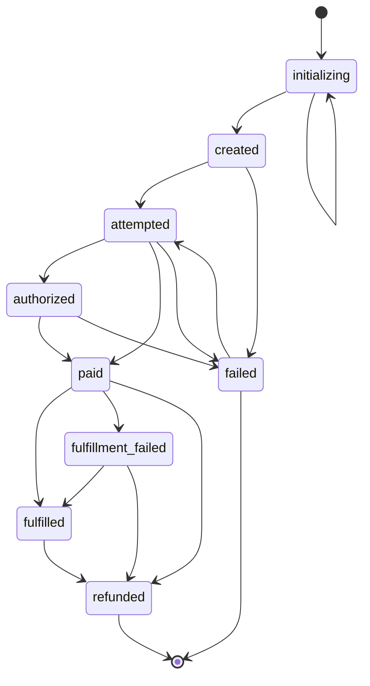
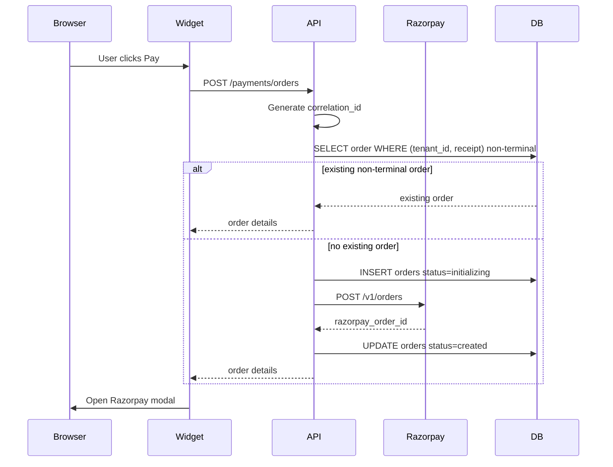
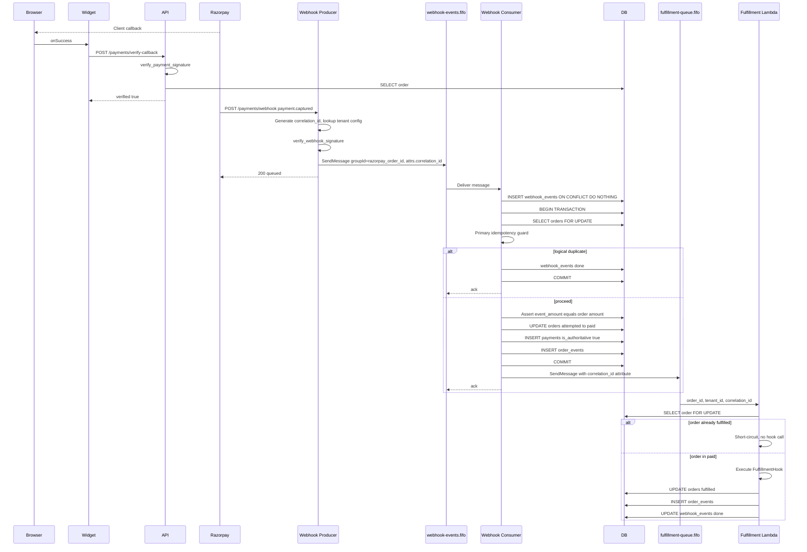
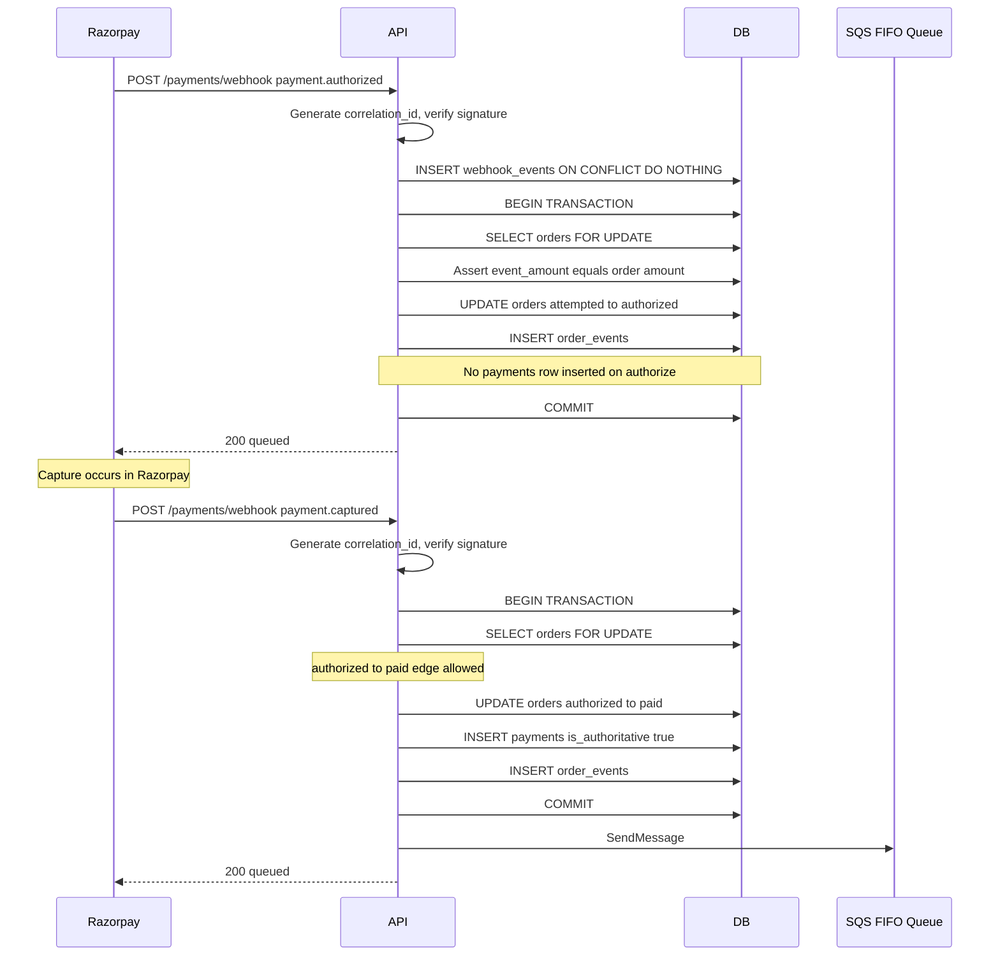
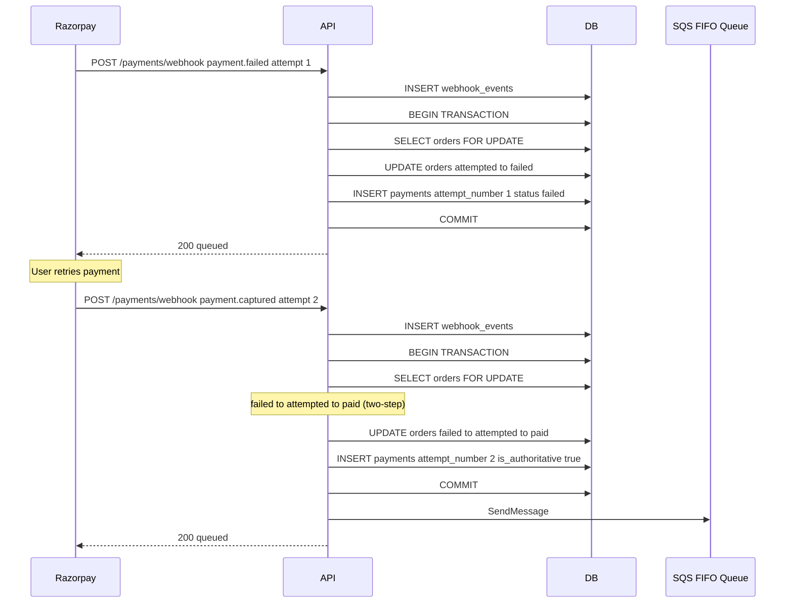
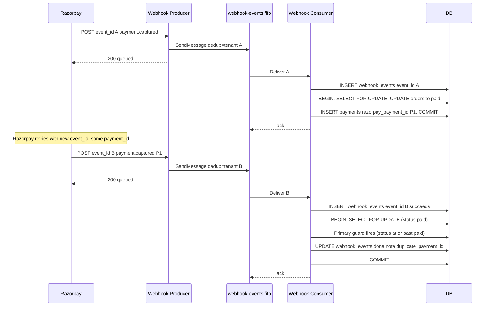
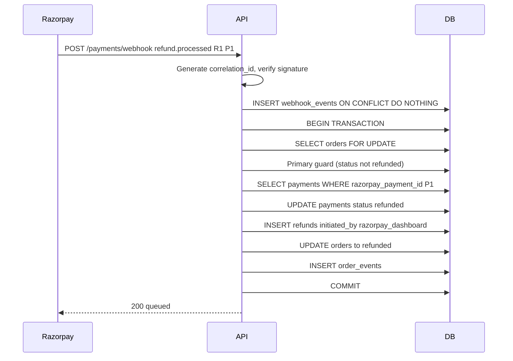
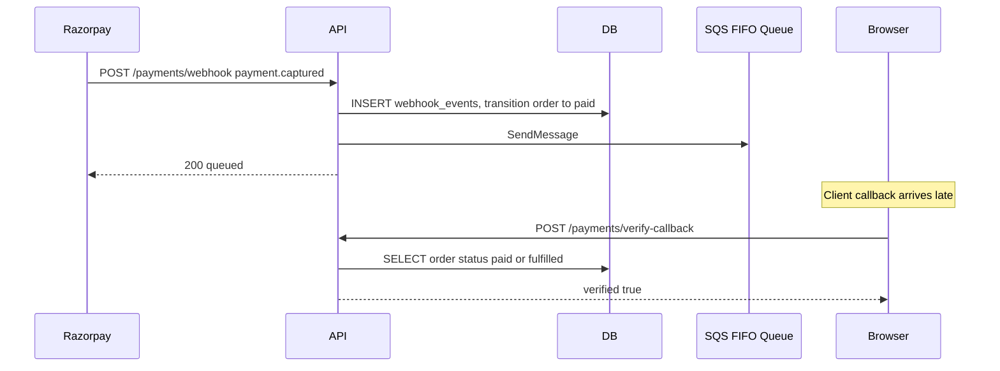
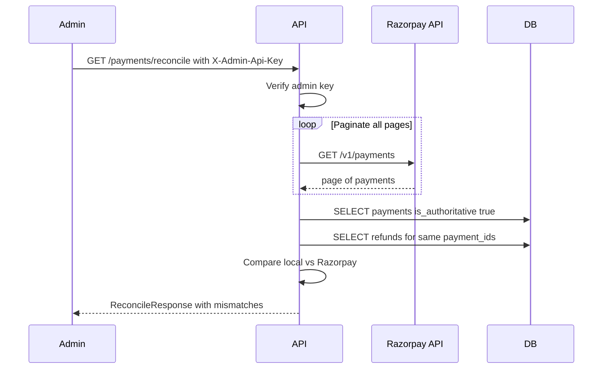
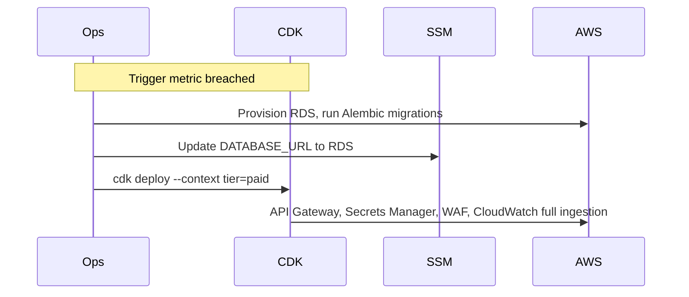

# DESIGN_v5.md: Razorpay Payment Integration Layer

Final design. Single source of truth. Supersedes all prior revisions.

## Table of Contents

1. [Repository Layout](#1-repository-layout)
2. [Public API Surface](#2-public-api-surface)
3. [DB Schema](#3-db-schema)
4. [Order State Machine](#4-order-state-machine)
5. [Sequence Diagrams](#5-sequence-diagrams)
6. [Failure Modes and Handling](#6-failure-modes-and-handling)
7. [Webhook and Fulfillment Architecture](#7-webhook-and-fulfillment-architecture)
8. [Free Track Capacity Model](#8-free-track-capacity-model)
9. [Paid Track API Layer Decision](#9-paid-track-api-layer-decision)
10. [Observability: OpenTelemetry and Correlation IDs](#10-observability-opentelemetry-and-correlation-ids)
11. [Fulfillment Hook Contract](#11-fulfillment-hook-contract)
12. [Operational Runbooks](#12-operational-runbooks)
13. [Monitoring and Alerts](#13-monitoring-and-alerts)
14. [Test Strategy](#14-test-strategy)
15. [Local Development and Webhook Simulation](#15-local-development-and-webhook-simulation)
16. [Out of Scope for v1 and Scaling Triggers](#16-out-of-scope-for-v1-and-scaling-triggers)
17. [Implementation Notes and Gotchas](#17-implementation-notes-and-gotchas)

---

## 1. Repository Layout

```
razorpay-payment-integration/
├── razorpay_checkout/
│   ├── pyproject.toml
│   ├── razorpay_checkout/
│   │   ├── __init__.py
│   │   ├── client.py
│   │   ├── models.py
│   │   ├── orders.py
│   │   ├── webhooks.py
│   │   ├── signatures.py
│   │   ├── router.py
│   │   ├── telemetry.py
│   │   ├── correlation.py
│   │   └── migrations/
│   └── tests/
│
├── packages/
│   └── checkout-widget/
│       ├── package.json
│       ├── tsconfig.json
│       ├── src/
│       │   ├── core.ts
│       │   ├── react.tsx
│       │   └── vanilla.ts
│       └── dist/
│
├── example/
│   ├── backend/
│   └── frontend/
│
├── infra/
│   ├── bin/app.ts
│   ├── lib/free-stack.ts
│   ├── lib/paid-stack.ts
│   └── README.md
│
├── scripts/
│   └── razorpay-simulator.py
│
├── DESIGN_v5.md
├── TEST_PLAN.md
└── SCALE_PLAN.md
```

---

## 2. Public API Surface

### 2.1 Backend Python Package (`razorpay_checkout`)

#### Router

```python
from razorpay_checkout import payments_router

app.include_router(payments_router, prefix="/payments")
```

All routes require the calling app to provide a `RazorpayConfig` dependency at mount time.

#### `RazorpayConfig`

```python
class RazorpayConfig(BaseSettings):
    tenant_id: str
    key_id: str
    key_secret: SecretStr
    webhook_secret: SecretStr
    webhook_secret_previous: SecretStr | None = None
    mode: Literal["test", "live"] = "test"
    db_dsn: PostgresDsn
    pool_min_size: int = 2
    pool_max_size: int = 10
    razorpay_api_timeout: float = 10.0
    otel_exporter: Literal["stdout", "xray", "otlp"] = "stdout"
    otel_endpoint: str | None = None
    admin_api_key: SecretStr | None = None
```

**Tenant isolation.** `tenant_id` is injected into every query via the config dependency. No query against `orders`, `payments`, `refunds`, `webhook_events`, or `order_events` may omit a `tenant_id` filter. Enforced by `OrderService` and `WebhookProcessor`, not by the caller.

**Multi-tenant webhook secret lookup.** The webhook route receives `tenant_id` in the URL path. The router uses this to look up the correct `RazorpayConfig` from `TenantConfigRegistry`, registered at application startup.

```python
class TenantConfigRegistry:
    def get(self, tenant_id: str) -> RazorpayConfig | None: ...
    def register(self, config: RazorpayConfig) -> None: ...
```

#### Route: `POST /payments/orders`

```python
class CreateOrderRequest(BaseModel):
    currency: str = "INR"
    receipt: str
    notes: dict[str, str] = {}

class CreateOrderResponse(BaseModel):
    order_id: str
    razorpay_order_id: str
    amount: int
    currency: str
    key_id: str
```

**Order creation sequence:**

1. Check for an existing non-terminal order with the same `(tenant_id, receipt)`. Non-terminal: `initializing`, `created`, `attempted`, `authorized`, `paid`, `fulfilled`, `fulfillment_failed`. Terminal: `failed`, `refunded`.
2. If not found, INSERT an `orders` row with `status=initializing`, `razorpay_order_id=NULL`, `amount=server_computed`, and a freshly generated `correlation_id`. The `UNIQUE(tenant_id, receipt)` constraint collapses concurrent inserts.
3. Call Razorpay API to create the order.
4. On success, UPDATE the row with `razorpay_order_id` and set `status=created`.
5. On Razorpay API failure, the row stays in `initializing`. Return `503` to the client. Retry on the next request with the same receipt.

Razorpay is never ahead of the local DB.

#### Route: `POST /payments/webhook/{tenant_id}`

Must return `200` in under 500 ms. The `tenant_id` path parameter resolves the tenant config from `TenantConfigRegistry` before signature verification.

```python
class WebhookAckResponse(BaseModel):
    status: Literal["queued"]
```

**Supported event types:**

| Razorpay event | Order transition or action |
|---|---|
| `payment.authorized` | `attempted -> authorized` (auto-capture-off accounts) |
| `payment.captured` | `attempted -> paid` OR `authorized -> paid` OR `failed -> attempted -> paid` |
| `payment.failed` | `attempted -> failed` OR `authorized -> failed` OR no-op on `paid`/`fulfilled` |
| `refund.processed` | `paid -> refunded` OR `fulfilled -> refunded` OR `fulfillment_failed -> refunded` |
| `order.paid` | Diagnostic only; logged, no state change |

**Internal pipeline (Webhook Producer, runs outside VPC):**

The producer holds no database credentials. Its sole responsibilities are signature verification and durable enqueue. It does not query, insert, or update Postgres.

1. Generate `correlation_id` (UUIDv4) at handler entry. Attach to every log line, every OTel span, and the SQS message attributes for the consumer.
2. Look up `RazorpayConfig` from `TenantConfigRegistry`. Return `400 Bad Request` if the tenant is unknown. The multi-tenant URL space is publicly enumerable; 400 avoids leaking tenant existence.
3. Verify `X-Razorpay-Signature` using `webhook_secret`, falling back to `webhook_secret_previous` if set. Both use `hmac.compare_digest`. Return `400` on mismatch.
4. Fast-parse the payload to extract `event_id`, `event`, and `razorpay_order_id` (for `MessageGroupId`). Reject malformed JSON with `400`.
5. Publish to `webhook-events.fifo` with:
   - Body: the raw signed payload plus an envelope `{tenant_id, event_id, event, received_at}` where `received_at` is the producer's wall clock at HTTP entry.
   - `MessageGroupId=razorpay_order_id` to preserve per-order event ordering (`authorized` before `captured`).
   - `MessageDeduplicationId=f"{tenant_id}:{event_id}"` so SQS suppresses Razorpay duplicates within the 5-minute FIFO dedup window before they reach the consumer.
   - `MessageAttributes.correlation_id` set to the value generated in step 1.
6. Return `200 queued`.

**Internal pipeline (Webhook Consumer, runs inside VPC):**

The consumer is triggered by `webhook-events.fifo` and is the only component with Postgres credentials. It has no public internet egress; SQS is reached via a VPC Interface Endpoint.

7. Read message. Bind `correlation_id` from `MessageAttributes` to log context.
8. INSERT into `webhook_events` with `ON CONFLICT (tenant_id, event_id) DO NOTHING`, using `received_at` from the envelope. On conflict, increment `webhook_duplicate_count`, return success (SQS deletes the message).
9. Begin DB transaction. Acquire `SELECT ... FOR UPDATE` on the `orders` row.
10. **Primary idempotency guard.** Determine if the event's intended transition has already been applied:
    - `payment.captured`: skip if `order.status IN ('paid', 'fulfilled', 'fulfillment_failed', 'refunded')` AND a captured `payments` row exists for this `razorpay_payment_id`.
    - `payment.authorized`: skip if `order.status IN ('authorized', 'paid', 'fulfilled', 'fulfillment_failed', 'refunded')`.
    - `payment.failed`: skip if `order.status IN ('failed', 'refunded')`. No-op (mark `done`) if `order.status IN ('paid', 'fulfilled', 'fulfillment_failed')`.
    - `refund.processed`: skip if `order.status = 'refunded'`.

    On skip, mark `webhook_events.processing_status = 'done'`, commit, return success.
11. Assert `event_amount == order.amount` for capture and authorize events. On mismatch, set `processing_status='failed'`, alert, return success (do not raise; the SQS message is consumed, the row records the failure for replay).
12. Execute the state transition via `OrderService.transition` (Section 4). Insert payment row only for terminal payment outcomes (`captured`, `failed`). Refunds UPDATE the existing captured `payments` row to `status='refunded'` and INSERT a row into `refunds`. Insert `order_events` for every transition.
13. Commit the transaction.
14. On a successful `paid` transition, publish to `fulfillment-queue.fifo` with `MessageGroupId=order_id` and `correlation_id` in `MessageAttributes`.
15. Return success. SQS deletes the `webhook-events.fifo` message.

**Producer-to-consumer latency budget.** Producer p99 is target < 100 ms (signature verify + SQS publish). Consumer p99 < 500 ms. End-to-end webhook-to-`paid` is well inside the polling client's 2-second interval.

**Razorpay 500 ms SLA.** Bounded by producer latency only. The consumer's runtime is invisible to Razorpay.

#### Route: `GET /payments/orders/{order_id}`

```python
class OrderStatusResponse(BaseModel):
    order_id: str
    razorpay_order_id: str
    status: OrderStatus
    amount: int
    currency: str
    created_at: datetime
    authorized_at: datetime | None
    paid_at: datetime | None
    fulfilled_at: datetime | None
    fulfillment_failed_at: datetime | None
    refunded_at: datetime | None
```

Frontend pattern: poll every 2s with a 30s timeout, transition UI on `fulfilled`. The `fulfilled` status is the authoritative signal for unlocking access.

#### Route: `POST /payments/verify-callback`

Verifies HMAC signature and confirms the order exists and is not in a terminal failed state. Returns `{verified: true}` when both checks pass. Does not unlock access, trigger fulfillment, or grant entitlements.

```python
class VerifyCallbackRequest(BaseModel):
    razorpay_order_id: str
    razorpay_payment_id: str
    razorpay_signature: str

class VerifyCallbackResponse(BaseModel):
    verified: bool
    order_id: str
    reason: str | None
```

#### Route: `GET /payments/reconcile`

Admin-only. Pulls Razorpay payments API for a date range with cursor-based pagination and flags mismatches against the local DB. Requires `X-Admin-Api-Key` matching `RazorpayConfig.admin_api_key`. If `admin_api_key is None`, returns `403`.

```python
class ReconcileRequest(BaseModel):
    from_date: date
    to_date: date

class ReconcileMismatch(BaseModel):
    razorpay_payment_id: str
    reason: Literal[
        "missing_in_local_db",
        "amount_mismatch",
        "status_mismatch",
        "refund_status_mismatch",
    ]
    razorpay_amount: int | None
    local_amount: int | None
    razorpay_status: str | None
    local_status: str | None

class ReconcileResponse(BaseModel):
    from_date: date
    to_date: date
    total_razorpay_payments_fetched: int
    total_local_payments: int
    mismatches: list[ReconcileMismatch]
```

#### Route: `POST /payments/admin/events/{event_id}/replay`

Admin-only. Resets a `failed` or `dead` webhook event to `pending` for reprocessing.

```python
class ReplayEventResponse(BaseModel):
    event_id: str
    previous_status: str
    new_status: Literal["pending"]
```

#### Route: `POST /payments/admin/orders/{order_id}/retry-fulfillment`

Admin-only. Re-enqueues an SQS message for an order in `paid` or `fulfillment_failed`. Used to recover from SQS publish failures or fulfillment hook exhaustion.

```python
class RetryFulfillmentResponse(BaseModel):
    order_id: str
    sqs_message_id: str
    previous_status: Literal["paid", "fulfillment_failed"]
```

#### Signature Utilities

```python
# razorpay_checkout.signatures

def verify_webhook_signature(
    raw_body: bytes,
    header_signature: str,
    webhook_secret: str,
    webhook_secret_previous: str | None = None,
) -> bool:
    """HMAC-SHA256, constant-time compare. Tries current secret first, falls back to previous if set."""
    ...

def verify_payment_signature(
    order_id: str,
    payment_id: str,
    signature: str,
    key_secret: str,
) -> bool:
    """HMAC-SHA256 of 'order_id|payment_id', constant-time compare."""
    ...
```

---

### 2.2 Frontend npm Package (`@akhiljoe/checkout-widget`)

#### React Component

```typescript
export interface RazorpayCheckoutProps {
    currency?: string;
    orderEndpoint: string;
    receipt: string;
    buttonLabel?: string;
    theme?: { color?: string };

    onSuccess: (result: PaymentResult) => void;
    onFailure: (error: PaymentError) => void;
    onDismiss: () => void;
}

export function RazorpayCheckout(props: RazorpayCheckoutProps): JSX.Element;
```

No `amount` prop. The server returns the authoritative amount in the `CreateOrderResponse`.

#### Vanilla Adapter

```typescript
export interface CheckoutOptions extends RazorpayCheckoutProps {}

export function mountCheckout(element: HTMLElement, options: CheckoutOptions): () => void;
```

#### Typed Event Shapes

```typescript
export interface PaymentResult {
    orderId: string;
    razorpayOrderId: string;
    razorpayPaymentId: string;
    razorpaySignature: string;
}

export interface PaymentError {
    code: string;
    description: string;
    reason: string;
    source: string;
    step: string;
    metadata: {
        orderId: string;
        paymentId: string;
    };
}
```

#### Internal Core Flow

1. POST to `orderEndpoint` with `{ receipt, currency }`. Receive `{ order_id, razorpay_order_id, amount, currency, key_id }`.
2. Inject `https://checkout.razorpay.com/v1/checkout.js` if not present. Verify `window.Razorpay` is defined within 3s; call `onFailure` with `code: "csp_blocked"` if not.
3. Construct `Razorpay(options)` using `key_id` and server-returned `amount`.
4. Open modal. Map raw Razorpay responses to `PaymentResult` or `PaymentError`.

**Amount safety.** Widget uses the server-returned `amount` only. No client-set amount reaches Razorpay.

**Post-payment flow.** After `onSuccess` and `verify-callback` returns `{verified: true}`, poll `GET /payments/orders/{order_id}` until `status === 'fulfilled'` (30s timeout, 2s interval).

**Required CSP directives:**

```
script-src https://checkout.razorpay.com;
frame-src https://api.razorpay.com;
```

---

## 3. DB Schema

All schema lives in Alembic migrations. No `metadata.create_all()` in application code.

### `tenants`

```sql
CREATE TABLE tenants (
    id          TEXT PRIMARY KEY,
    name        TEXT NOT NULL,
    created_at  TIMESTAMPTZ NOT NULL DEFAULT NOW()
);
```

### `orders`

```sql
CREATE TABLE orders (
    id                      UUID PRIMARY KEY DEFAULT gen_random_uuid(),
    tenant_id               TEXT NOT NULL,
    receipt                 TEXT NOT NULL,
    razorpay_order_id       TEXT UNIQUE,
    amount                  INTEGER NOT NULL CHECK (amount > 0),
    currency                TEXT NOT NULL DEFAULT 'INR' CHECK (char_length(currency) <= 3),
    status                  TEXT NOT NULL DEFAULT 'initializing',
    notes                   JSONB NOT NULL DEFAULT '{}',
    correlation_id          TEXT NOT NULL,
    created_at              TIMESTAMPTZ NOT NULL DEFAULT NOW(),
    attempted_at            TIMESTAMPTZ,
    authorized_at           TIMESTAMPTZ,
    paid_at                 TIMESTAMPTZ,
    fulfilled_at            TIMESTAMPTZ,
    fulfillment_failed_at   TIMESTAMPTZ,
    failed_at               TIMESTAMPTZ,
    refunded_at             TIMESTAMPTZ,
    updated_at              TIMESTAMPTZ NOT NULL DEFAULT NOW()
);
```

`updated_at` is maintained by a DB-level `BEFORE UPDATE` trigger.

**Allowed `status` values:** `initializing`, `created`, `attempted`, `authorized`, `paid`, `fulfilled`, `fulfillment_failed`, `failed`, `refunded`. Validated by application-level state machine.

**Indexes:**

| Index | Column(s) | Type | Reason |
|---|---|---|---|
| `orders_pkey` | `id` | B-tree (PK) | Primary lookup |
| `orders_razorpay_order_id_key` | `razorpay_order_id` | Unique B-tree | Webhook lookup |
| `orders_tenant_receipt_unique` | `(tenant_id, receipt)` | Unique B-tree | Idempotency on creation |
| `orders_tenant_status_idx` | `(tenant_id, status)` | B-tree | Reconciliation and admin queries |
| `orders_created_at_idx` | `created_at` | B-tree | Date-range scans |
| `orders_correlation_id_idx` | `correlation_id` | B-tree | Cross-service trace lookup |

### `payments`

```sql
CREATE TABLE payments (
    id                  UUID PRIMARY KEY DEFAULT gen_random_uuid(),
    tenant_id           TEXT NOT NULL,
    order_id            UUID NOT NULL REFERENCES orders(id),
    razorpay_payment_id TEXT NOT NULL UNIQUE,
    razorpay_order_id   TEXT NOT NULL,
    razorpay_signature  TEXT,
    amount              INTEGER NOT NULL,
    currency            TEXT NOT NULL,
    method              TEXT,
    status              TEXT NOT NULL,
    attempt_number      INTEGER NOT NULL DEFAULT 1,
    is_authoritative    BOOLEAN NOT NULL DEFAULT FALSE,
    captured_at         TIMESTAMPTZ,
    refunded_at         TIMESTAMPTZ,
    created_at          TIMESTAMPTZ NOT NULL DEFAULT NOW()
);
```

A `payments` row is inserted only on terminal payment outcomes (`captured`, `failed`). `payment.authorized` does not insert a row; the transition is recorded in `order_events` only. On `refund.processed`, the captured row is UPDATEd to `status='refunded'`, `refunded_at=NOW()`. `is_authoritative=TRUE` is set on capture and remains TRUE after refund.

**Indexes:**

| Index | Column(s) | Type | Reason |
|---|---|---|---|
| `payments_pkey` | `id` | B-tree (PK) | Primary lookup |
| `payments_razorpay_payment_id_key` | `razorpay_payment_id` | Unique B-tree | Primary idempotency guard |
| `payments_order_id_idx` | `order_id` | B-tree | FK join from orders |
| `payments_razorpay_order_id_idx` | `razorpay_order_id` | B-tree | Webhook event join |
| `payments_tenant_idx` | `tenant_id` | B-tree | Tenant-scoped queries |

### `refunds`

```sql
CREATE TABLE refunds (
    id                  UUID PRIMARY KEY DEFAULT gen_random_uuid(),
    tenant_id           TEXT NOT NULL,
    order_id            UUID NOT NULL REFERENCES orders(id),
    payment_id          UUID NOT NULL REFERENCES payments(id),
    razorpay_refund_id  TEXT NOT NULL UNIQUE,
    razorpay_payment_id TEXT NOT NULL,
    amount              INTEGER NOT NULL,
    currency            TEXT NOT NULL,
    status              TEXT NOT NULL,
    initiated_by        TEXT NOT NULL,
    notes               JSONB NOT NULL DEFAULT '{}',
    processed_at        TIMESTAMPTZ,
    created_at          TIMESTAMPTZ NOT NULL DEFAULT NOW()
);
```

One row per Razorpay refund event. `initiated_by` records trigger source: `razorpay_dashboard`, `admin_api`, `auto`. The `amount` column supports v2 partial refunds without migration.

**Indexes:**

| Index | Column(s) | Type | Reason |
|---|---|---|---|
| `refunds_pkey` | `id` | B-tree (PK) | Primary lookup |
| `refunds_razorpay_refund_id_key` | `razorpay_refund_id` | Unique B-tree | Idempotency on refund events |
| `refunds_order_id_idx` | `order_id` | B-tree | Order to refunds join |
| `refunds_tenant_idx` | `tenant_id` | B-tree | Tenant-scoped queries |

### `webhook_events`

```sql
CREATE TABLE webhook_events (
    id                  UUID PRIMARY KEY DEFAULT gen_random_uuid(),
    tenant_id           TEXT NOT NULL,
    event_id            TEXT NOT NULL,
    event               TEXT NOT NULL,
    payload             JSONB NOT NULL,
    correlation_id      TEXT NOT NULL,
    received_at         TIMESTAMPTZ NOT NULL DEFAULT NOW(),
    processed_at        TIMESTAMPTZ,
    processing_status   TEXT NOT NULL DEFAULT 'pending',
    error               TEXT,
    attempts            INTEGER NOT NULL DEFAULT 0,
    max_attempts        INTEGER NOT NULL DEFAULT 5,
    UNIQUE(tenant_id, event_id)
);
```

After `attempts >= max_attempts`, `processing_status` is set to `dead` and processing stops. CloudWatch alert fires on any `dead` event.

**Indexes:**

| Index | Column(s) | Type | Reason |
|---|---|---|---|
| `webhook_events_pkey` | `id` | B-tree (PK) | Internal |
| `webhook_events_tenant_event_id_key` | `(tenant_id, event_id)` | Unique B-tree | Fast-path idempotency |
| `webhook_events_tenant_status_idx` | `(tenant_id, processing_status)` | B-tree | Processor poll |
| `webhook_events_received_at_idx` | `received_at` | B-tree | Replay and ordering |
| `webhook_events_correlation_id_idx` | `correlation_id` | B-tree | Cross-service trace lookup |

### `order_events`

```sql
CREATE TABLE order_events (
    id               UUID PRIMARY KEY DEFAULT gen_random_uuid(),
    order_id         UUID NOT NULL REFERENCES orders(id),
    tenant_id        TEXT NOT NULL,
    from_status      TEXT NOT NULL,
    to_status        TEXT NOT NULL,
    trigger          TEXT NOT NULL,
    webhook_event_id UUID REFERENCES webhook_events(id),
    correlation_id   TEXT NOT NULL,
    metadata         JSONB NOT NULL DEFAULT '{}',
    created_at       TIMESTAMPTZ NOT NULL DEFAULT NOW()
);

CREATE INDEX ON order_events(order_id);
CREATE INDEX ON order_events(tenant_id, created_at);
CREATE INDEX ON order_events(correlation_id);
```

`trigger` values: `webhook`, `reconcile`, `manual`, `fulfillment`, `initializing`, `admin_retry`.

### Alembic Notes

```sql
CREATE OR REPLACE FUNCTION set_updated_at()
RETURNS TRIGGER AS $$
BEGIN
  NEW.updated_at = NOW();
  RETURN NEW;
END;
$$ LANGUAGE plpgsql;

CREATE TRIGGER orders_updated_at
BEFORE UPDATE ON orders
FOR EACH ROW EXECUTE FUNCTION set_updated_at();
```

---

## 4. Order State Machine



`failed` and `refunded` are terminal. `fulfillment_failed` is distinct from `failed` so dashboards and customer support can separate payment-side failures from delivery-side failures. `fulfillment_failed` is recoverable: admin retry can transition back to `fulfilled`, or a refund can transition to `refunded`.

**Illegal transition guard.** `OrderService.transition(order, new_status)` raises `IllegalTransitionError` for any edge not in the table below. Special case: `payment.failed` on `paid`, `fulfilled`, or `fulfillment_failed` is treated as a stale event (valid no-op). The event is marked `done`.

**Allowed transitions:**

| From | To | Trigger |
|---|---|---|
| `initializing` | `created` | Razorpay API returns `rzp_order_id` |
| `created` | `attempted` | First payment event |
| `created` | `failed` | Order expiry |
| `attempted` | `authorized` | `payment.authorized` (auto-capture off) |
| `attempted` | `paid` | `payment.captured` |
| `attempted` | `failed` | `payment.failed` |
| `authorized` | `paid` | `payment.captured` |
| `authorized` | `failed` | `payment.failed` or 5-day capture window expired |
| `failed` | `attempted` | New `payment.*` event for the same order |
| `paid` | `fulfilled` | Fulfillment hook succeeded |
| `paid` | `fulfillment_failed` | Fulfillment hook exhausted SQS retries |
| `paid` | `refunded` | `refund.processed` before fulfillment |
| `fulfilled` | `refunded` | `refund.processed` |
| `fulfillment_failed` | `fulfilled` | Admin retry succeeded |
| `fulfillment_failed` | `refunded` | Refund issued |

---

## 5. Sequence Diagrams

### 5.1 Order Creation



### 5.2 Successful Payment



### 5.3 Authorized Then Captured



### 5.4 Failed Payment With Successful Retry



### 5.5 Webhook Retry With New event_id



**SQS dedup vs. application dedup.** `MessageDeduplicationId=f"{tenant_id}:{event_id}"` suppresses Razorpay's literal duplicates (same `event_id`) within the 5-minute FIFO dedup window before they reach the consumer. The application's `webhook_events` UNIQUE constraint catches duplicates outside that window. The event-type-aware primary guard catches Razorpay retries with a **new** `event_id` for the **same** payment, which SQS dedup cannot detect.

### 5.6 Refund Processed



### 5.7 Webhook Before Client Callback



### 5.8 Reconciliation



### 5.9 Free-to-Paid Migration Per Component



---

## 6. Failure Modes and Handling

| Failure | Detection | Handling | Recovery |
|---|---|---|---|
| **Razorpay API timeout during order creation** | `httpx.TimeoutException` | Exponential backoff (1s, 2s, 4s). After 3 retries, return `503`. Row stays in `initializing`. | Client retries with same receipt. `UNIQUE(tenant_id, receipt)` returns the `initializing` row. Retry calls Razorpay and updates. |
| **Duplicate webhook (same tenant_id + event_id)** | `UNIQUE(tenant_id, event_id)` | `ON CONFLICT DO NOTHING`. Increment `webhook_duplicate_count`. Return `200 queued`. | Transparent. |
| **Duplicate webhook (different event_id, same payment)** | Primary idempotency guard | Order state is already at or past the event's target state. Mark event `done`. | Transparent. |
| **Webhook signature mismatch** | `hmac.compare_digest` returns `False` for both secrets | Return `400`. Log at WARN. Do not persist. | Razorpay retries. Investigate via dashboard if persistent. |
| **payment.failed then payment.captured** | Second event is `payment.captured`, order is `failed` | `failed -> attempted -> paid`. Processor continues. | Fulfillment runs normally. |
| **payment.failed for already-paid order** | Stale failed event arrives after capture | Mark event `done` with note. Not a failure. | No action. |
| **payment.authorized received** | Webhook event type is `payment.authorized` | `attempted -> authorized`. No payments row inserted. Emit `payment_authorized_count`. | Wait for `payment.captured`. Alert if order remains in `authorized` for > 24h. |
| **Order stuck in `authorized` > 24h** | Scheduled scan | CloudWatch alarm fires. | Manual capture via Razorpay dashboard, or 5-day window expiry triggers `payment.failed`. |
| **Concurrent processor for same order** | `SELECT ... FOR UPDATE` on `orders` | Second processor blocks until first commits. | Transparent. |
| **Amount mismatch** | Assertion in processor | Set `processing_status='failed'`, log ERROR, alert. Do not return 500. | Manual review. Razorpay is authoritative. |
| **Webhook event processing fails repeatedly** | `attempts >= max_attempts` | Set `processing_status='dead'`. CloudWatch alert. | `POST /admin/events/{id}/replay` after root cause fix. |
| **Client callback without subsequent webhook** | Order remains `created` or `attempted` after 24h | Reconciliation flags it. No automatic state change. | Admin investigates via Razorpay dashboard and `/reconcile`. |
| **Neon cold start during webhook** | asyncpg pool acquire above threshold | Return `503`. Log cold-start latency. | Razorpay retries. |
| **Webhook before client callback** | Order already `paid` or `fulfilled` when callback verify is called | `verify-callback` returns `{verified: true}` after confirming non-terminal-failed. | No action. |
| **Neon paused after inactivity** | All requests returning 503 | EventBridge keep-alive runs `SELECT 1` every 4 days. | Resume Neon manually if needed. Razorpay retries cover the window. |
| **Webhook secret rotation** | Operational procedure | Add `RAZORPAY_WEBHOOK_SECRET_PREVIOUS`. Verify tries current first, falls back. Remove previous after 24h. | Zero-downtime. |
| **SQS publish fails after DB commit** | Lambda exception after commit | Order stays `paid` with no in-flight message. Scheduled monitor flags orders in `paid` for > 5 min. | `POST /admin/orders/{order_id}/retry-fulfillment`. |
| **Fulfillment Lambda repeated failure** | SQS `maxReceiveCount=5` exceeded | Message moves to `fulfillment-dlq.fifo`. Order transitions `paid -> fulfillment_failed`. CloudWatch alarm on DLQ depth > 0. | Fix root cause; `POST /admin/orders/{order_id}/retry-fulfillment`. |
| **Unknown tenant_id on webhook route** | `TenantConfigRegistry.get(tenant_id)` returns `None` | Return `400 Bad Request`. Do not persist event. | Operator verifies tenant registration. |
| **Refund processed by Razorpay dashboard** | `refund.processed` webhook | Update payment to `status=refunded`, insert `refunds` row, transition order to `refunded`. | Transparent. |
| **Refund event for unknown payment** | `refund.processed` arrives but `razorpay_payment_id` not in local `payments` | Set `processing_status='failed'`, alert. Indicates webhook delivery gap. | Run `/reconcile`, then `/admin/events/{id}/replay`. |
| **Producer SQS publish failure** | `boto3.exceptions.Boto3Error` on `SendMessage` | Return `503` to Razorpay. No DB writes occurred. Razorpay retries. | Transparent. SQS endpoint outage is rare and resolves quickly. |
| **Webhook Consumer DB outage** | Consumer raises on transaction begin or commit | SQS retries with backoff (`maxReceiveCount=5`). | Razorpay already received `200 queued`; SQS holds the message. Resume DB; the queue drains. |
| **Webhook Consumer exhausts retries** | `attempts >= maxReceiveCount` | Message moves to `webhook-events-dlq.fifo`. DLQ-poller marks `webhook_events.processing_status='dead'` (or inserts a stub row if the consumer never reached the fast-path INSERT). CloudWatch alarm on DLQ depth > 0. | Fix root cause, then `POST /admin/events/{id}/replay`. |
| **Consumer cold start with VPC ENI attach** | First invocation after long idle | ENI attach adds ~1 second to cold start. Consumer is event-driven, Razorpay is not waiting. | None; producer's 200 already returned. |

---

## 7. Webhook and Fulfillment Architecture

Three AWS Lambda functions connected by two SQS FIFO queues. The split between **Webhook Producer** and **Webhook Consumer** is a deliberate security and cost-floor decision: the public-facing Lambda holds no database credentials, and the database-facing Lambda has no public internet egress. This eliminates the future NAT Gateway cost (~$32/month) when Postgres migrates to a private VPC subnet, and keeps the security boundary tight from day one.

```
Razorpay ──(HTTPS)──> Webhook Producer ──> webhook-events.fifo ──> Webhook Consumer ──> Postgres
  (public)                (public)              (FIFO)                 (private VPC)
                                                                            │
                                                                            ▼
                                                                    fulfillment-queue.fifo
                                                                            │
                                                                            ▼
                                                                   Fulfillment Lambda (private VPC)
                                                                            │
                                                                            ▼
                                                                       FulfillmentHook
```

### Webhook Producer Lambda (public, no VPC)

Triggered by `POST /payments/webhook/{tenant_id}` via API Gateway.

- Generates `correlation_id` on every request.
- Resolves tenant configuration from `TenantConfigRegistry`.
- Verifies the Razorpay signature.
- Fast-parses the payload to extract `event_id`, `event`, and `razorpay_order_id`.
- Publishes to `webhook-events.fifo` with `MessageGroupId=razorpay_order_id`, `MessageDeduplicationId=f"{tenant_id}:{event_id}"`, and `correlation_id` in `MessageAttributes`.
- Returns `200 queued` to Razorpay in under 500 ms.

The producer **does not** touch Postgres, **does not** invoke `FulfillmentHook`, **does not** schedule background tasks, and **does not** hold IAM permission to reach any data store other than SQS. Razorpay enforces a 500 ms response SLA. SQS publish p50 is 10 to 30 ms; signature verify is sub-millisecond.

### Webhook Consumer Lambda (private VPC)

Event source is `webhook-events.fifo`. The function lives in private subnets with no internet route and reaches SQS, Secrets Manager, and CloudWatch via VPC Interface Endpoints.

- Reads message, binds `correlation_id`.
- Fast-path dedup via `INSERT INTO webhook_events ... ON CONFLICT (tenant_id, event_id) DO NOTHING` using `received_at` from the message envelope.
- Begins DB transaction, acquires `SELECT ... FOR UPDATE` on the order.
- Runs the event-type-aware primary idempotency guard (Section 2.1 and `.claude/rules/webhook-idempotency.md`).
- Asserts amount on capture/authorize events.
- Executes the state transition. INSERTs `payments` rows on terminal payment outcomes. INSERTs `refunds` rows on refund events. INSERTs an `order_events` row for every transition.
- Commits.
- On `paid` transitions, publishes to `fulfillment-queue.fifo`.
- Returns success to SQS, which deletes the message.

On unhandled exception, SQS retries via `maxReceiveCount=5`. After exhaustion, the message moves to `webhook-events-dlq.fifo`. A scheduled DLQ-poller transitions affected `webhook_events` to `processing_status='dead'` and emits `dead_event_count`.

### Fulfillment Lambda (private VPC)

Event source is `fulfillment-queue.fifo`. Same VPC and endpoint posture as the consumer.

- Receives `{order_id, tenant_id}` in the body and `correlation_id` in MessageAttributes.
- Acquires `SELECT order FOR UPDATE`. **Short-circuit:** if `order.status = 'fulfilled'`, commit and return without invoking the hook. This handles interleaved SQS deliveries where the first completes before the second is consumed.
- Otherwise calls `FulfillmentHook.fulfill(order_id, tenant_id, amount, metadata={"correlation_id": ...})`.
- On success: `UPDATE orders SET status='fulfilled', fulfilled_at=NOW()`. INSERT `order_events`. UPDATE `webhook_events`.
- On exception: re-raise. SQS retries via `maxReceiveCount=5`. After exhaustion, the message moves to `fulfillment-dlq.fifo` and a scheduled Lambda transitions the order to `fulfillment_failed`.

### Network Topology

The producer-consumer split is permanent. VPC placement is **tier-dependent** so the Free Track pays nothing for network infrastructure.

| Component | Free Track | Paid Track / RDS-in-VPC |
|---|---|---|
| **Webhook Producer** | Public, no VPC | Public, no VPC, optional WAF |
| **Webhook Consumer** | **Public, no VPC** (reaches Neon and SQS via internet, TLS) | Private VPC, reaches SQS via Interface Endpoint |
| **Fulfillment Lambda** | **Public, no VPC** | Private VPC, reaches SQS via Interface Endpoint |
| **Stale-paid monitor, keep-alive, authorized monitor** | **Public, no VPC** | Private VPC |
| **VPC Interface Endpoints** | **None** | SQS, Secrets Manager, Logs, Monitoring |
| **NAT Gateway** | None | None (Interface Endpoints replace it) |
| **Fixed monthly network cost** | **$0** | ~$15 to $50 (endpoint hours + data) |

**Free Track network posture.** All Lambdas run in the default AWS Lambda networking (public egress). Postgres lives on Neon, reachable over the public internet with TLS. SQS is reached over the same path. The security perimeter is the **IAM scope per Lambda** plus **TLS in transit** plus **credentials in SSM Parameter Store SecureString**, not network isolation. Trade-off accepted: a compromised consumer or fulfillment Lambda could exfiltrate data over the public internet. Mitigation: tight IAM, no internet egress permissions beyond what each function actually uses (boto3 default), and credential redaction in logs (enforced by the secrets-in-logs regression test).

**Paid Track / RDS-in-VPC posture.** Producer stays public (it must reach Razorpay). Consumer and Fulfillment move into private subnets and reach SQS via a `com.amazonaws.<region>.sqs` VPC Interface Endpoint. Same for `secretsmanager`, `logs`, `monitoring`. No NAT Gateway is provisioned in either track.

**Switching tracks is a CDK diff, not a re-architecture.** The application code is identical across tiers. The CDK construct that wraps the consumer and fulfillment functions takes a `vpc: ec2.IVpc | None` parameter. Pass `None` for Free Track, pass the `RazorpayNetwork.vpc` for Paid Track.

### Safety Net: SQS Publish Failure From Consumer

The Webhook Consumer commits to the DB before publishing to `fulfillment-queue.fifo`. If that publish fails, the order stays in `paid` with no in-flight fulfillment message. A scheduled Lambda runs every minute:

```sql
SELECT id, tenant_id FROM orders
WHERE status = 'paid' AND paid_at < NOW() - INTERVAL '5 minutes'
LIMIT 100;
```

CloudWatch alarm fires on any result. Operator uses `POST /admin/orders/{order_id}/retry-fulfillment`. Migration to a transactional outbox is recorded as a v2 scaling trigger (Section 16).

### Safety Net: Producer-to-Consumer Gap

If the producer enqueues but the consumer never processes (consumer disabled, SQS endpoint outage, sustained DB outage exhausting retries), the message lands in `webhook-events-dlq.fifo`. A scheduled DLQ-poller transitions affected events to `processing_status='dead'` and emits `dead_event_count`. Recovery: fix root cause, then `POST /admin/events/{event_id}/replay` after the DLQ-poller has persisted the row.

### Scaling Triggers (Upgrade to SQS Standard plus Fan-out)

1. Webhook Consumer p95 exceeds 30s for 1 hour (FIFO throughput per `MessageGroupId` is one message at a time).
2. Either DLQ depth exceeds 100 sustained for more than 1 hour.
3. A fulfillment side-effect requires fan-out to multiple downstream systems.
4. Cross-order ordering becomes a requirement (currently we only guarantee per-order ordering via `MessageGroupId=razorpay_order_id`).

---

## 8. Free Track Capacity Model

| Resource | Service | Free Tier Limit | Estimated at 1k payments/mo | Headroom | Migration Trigger |
|---|---|---|---|---|---|
| Lambda invocations | AWS Lambda | 1,000,000 req/mo | ~5,000 | 995,000 | >200k payments/mo |
| Lambda compute | AWS Lambda | 400,000 GB-sec/mo | ~5,000 GB-sec | 395,000 | >80k payments/mo |
| SQS requests | AWS SQS | 1,000,000 req/mo | ~3,000 | 997,000 | >300k payments/mo |
| Postgres storage | Neon free tier | 0.5 GB | ~80 MB | ~420 MB | Storage > 400 MB for 7 days |
| Postgres connections | Neon free tier | 1,000 concurrent | pool_max_size=10 per Lambda | Ample | N/A |
| Log ingestion | CloudWatch | 5 GB/mo | ~500 MB | 4.5 GB | >10k payments/mo |
| Lambda concurrency | AWS Lambda | 1,000 concurrent (regional) | ~10 peak | Ample | Sustained >900 concurrent |
| CloudWatch custom metrics | AWS CloudWatch | 10 metrics free | 10 (Section 13) | 0 | Consolidate via dimensions |

Estimated monthly cost on Free Track: $0.

---

## 9. Paid Track API Layer Decision

| Dimension | Lambda (paid) | ECS Fargate | App Runner |
|---|---|---|---|
| Cold start | 0.8 to 1.5s (mitigated by provisioned concurrency) | None | None |
| Cost at 10k payments/mo | ~$1 to $3/mo | ~$15/mo | ~$8/mo |
| Cost at 100k payments/mo | ~$5 to $15/mo | ~$15/mo | ~$25 to $40/mo |
| Ops complexity | Low | High | Low |
| Mangum required | Yes | No | No |
| Webhook 500ms SLA | Achievable with provisioned concurrency = 1 on webhook function | Trivially met | Trivially met |
| Migration effort from Free Track | Near-zero | Medium | Low |

**Decision: Lambda (paid) with provisioned concurrency = 1 on the webhook function.**

**Fargate trigger.** Move to Fargate only if Lambda concurrent execution limits are hit (>900 of 1,000 regional concurrency for >1 hour), or if p99 cold start with provisioned concurrency breaches the webhook SLA.

---

## 10. Observability: OpenTelemetry and Correlation IDs

### OTel Exporter

| `OTEL_EXPORTER` | Used in | Sink | Cost |
|---|---|---|---|
| `stdout` | Free Track (default) | CloudWatch Logs (structured JSON) | $0 within 5 GB free tier |
| `xray` | Paid Track | AWS X-Ray via ADOT Lambda layer | ~$5/mo at 10k payments |
| `otlp` | Future / custom | Any OTLP-compatible backend | Varies |

Exporter is selected at startup from the `OTEL_EXPORTER` env var. No application branching on the exporter.

**Log sanitization.** `key_secret` and `webhook_secret` must never appear in log output. Pydantic's `SecretStr` is used for these fields. A test asserts no log record contains these values.

### Correlation ID Propagation

A single `correlation_id` (UUIDv4) ties every record produced by one logical request: HTTP entry, DB rows, SQS message, Fulfillment Lambda invocation, FulfillmentHook execution.

**Origin:**

- Order creation: generated in `POST /payments/orders` handler. Persisted on `orders.correlation_id`.
- Webhook: generated in `POST /payments/webhook/{tenant_id}` handler. Persisted on `webhook_events.correlation_id` and `order_events.correlation_id`.

**Propagation contract:**

1. Every log line includes `correlation_id` as a structured field.
2. Every OTel span has `correlation_id` as an attribute.
3. SQS publish includes `correlation_id` in `MessageAttributes`.
4. Fulfillment Lambda reads `correlation_id` from the SQS message and uses it for the duration of processing.
5. `FulfillmentHook.fulfill(order_id, tenant_id, amount, metadata)` receives `correlation_id` in `metadata`.

Search `correlation_id` in CloudWatch Logs Insights or X-Ray to see the full timeline for one logical request.

---

## 11. Fulfillment Hook Contract

The fulfillment hook is called by the Fulfillment Lambda after `payment.captured` has transitioned the order to `paid`.

**Default.** The default hook is a no-op (logs `order_id` and `correlation_id`, returns). Consuming apps that need fulfillment implement the protocol and register it with the Fulfillment Lambda at deploy time.

**Invocation context.** Triggered by SQS. SQS provides at-least-once delivery; the hook must be idempotent. The Fulfillment Lambda enforces an additional safety net: a `SELECT order FOR UPDATE` short-circuit skips the hook if `order.status = 'fulfilled'`.

**Hook interface:**

```python
class FulfillmentHook(Protocol):
    async def fulfill(
        self,
        order_id: str,
        tenant_id: str,
        amount: int,
        metadata: dict,
    ) -> None:
        """
        Called by the Fulfillment Lambda after payment.captured is confirmed.
        metadata contains: {"correlation_id": str, "razorpay_payment_id": str}.

        MUST be idempotent: calling multiple times with the same order_id must
        produce the same outcome and not raise on repeat calls.
        MUST be atomic: either all side-effects complete or raise.

        On exception: SQS retries up to maxReceiveCount=5. After exhaustion,
        the message moves to DLQ, the order transitions paid -> fulfillment_failed,
        and a CloudWatch alarm fires on DLQ depth > 0.
        """
        ...
```

**Retry behavior.** SQS `maxReceiveCount=5` on `fulfillment-queue.fifo`. After exhaustion, a DLQ-poller Lambda transitions the order to `fulfillment_failed` and records the failure reason in `order_events.metadata`. Recovery: fix root cause, then `POST /admin/orders/{order_id}/retry-fulfillment`.

---

## 12. Operational Runbooks

**Runbook 1: Stuck or Dead Webhook Event**

- Trigger: `webhook_events.processing_status = 'dead'` count > 0 OR `processing_status = 'failed'` AND `attempts >= 3` AND `received_at < NOW() - 1hr`.
- Steps: (1) `GET /admin/events/{id}` to inspect `error`. (2) Fix root cause. (3) `POST /admin/events/{id}/replay`. (4) Monitor.

**Runbook 2: Fulfillment DLQ Message**

- Trigger: `fulfillment-dlq.fifo` depth > 0. A scheduled DLQ-poller transitions the order to `fulfillment_failed`.
- Steps: (1) Inspect DLQ message and `order_events` row recording `fulfillment_failed` (includes `correlation_id` and error). (2) Search CloudWatch Logs by `correlation_id`. (3) Fix root cause in `FulfillmentHook`. (4) `POST /admin/orders/{order_id}/retry-fulfillment`. (5) Monitor until `fulfilled`.

**Runbook 3: Order Stuck in `paid` With No SQS Message**

- Trigger: Orders in `paid` for > 5 minutes (scheduled check Lambda).
- Cause: SQS publish failed after DB commit, or Fulfillment Lambda misconfigured.
- Steps: (1) Verify Fulfillment Lambda deployment and SQS event source mapping. (2) `POST /admin/orders/{order_id}/retry-fulfillment`. (3) Monitor.

**Runbook 4: Order Stuck in `authorized` > 24 Hours**

- Trigger: `status='authorized' AND authorized_at < NOW() - INTERVAL '24 hours'`.
- Cause: Razorpay account has auto-capture off, or capture is being performed manually.
- Steps: (1) Inspect order in Razorpay dashboard. (2) Initiate manual capture if appropriate, or allow the 5-day capture window to expire. (3) Monitor for `payment.captured` or `payment.failed`.

**Runbook 5: Reconciliation Mismatch**

- Steps: (1) `missing_in_local_db`: check Razorpay dashboard. If captured, check `webhook_events`. If `failed` or `dead`, run Runbook 1. If absent, manually insert. (2) `amount_mismatch`: correct local amount. Razorpay is authoritative. (3) `status_mismatch`: transition via admin endpoint. (4) `refund_status_mismatch`: confirm in dashboard, replay missing `refund.processed` via Runbook 1.

**Runbook 6: Neon Instance Paused**

- Trigger: All webhook events returning 503.
- Prevention: EventBridge keep-alive runs `SELECT 1` every 4 days.
- Steps: (1) Log in to Neon console. (2) Resume the project. (3) Verify Lambda connectivity. Razorpay retries cover the window.

**Runbook 7: Webhook Secret Rotation (Zero-Downtime)**

- Steps: (1) Add `RAZORPAY_WEBHOOK_SECRET_PREVIOUS` to Webhook Lambda. (2) `verify_webhook_signature` tries current first, falls back. (3) Update Razorpay dashboard. (4) After 24h, remove `RAZORPAY_WEBHOOK_SECRET_PREVIOUS`.

**Runbook 8: Captured Payment With No Fulfillment**

- Trigger: Support ticket; order is `paid` but not `fulfilled`, no DLQ message.
- Steps: (1) Check `order_events` for history. (2) Check SQS queue and DLQ. (3) `POST /admin/orders/{order_id}/retry-fulfillment`. (4) Monitor.

**Runbook 9: Refund Out of Sync**

- Trigger: Support ticket or reconciliation flag. Razorpay shows refund processed but local order still in `paid` or `fulfilled`.
- Steps: (1) Confirm refund in Razorpay dashboard. (2) Check `webhook_events` for the `refund.processed` event. (3) Replay via Runbook 1 if present; backfill via admin endpoint if absent. (4) Verify transition to `refunded`.

---

## 13. Monitoring and Alerts

**Dashboard: Payment Health**

- Webhook events by `processing_status` over last 24h.
- Order status distribution over last 7 days (includes `authorized` and `fulfillment_failed`).
- Webhook p50, p95, p99 handler latency.
- Reconciliation mismatch count.
- Lambda cold start count and p95 duration.
- Dead event count, all time.
- Orders stuck in `authorized` > 24h.
- Orders in `fulfillment_failed`.

**Critical Alerts (PagerDuty):**

- `fulfillment-dlq.fifo` depth > 0.
- `webhook-events-dlq.fifo` depth > 0.
- `webhook_events.processing_status = 'dead'` count > 0.
- `webhook_events.processing_status = 'failed'` AND `attempts >= 3` AND `received_at < 1hr ago` count > 0 for >30 min.
- Orders in `paid` for > 5 minutes with no SQS message in flight.
- Orders in `authorized` for > 24h.
- Orders transitioned to `fulfillment_failed` in the last hour.
- DB connection pool exhaustion.
- `webhook_publish_failures` rate > 1% over 5 min (producer cannot enqueue).

**Warning Alerts (Slack):**

- Webhook handler p95 > 3000ms for 10 min.
- Lambda error rate > 1% for 5 min.
- Reconciliation mismatch count > 0.
- Razorpay webhook response p95 > 3s for 10 min.

**Email Alerts:**

- Reconciliation mismatch count > 0 (daily scheduled).

**Metrics (`telemetry.py`):**

Emitted from the producer:

- `webhook_latency_ms` (producer entry to 200 response)
- `webhook_publish_failures` (SQS `SendMessage` errors)
- `payment_authorized_count`
- `tenant_lookup_failures`

Emitted from the consumer:

- `webhook_duplicate_count` (fast-path `ON CONFLICT` hits + primary-guard duplicate-payment hits)
- `webhook_consumer_duration_ms` (message receive to ack)
- `order_state_transition_count{from,to}`
- `reconciliation_mismatch_count{reason}` (also emitted by the reconcile job)
- `dead_event_count` (DLQ-poller flagging `processing_status='dead'`)

Emitted from the Fulfillment Lambda:

- `fulfillment_duration_ms`
- `fulfillment_sqs_publish_failures` (publish from Webhook Consumer to fulfillment-queue.fifo)
- `cold_start_ms`

**Free-tier custom metric cap.** AWS Free Tier includes 10 custom metrics. The list above has 12 distinct metric names. Consolidate by dropping `payment_authorized_count` (replaceable by `order_state_transition_count{to=authorized}`) and `tenant_lookup_failures` (replaceable by a CloudWatch Logs metric filter on the producer's WARN log line). Documented promotion: once Paid Track is provisioned, restore all 12 and pay for the surplus (~$0.30/metric/month).

---

## 14. Test Strategy

**Unit Tests:**

- State machine: every valid transition; every invalid transition raises `IllegalTransitionError`.
- `failed -> attempted -> paid` flow.
- `attempted -> authorized -> paid` flow.
- `attempted -> authorized -> failed` flow.
- `payment.failed` on `paid`, `fulfilled`, or `fulfillment_failed` is a no-op.
- `paid -> fulfillment_failed` on hook exhaustion.
- `fulfillment_failed -> fulfilled` on admin retry.
- `paid -> refunded`, `fulfilled -> refunded`, `fulfillment_failed -> refunded`.
- `verify_webhook_signature`: valid, tampered, wrong secret, empty body, previous secret fallback.
- `verify_payment_signature`: valid, mismatched IDs, wrong secret.
- Idempotency on receipt: duplicate receipt returns existing order across all non-terminal statuses.
- Duplicate `event_id`: `ON CONFLICT DO NOTHING`.
- Primary idempotency guard: skips when order is at or past the event's target state.
- Refund idempotency: duplicate `razorpay_refund_id` does not double-process.
- Amount assertion raises `AmountMismatchError`.
- Admin routes: `403` on missing or wrong key.
- Order creation: `initializing` row inserted before Razorpay call.
- Webhook route: `400` on unknown `tenant_id`; correct secret used per tenant.
- `TenantConfigRegistry`: returns correct config; `None` for unknown tenant.
- SQS publish after `paid` transition only; never on duplicate, failed, authorized, or refund events.
- Correlation ID: `orders.correlation_id`, `webhook_events.correlation_id`, `order_events.correlation_id`, and SQS `MessageAttributes.correlation_id` all match within one logical request.
- Fulfillment Lambda short-circuit: `fulfilled` order skips hook invocation.

**Integration Tests (against test Razorpay account):**

- Full happy path: create order, capture, webhook, SQS, fulfillment.
- Authorize then capture.
- Failed payment retry.
- Refund after fulfillment (`fulfilled -> refunded`).
- Refund before fulfillment (`paid -> refunded`).
- Refund after fulfillment failure (`fulfillment_failed -> refunded`).
- Webhook before callback.
- Duplicate webhook (same `event_id`): silently ignored.
- Duplicate webhook (different `event_id`, same payment): primary guard catches it.
- Multi-tenant: webhook for tenant A does not process orders for tenant B.
- Reconciliation: intentionally create mismatches; verify detection and pagination.
- Concurrent order creation with same receipt: 10 simultaneous POSTs result in exactly 1 Razorpay order.
- SQS publish failure: order stays `paid`, alarm fires, manual re-enqueue works.
- Fulfillment exhaustion: hook raises 5 times, order transitions to `fulfillment_failed`, admin retry succeeds.
- Correlation ID end-to-end across HTTP, DB, SQS, Fulfillment Lambda.

**Chaos and Failure Tests:**

- DB down during webhook handler: Razorpay gets 503, retries, event processed correctly.
- DB down during Fulfillment Lambda: SQS retries; idempotent hook handles re-delivery.
- Fulfillment Lambda cold start covered by SQS visibility timeout.
- Webhook burst (100 events in 1s): all DB transitions complete; SQS drains within 30s.
- Neon cold start simulation: 3s delay on pool acquire; Razorpay gets 503 and retries.
- State machine chaos: events out of order; no silent corruption.
- Unknown `tenant_id`: `400` returned, event not persisted.
- Stuck in `authorized`: simulate `payment.authorized` with no follow-up; verify 24h alarm.
- Refund event for unknown payment: `processing_status='failed'`, alert.

---

## 15. Local Development and Webhook Simulation

Razorpay webhooks require a publicly reachable URL. Local development uses two paths.

**Simulator (preferred for unit and integration tests).** `scripts/razorpay-simulator.py` builds a canonical Razorpay payload, signs it with the dev `webhook_secret`, and POSTs to a configurable URL. Deterministic, no network beyond localhost, runs in CI.

Interface:

```bash
python scripts/razorpay-simulator.py <event_type> \
    --tenant <tenant_id> \
    --order-id <razorpay_order_id> \
    --payment-id <razorpay_payment_id> \
    [--amount <paise>] \
    [--refund-id <razorpay_refund_id>] \
    [--secret <webhook_secret>] \
    [--url <target_url>]
```

Supported event types: `payment.authorized`, `payment.captured`, `payment.failed`, `refund.processed`.

The simulator computes `HMAC-SHA256(webhook_secret, body)` and POSTs with header `X-Razorpay-Signature`. The simulator, the HMAC test vectors in `.claude/commands/local-sig-validate.md`, and the unit tests in `tests/test_signatures.py` share one source of truth; a change to any one must update all three.

**Tunnel (for end-to-end with Razorpay test mode).** Expose `localhost:8000` via ngrok or Cloudflare Tunnel and register the tunnel URL in the Razorpay test dashboard under Webhook Settings. The tunnel must support HTTPS; Razorpay rejects non-HTTPS webhook URLs.

---

## 16. Out of Scope for v1 and Scaling Triggers

| Item | v1 Behavior | Promotion Trigger |
|---|---|---|
| **Transactional outbox pattern** | Dual-write with 5-minute stale-monitor safety net (Section 7). | SQS publish failure rate > 1 per 1,000 webhooks (weekly window) OR payment volume > 10,000/mo. |
| **Scheduled automated reconciliation** | Manual `GET /payments/reconcile`. | Paid Track provisioned OR payment volume > 5,000/mo. |
| **Constant-time webhook responses** | Unknown-tenant returns 400 quickly. | External pentest finding OR tenant count > 20 OR active tenant enumeration detected. |
| **Manual capture admin endpoint** | `payment.authorized` is logged; 24h alarm; capture via Razorpay dashboard. | Auto-capture-off deployments OR repeated 24h-stuck-in-authorized incidents. |
| **Automated capture retry policy** | None. Capture is Razorpay's responsibility. | Same trigger as manual capture endpoint. |
| **Refund UI and refund initiation API** | Refunds received via webhook only; initiated via Razorpay dashboard. | Customer support volume requirement OR multi-step refund workflows. |
| **Partial refund support** | Out of scope. The `refunds.amount` column exists for forward compatibility. | Product requirement. |
| **Subscriptions and recurring payments** | Out of scope. | New product line. |
| **Multi-currency** | INR only. | International expansion. |
| **Partial captures** | Out of scope. | Same as multi-currency. |
| **3DS edge cases beyond standard Razorpay flow** | Standard flow only. | Specific gateway requirement. |
| **Payment link generation** | Out of scope. | Product requirement. |
| **UPI intent flow (QR code)** | Out of scope. | Mobile-first checkout requirement. |
| **EMI and cardless credit options** | Out of scope. | Higher ticket size. |
| **International payment methods** | Out of scope. | Same as multi-currency. |
| **API versioning (`/v1/` prefix)** | Single unversioned API. | First breaking API change. |
| **SQS Standard plus SNS fan-out** | FIFO is v1. | Section 7 scaling triggers. |
| **HTTP `Idempotency-Key` header** | Body `receipt` is the idempotency key. | Public API consumer requirement. |
| **Vendor-agnostic schema column naming** | `razorpay_*` prefixes retained. | Multi-gateway support. |
| **VPC placement of Consumer and Fulfillment Lambdas** | Both run public on Free Track. Producer-consumer split provides the security boundary; network isolation does not. | RDS-in-VPC migration OR Paid Track provisioned OR external compliance requirement (PCI scope expansion). |
| **VPC Interface Endpoints (SQS, Secrets Manager, Logs, Monitoring)** | None. Lambdas reach AWS services via public APIs. | Same trigger as VPC placement above. |
| **Lambda Power Tuning** | Static memory: Producer 512 MB, Consumer 1024 MB, Fulfillment 1024 MB, monitors 256 MB. | Sustained webhook p95 > 800 ms OR fulfillment p95 > 2 s OR cost per invocation > $0.0005. Then run AWS Lambda Power Tuner against production traffic samples and adjust. |


---

## 17. Implementation Notes and Gotchas

A live appendix. Each entry captures a rule that prevented or fixed a real bug
during implementation, with the underlying mechanism so future contributors
can judge edge cases. New entries land here as they are discovered, dated for
context.

### 17.1 Logging factory must defer `sys.stdout` resolution (Phase 5)

**Rule.** Initialize structlog with `PrintLoggerFactory()` and no `file=`
argument. Never pass `file=sys.stdout` to the factory.

**Why.** `PrintLoggerFactory(file=sys.stdout)` captures the stdout file handle
at factory construction. The handle becomes stale when a test harness (pytest
capture, an embedded shell, or any stdout redirection) closes or rotates
stdout between calls. Subsequent log emissions raise
`ValueError: I/O operation on closed file`. The factory's default
(`file=None`) tells `PrintLogger.msg` to use the current `sys.stdout` at log
time, which survives capture rotation.

**How to apply.** Any module that configures structlog or any other "lazy
print" logger must keep file resolution dynamic. Code review checkpoint:
`grep -n "file=sys.stdout" razorpay_checkout/` should return zero hits.

### 17.2 FastAPI introspection breaks under `TYPE_CHECKING` + future annotations (Phase 5)

**Rule.** Any name used as a type annotation in a function FastAPI introspects
(route handler, `Depends` target, response model) must be imported at module
top, not inside `if TYPE_CHECKING:`. Prefer to drop
`from __future__ import annotations` from these modules entirely.

**Why.** FastAPI resolves route and dependency signatures via
`typing.get_type_hints()` at registration time. With future annotations active,
the annotations are strings; resolution requires the names to be in the
module's runtime globals. `TYPE_CHECKING` imports never enter runtime globals,
so resolution silently fails and FastAPI falls back to treating the parameter
as a query string. The visible symptom is a 422 with
`{"loc":["query","<param_name>"]}` for a parameter that should have been the
body or a `Depends` injection.

**Trap.** The failing parameter may not be the obvious one. The bug surfaced
when `correlation_id_dependency(request: Request)` had `Request` under
`TYPE_CHECKING`; FastAPI's introspection of the dependency's signature failed,
which it surfaced as a 422 on the **route's** body parameter instead of the
dependency's.

**How to apply.** Two-part checklist for any module that participates in route
or dependency wiring:

1. No `from __future__ import annotations` at the top.
2. All type annotation names imported at runtime (no `TYPE_CHECKING` block for
   FastAPI-visible types).

Modules holding pure data (Pydantic models, services, enums) may keep
`from __future__ import annotations`. The constraint applies only to modules
whose functions FastAPI introspects.

### 17.3 `UNIQUE` constraint is not sufficient to deduplicate side-effects (Phase 5)

**Rule.** When concurrent callers must produce **one** external side-effect
(e.g., one Razorpay order creation per receipt), wrap the side-effect plus the
post-side-effect DB write in a transaction guarded by
`pg_advisory_xact_lock(hash(tenant_id, business_key))`. The `UNIQUE`
constraint alone serialises the INSERT but does not prevent the loser threads
from each performing the side-effect.

**Why.** The race is between the SELECT-then-INSERT phase (which the UNIQUE
constraint resolves via `UniqueViolationError`) and the post-INSERT side
effect. Losers refetch a row in `initializing` and proceed to make their own
external call. Result: N callers, 1 row, N external calls.

**How to apply.** For `create_or_get`-style flows that involve an external
HTTP call:

1. Txn A under `pg_advisory_xact_lock`: SELECT or INSERT the placeholder row.
   Commit.
2. Txn B under the same advisory lock: re-check the row's completed state;
   short-circuit if a leader already filled it in. Otherwise perform the
   external call inside the transaction and UPDATE the row.

This pattern is in `OrderService.create_or_get`. Adopt the same shape for any
new gateway or third-party handshake that must be deduplicated.

### 17.4 "Terminal" has two senses in the order state machine (Phase 4)

**Rule.** Distinguish **idempotency-terminal** (receipt freed; new orders
allowed) from **lifecycle-terminal** (no outgoing edges in the transition
table). `failed` is idempotency-terminal but **not** lifecycle-terminal
because `failed -> attempted` is a legal recovery edge. Only `refunded` is
lifecycle-terminal.

**Why.** The DESIGN prose calls `failed` "terminal" for receipt idempotency
purposes (Section 2.1 and Section 4). The transition table contradicts this
on closer reading by allowing the recovery edge. Treating them as one concept
in code produces unit-test contradictions, as observed when asserting "no
terminal status has outgoing edges".

**How to apply.** `razorpay_checkout/state_machine.py` exports both `TERMINAL`
and `LIFECYCLE_TERMINAL` frozensets. Use `TERMINAL` when reasoning about
receipt re-use; use `LIFECYCLE_TERMINAL` when reasoning about whether any
edge can leave the state.

### 17.5 `received_at` belongs to the producer, not the consumer (Phase 6 forward-looking)

**Rule.** The Webhook Consumer's `INSERT INTO webhook_events` must pass an
explicit `received_at` value from the SQS message envelope. Do not let the DB
default (`NOW()`) fire.

**Why.** The Webhook Producer is what Razorpay sees. The producer-to-consumer
SQS hop adds variable latency. `received_at` must reflect Razorpay-perceived
receipt time for accurate reconciliation, latency dashboards, and forensic
trace alignment.

**How to apply.** Producer puts `received_at` (its wall clock at HTTP entry)
into the SQS message envelope. Consumer reads the envelope and uses
`INSERT INTO webhook_events (..., received_at, ...) VALUES (..., $env_ts, ...)`.
The DB default `NOW()` remains as a safety fallback only for direct inserts
outside the application path.

### 17.6 asyncpg requires `datetime` for TIMESTAMPTZ params, not ISO strings (Phase 8)

**Rule.** When passing a timestamp value as an asyncpg query parameter, parse
it to a `datetime.datetime` object first. The SQL-side `::timestamptz` cast
does not help; asyncpg validates the parameter type **client-side** before
the SQL ever reaches Postgres.

**Why.** asyncpg's binary protocol encodes parameters in their native binary
representations. The codec for `timestamptz` only knows how to encode
`datetime` instances. Passing a string raises
`asyncpg.exceptions.DataError: invalid input for query argument $N:
'2026-05-12T09:38:48.178Z' (expected a datetime.date or datetime.datetime
instance, got 'str')`. The exception originates client-side; Postgres never
sees the value.

**Trap.** It is tempting to write `VALUES (..., $N::timestamptz)` and pass an
ISO string, reasoning that Postgres will parse it. The cast in SQL has no
effect on parameter encoding. The parameter is rejected before query
submission.

**How to apply.** Any module that receives ISO-8601 timestamps over the wire
(SQS message envelopes, Razorpay API responses, JSON files) and persists them
via asyncpg must convert to `datetime` before the asyncpg call:

```python
from datetime import datetime
ts = datetime.fromisoformat(envelope["received_at"])  # 3.11+ handles trailing 'Z'
await conn.execute("INSERT INTO t (received_at) VALUES ($1)", ts)
```

The consumer's helper `_parse_received_at` in `webhook_consumer.py` does
this conversion at the boundary between SQS and Postgres.

### 17.7 Orchestrator post-handler writes can overwrite handler-set state (Phase 8)

**Rule.** When a generic orchestrator runs cleanup after a handler (e.g.,
`UPDATE webhook_events SET processing_status = 'done'`), and the handler may
have already set the same field to a different value (e.g., `'failed'`), the
orchestrator MUST gate its cleanup on a flag returned by the handler.

**Why.** The consumer's `_run_in_transaction` ran `_mark_event_done` after
every successful handler return, on the assumption that the handler had not
written to `webhook_events.processing_status`. The refund handler violated
this assumption by calling `_mark_failed_in_handler` on unknown-payment, then
returning normally. The orchestrator's post-handler write then overwrote
`'failed'` with `'done'`, breaking the operator's signal that this event
needs reconciliation.

**How to apply.** The handler outcome carries `event_already_marked: bool`.
Any handler that calls `_mark_failed_in_handler` (or otherwise writes
`webhook_events.processing_status` from inside the transaction) MUST set
`event_already_marked=True` on its returned `_HandlerOutcome`. The
orchestrator skips its `_mark_event_done` call when this flag is set.

More generally: when an orchestrator and its callees share a write target,
the callees must communicate write intent back to the orchestrator. Silent
overwrites are the failure mode.

### 17.8 asyncpg returns JSONB as `str` by default; register a codec (Phase 9)

**Rule.** Register `json.dumps` / `json.loads` codecs for the `jsonb` and
`json` types on every asyncpg connection. Do this at pool init time via the
`init=` callback so the codec is uniform across the codebase.

**Why.** asyncpg's default behaviour for JSONB columns is to round-trip them
as `str`. Code that reads `row["metadata"]` expecting a dict gets a JSON
string back, producing `TypeError: string indices must be integers, not 'str'`
the moment any handler indexes into it. Worse, default-string semantics
silently work for INSERTs when callers happen to pass JSON strings, hiding
the asymmetry until a SELECT path exercises it.

**How to apply.** `razorpay_checkout/db.py` registers the codec in
`_register_codecs`, passed as `init=` to `asyncpg.create_pool`. Every
connection acquired from the pool has the codec installed. Consequences:

- INSERTs into JSONB columns must pass `dict` (or other JSON-serializable
  Python objects), **not** pre-serialized JSON strings. `json.dumps(...)`
  before the asyncpg call is now wrong.
- SELECTs return `dict`. Handlers can index into `row["metadata"]["key"]`
  directly.
- The `::jsonb` cast in SQL is still accepted but no longer required for
  type coercion. Keep it for explicit-is-better-than-implicit.

**Diagnostic.** If a test asserts `row["jsonb_col"]["key"] == value` and
errors with `TypeError: string indices must be integers, not 'str'`, the
codec is not registered on the connection that ran the SELECT. Check that
the pool was built via `razorpay_checkout.db.create_pool` (not a raw
`asyncpg.create_pool` call somewhere bypassing the init hook).

### 17.9 ConsoleMetricExporter pins `sys.stdout` and runs on a daemon thread (Phase 11)

**Rule.** When `OTEL_EXPORTER=stdout` is selected, the OTel SDK wraps a
`ConsoleMetricExporter` in a `PeriodicExportingMetricReader` that runs on a
background daemon thread. The exporter captures `sys.stdout` at construction.
Any test (or test-like environment) that creates this configuration without
explicitly calling `meter_provider.shutdown()` afterwards will see a noisy
`ValueError: I/O operation on closed file` at interpreter shutdown when the
background thread tries to flush against the closed pytest-capture stdout.

**Why.** Same family as Section 17.1 (logging factory pinning). OTel's
`ConsoleMetricExporter.__init__` stores `self.out = sys.stdout`. The
`PeriodicExportingMetricReader` schedules a flush every 5 seconds on a
non-test-aware daemon thread. pytest's capture mechanism replaces
`sys.stdout` per test; the daemon thread holds the now-closed original.

**How to apply.** Any test that invokes `configure_otel(...)` without
injecting `metric_readers=[InMemoryMetricReader()]` must call
`meter_provider.shutdown()` and `tracer_provider.shutdown()` in a `finally`
block. Production code is unaffected because the exporter is constructed
once at startup and the process keeps its stdout for its lifetime.

A safer alternative is to always inject an `InMemoryMetricReader` in tests
(which the rest of `tests/test_telemetry.py` does). The one stdout-mode test
exists precisely to exercise the production code path and therefore must
shut down explicitly.

The `Overriding of current MeterProvider is not allowed` warning (Section
17 implicit via Phase 11 fix) is a related but separate trap: OTel's global
provider setters are set-once. Tests must bind instruments to the
explicit `MeterProvider` returned from `configure_otel`, not to the global,
which is why `_rebind_instruments(meter_provider)` accepts an argument.
