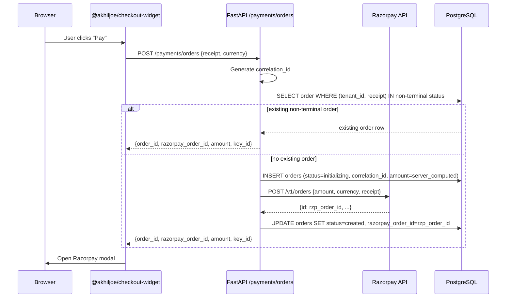
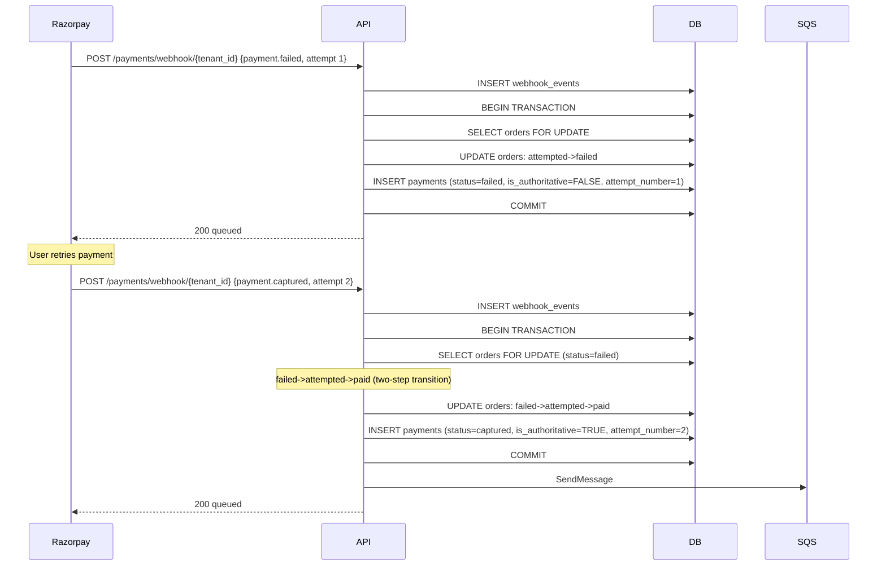
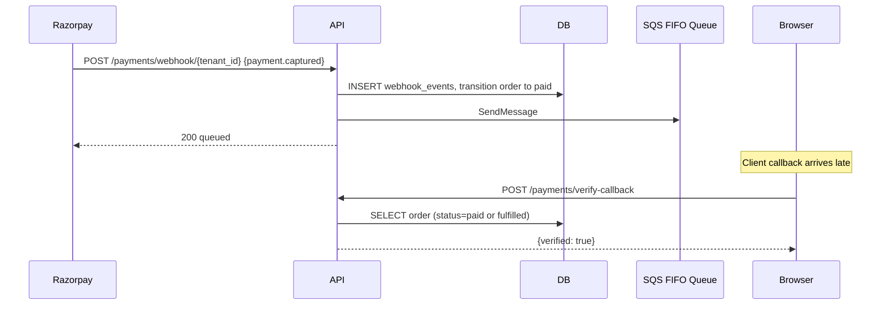
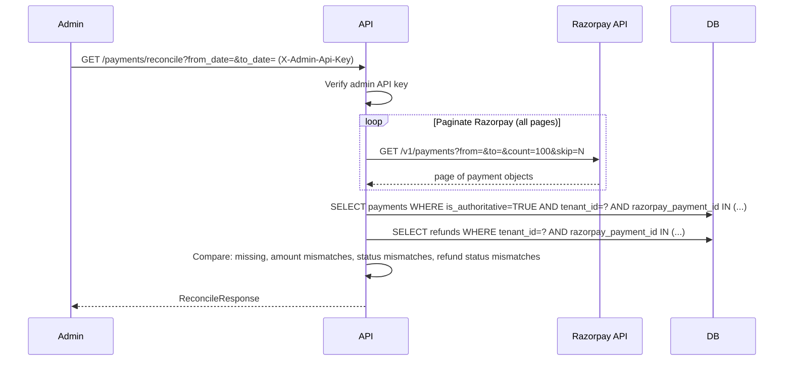
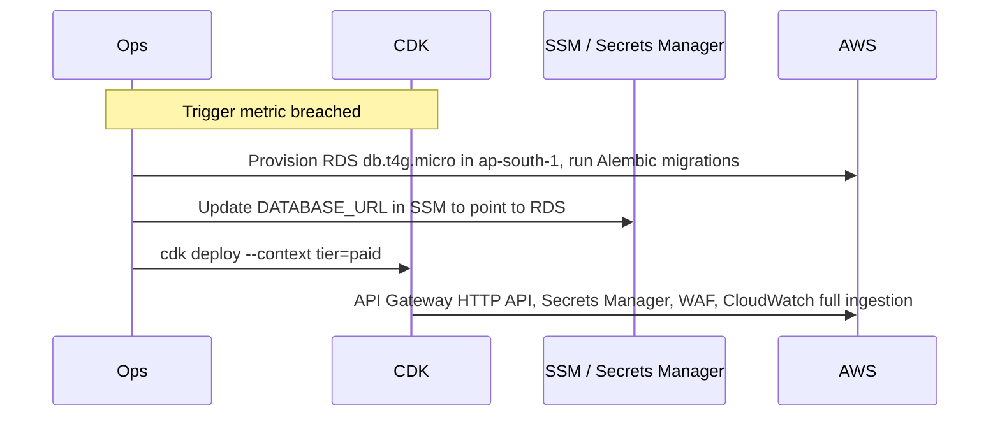

# DESIGN_v5.md: Razorpay Payment Integration Layer

Final design. Single source of truth. Supersedes all prior revisions.

## Table of Contents

1. [Repository Layout](#1-repository-layout)
2. [Public API Surface](#2-public-api-surface)
3. [DB Schema](#3-db-schema)
4. [Order State Machine](#4-order-state-machine)
5. [Sequence Diagrams](#5-sequence-diagrams)
6. [Failure Modes and Handling](#6-failure-modes-and-handling)
7. [Webhook and Fulfillment Architecture](#7-webhook-and-fulfillment-architecture)
8. [Free Track Capacity Model](#8-free-track-capacity-model)
9. [Paid Track API Layer Decision](#9-paid-track-api-layer-decision)
10. [Observability: OpenTelemetry and Correlation IDs](#10-observability-opentelemetry-and-correlation-ids)
11. [Fulfillment Hook Contract](#11-fulfillment-hook-contract)
12. [Operational Runbooks](#12-operational-runbooks)
13. [Monitoring and Alerts](#13-monitoring-and-alerts)
14. [Test Strategy](#14-test-strategy)
15. [Local Development and Webhook Simulation](#15-local-development-and-webhook-simulation)
16. [Out of Scope for v1 and Scaling Triggers](#16-out-of-scope-for-v1-and-scaling-triggers)

---

## 1. Repository Layout

```
razorpay-payment-integration/
├── razorpay_checkout/
│   ├── pyproject.toml
│   ├── razorpay_checkout/
│   │   ├── __init__.py
│   │   ├── client.py           # Async Razorpay HTTP client
│   │   ├── models.py           # Pydantic v2 models
│   │   ├── orders.py           # OrderService, state machine, transition guard
│   │   ├── webhooks.py         # Webhook handler and processor
│   │   ├── signatures.py       # HMAC verification utilities
│   │   ├── router.py           # FastAPI router, mountable at /payments
│   │   ├── telemetry.py        # OTel setup, pluggable exporter
│   │   ├── correlation.py      # Correlation ID generation and propagation
│   │   └── migrations/         # Alembic env and versions
│   └── tests/
│
├── packages/
│   └── checkout-widget/        # @akhiljoe/checkout-widget
│       ├── package.json
│       ├── tsconfig.json
│       ├── src/
│       │   ├── core.ts
│       │   ├── react.tsx
│       │   └── vanilla.ts
│       └── dist/
│
├── example/
│   ├── backend/
│   └── frontend/
│
├── infra/
│   ├── bin/app.ts
│   ├── lib/free-stack.ts
│   ├── lib/paid-stack.ts
│   └── README.md
│
├── scripts/
│   └── razorpay-simulator.py   # Local webhook simulator (signed payloads)
│
├── DESIGN_v5.md
├── TEST_PLAN.md
└── SCALE_PLAN.md
```

---

## 2. Public API Surface

### 2.1 Backend Python Package (`razorpay_checkout`)

#### Router

```python
from razorpay_checkout import payments_router

app.include_router(payments_router, prefix="/payments")
```

All routes require the calling app to provide a `RazorpayConfig` dependency at mount time.

#### `RazorpayConfig`

```python
class RazorpayConfig(BaseSettings):
    tenant_id: str
    key_id: str
    key_secret: SecretStr
    webhook_secret: SecretStr
    webhook_secret_previous: SecretStr | None = None
    mode: Literal["test", "live"] = "test"
    db_dsn: PostgresDsn
    pool_min_size: int = 2
    pool_max_size: int = 10
    razorpay_api_timeout: float = 10.0
    otel_exporter: Literal["stdout", "xray", "otlp"] = "stdout"
    otel_endpoint: str | None = None
    admin_api_key: SecretStr | None = None
```

**Tenant isolation.** `tenant_id` is injected into every query via the config dependency. No query against `orders`, `payments`, `webhook_events`, `order_events`, or `refunds` may omit a `tenant_id` filter. This is enforced by the `OrderService` and `WebhookProcessor` classes, not by the caller.

**Multi-tenant webhook secret lookup.** In shared-service deployments, the webhook route receives `tenant_id` in the URL path. The router uses this to look up the correct `RazorpayConfig` from `TenantConfigRegistry`, a dict registered at application startup.

```python
class TenantConfigRegistry:
    def get(self, tenant_id: str) -> RazorpayConfig | None: ...
    def register(self, config: RazorpayConfig) -> None: ...
```

#### Route: `POST /payments/orders`

```python
class CreateOrderRequest(BaseModel):
    currency: str = "INR"
    receipt: str
    notes: dict[str, str] = {}

class CreateOrderResponse(BaseModel):
    order_id: str
    razorpay_order_id: str
    amount: int
    currency: str
    key_id: str
```

**Order creation sequence:**

1. Check for an existing non-terminal order with the same `(tenant_id, receipt)`. Non-terminal: `initializing`, `created`, `attempted`, `authorized`, `paid`, `fulfilled`, `fulfillment_failed`. Terminal: `failed`, `refunded`.
2. If not found, INSERT an `orders` row with `status=initializing`, `razorpay_order_id=NULL`, `amount=server_computed`, and a freshly generated `correlation_id`. The `UNIQUE(tenant_id, receipt)` constraint collapses concurrent inserts.
3. Call Razorpay API to create the order.
4. On success, UPDATE the row with `razorpay_order_id` and set `status=created`.
5. On Razorpay API failure, the row stays in `initializing`. Return `503` to the client. Retry on the next request with the same receipt.

Razorpay is never ahead of the local DB.

#### Route: `POST /payments/webhook/{tenant_id}`

Razorpay calls this. Must return `200` in under 500 ms. The `tenant_id` path parameter resolves the tenant config from `TenantConfigRegistry` before signature verification.

```python
class WebhookAckResponse(BaseModel):
    status: Literal["queued"]
```

**Supported event types:**

| Razorpay event | Order transition or action |
|---|---|
| `payment.authorized` | `attempted -> authorized` (auto-capture-off accounts) |
| `payment.captured` | `attempted -> paid` OR `authorized -> paid` OR `failed -> attempted -> paid` |
| `payment.failed` | `attempted -> failed` OR `authorized -> failed` OR no-op on `paid`/`fulfilled` |
| `refund.processed` | `paid -> refunded` OR `fulfilled -> refunded` OR `fulfillment_failed -> refunded` |
| `order.paid` | Diagnostic only; logged, no state change (the `payment.captured` handler is authoritative) |

**Internal pipeline:**

1. Generate a `correlation_id` (UUIDv4) at handler entry. Attach to every log line, every OTel span, and the SQS message attributes for downstream consumers.
2. Look up `RazorpayConfig` from `TenantConfigRegistry` by the `tenant_id` path parameter. Return `400 Bad Request` if the tenant is unknown. The multi-tenant URL space is publicly enumerable; returning 400 (not 404) avoids leaking tenant existence.
3. Verify `X-Razorpay-Signature` using the tenant's `webhook_secret`, falling back to `webhook_secret_previous` if set. Both checks use `hmac.compare_digest`. Return `400` on mismatch.
4. INSERT into `webhook_events` with `ON CONFLICT (tenant_id, event_id) DO NOTHING`. Increment `webhook_duplicate_count` on conflict. On exact `event_id` duplicate, return `200 queued` immediately.
5. Begin the DB transaction. Acquire `SELECT ... FOR UPDATE` on the `orders` row to serialize concurrent processors.
6. **Primary idempotency guard.** Determine if the event's intended transition has already been applied:
   - `payment.captured`: skip if `order.status IN ('paid', 'fulfilled', 'fulfillment_failed', 'refunded')` AND a captured `payments` row already exists for this `razorpay_payment_id`.
   - `payment.authorized`: skip if `order.status IN ('authorized', 'paid', 'fulfilled', 'fulfillment_failed', 'refunded')`.
   - `payment.failed`: skip if `order.status IN ('failed', 'refunded')`. No-op (mark `done`) if `order.status IN ('paid', 'fulfilled', 'fulfillment_failed')`.
   - `refund.processed`: skip if `order.status = 'refunded'`.

   On skip, mark `webhook_events.processing_status = 'done'`, commit, return `200 queued`.
7. Assert `event_amount == order.amount` for capture and authorize events. On mismatch, set `processing_status='failed'`, alert, return `200 queued`. Do not return `500`.
8. Execute the state transition via `OrderService.transition` (Section 4). Insert payment row only for terminal payment outcomes (`captured`, `failed`). Refunds UPDATE the existing captured `payments` row to `status='refunded'` and INSERT a row into `refunds`. Insert `order_events` for every transition.
9. Commit the transaction.
10. On a successful `paid` transition, publish a message to `fulfillment-queue.fifo` with `MessageGroupId=order_id` and the `correlation_id` in `MessageAttributes`.
11. Return `200 queued`.

The Webhook Lambda's responsibility ends at the SQS publish.

#### Route: `GET /payments/orders/{order_id}`

```python
class OrderStatusResponse(BaseModel):
    order_id: str
    razorpay_order_id: str
    status: OrderStatus
    amount: int
    currency: str
    created_at: datetime
    authorized_at: datetime | None
    paid_at: datetime | None
    fulfilled_at: datetime | None
    fulfillment_failed_at: datetime | None
    refunded_at: datetime | None
```

Recommended frontend pattern: poll every 2s with a 30s timeout, transition UI on `fulfilled`. This is the authoritative signal for unlocking access, provisioning, or downloads.

#### Route: `POST /payments/verify-callback`

Verifies HMAC signature and confirms the order exists and is not in a terminal failed state. Returns `{verified: true}` when both checks pass. Does not unlock access, trigger fulfillment, or grant entitlements.

```python
class VerifyCallbackRequest(BaseModel):
    razorpay_order_id: str
    razorpay_payment_id: str
    razorpay_signature: str

class VerifyCallbackResponse(BaseModel):
    verified: bool
    order_id: str
    reason: str | None
```

#### Route: `GET /payments/reconcile`

Admin-only. Pulls Razorpay payments API for a date range with full cursor-based pagination and flags mismatches against the local DB.

Requires `X-Admin-Api-Key` header matching `RazorpayConfig.admin_api_key`. If `admin_api_key is None`, returns `403`.

```python
class ReconcileRequest(BaseModel):
    from_date: date
    to_date: date

class ReconcileMismatch(BaseModel):
    razorpay_payment_id: str
    reason: Literal[
        "missing_in_local_db",
        "amount_mismatch",
        "status_mismatch",
        "refund_status_mismatch",
    ]
    razorpay_amount: int | None
    local_amount: int | None
    razorpay_status: str | None
    local_status: str | None

class ReconcileResponse(BaseModel):
    from_date: date
    to_date: date
    total_razorpay_payments_fetched: int
    total_local_payments: int
    mismatches: list[ReconcileMismatch]
```

#### Route: `POST /payments/admin/events/{event_id}/replay`

Admin-only. Resets a `failed` or `dead` webhook event to `pending` for reprocessing.

```python
class ReplayEventResponse(BaseModel):
    event_id: str
    previous_status: str
    new_status: Literal["pending"]
```

#### Route: `POST /payments/admin/orders/{order_id}/retry-fulfillment`

Admin-only. Re-enqueues an SQS message for an order in `paid` or `fulfillment_failed` status. Used to recover from SQS publish failures or fulfillment hook exhaustion.

```python
class RetryFulfillmentResponse(BaseModel):
    order_id: str
    sqs_message_id: str
    previous_status: Literal["paid", "fulfillment_failed"]
```

#### Signature Utilities

```python
# razorpay_checkout.signatures

def verify_webhook_signature(
    raw_body: bytes,
    header_signature: str,
    webhook_secret: str,
    webhook_secret_previous: str | None = None,
) -> bool:
    """
    Tries the current secret first. Falls back to webhook_secret_previous if set.
    HMAC-SHA256, constant-time comparison via hmac.compare_digest.
    """
    ...

def verify_payment_signature(
    order_id: str,
    payment_id: str,
    signature: str,
    key_secret: str,
) -> bool:
    """HMAC-SHA256 of 'order_id|payment_id', constant-time comparison."""
    ...
```

---

### 2.2 Frontend npm Package (`@akhiljoe/checkout-widget`)

#### React Component

```typescript
export interface RazorpayCheckoutProps {
    currency?: string;
    orderEndpoint: string;
    receipt: string;
    buttonLabel?: string;
    theme?: { color?: string };

    onSuccess: (result: PaymentResult) => void;
    onFailure: (error: PaymentError) => void;
    onDismiss: () => void;
}

export function RazorpayCheckout(props: RazorpayCheckoutProps): JSX.Element;
```

There is no `amount` prop. The server returns the authoritative amount in the `CreateOrderResponse`.

#### Vanilla Adapter

```typescript
export interface CheckoutOptions extends RazorpayCheckoutProps {}

export function mountCheckout(element: HTMLElement, options: CheckoutOptions): () => void;
```

#### Typed Event Shapes

```typescript
export interface PaymentResult {
    orderId: string;
    razorpayOrderId: string;
    razorpayPaymentId: string;
    razorpaySignature: string;
}

export interface PaymentError {
    code: string;
    description: string;
    reason: string;
    source: string;
    step: string;
    metadata: {
        orderId: string;
        paymentId: string;
    };
}
```

#### Internal Core Flow

1. POST to `orderEndpoint` with `{ receipt, currency }`. Receive `{ order_id, razorpay_order_id, amount, currency, key_id }`.
2. Inject `https://checkout.razorpay.com/v1/checkout.js` if not present. Verify `window.Razorpay` is defined within 3s; call `onFailure` with `code: "csp_blocked"` if not.
3. Construct `Razorpay(options)` using `key_id` and the server-returned `amount`.
4. Open modal. Map raw Razorpay responses to `PaymentResult` or `PaymentError`.

**Amount safety.** The widget uses the `amount` returned by the server only. No client-set amount reaches Razorpay.

**Post-payment flow.** After `onSuccess` fires and `verify-callback` returns `{verified: true}`, the widget polls `GET /payments/orders/{order_id}` until `status === 'fulfilled'` (30s timeout, 2s interval) before unlocking access.

**Required CSP directives:**

```
script-src https://checkout.razorpay.com;
frame-src https://api.razorpay.com;
```

---

## 3. DB Schema

All schema lives in Alembic migrations. No `metadata.create_all()` in application code.

### Tables

#### `tenants`

```sql
CREATE TABLE tenants (
    id          TEXT PRIMARY KEY,
    name        TEXT NOT NULL,
    created_at  TIMESTAMPTZ NOT NULL DEFAULT NOW()
);
```

#### `orders`

```sql
CREATE TABLE orders (
    id                      UUID PRIMARY KEY DEFAULT gen_random_uuid(),
    tenant_id               TEXT NOT NULL,
    receipt                 TEXT NOT NULL,
    razorpay_order_id       TEXT UNIQUE,
    amount                  INTEGER NOT NULL CHECK (amount > 0),
    currency                TEXT NOT NULL DEFAULT 'INR' CHECK (char_length(currency) <= 3),
    status                  TEXT NOT NULL DEFAULT 'initializing',
    notes                   JSONB NOT NULL DEFAULT '{}',
    correlation_id          TEXT NOT NULL,
    created_at              TIMESTAMPTZ NOT NULL DEFAULT NOW(),
    attempted_at            TIMESTAMPTZ,
    authorized_at           TIMESTAMPTZ,
    paid_at                 TIMESTAMPTZ,
    fulfilled_at            TIMESTAMPTZ,
    fulfillment_failed_at   TIMESTAMPTZ,
    failed_at               TIMESTAMPTZ,
    refunded_at             TIMESTAMPTZ,
    updated_at              TIMESTAMPTZ NOT NULL DEFAULT NOW()
);
```

`updated_at` is maintained by a DB-level `BEFORE UPDATE` trigger.

**Allowed `status` values:** `initializing`, `created`, `attempted`, `authorized`, `paid`, `fulfilled`, `fulfillment_failed`, `failed`, `refunded`. Validated by application-level state machine, not a DB enum.

**Indexes:**

| Index | Column(s) | Type | Reason |
|---|---|---|---|
| `orders_pkey` | `id` | B-tree (PK) | Primary lookup |
| `orders_razorpay_order_id_key` | `razorpay_order_id` | Unique B-tree | Webhook lookup |
| `orders_tenant_receipt_unique` | `(tenant_id, receipt)` | Unique B-tree | Idempotency on creation |
| `orders_tenant_status_idx` | `(tenant_id, status)` | B-tree | Reconciliation and admin queries |
| `orders_created_at_idx` | `created_at` | B-tree | Date-range scans |
| `orders_correlation_id_idx` | `correlation_id` | B-tree | Cross-service trace lookup |

#### `payments`

```sql
CREATE TABLE payments (
    id                  UUID PRIMARY KEY DEFAULT gen_random_uuid(),
    tenant_id           TEXT NOT NULL,
    order_id            UUID NOT NULL REFERENCES orders(id),
    razorpay_payment_id TEXT NOT NULL UNIQUE,
    razorpay_order_id   TEXT NOT NULL,
    razorpay_signature  TEXT,
    amount              INTEGER NOT NULL,
    currency            TEXT NOT NULL,
    method              TEXT,
    status              TEXT NOT NULL,
    attempt_number      INTEGER NOT NULL DEFAULT 1,
    is_authoritative    BOOLEAN NOT NULL DEFAULT FALSE,
    captured_at         TIMESTAMPTZ,
    refunded_at         TIMESTAMPTZ,
    created_at          TIMESTAMPTZ NOT NULL DEFAULT NOW()
);
```

A `payments` row is inserted only on terminal payment outcomes: `captured` or `failed`. `payment.authorized` does not insert a row; the authorize transition is recorded in `order_events` only. When `refund.processed` arrives, the existing captured row is UPDATEd to `status='refunded'`, `refunded_at=NOW()`. `is_authoritative=TRUE` is set on `payment.captured` and remains TRUE after refund (the original capture is still the authoritative payment event).

**Indexes:**

| Index | Column(s) | Type | Reason |
|---|---|---|---|
| `payments_pkey` | `id` | B-tree (PK) | Primary lookup |
| `payments_razorpay_payment_id_key` | `razorpay_payment_id` | Unique B-tree | Primary idempotency guard |
| `payments_order_id_idx` | `order_id` | B-tree | FK join from orders |
| `payments_razorpay_order_id_idx` | `razorpay_order_id` | B-tree | Webhook event join |
| `payments_tenant_idx` | `tenant_id` | B-tree | Tenant-scoped queries |

#### `refunds`

```sql
CREATE TABLE refunds (
    id                  UUID PRIMARY KEY DEFAULT gen_random_uuid(),
    tenant_id           TEXT NOT NULL,
    order_id            UUID NOT NULL REFERENCES orders(id),
    payment_id          UUID NOT NULL REFERENCES payments(id),
    razorpay_refund_id  TEXT NOT NULL UNIQUE,
    razorpay_payment_id TEXT NOT NULL,
    amount              INTEGER NOT NULL,
    currency            TEXT NOT NULL,
    status              TEXT NOT NULL,
    initiated_by        TEXT NOT NULL,
    notes               JSONB NOT NULL DEFAULT '{}',
    processed_at        TIMESTAMPTZ,
    created_at          TIMESTAMPTZ NOT NULL DEFAULT NOW()
);
```

One row per Razorpay refund event. `initiated_by` records the trigger source: `razorpay_dashboard`, `admin_api`, `auto` (system-initiated, future). Partial refund support is out of scope for v1 (Section 16); the `amount` column is included now so that v2 partial refund support does not require a migration.

**Indexes:**

| Index | Column(s) | Type | Reason |
|---|---|---|---|
| `refunds_pkey` | `id` | B-tree (PK) | Primary lookup |
| `refunds_razorpay_refund_id_key` | `razorpay_refund_id` | Unique B-tree | Idempotency on refund events |
| `refunds_order_id_idx` | `order_id` | B-tree | Order to refunds join |
| `refunds_tenant_idx` | `tenant_id` | B-tree | Tenant-scoped queries |

#### `webhook_events`

```sql
CREATE TABLE webhook_events (
    id                  UUID PRIMARY KEY DEFAULT gen_random_uuid(),
    tenant_id           TEXT NOT NULL,
    event_id            TEXT NOT NULL,
    event               TEXT NOT NULL,
    payload             JSONB NOT NULL,
    correlation_id      TEXT NOT NULL,
    received_at         TIMESTAMPTZ NOT NULL DEFAULT NOW(),
    processed_at        TIMESTAMPTZ,
    processing_status   TEXT NOT NULL DEFAULT 'pending',
    error               TEXT,
    attempts            INTEGER NOT NULL DEFAULT 0,
    max_attempts        INTEGER NOT NULL DEFAULT 5,
    UNIQUE(tenant_id, event_id)
);
```

After `attempts >= max_attempts`, `processing_status` is set to `dead` and processing stops. CloudWatch alert fires on any `dead` event.

**Indexes:**

| Index | Column(s) | Type | Reason |
|---|---|---|---|
| `webhook_events_pkey` | `id` | B-tree (PK) | Internal |
| `webhook_events_tenant_event_id_key` | `(tenant_id, event_id)` | Unique B-tree | Fast-path idempotency |
| `webhook_events_tenant_status_idx` | `(tenant_id, processing_status)` | B-tree | Processor poll |
| `webhook_events_received_at_idx` | `received_at` | B-tree | Replay and ordering |
| `webhook_events_correlation_id_idx` | `correlation_id` | B-tree | Cross-service trace lookup |

#### `order_events`

```sql
CREATE TABLE order_events (
    id               UUID PRIMARY KEY DEFAULT gen_random_uuid(),
    order_id         UUID NOT NULL REFERENCES orders(id),
    tenant_id        TEXT NOT NULL,
    from_status      TEXT NOT NULL,
    to_status        TEXT NOT NULL,
    trigger          TEXT NOT NULL,
    webhook_event_id UUID REFERENCES webhook_events(id),
    correlation_id   TEXT NOT NULL,
    metadata         JSONB NOT NULL DEFAULT '{}',
    created_at       TIMESTAMPTZ NOT NULL DEFAULT NOW()
);

CREATE INDEX ON order_events(order_id);
CREATE INDEX ON order_events(tenant_id, created_at);
CREATE INDEX ON order_events(correlation_id);
```

`trigger` values: `webhook`, `reconcile`, `manual`, `fulfillment`, `initializing`, `admin_retry`.

### Alembic Notes

```sql
CREATE OR REPLACE FUNCTION set_updated_at()
RETURNS TRIGGER AS $$
BEGIN
  NEW.updated_at = NOW();
  RETURN NEW;
END;
$$ LANGUAGE plpgsql;

CREATE TRIGGER orders_updated_at
BEFORE UPDATE ON orders
FOR EACH ROW EXECUTE FUNCTION set_updated_at();
```

---

## 4. Order State Machine

```mermaid
stateDiagram-v2
    [*] --> initializing : POST /payments/orders

    initializing --> created : Razorpay API returns rzp_order_id
    initializing --> initializing : Razorpay call failed; retry

    created --> attempted : First payment event received
    created --> failed : Razorpay order expired with no attempt

    attempted --> authorized : payment.authorized (auto-capture off)
    attempted --> paid : payment.captured
    attempted --> failed : payment.failed

    authorized --> paid : payment.captured
    authorized --> failed : payment.failed or 5-day window expired

    failed --> attempted : New payment attempt on same order

    paid --> fulfilled : Fulfillment hook succeeded
    paid --> fulfillment_failed : Fulfillment hook exhausted retries
    paid --> refunded : refund.processed before fulfillment

    fulfilled --> refunded : refund.processed after fulfillment
    fulfillment_failed --> fulfilled : Admin retry succeeded
    fulfillment_failed --> refunded : Refund issued instead of fulfillment

    failed --> [*]
    refunded --> [*]
```



`failed` and `refunded` are terminal. `fulfilled` and `fulfillment_failed` are recoverable (forward to `refunded` or, for `fulfillment_failed`, back to `fulfilled` via admin retry).

**Why `fulfillment_failed` is a distinct state.** Conflating "the customer's payment failed" with "we received the customer's money but our fulfillment hook is broken" makes dashboards, queries, and customer support behavior incorrect. The distinct state lets reconciliation, alerting, and support flows treat the two cases differently. `paid -> failed` is no longer a valid edge.

**Illegal transition guard.** `OrderService.transition(order, new_status)` raises `IllegalTransitionError` for any edge not in the table below. Special case: if the event is `payment.failed` and the order is already `paid`, `fulfilled`, or `fulfillment_failed`, this is treated as a stale event (valid no-op). The event is marked `done`.

**Allowed transitions:**

| From | To | Trigger |
|---|---|---|
| `initializing` | `created` | Razorpay API returns `rzp_order_id` |
| `created` | `attempted` | First payment event |
| `created` | `failed` | Order expiry |
| `attempted` | `authorized` | `payment.authorized` (auto-capture off) |
| `attempted` | `paid` | `payment.captured` |
| `attempted` | `failed` | `payment.failed` |
| `authorized` | `paid` | `payment.captured` |
| `authorized` | `failed` | `payment.failed` or 5-day capture window expired |
| `failed` | `attempted` | New `payment.*` event for the same order |
| `paid` | `fulfilled` | Fulfillment hook succeeded |
| `paid` | `fulfillment_failed` | Fulfillment hook exhausted SQS retries |
| `paid` | `refunded` | `refund.processed` before fulfillment |
| `fulfilled` | `refunded` | `refund.processed` |
| `fulfillment_failed` | `fulfilled` | Admin retry succeeded |
| `fulfillment_failed` | `refunded` | Refund issued |

---

## 5. Sequence Diagrams

### 5.1 Order Creation



### 5.2 Successful Payment (Auto-Capture)

```mermaid
sequenceDiagram
    participant Browser
    participant Widget
    participant API
    participant RZP as Razorpay
    participant DB
    participant SQS as SQS FIFO Queue
    participant FulfillLambda as Fulfillment Lambda

    RZP-->>Browser: Client callback (razorpay_payment_id, razorpay_signature)
    Browser->>Widget: onSuccess callback
    Widget->>API: POST /payments/verify-callback
    API->>API: verify_payment_signature() (constant-time HMAC)
    API->>DB: SELECT order (confirm exists, not terminal-failed)
    API-->>Widget: {verified: true, order_id}

    Note over RZP,API: Webhook arrives at tenant-scoped URL
    RZP->>API: POST /payments/webhook/{tenant_id} {payment.captured}
    API->>API: Generate correlation_id; lookup tenant config
    API->>API: verify_webhook_signature(tenant.webhook_secret)
    API->>DB: INSERT webhook_events ON CONFLICT (tenant_id, event_id) DO NOTHING
    API->>DB: BEGIN TRANSACTION
    API->>DB: SELECT orders FOR UPDATE WHERE razorpay_order_id=? AND tenant_id=?
    API->>DB: Primary idempotency guard (Section 2.1 step 6)
    alt logical duplicate (state already at or past paid)
        API->>DB: UPDATE webhook_events SET processing_status=done
        API->>DB: COMMIT
        API-->>RZP: 200 queued
    else proceed
        API->>DB: Assert event_amount == order.amount
        API->>DB: UPDATE orders: attempted->paid
        API->>DB: INSERT payments (is_authoritative=TRUE)
        API->>DB: INSERT order_events
        API->>DB: COMMIT
        API->>SQS: SendMessage body={order_id, tenant_id} attrs={correlation_id}
        API-->>RZP: 200 queued
    end

    SQS->>FulfillLambda: {order_id, tenant_id}, attrs.correlation_id
    FulfillLambda->>DB: SELECT order FOR UPDATE
    alt order already fulfilled (duplicate SQS delivery)
        FulfillLambda->>FulfillLambda: Short-circuit; no hook call
    else order in paid
        FulfillLambda->>FulfillLambda: Execute FulfillmentHook (idempotent)
        FulfillLambda->>DB: UPDATE orders SET status=fulfilled, fulfilled_at=NOW()
        FulfillLambda->>DB: INSERT order_events (from=paid, to=fulfilled)
        FulfillLambda->>DB: UPDATE webhook_events SET processing_status=done
    end
```

### 5.3 Authorized Then Captured (Manual Capture Path)

```mermaid
sequenceDiagram
    participant RZP as Razorpay
    participant API
    participant DB

    RZP->>API: POST /payments/webhook/{tenant_id} {payment.authorized}
    API->>API: Generate correlation_id; verify signature
    API->>DB: INSERT webhook_events ON CONFLICT DO NOTHING
    API->>DB: BEGIN TRANSACTION
    API->>DB: SELECT orders FOR UPDATE
    API->>DB: Assert event_amount == order.amount
    API->>DB: UPDATE orders: attempted->authorized, authorized_at=NOW()
    API->>DB: INSERT order_events (from=attempted, to=authorized)
    Note over API,DB: NO payments row inserted on authorize
    API->>DB: COMMIT
    API-->>RZP: 200 queued

    Note over RZP: Auto-capture or manual capture occurs in Razorpay

    RZP->>API: POST /payments/webhook/{tenant_id} {payment.captured}
    API->>API: Generate correlation_id; verify signature
    API->>DB: BEGIN TRANSACTION
    API->>DB: SELECT orders FOR UPDATE (status=authorized)
    Note over API: authorized->paid edge allowed
    API->>DB: UPDATE orders: authorized->paid
    API->>DB: INSERT payments (is_authoritative=TRUE, status=captured)
    API->>DB: INSERT order_events (from=authorized, to=paid)
    API->>DB: COMMIT
    API->>SQS: SendMessage {order_id, tenant_id}
    API-->>RZP: 200 queued
```

### 5.4 Failed Payment With Successful Retry



### 5.5 Webhook Retry With New `event_id`

```mermaid
sequenceDiagram
    participant RZP as Razorpay
    participant API
    participant DB

    RZP->>API: POST /payments/webhook/{tenant_id} (event_id=A, payment.captured)
    API->>DB: INSERT webhook_events (event_id=A)
    API->>DB: BEGIN TRANSACTION
    API->>DB: SELECT orders FOR UPDATE (status=attempted)
    API->>DB: Primary guard: order not at/past paid; proceed
    API->>DB: UPDATE orders: attempted->paid; INSERT payments(razorpay_payment_id=P1)
    API->>DB: COMMIT
    API-->>RZP: 200 queued

    Note over RZP: Razorpay retries with NEW event_id, same payment_id
    RZP->>API: POST /payments/webhook/{tenant_id} (event_id=B, payment.captured, razorpay_payment_id=P1)
    API->>DB: INSERT webhook_events (event_id=B) (succeeds, new event_id)
    API->>DB: BEGIN TRANSACTION
    API->>DB: SELECT orders FOR UPDATE (status=paid)
    API->>DB: Primary guard: order already at paid AND payments row exists for P1
    API->>DB: UPDATE webhook_events SET processing_status=done, note='duplicate_payment_id'
    API->>DB: COMMIT
    API-->>RZP: 200 queued
```

### 5.6 Refund Processed

```mermaid
sequenceDiagram
    participant RZP as Razorpay
    participant API
    participant DB

    RZP->>API: POST /payments/webhook/{tenant_id} {refund.processed, razorpay_refund_id=R1, razorpay_payment_id=P1}
    API->>API: Generate correlation_id; verify signature
    API->>DB: INSERT webhook_events ON CONFLICT DO NOTHING
    API->>DB: BEGIN TRANSACTION
    API->>DB: SELECT orders FOR UPDATE (status IN paid, fulfilled, fulfillment_failed)
    API->>DB: Primary guard: status != refunded; proceed
    API->>DB: SELECT payments WHERE razorpay_payment_id=P1
    API->>DB: UPDATE payments SET status=refunded, refunded_at=NOW()
    API->>DB: INSERT refunds (razorpay_refund_id=R1, initiated_by=razorpay_dashboard)
    API->>DB: UPDATE orders: {paid, fulfilled, fulfillment_failed}->refunded
    API->>DB: INSERT order_events (from=<current>, to=refunded, metadata={refund_id: R1})
    API->>DB: COMMIT
    API-->>RZP: 200 queued
    Note over API: No SQS publish on refund. Refund hooks are out of scope for v1.
```

### 5.7 Webhook Before Client Callback



### 5.8 Reconciliation



### 5.9 Free-to-Paid Migration Per Component



---

## 6. Failure Modes and Handling

| Failure | Detection | Handling | Recovery |
|---|---|---|---|
| **Razorpay API timeout during order creation** | `httpx.TimeoutException` | Exponential backoff (1s, 2s, 4s). After 3 retries, return `503`. Row stays in `initializing`. | Client retries with same receipt. `UNIQUE(tenant_id, receipt)` returns the `initializing` row. Retry calls Razorpay and updates. |
| **Duplicate webhook (same tenant_id + event_id)** | `UNIQUE(tenant_id, event_id)` | `ON CONFLICT DO NOTHING`. Increment `webhook_duplicate_count`. Return `200 queued`. | Transparent. |
| **Duplicate webhook (different event_id, same payment)** | Primary idempotency guard (Section 2.1 step 6) | Order state is already at or past the event's target state. Mark event `done`. | Transparent. |
| **Webhook signature mismatch** | `hmac.compare_digest` returns `False` for both secrets | Return `400`. Log at WARN. Do not persist. | Razorpay retries. If retries fail, investigate via dashboard. |
| **payment.failed then payment.captured** | Second event is `payment.captured`, order is `failed` | `failed -> attempted -> paid`. Processor continues. | Fulfillment runs normally. |
| **payment.failed for already-paid order** | Stale failed event arrives after capture | Mark event `done` with note. Not a failure. | No action. |
| **payment.authorized received** | Webhook event type is `payment.authorized` | `attempted -> authorized`. No payments row inserted. Emit `payment_authorized_count` metric. | Wait for `payment.captured`. Alert if order remains in `authorized` for > 24h. |
| **Order stuck in `authorized` > 24h** | Scheduled scan: `status=authorized AND authorized_at < NOW() - INTERVAL '24 hours'` | CloudWatch alarm fires. Operator reviews Razorpay dashboard. | Manual capture via Razorpay dashboard, OR the 5-day capture window expires and Razorpay sends `payment.failed`. |
| **Concurrent processor for same order** | `SELECT ... FOR UPDATE` on `orders` row | Second processor blocks until first commits. | Transparent. |
| **Amount mismatch (event amount != order amount)** | Assertion in processor | Set `processing_status='failed'`, log ERROR, alert. Do not return 500. | Manual review. Razorpay is authoritative. |
| **Webhook event processing fails repeatedly** | `attempts >= max_attempts` | Set `processing_status='dead'`. CloudWatch alert. | `POST /admin/events/{id}/replay` after root cause fix. |
| **Client callback without subsequent webhook** | Order remains `created` or `attempted` after 24h | Reconciliation flags it. No automatic state change. | Admin investigates via Razorpay dashboard and `/reconcile`. |
| **Neon cold start during webhook** | asyncpg pool acquire above threshold | Return `503`. Log cold-start latency. | Razorpay retries. |
| **Razorpay retries with new event_id, bypassing event_id idempotency** | Different `event_id`, same `razorpay_payment_id` | Primary idempotency guard inside DB transaction catches it via `orders.status` check. | Transparent. |
| **Webhook before client callback** | Order is already `paid` or `fulfilled` when callback verify is called | `verify-callback` returns `{verified: true}` after confirming order is not terminal-failed. | No action. |
| **Neon paused after inactivity** | All requests returning 503 | EventBridge keep-alive Lambda runs `SELECT 1` every 4 days. | Resume Neon manually if still paused. Razorpay retries cover the window. |
| **Webhook secret rotation** | Operational procedure | Add `RAZORPAY_WEBHOOK_SECRET_PREVIOUS`. Verify tries current first, falls back. Remove previous after 24h. | Zero-downtime. |
| **SQS publish fails after DB commit** | Lambda exception after commit | Order stays `paid` with no in-flight SQS message. Scheduled monitor (every 1 min) flags orders in `paid` for > 5 min. | `POST /admin/orders/{order_id}/retry-fulfillment`. |
| **Fulfillment Lambda repeated failure** | SQS `maxReceiveCount=5` exceeded | Message moves to `fulfillment-dlq.fifo`. Order transitions `paid -> fulfillment_failed`. CloudWatch alarm fires on DLQ depth > 0. | Fix root cause; `POST /admin/orders/{order_id}/retry-fulfillment` (transitions `fulfillment_failed -> paid -> fulfilled` on success). |
| **Unknown tenant_id on webhook route** | `TenantConfigRegistry.get(tenant_id)` returns `None` | Return `400 Bad Request`. Do not persist event. | Operator verifies tenant registration. |
| **Refund processed by Razorpay dashboard** | `refund.processed` webhook | Update payment to `status=refunded`, insert `refunds` row, transition order to `refunded`. | Transparent. Order state stays in sync with Razorpay. |
| **Refund event for unknown payment** | `refund.processed` arrives but `razorpay_payment_id` not in local `payments` | Set `processing_status='failed'`, alert. Likely indicates a webhook delivery gap. | Run `/reconcile` to backfill missing payments, then `/admin/events/{id}/replay`. |

---

## 7. Webhook and Fulfillment Architecture

Two AWS Lambda functions connected by an SQS FIFO queue (`fulfillment-queue.fifo`).

### Webhook Lambda

Triggered by `POST /payments/webhook/{tenant_id}`.

- Generates `correlation_id` on every request.
- Resolves tenant configuration from `TenantConfigRegistry`.
- Verifies the Razorpay signature.
- Executes all DB state transitions synchronously within the request/response cycle.
- On a successful `paid` transition, publishes to `fulfillment-queue.fifo` with `MessageGroupId=order_id` and `MessageAttributes.correlation_id` set.
- Returns `200 queued` to Razorpay in under 500 ms.

The Webhook Lambda does not invoke `FulfillmentHook` and does not schedule background tasks. Razorpay enforces a 500 ms response SLA and deactivates endpoints that exceed it. SQS publish p50 is 10 to 30 ms.

### Fulfillment Lambda

Separate function. Event source mapping is the SQS queue.

- Receives `{order_id, tenant_id}` in the body and `correlation_id` in MessageAttributes.
- Acquires `SELECT order FOR UPDATE`. **Short-circuit:** if `order.status = 'fulfilled'`, mark `webhook_events.processing_status = 'done'`, commit, and return without invoking the hook. This handles the case where two SQS deliveries arrive interleaved and the first completes before the second is consumed.
- Otherwise, calls `FulfillmentHook.fulfill(order_id, tenant_id, amount, metadata={"correlation_id": ...})`.
- On success: `UPDATE orders SET status='fulfilled', fulfilled_at=NOW()`. INSERT `order_events`. UPDATE `webhook_events`.
- On exception: re-raise. SQS retries via `maxReceiveCount=5`. After exhaustion, the message moves to `fulfillment-dlq.fifo` and a scheduled Lambda transitions the order to `fulfillment_failed`.
- The `FulfillmentHook` implementation can be swapped without touching the webhook code path.

### Cost on Free Track

- SQS: 1,000,000 requests per month permanent free tier. At 1,000 payments per month with three fulfillment attempts maximum, consumption is approximately 3,000 messages per month. Cost: $0.
- Fulfillment Lambda: counted within the same Lambda free tier (1,000,000 invocations per month).

### Dual-Write Safety Net (v1)

The Webhook Lambda commits to the DB before publishing to SQS. If SQS publish fails after commit, the order stays in `paid` with no in-flight fulfillment message. A scheduled Lambda runs every minute with the query:

```sql
SELECT id, tenant_id FROM orders
WHERE status = 'paid' AND paid_at < NOW() - INTERVAL '5 minutes'
LIMIT 100;
```

CloudWatch alarm fires on any result. Operator uses `POST /admin/orders/{order_id}/retry-fulfillment` to re-enqueue. At the v1 target volume of 1,000 payments per month, this safety net is sufficient. Migration to a transactional outbox pattern is recorded as a v2 scaling trigger (Section 16).

### Scaling Triggers (Upgrade to SQS Standard plus Fan-out)

Upgrade to SQS Standard with per-tenant consumer groups when:

1. Fulfillment processing p95 latency exceeds 30s for 1 hour (FIFO throughput per `MessageGroupId` is one message at a time).
2. DLQ depth exceeds 100 sustained for more than 1 hour.
3. A fulfillment side-effect requires fan-out to multiple downstream systems (SNS to SQS per system).

---

## 8. Free Track Capacity Model

| Resource | Service | Free Tier Limit | Estimated Consumption at 1k payments/mo | Headroom | Migration Trigger |
|---|---|---|---|---|---|
| Lambda invocations | AWS Lambda | 1,000,000 req/mo | ~5,000 (5 invocations per payment) | 995,000 | >200k payments/mo |
| Lambda compute | AWS Lambda | 400,000 GB-sec/mo | ~5,000 GB-sec | 395,000 | >80k payments/mo |
| SQS requests | AWS SQS | 1,000,000 req/mo | ~3,000 | 997,000 | >300k payments/mo |
| Postgres storage | Neon free tier | 0.5 GB | ~80 MB (orders + payments + refunds + webhook_events + order_events) | ~420 MB | Neon storage > 400 MB for 7 days |
| Postgres connections | Neon free tier | 1,000 concurrent | asyncpg pool_max_size=10 per Lambda; max concurrency = 10 on Free Track | Ample | N/A |
| Log ingestion | CloudWatch | 5 GB/mo | ~500 MB | 4.5 GB | >10k payments/mo |
| Lambda concurrency | AWS Lambda | 1,000 concurrent (regional) | ~10 peak | Ample | Sustained >900 concurrent |
| Amplify bandwidth | AWS Amplify | 15 GB/mo | Negligible | ~14.9 GB | >15 GB/mo |
| SSM Parameter reads | AWS SSM | ~10k reads/mo free | ~100/mo | ~$0 | N/A |
| CloudWatch custom metrics | AWS CloudWatch | 10 metrics/mo free | 10 (see Section 13) | 0 | >10 custom metrics; consolidate via dimensions |

Estimated monthly cost on Free Track: $0.

---

## 9. Paid Track API Layer Decision

| Dimension | Lambda (paid) | ECS Fargate | App Runner |
|---|---|---|---|
| Cold start | 0.8 to 1.5s (mitigated by provisioned concurrency) | None | None |
| Cost at 10k payments/mo | ~$1 to $3/mo | ~$15/mo | ~$8/mo |
| Cost at 100k payments/mo | ~$5 to $15/mo | ~$15/mo | ~$25 to $40/mo |
| Ops complexity | Low | High | Low |
| Mangum required | Yes | No | No |
| Webhook 500ms SLA | Achievable with provisioned concurrency = 1 on webhook function | Trivially met | Trivially met |
| Migration effort from Free Track | Near-zero | Medium | Low |

**Decision: Lambda (paid) with provisioned concurrency = 1 on the webhook function.**

**Fargate trigger.** Move to Fargate only if Lambda concurrent execution limits are hit (>900 of 1,000 regional concurrency for >1 hour), or if p99 cold start with provisioned concurrency breaches the webhook SLA.

---

## 10. Observability: OpenTelemetry and Correlation IDs

### OTel Exporter

| `OTEL_EXPORTER` value | Used in | Sink | Cost |
|---|---|---|---|
| `stdout` | Free Track (default) | CloudWatch Logs (structured JSON) | $0 within 5 GB free tier |
| `xray` | Paid Track | AWS X-Ray via ADOT Lambda layer | ~$5/mo at 10k payments |
| `otlp` | Future / custom | Any OTLP-compatible backend | Varies |

Exporter is selected at startup from the `OTEL_EXPORTER` env var. No application branching on the exporter.

**Log sanitization.** `key_secret` and `webhook_secret` must never appear in log output. Pydantic's `SecretStr` is used for these fields. A test asserts no log record contains these values.

### Correlation ID Propagation

A single `correlation_id` (UUIDv4) ties every record produced by one logical request: HTTP entry, DB rows, SQS message, Fulfillment Lambda invocation, FulfillmentHook execution, and external system calls.

**Origin:**

- Order creation: `correlation_id` is generated in `POST /payments/orders` handler and persisted on `orders.correlation_id`.
- Webhook: `correlation_id` is generated in `POST /payments/webhook/{tenant_id}` handler and persisted on `webhook_events.correlation_id`. If the order's `correlation_id` differs (because the order was created in a separate request), the webhook also writes to `order_events.correlation_id` for transition rows.

**Propagation contract:**

1. Every log line emitted during a request includes `correlation_id` as a structured field.
2. Every OTel span set during a request has `correlation_id` as a span attribute.
3. SQS publish includes `correlation_id` in `MessageAttributes`:
   ```python
   sqs.send_message(
       QueueUrl=...,
       MessageBody=json.dumps({"order_id": ..., "tenant_id": ...}),
       MessageGroupId=order_id,
       MessageDeduplicationId=event_id,
       MessageAttributes={
           "correlation_id": {"DataType": "String", "StringValue": correlation_id}
       },
   )
   ```
4. The Fulfillment Lambda reads `record["messageAttributes"]["correlation_id"]["stringValue"]` and uses it for the duration of message processing.
5. `FulfillmentHook.fulfill(order_id, tenant_id, amount, metadata)` receives `correlation_id` in `metadata`.

**Lookup:**

Search `correlation_id` in CloudWatch Logs Insights or X-Ray to see the full timeline: HTTP entry, DB transactions, SQS publish, SQS consume, hook execution, hook completion.

```sql
-- Audit query (PostgreSQL): full timeline for one request
SELECT 'orders' AS source, created_at, status::TEXT AS info FROM orders WHERE correlation_id = ?
UNION ALL
SELECT 'webhook_events', received_at, processing_status FROM webhook_events WHERE correlation_id = ?
UNION ALL
SELECT 'order_events', created_at, from_status || '->' || to_status FROM order_events WHERE correlation_id = ?
ORDER BY created_at;
```

---

## 11. Fulfillment Hook Contract

The fulfillment hook is called by the Fulfillment Lambda after `payment.captured` has transitioned the order to `paid`.

**Default.** The default hook is a no-op (logs `order_id` and `correlation_id`, returns immediately). Consuming apps that need fulfillment implement the protocol and register it with the Fulfillment Lambda at deploy time.

**Invocation context.** Triggered by SQS. SQS provides at-least-once delivery; the hook must be idempotent. The Fulfillment Lambda enforces an additional safety net: a `SELECT order FOR UPDATE` short-circuit if `order.status = 'fulfilled'` skips the hook call entirely on duplicate deliveries (Section 7).

**Hook interface:**

```python
class FulfillmentHook(Protocol):
    async def fulfill(
        self,
        order_id: str,
        tenant_id: str,
        amount: int,
        metadata: dict,
    ) -> None:
        """
        Called by the Fulfillment Lambda after payment.captured is confirmed.
        metadata contains: {"correlation_id": str, "razorpay_payment_id": str}.

        MUST be idempotent: calling multiple times with the same order_id must
        produce the same outcome and not raise on repeat calls.
        MUST be atomic: either all side-effects complete or raise an exception.
        Partial completion is not acceptable; use a fulfillment_events table
        internally if multi-step.

        On exception: SQS retries up to maxReceiveCount=5. After exhaustion,
        the message moves to DLQ, the order transitions paid -> fulfillment_failed,
        and a CloudWatch alarm fires on DLQ depth > 0.
        """
        ...
```

**DB transaction boundary.** The Webhook Lambda commits the `paid` DB transition before publishing to SQS. The dual-write safety net (Section 7) detects post-commit publish failures.

**Retry behavior.** SQS `maxReceiveCount=5` on `fulfillment-queue.fifo`. After exhaustion, a DLQ-poller Lambda transitions the order to `fulfillment_failed` and records the failure reason in `order_events.metadata`. Recovery: fix root cause, then `POST /admin/orders/{order_id}/retry-fulfillment` re-enqueues and transitions `fulfillment_failed -> paid -> fulfilled` on success.

---

## 12. Operational Runbooks

**Runbook 1: Stuck or Dead Webhook Event**

- Trigger: CloudWatch alarm. `webhook_events.processing_status = 'dead'` count > 0 OR `processing_status = 'failed'` AND `attempts >= 3` AND `received_at < NOW() - 1hr`.
- Steps: (1) `GET /admin/events/{id}` to inspect `error`. (2) Fix root cause. (3) `POST /admin/events/{id}/replay`. (4) Monitor.

**Runbook 2: Fulfillment DLQ Message**

- Trigger: CloudWatch alarm. `fulfillment-dlq.fifo` depth > 0.
- Effect: A scheduled DLQ-poller Lambda transitions the affected order to `fulfillment_failed`.
- Steps: (1) Inspect DLQ message body and the `order_events` row recording `fulfillment_failed` (includes `correlation_id` and error). (2) Search CloudWatch Logs by `correlation_id` for the full trace. (3) Fix root cause in `FulfillmentHook`. (4) `POST /admin/orders/{order_id}/retry-fulfillment`. (5) Monitor until order reaches `fulfilled`.

**Runbook 3: Order Stuck in `paid` With No SQS Message**

- Trigger: CloudWatch alarm. Orders in `paid` status for > 5 minutes (scheduled check Lambda).
- Cause: SQS publish failed after DB commit, or Fulfillment Lambda misconfigured.
- Steps: (1) Verify Fulfillment Lambda deployment and SQS event source mapping. (2) `POST /admin/orders/{order_id}/retry-fulfillment`. (3) Monitor.

**Runbook 4: Order Stuck in `authorized` > 24 Hours**

- Trigger: CloudWatch alarm. `status='authorized' AND authorized_at < NOW() - INTERVAL '24 hours'` count > 0.
- Cause: Razorpay account has auto-capture off, or capture is being performed manually.
- Steps: (1) Inspect order in Razorpay dashboard. (2) Initiate manual capture if appropriate, OR allow the 5-day capture window to expire (Razorpay will emit `payment.failed`). (3) Monitor for `payment.captured` or `payment.failed` webhook.

**Runbook 5: Reconciliation Mismatch**

- Trigger: Manual or scheduled reconcile reports mismatches.
- Steps: (1) For `missing_in_local_db`: check Razorpay dashboard. If captured, check `webhook_events`. If event is `failed` or `dead`, run Runbook 1. If absent, manually insert from Razorpay payload. (2) For `amount_mismatch`: Razorpay is authoritative. Correct local amount. Alert on any mismatch. (3) For `status_mismatch`: Razorpay is authoritative. Transition via admin endpoint. (4) For `refund_status_mismatch`: confirm refund in Razorpay dashboard; if confirmed but missing locally, the `refund.processed` webhook was not delivered or was rejected. Replay via Runbook 1.

**Runbook 6: Neon Instance Paused**

- Trigger: All webhook events returning 503; Lambda logs show `asyncpg.TooManyConnectionsError`.
- Prevention: EventBridge keep-alive Lambda runs `SELECT 1` every 4 days.
- Steps: (1) Log in to Neon console. (2) Resume the project. (3) Verify Lambda connectivity. (4) Razorpay retries cover the window. Monitor `webhook_events` for backlog.

**Runbook 7: Webhook Secret Rotation (Zero-Downtime)**

- Steps: (1) Add `RAZORPAY_WEBHOOK_SECRET_PREVIOUS` env var with old secret to Webhook Lambda. (2) `verify_webhook_signature` tries current first, falls back to previous. (3) Update Razorpay dashboard with new secret. (4) After 24h, remove `RAZORPAY_WEBHOOK_SECRET_PREVIOUS`.

**Runbook 8: Captured Payment With No Fulfillment**

- Trigger: Support ticket; order is `paid` but not `fulfilled` and no DLQ message.
- Steps: (1) Check `order_events` for transition history. (2) Check SQS queue and DLQ. (3) `POST /admin/orders/{order_id}/retry-fulfillment`. (4) Monitor until `fulfilled`.

**Runbook 9: Refund Out of Sync**

- Trigger: Support ticket or reconciliation flag. Razorpay shows refund processed but local order still in `paid` or `fulfilled`.
- Steps: (1) Confirm refund in Razorpay dashboard, capture `razorpay_refund_id`. (2) Check `webhook_events` for the missing `refund.processed` event. (3) If event is `failed` or absent: replay via Runbook 1 if present, or backfill via `POST /admin/orders/{order_id}/replay-refund?refund_id=...` (admin-only). (4) Verify order transitions to `refunded`.

---

## 13. Monitoring and Alerts

**Dashboard: Payment Health**

- Webhook events by `processing_status` over last 24h.
- Order status distribution over last 7 days (now includes `authorized` and `fulfillment_failed`).
- Webhook p50, p95, p99 handler latency.
- Reconciliation mismatch count.
- Lambda cold start count and p95 duration.
- Dead event count, all time.
- Orders stuck in `authorized` > 24h.
- Orders in `fulfillment_failed`.

**Critical Alerts (PagerDuty):**

- `fulfillment-dlq.fifo` depth > 0.
- `webhook_events.processing_status = 'dead'` count > 0.
- `webhook_events.processing_status = 'failed'` AND `attempts >= 3` AND `received_at < 1hr ago` count > 0 for >30 min.
- Orders in `paid` status for > 5 minutes with no SQS message in flight.
- Orders in `authorized` for > 24h.
- Orders transitioned to `fulfillment_failed` in the last hour.
- DB connection pool exhaustion.

**Warning Alerts (Slack):**

- Webhook handler p95 > 3000ms for 10 min.
- Lambda error rate > 1% for 5 min.
- Reconciliation mismatch count > 0.
- Razorpay webhook response p95 > 3s for 10 min.

**Email Alerts:**

- Reconciliation mismatch count > 0 (daily scheduled run).

**Metrics (`telemetry.py`):**

- `webhook_duplicate_count`: on `ON CONFLICT DO NOTHING` or primary guard.
- `order_state_transition_count{from,to}`: histogram.
- `fulfillment_duration_ms`: time from `paid` to `fulfilled`.
- `fulfillment_sqs_publish_failures`: SQS publish errors after DB commit.
- `reconciliation_mismatch_count{reason}`.
- `cold_start_ms`: Lambda cold start latency.
- `dead_event_count`.
- `webhook_latency_ms`.
- `payment_authorized_count`: number of `payment.authorized` events received.
- `tenant_lookup_failures`: unknown `tenant_id` on webhook route.

---

## 14. Test Strategy

**Unit Tests:**

- State machine: every valid transition and every invalid transition raises `IllegalTransitionError`.
- `failed -> attempted -> paid` flow.
- `attempted -> authorized -> paid` flow.
- `attempted -> authorized -> failed` flow.
- `payment.failed` on `paid` order treated as no-op.
- `payment.failed` on `fulfillment_failed` order treated as no-op.
- `paid -> fulfillment_failed` transition on hook exhaustion.
- `fulfillment_failed -> fulfilled` transition on admin retry success.
- `paid -> refunded` transition on `refund.processed`.
- `fulfilled -> refunded` transition on `refund.processed`.
- `fulfillment_failed -> refunded` transition on `refund.processed`.
- `verify_webhook_signature`: valid, tampered body, wrong secret, empty body, previous secret fallback.
- `verify_payment_signature`: valid, mismatched IDs, wrong secret.
- Idempotency on receipt: duplicate receipt returns existing order across all non-terminal statuses (`initializing`, `created`, `attempted`, `authorized`, `paid`, `fulfilled`, `fulfillment_failed`).
- Duplicate `event_id`: `ON CONFLICT DO NOTHING`, no duplicate processing.
- Primary idempotency guard: skips when order is already at or past the event's target state.
- Refund idempotency: duplicate `razorpay_refund_id` does not double-process.
- Amount assertion: webhook amount != order amount raises `AmountMismatchError`.
- Admin routes: `403` on missing or wrong key.
- Order creation: `initializing` row inserted before Razorpay call.
- Webhook route: `400` on unknown `tenant_id`; correct secret used per tenant.
- `TenantConfigRegistry`: returns correct config; returns `None` for unknown tenant.
- SQS publish called after `paid` transition; not called on duplicate, failed, authorized, or refund events.
- Correlation ID: `orders.correlation_id`, `webhook_events.correlation_id`, `order_events.correlation_id`, and SQS `MessageAttributes.correlation_id` all match within a single logical request.
- Fulfillment Lambda short-circuit: order already in `fulfilled` skips hook invocation.

**Integration Tests (against test Razorpay account):**

- Full happy path: create order, capture payment, webhook, SQS, fulfillment.
- Authorize-then-capture: `payment.authorized` followed by `payment.captured`.
- Failed payment retry: fail then succeed.
- Refund after fulfillment: `refund.processed` transitions `fulfilled -> refunded`.
- Refund before fulfillment: `refund.processed` transitions `paid -> refunded`.
- Refund after fulfillment failure: `refund.processed` transitions `fulfillment_failed -> refunded`.
- Webhook before callback: webhook processes first, callback verify still returns `{verified: true}`.
- Webhook arrives twice (same `event_id`): silently ignored at INSERT.
- Webhook arrives twice (different `event_id`, same payment): primary guard catches it.
- Multi-tenant: tenant A webhook does not process tenant B orders.
- Reconciliation: intentionally create mismatches; verify detection and pagination.
- Concurrent order creation with same receipt: 10 simultaneous POSTs result in exactly 1 Razorpay order created.
- SQS publish failure after DB commit: order stays `paid`, alarm fires, manual re-enqueue works.
- Fulfillment exhaustion: hook raises 5 times, order transitions `paid -> fulfillment_failed`, admin retry succeeds.
- Correlation ID end-to-end: trace one request across HTTP, DB, SQS, and Fulfillment Lambda via `correlation_id`.

**Chaos and Failure Tests:**

- DB down during webhook handler: Razorpay gets 503, retries, event processed correctly.
- DB down during Fulfillment Lambda: SQS retries; idempotent hook handles re-delivery.
- Fulfillment Lambda cold start: SQS visibility timeout covers cold start.
- Webhook burst (100 events in 1s): all DB transitions complete; SQS drains within 30s.
- Neon cold start simulation: 3s delay on pool acquire; Razorpay gets 503 and retries.
- State machine chaos: events out of order; no silent corruption.
- Unknown `tenant_id` on webhook: `400` returned, event not persisted.
- Stuck in `authorized`: simulate `payment.authorized` with no follow-up; verify 24h alarm fires.
- Refund event for unknown payment: `processing_status='failed'`, alert fires.

---

## 15. Local Development and Webhook Simulation

Razorpay webhooks require a publicly reachable URL. Local development uses one of two paths:

### Path A: Local Simulator (preferred for unit and integration tests)

`scripts/razorpay-simulator.py` builds a canonical Razorpay payload, signs it with the dev `webhook_secret`, and POSTs to a configurable URL. No tunnel, no network beyond localhost, runs in CI.

**Interface:**

```bash
python scripts/razorpay-simulator.py <event_type> \
    --tenant <tenant_id> \
    --order-id <razorpay_order_id> \
    --payment-id <razorpay_payment_id> \
    [--amount <paise>] \
    [--refund-id <razorpay_refund_id>] \
    [--secret <webhook_secret>] \
    [--url <target_url>]
```

**Supported event types:** `payment.authorized`, `payment.captured`, `payment.failed`, `refund.processed`.

**Defaults:**

- `--secret`: read from `RAZORPAY_WEBHOOK_SECRET` env var.
- `--url`: `http://localhost:8000/payments/webhook/{tenant_id}` (substitutes tenant).
- `--amount`: 50000 paise (matches local fixture order).

**Behavior:**

1. Loads the event-type-specific JSON template (committed under `scripts/templates/`).
2. Substitutes the user-supplied IDs and amount.
3. Computes `HMAC-SHA256(webhook_secret, body)`, hex-encoded.
4. POSTs to the target URL with headers `X-Razorpay-Signature: <hex>` and `Content-Type: application/json`.
5. Prints the response status and body.

**Example:**

```bash
# Simulate a successful capture for tenant "site-a" against a running local server
python scripts/razorpay-simulator.py payment.captured \
    --tenant site-a \
    --order-id order_abc \
    --payment-id pay_xyz
```

The simulator is the same source of truth as the HMAC test vectors in `.claude/commands/local-sig-validate.md` and the unit tests in `tests/test_signatures.py`. A change to either must update all three.

### Path B: Tunnel (for end-to-end with Razorpay test mode)

For verifying real Razorpay test-mode webhook delivery, expose `localhost:8000` via ngrok or Cloudflare Tunnel. Register the tunnel URL in the Razorpay test dashboard under Webhook Settings. The tunnel choice is left to the developer; the design only requires that the tunnel must support HTTPS (Razorpay refuses non-HTTPS webhook URLs).

### Local DB

Use a local PostgreSQL instance (Docker Compose recommended):

```yaml
services:
  postgres:
    image: postgres:16
    environment:
      POSTGRES_USER: razorpay_dev
      POSTGRES_PASSWORD: razorpay_dev
      POSTGRES_DB: razorpay_checkout
    ports:
      - "5432:5432"
```

Apply migrations: `cd razorpay_checkout && uv run alembic upgrade head`.

### Local Fulfillment Lambda

For local fulfillment testing, the SQS queue can be replaced with `LocalStack` SQS, or the Fulfillment Lambda's handler can be invoked directly from a test runner:

```python
from razorpay_checkout.fulfillment import handler

await handler({"Records": [{"body": json.dumps({"order_id": "...", "tenant_id": "site-a"}),
                            "messageAttributes": {"correlation_id": {"stringValue": "..."}}}]}, None)
```

---

## 16. Out of Scope for v1 and Scaling Triggers

The following are intentionally deferred. Each has a documented trigger for promotion to a future version.

| Item | v1 Behavior | Promotion Trigger |
|---|---|---|
| **Transactional outbox pattern** | Dual-write with 5-minute stale-monitor safety net (Section 7). | Sustained SQS publish failure rate > 1 per 1,000 webhooks (weekly window) OR payment volume > 10,000/mo. |
| **Scheduled automated reconciliation** | Manual `GET /payments/reconcile` invocation. | Paid Track provisioned OR payment volume > 5,000/mo. |
| **Constant-time webhook responses** | Unknown-tenant returns 400 quickly; valid-tenant responses include signature verification time. | External pentest finding OR tenant count > 20 OR active tenant enumeration detected. |
| **Manual capture admin endpoint** | `payment.authorized` is logged and alerts at 24h; capture must occur via Razorpay dashboard. | Auto-capture-off deployments OR repeated 24h-stuck-in-authorized incidents. |
| **Automated capture retry policy** | None. Capture is Razorpay's responsibility (auto-capture default). | Same trigger as manual capture endpoint. |
| **Refund UI and refund initiation API** | Refunds are received via webhook only; initiation is via Razorpay dashboard. | Customer support volume requirement OR multi-step refund workflows. |
| **Partial refund support** | Out of scope. The `refunds.amount` column exists for forward compatibility. | Product requirement for partial refunds. |
| **Subscriptions and recurring payments** | Out of scope. | New product line. |
| **Multi-currency** | INR only. `currency` field exists in schema for forward compatibility. | International expansion. |
| **Partial captures** | Out of scope. | Same as multi-currency. |
| **3DS edge cases beyond standard Razorpay flow** | Standard flow only. | Specific gateway-imposed requirement. |
| **Savings plan or Reserved Instance cost optimization** | Out of scope at Free Track scale. | Paid Track sustained $50/mo. |
| **Payment link generation** | Out of scope. | Product requirement. |
| **UPI intent flow (QR code)** | Out of scope. | Mobile-first checkout requirement. |
| **EMI and cardless credit options** | Out of scope. | Higher-ticket-size product. |
| **International payment methods** | Out of scope. | Same as multi-currency. |
| **API versioning (`/v1/` prefix)** | Single unversioned API. | First breaking API change. |
| **SQS Standard plus SNS fan-out** | FIFO is the v1 model. | Section 7 scaling triggers. |
| **HTTP `Idempotency-Key` header on order creation** | Body `receipt` is the idempotency key. | Public API consumer requirement. |
| **Vendor-agnostic schema column naming** | Columns include `razorpay_*` prefixes. | Multi-gateway support (Stripe, Paytm, etc.). |
