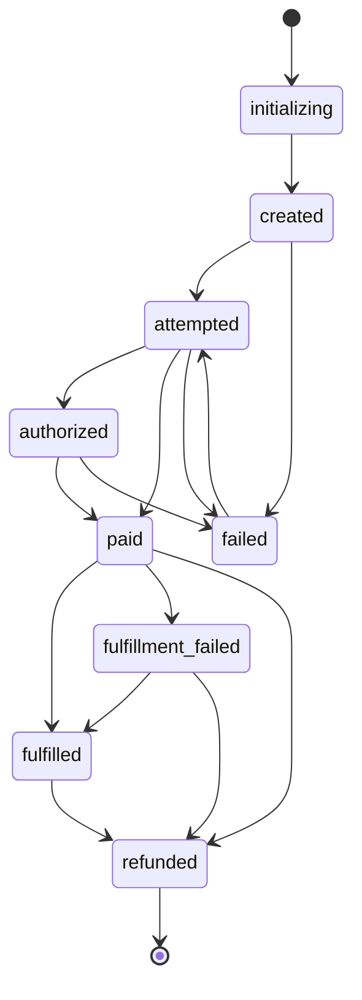
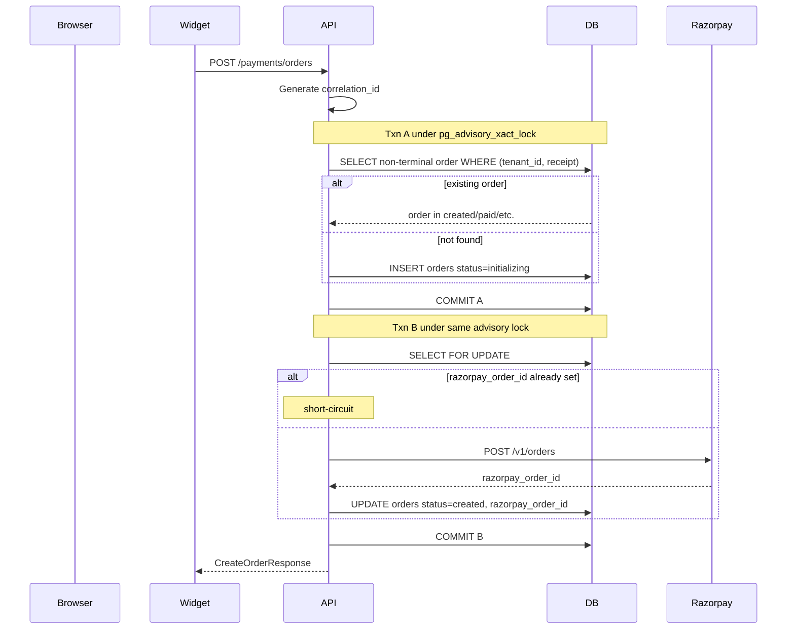

# DESIGN_v6.md: Razorpay Payment Integration Layer

Final, current design. Single source of truth. Reflects the system as built. Supersedes DESIGN_v5.md.

## Table of Contents

1. [Repository Layout](#1-repository-layout)
2. [Public API Surface](#2-public-api-surface)
3. [Database Schema](#3-database-schema)
4. [Order State Machine](#4-order-state-machine)
5. [Sequence Diagrams](#5-sequence-diagrams)
6. [Webhook and Fulfillment Architecture](#6-webhook-and-fulfillment-architecture)
7. [Webhook Idempotency Contract](#7-webhook-idempotency-contract)
8. [Fulfillment Hook Contract](#8-fulfillment-hook-contract)
9. [Failure Modes and Handling](#9-failure-modes-and-handling)
10. [Observability and Correlation IDs](#10-observability-and-correlation-ids)
11. [Network Topology and Tier Switching](#11-network-topology-and-tier-switching)
12. [Free Track Capacity Model](#12-free-track-capacity-model)
13. [Monitoring and Alerts](#13-monitoring-and-alerts)
14. [Operational Runbooks](#14-operational-runbooks)
15. [Test Strategy](#15-test-strategy)
16. [Local Development](#16-local-development)
17. [Critical Implementation Rules](#17-critical-implementation-rules)
18. [Out of Scope and Scaling Triggers](#18-out-of-scope-and-scaling-triggers)

---

## 1. Repository Layout

```
razorpay-payment-integration/
├── razorpay_checkout/                 # Python library, FastAPI router, Lambda handlers
│   ├── pyproject.toml
│   ├── alembic.ini
│   ├── razorpay_checkout/
│   │   ├── __init__.py                # Public re-exports
│   │   ├── amounts.py                 # AmountResolver protocol + FixedAmountResolver
│   │   ├── client.py                  # RazorpayClient (httpx.AsyncClient)
│   │   ├── config.py                  # RazorpayConfig (pydantic-settings v2)
│   │   ├── correlation.py             # correlation_id contextvar + FastAPI dep
│   │   ├── db.py                      # asyncpg pool + JSONB codec init
│   │   ├── fulfillment.py             # FulfillmentHook protocol + processor
│   │   ├── logging_config.py          # structlog + secret-redaction processor
│   │   ├── models.py                  # Pydantic wire models
│   │   ├── orders.py                  # OrderService (create_or_get, transition)
│   │   ├── queue.py                   # SQS envelope builders + publishers
│   │   ├── reconcile.py               # Razorpay-to-local reconciliation
│   │   ├── router.py                  # FastAPI payments_router
│   │   ├── signatures.py              # HMAC verify (webhook + payment)
│   │   ├── state_machine.py           # OrderStatus enum, ALLOWED_TRANSITIONS, terminals
│   │   ├── telemetry.py               # OTel + 10 metric instruments
│   │   ├── tenants.py                 # TenantConfigRegistry
│   │   ├── webhook_consumer.py        # Consumer orchestrator
│   │   ├── webhook_handlers.py        # Per-event handlers
│   │   ├── webhook_idempotency.py     # SkipDecision + should_skip
│   │   ├── webhook_producer.py        # Producer (signature verify + SQS publish)
│   │   ├── lambdas/
│   │   │   ├── webhook_consumer_handler.py
│   │   │   ├── fulfillment_handler.py
│   │   │   ├── fulfillment_dlq_poller.py
│   │   │   ├── webhook_events_dlq_poller.py
│   │   │   └── stale_paid_monitor.py
│   │   └── migrations/versions/       # Alembic 0001..0007
│   └── tests/
│
├── packages/checkout-widget/          # TypeScript / npm widget
│   └── src/{core.ts, react.tsx, vanilla.ts, types.ts, index.ts}
│
├── infra/                             # AWS CDK (Python)
│   ├── app.py
│   └── stacks/{foundation.py, payments.py}
│
├── example/
│   ├── backend/main.py                # Dev FastAPI host (mounts router, dashboards)
│   ├── frontend/
│   │   ├── dashboard.html             # Dev Mission Control (write-capable harness)
│   │   ├── admin-dashboard.html       # Read-only prod dashboard
│   │   ├── shop.html                  # Buyer demo
│   │   └── test_page.html
│   └── website-integration/           # Standalone reference website ("Demo Store")
│
├── scripts/
│   ├── razorpay-simulator.py
│   ├── local-fixtures.py
│   ├── local-pump.py
│   ├── dlq-replay.py
│   ├── prod-smoke.py
│   ├── check-stuck-paid.py
│   └── reconcile-diff.py
│
├── docs/{cloud,diagrams,runbooks}/
└── designs/DESIGN_v6.md
```

The Python library ships the router and all Lambda handlers. The dashboards and dev-only routes live in the example host (`example/backend/main.py`), not in the library itself.

---

## 2. Public API Surface

### 2.1 Library Router (`payments_router`)

```python
from razorpay_checkout import payments_router
app.include_router(payments_router, prefix="/payments")
```

Six routes. Tenant configuration is provided at mount time via `TenantConfigRegistry`.

| Method | Path | Auth | Purpose |
|---|---|---|---|
| `POST` | `/orders` | None | Idempotent order create |
| `GET` | `/orders/{order_id}` | None (tenant-scoped) | Poll order status |
| `POST` | `/verify-callback` | HMAC | Verify client-side `order_id\|payment_id` signature |
| `POST` | `/webhook/{tenant_id}` | HMAC (Razorpay) | Webhook Producer entry |
| `GET` | `/reconcile` | `X-Admin-Api-Key` | Compare Razorpay payments to local DB |
| `POST` | `/admin/events/{event_id}/replay` | `X-Admin-Api-Key` | Reset `failed`/`dead` event to `pending` |
| `POST` | `/admin/orders/{order_id}/retry-fulfillment` | `X-Admin-Api-Key` | Re-enqueue fulfillment for `paid`/`fulfillment_failed` |

`require_admin` returns **403** if `admin_api_key` is `None`. Comparisons use `hmac.compare_digest`.

#### `RazorpayConfig` (pydantic-settings v2, `env_prefix="RAZORPAY_"`)

```python
class RazorpayConfig(BaseSettings):
    tenant_id: str
    key_id: str
    key_secret: SecretStr
    webhook_secret: SecretStr
    webhook_secret_previous: SecretStr | None = None
    mode: Literal["test", "live"] = "test"
    db_dsn: PostgresDsn
    pool_min_size: int = 2
    pool_max_size: int = 10
    razorpay_api_timeout: float = 10.0
    otel_exporter: Literal["stdout", "xray", "otlp"] = "stdout"
    otel_endpoint: str | None = None
    admin_api_key: SecretStr | None = None
```

`model_post_init` registers every `SecretStr` value into the structlog redaction set so no secret can appear in logs.

`TenantConfigRegistry` is a thread-safe in-memory map of `tenant_id -> RazorpayConfig`. `get(tenant_id)` returns `None` for unknown tenants. Only `RAZORPAY_`-prefixed env vars auto-load from `.env`; AWS credentials must be exported separately.

#### `POST /orders`

Order creation sequence (`OrderService.create_or_get`):

1. **Transaction A** under `pg_advisory_xact_lock(hash(tenant_id, receipt))`. SELECT for a non-terminal order with `(tenant_id, receipt)`. Non-terminal: `initializing`, `created`, `attempted`, `authorized`, `paid`, `fulfilled`, `fulfillment_failed`. Terminal: `failed`, `refunded`.
2. If absent, INSERT `orders` row with `status='initializing'`, `razorpay_order_id=NULL`, `amount=server_computed`, and a freshly generated `correlation_id`. Commit.
3. **Transaction B** under the same advisory lock. Re-check; short-circuit if a leader already filled in `razorpay_order_id`. Otherwise call Razorpay API inside the transaction and UPDATE the row to `status='created'` with the returned `razorpay_order_id`.
4. On Razorpay API failure, the row stays in `initializing`. Return `503`. Retry on the next request with the same receipt.

The advisory lock is required. A `UNIQUE(tenant_id, receipt)` index alone serialises the INSERT but does not prevent N concurrent callers from each making the external Razorpay call. The lock collapses the side effect to one.

```python
class CreateOrderRequest(BaseModel):
    currency: str = "INR"
    receipt: str
    notes: dict[str, str] = {}

class CreateOrderResponse(BaseModel):
    order_id: str
    razorpay_order_id: str
    amount: int
    currency: str
    key_id: str
```

#### `POST /webhook/{tenant_id}`

Producer entry. Must return `200` to Razorpay within 500 ms. Producer has no DB credentials.

```python
class WebhookAckResponse(BaseModel):
    status: Literal["queued"]
    correlation_id: str
```

Exception mapping:

| Internal exception | HTTP | Body |
|---|---|---|
| `UnknownTenantError` | 400 | `unknown_tenant` |
| `SignatureMismatchError` | 400 | `signature_mismatch` |
| `MalformedPayloadError` | 400 | `malformed_payload` |
| `PublishFailureError` | 503 | `queue_unavailable` |

Unknown tenant returns **400**, not 404, because the URL space is publicly enumerable and 400 avoids leaking tenant existence.

Supported event types: `payment.authorized`, `payment.captured`, `payment.failed`, `refund.processed`, `order.paid` (log-only).

#### `GET /orders/{order_id}`

```python
class OrderStatusResponse(BaseModel):
    order_id: str
    razorpay_order_id: str
    status: OrderStatus
    amount: int
    currency: str
    created_at: datetime
    attempted_at: datetime | None
    authorized_at: datetime | None
    paid_at: datetime | None
    fulfilled_at: datetime | None
    fulfillment_failed_at: datetime | None
    failed_at: datetime | None
    refunded_at: datetime | None
```

Frontend polls every 2s, 30s timeout, unlocks on `status === 'fulfilled'`.

#### `POST /verify-callback`

Verifies HMAC of `order_id|payment_id` with `verify_payment_signature`. Returns `200` with `verified=true|false`. Returns `verified=false` on `order_not_found` or `terminal_failed`. **Does not** unlock access or trigger fulfillment.

#### `GET /reconcile?from_date&to_date`

Admin only. Paginates Razorpay payments API, compares to local `payments` where `is_authoritative=TRUE`. Reports four mismatch reasons: `missing_in_local_db`, `amount_mismatch`, `status_mismatch`, `refund_status_mismatch`. Local-only rows are not reported (Razorpay is authoritative).

#### `POST /admin/events/{event_id}/replay`

Admin only. Resets a `webhook_events` row from `failed` or `dead` to `pending`. Returns `404` if absent, `409` if not in either of those statuses. Resets `attempts=0`, `error=NULL`, `processed_at=NULL`.

#### `POST /admin/orders/{order_id}/retry-fulfillment`

Admin only. Allowed for `paid` or `fulfillment_failed`. Publishes a fresh fulfillment-queue message and INSERTs an `order_events` row with `trigger='admin_retry'`, `from_status == to_status` (no state change), and `sqs_message_id` in metadata.

### 2.2 Host-Only Routes (Example Backend, Not Shipped in Library)

`example/backend/main.py` mounts the library router and adds:

| Method | Path | Auth | Gate | Purpose |
|---|---|---|---|---|
| `GET` | `/dev/dashboard` | None | `RAZORPAY_DEV_ROUTES_ENABLED=true` | Serves `dashboard.html` (Mission Control) |
| `GET` | `/dev/dashboard-data` | None | Dev gate | Aggregated KPIs + queues + orders + selected order |
| `POST` | `/dev/simulate` | None | Dev gate | Fires a signed canonical Razorpay payload at `/payments/webhook/{tenant}` |
| `POST` | `/dev/reset` | None | Dev gate | Wipes DB and SQS for scenario harness |
| `GET` | `/dev/flow`, `/dev/queues`, `/dev/shop`, `/dev/widget.js`, `/dev/test-page` | None | Dev gate | Legacy single-purpose endpoints (retained for scenario harness) |
| `GET` | `/admin/dashboard` | None (HTML only) | None | Serves `admin-dashboard.html` |
| `GET` | `/admin/dashboard-data` | `X-Admin-Api-Key` | Always on | Aggregated payload, no scenario harness |
| `GET` | `/admin/orders/{order_id}` | `X-Admin-Api-Key` | Always on | Full per-order detail block |
| `GET` | `/admin/kpis` | `X-Admin-Api-Key` | Always on | KPI strip only |
| `GET` | `/health` | None | Always on | Liveness |

`RAZORPAY_DEV_ROUTES_ENABLED` must be unset in any deployed environment. The aggregated dashboard payload is one round trip with a CTE-based KPI block, four SQS `GetQueueAttributes` calls, and per-order webhook scoping via JSONB path (`payload->'payload'->'payment'->'entity'->>'order_id'` and the refund/order equivalents) so the selected-order panel never shows another order's `refund.processed`.

### 2.3 Frontend Widget (`@akhiljoe/checkout-widget`)

Exports `runCheckout`, `ensureRazorpayLoaded`, `RazorpayCheckout` (React), `mountCheckout` (vanilla), and typed `PaymentResult`, `PaymentError`, `CreateOrderResponse`, `CheckoutOptions`. No `amount` prop. The server is authoritative.

Core flow (`core.ts`):

1. `POST orderEndpoint` with `{ receipt, currency }`. On HTTP failure, emit `code: "order_create_failed"`.
2. Inject `https://checkout.razorpay.com/v1/checkout.js` if not present. Poll `window.Razorpay` every 50 ms up to `SCRIPT_LOAD_TIMEOUT_MS=3000`. On timeout, emit `code: "csp_blocked"`.
3. Construct `new Razorpay({ key_id, order_id, amount, ... handler, modal.ondismiss })` using the server response only.
4. Bind the `payment.failed` event for typed `PaymentError`.
5. After `onSuccess`, host code calls `POST /payments/verify-callback`, then polls `GET /payments/orders/{order_id}` until `status === 'fulfilled'` (2s interval, 30s timeout).

Required CSP directives:

```
script-src https://checkout.razorpay.com;
frame-src https://api.razorpay.com;
```

---

## 3. Database Schema

All schema lives in seven Alembic migrations (`0001` to `0007`). No `metadata.create_all()` anywhere. `updated_at` on `orders` is maintained by the `set_updated_at()` `BEFORE UPDATE` trigger function.

### `tenants`

```sql
CREATE TABLE tenants (
    id          TEXT PRIMARY KEY,
    name        TEXT NOT NULL,
    created_at  TIMESTAMPTZ NOT NULL DEFAULT NOW()
);
```

No `webhook_secret` or `key_id` columns. Tenant secrets live in `RazorpayConfig` (env or SSM Parameter Store SecureString), never in the DB.

### `orders`

```sql
CREATE TABLE orders (
    id                      UUID PRIMARY KEY DEFAULT gen_random_uuid(),
    tenant_id               TEXT NOT NULL,
    receipt                 TEXT NOT NULL,
    razorpay_order_id       TEXT UNIQUE,
    amount                  INTEGER NOT NULL CHECK (amount > 0),
    currency                TEXT NOT NULL DEFAULT 'INR' CHECK (char_length(currency) <= 3),
    status                  TEXT NOT NULL DEFAULT 'initializing',
    notes                   JSONB NOT NULL DEFAULT '{}',
    correlation_id          TEXT NOT NULL,
    created_at              TIMESTAMPTZ NOT NULL DEFAULT NOW(),
    attempted_at            TIMESTAMPTZ,
    authorized_at           TIMESTAMPTZ,
    paid_at                 TIMESTAMPTZ,
    fulfilled_at            TIMESTAMPTZ,
    fulfillment_failed_at   TIMESTAMPTZ,
    failed_at               TIMESTAMPTZ,
    refunded_at             TIMESTAMPTZ,
    updated_at              TIMESTAMPTZ NOT NULL DEFAULT NOW()
);
```

| Index | Column(s) | Type | Purpose |
|---|---|---|---|
| `orders_pkey` | `id` | PK | Primary lookup |
| `orders_razorpay_order_id_key` | `razorpay_order_id` | UNIQUE | Webhook lookup |
| `orders_tenant_receipt_unique` | `(tenant_id, receipt)` | UNIQUE | Receipt idempotency |
| `orders_tenant_status_idx` | `(tenant_id, status)` | B-tree | Reconciliation, admin |
| `orders_created_at_idx` | `created_at` | B-tree | Date scans |
| `orders_correlation_id_idx` | `correlation_id` | B-tree | Trace lookup |

Allowed `status` values: `initializing`, `created`, `attempted`, `authorized`, `paid`, `fulfilled`, `fulfillment_failed`, `failed`, `refunded`. Application-enforced via the state machine.

### `payments`

```sql
CREATE TABLE payments (
    id                  UUID PRIMARY KEY DEFAULT gen_random_uuid(),
    tenant_id           TEXT NOT NULL,
    order_id            UUID NOT NULL REFERENCES orders(id),
    razorpay_payment_id TEXT NOT NULL UNIQUE,
    razorpay_order_id   TEXT NOT NULL,
    razorpay_signature  TEXT,
    amount              INTEGER NOT NULL,
    currency            TEXT NOT NULL,
    method              TEXT,
    status              TEXT NOT NULL,
    attempt_number      INTEGER NOT NULL DEFAULT 1,
    is_authoritative    BOOLEAN NOT NULL DEFAULT FALSE,
    captured_at         TIMESTAMPTZ,
    refunded_at         TIMESTAMPTZ,
    created_at          TIMESTAMPTZ NOT NULL DEFAULT NOW()
);
```

A row exists only for terminal payment outcomes (`captured`, `failed`). `payment.authorized` does **not** insert a row. `refund.processed` UPDATEs the captured row to `status='refunded'`; `is_authoritative` stays `TRUE`. `attempt_number` is `MAX(attempt_number)+1` per `(tenant_id, order_id)`. Indexes on `order_id`, `razorpay_order_id`, `tenant_id`.

### `refunds`

```sql
CREATE TABLE refunds (
    id                  UUID PRIMARY KEY DEFAULT gen_random_uuid(),
    tenant_id           TEXT NOT NULL,
    order_id            UUID NOT NULL REFERENCES orders(id),
    payment_id          UUID NOT NULL REFERENCES payments(id),
    razorpay_refund_id  TEXT NOT NULL UNIQUE,
    razorpay_payment_id TEXT NOT NULL,
    amount              INTEGER NOT NULL,
    currency            TEXT NOT NULL,
    status              TEXT NOT NULL,
    initiated_by        TEXT NOT NULL,
    notes               JSONB NOT NULL DEFAULT '{}',
    processed_at        TIMESTAMPTZ,
    created_at          TIMESTAMPTZ NOT NULL DEFAULT NOW()
);
```

One row per Razorpay refund event. `initiated_by` is `razorpay_dashboard`, `admin_api`, or `auto`. `amount` is per-refund; partial refunds are forward-compatible. Indexes on `order_id`, `tenant_id`.

### `webhook_events`

```sql
CREATE TABLE webhook_events (
    id                  UUID PRIMARY KEY DEFAULT gen_random_uuid(),
    tenant_id           TEXT NOT NULL,
    event_id            TEXT NOT NULL,
    event               TEXT NOT NULL,
    payload             JSONB NOT NULL,
    correlation_id      TEXT NOT NULL,
    received_at         TIMESTAMPTZ NOT NULL DEFAULT NOW(),
    processed_at        TIMESTAMPTZ,
    processing_status   TEXT NOT NULL DEFAULT 'pending',
    error               TEXT,
    attempts            INTEGER NOT NULL DEFAULT 0,
    max_attempts        INTEGER NOT NULL DEFAULT 5,
    UNIQUE(tenant_id, event_id)
);
```

`processing_status` lifecycle: `pending` -> `done` | `failed` | `dead`. `failed` is set by handlers on recoverable errors (refund for unknown payment, amount mismatch). `dead` is set exclusively by `webhook_events_dlq_poller` after SQS exhausts retries. `/admin/events/{id}/replay` accepts both `failed` and `dead`. Indexes on `(tenant_id, processing_status)`, `received_at`, `correlation_id`.

`received_at` is set by the Webhook Producer at HTTP entry and carried through SQS; the Consumer reads it from the envelope, never `NOW()`. The DB default exists only as a safety fallback for direct inserts.

### `order_events`

```sql
CREATE TABLE order_events (
    id               UUID PRIMARY KEY DEFAULT gen_random_uuid(),
    order_id         UUID NOT NULL REFERENCES orders(id),
    tenant_id        TEXT NOT NULL,
    from_status      TEXT NOT NULL,
    to_status        TEXT NOT NULL,
    trigger          TEXT NOT NULL,
    webhook_event_id UUID REFERENCES webhook_events(id),
    correlation_id   TEXT NOT NULL,
    metadata         JSONB NOT NULL DEFAULT '{}',
    created_at       TIMESTAMPTZ NOT NULL DEFAULT NOW()
);
```

`trigger` values: `webhook`, `reconcile`, `manual`, `fulfillment`, `initializing`, `admin_retry`. Most rows record a state transition (`from_status != to_status`). Admin retry inserts a marker row where `from_status == to_status` and metadata carries `sqs_message_id`. Indexes on `order_id`, `(tenant_id, created_at)`, `correlation_id`.

### Trigger

```sql
CREATE OR REPLACE FUNCTION set_updated_at() RETURNS TRIGGER AS $$
BEGIN NEW.updated_at = NOW(); RETURN NEW; END;
$$ LANGUAGE plpgsql;

CREATE TRIGGER orders_updated_at
BEFORE UPDATE ON orders FOR EACH ROW EXECUTE FUNCTION set_updated_at();
```

The `pgcrypto` extension is enabled (for `gen_random_uuid()`).

---

## 4. Order State Machine



`OrderStatus` is a `StrEnum` with nine values. `ALLOWED_TRANSITIONS` is a `frozenset` of 15 ordered pairs. `OrderService.transition(order, new_status, *, trigger, webhook_event_id, metadata)` calls `assert_transition(...)` which raises `IllegalTransitionError(from_status, to_status, order_id)` on any pair not in the set.

**Two distinct senses of "terminal":**

| Concept | Set | Meaning |
|---|---|---|
| `TERMINAL` | `{failed, refunded}` | Idempotency-terminal: receipt is freed for re-use |
| `LIFECYCLE_TERMINAL` | `{refunded}` | Zero outgoing edges |

`failed` is idempotency-terminal but not lifecycle-terminal, because `failed -> attempted` exists as a recovery edge.

**Stale-event no-op:** `is_stale_failed_event(status)` returns `True` when `status` is `paid`, `fulfilled`, or `fulfillment_failed`. A `payment.failed` event in those states is marked `done` without transitioning.

**Allowed transitions:**

| From | To | Trigger |
|---|---|---|
| `initializing` | `created` | Razorpay API returns `rzp_order_id` |
| `created` | `attempted` | First payment event (or auto-hop, see below) |
| `created` | `failed` | Order expiry |
| `attempted` | `authorized` | `payment.authorized` |
| `attempted` | `paid` | `payment.captured` |
| `attempted` | `failed` | `payment.failed` |
| `authorized` | `paid` | `payment.captured` |
| `authorized` | `failed` | `payment.failed` or 5-day capture window expiry |
| `failed` | `attempted` | Recovery (new payment event for same order) |
| `paid` | `fulfilled` | Fulfillment hook succeeded |
| `paid` | `fulfillment_failed` | Fulfillment hook exhausted SQS retries |
| `paid` | `refunded` | `refund.processed` before fulfillment |
| `fulfilled` | `refunded` | `refund.processed` |
| `fulfillment_failed` | `fulfilled` | Admin retry succeeded |
| `fulfillment_failed` | `refunded` | Refund issued |

### Handler Auto-Hops

When a payment event arrives for an order still in `created` (server-to-server flow, no `verify-callback` round-trip), the handler performs a synthetic intermediate hop within the same DB transaction:

| Event | If order is in | Synthetic transitions | Metadata |
|---|---|---|---|
| `payment.authorized` | `created` | `created -> attempted -> authorized` | `auto_attempted=true` |
| `payment.captured` | `created` | `created -> attempted -> paid` | `auto_attempted=true` |
| `payment.captured` | `failed` | `failed -> attempted -> paid` | `auto_attempted=true, recovery=true` |

Each hop INSERTs its own `order_events` row, so the audit log remains faithful to the canonical state machine.

---

## 5. Sequence Diagrams

### 5.1 Order Creation (with Advisory Lock)



### 5.2 Successful Payment

```mermaid
sequenceDiagram
    participant RZP as Razorpay
    participant WP as Webhook Producer
    participant WQ as webhook-events.fifo
    participant WC as Webhook Consumer
    participant DB
    participant FQ as fulfillment-queue.fifo
    participant FL as Fulfillment Lambda

    RZP->>WP: POST /payments/webhook/{tenant_id} payment.captured
    WP->>WP: Generate correlation_id, lookup tenant, verify signature
    WP->>WQ: SendMessage groupId=razorpay_order_id, dedupId=tenant:event_id
    WP-->>RZP: 200 queued

    WQ->>WC: Deliver
    WC->>WC: Bind correlation_id from MessageAttributes
    WC->>DB: INSERT webhook_events ON CONFLICT DO NOTHING (received_at from envelope)
    WC->>DB: BEGIN; SELECT orders FOR UPDATE
    WC->>WC: should_skip(event, status, captured_payment_exists)
    alt PROCEED
        WC->>DB: Assert event_amount == order.amount
        WC->>DB: UPDATE orders attempted -> paid
        WC->>DB: INSERT payments is_authoritative=TRUE, attempt_number=N
        WC->>DB: INSERT order_events trigger=webhook
        WC->>DB: COMMIT
        WC->>FQ: SendMessage {order_id, tenant_id, razorpay_payment_id}
    end

    FQ->>FL: Deliver
    FL->>DB: SELECT orders FOR UPDATE
    alt status == fulfilled
        Note over FL: short-circuit
    else
        FL->>FL: FulfillmentHook.fulfill(...)
        FL->>DB: UPDATE orders paid -> fulfilled
        FL->>DB: INSERT order_events trigger=fulfillment
    end
```

### 5.3 Authorized Then Captured

`payment.authorized` runs the consumer path, inserts an `order_events` row, transitions `attempted -> authorized` (or auto-hops from `created`), and inserts **no** `payments` row. A subsequent `payment.captured` runs the same path with the `authorized -> paid` edge, inserts the authoritative `payments` row, and publishes to `fulfillment-queue.fifo`.

### 5.4 Failed Payment With Successful Retry

`payment.failed` on `attempted` transitions to `failed` and inserts a non-authoritative `payments` row (`is_authoritative=FALSE`, `attempt_number=1`). A subsequent `payment.captured` triggers the `failed -> attempted -> paid` recovery auto-hop, inserts an authoritative `payments` row (`attempt_number=2`), and publishes fulfillment.

### 5.5 Webhook Retry With New `event_id`, Same Payment

Razorpay may retry with a different `event_id` for the same `razorpay_payment_id`. SQS `MessageDeduplicationId=f"{tenant_id}:{event_id}"` only dedupes literal duplicates within the 5-minute FIFO window. The new event passes both the SQS dedup window and the `webhook_events` UNIQUE constraint. The event-type-aware primary guard inside the DB transaction catches it: the order is already at or past `paid` and a captured `payments` row exists for the `razorpay_payment_id`, so `should_skip` returns `SKIP_ALREADY_APPLIED`. The event is marked `done` with a note; no double processing.

### 5.6 Refund Processed

`refund.processed` looks up the captured `payments` row by `(tenant_id, razorpay_payment_id, is_authoritative=TRUE)`. If found, UPDATE `payments.status='refunded'`, INSERT a `refunds` row with `initiated_by='razorpay_dashboard'`, transition order to `refunded`. If the captured row is **not** found, mark the event `failed` with reason `refund_for_unknown_payment:{razorpay_payment_id}` and return without state change. Recovery: `/reconcile` then `/admin/events/{id}/replay`.

### 5.7 SQS Publish Failure After DB Commit

The Consumer commits the DB transaction before publishing to `fulfillment-queue.fifo`. If `publish_fulfillment_message` raises, the order stays in `paid` with no in-flight message and the `fulfillment_sqs_publish_failures` metric is incremented. The stale-paid monitor (5-minute cadence) detects this and emits a WARN log; operator uses `POST /admin/orders/{order_id}/retry-fulfillment` to re-enqueue.

---

## 6. Webhook and Fulfillment Architecture

Three Lambda functions connected by two SQS FIFO queue pairs.

```
Razorpay ──HTTPS──▶ Webhook Producer ──▶ webhook-events.fifo ──▶ Webhook Consumer ──▶ Postgres
   (public)          (public, no DB)          (FIFO + DLQ)          (DB credentials)        │
                                                                                            │
                                                                                            ▼
                                                                                fulfillment-queue.fifo
                                                                                            │
                                                                                            ▼
                                                                                  Fulfillment Lambda
                                                                                            │
                                                                                            ▼
                                                                                     FulfillmentHook
```

The producer-consumer split is permanent and exists for two reasons. **Latency:** Razorpay enforces a 500 ms response SLA; signature verification plus SQS publish runs in 10 to 30 ms p50, decoupled from DB latency. **Security:** the public-facing Lambda holds zero database credentials. A defence-in-depth IAM policy explicitly denies `rds:*` and `secretsmanager:GetSecretValue` on the DB secret ARN for the Producer role.

### Lambda Inventory

| Lambda | Trigger | Responsibilities | Reserved Concurrency | Memory | Timeout |
|---|---|---|---|---|---|
| **Webhook Producer** | Function URL `POST /payments/webhook/{tenant_id}` | Tenant lookup, signature verify, fast-parse, SQS publish | 50 | 512 MB | 30 s |
| **Webhook Consumer** | SQS `webhook-events.fifo` (batch size 1) | Fast-path dedup, primary guard, DB transitions, fulfillment publish | None | 512 MB | 60 s |
| **Fulfillment Lambda** | SQS `fulfillment-queue.fifo` (batch size 1) | Invoke `FulfillmentHook`, transition `paid -> fulfilled` or short-circuit | None | 512 MB | 60 s |
| **Webhook Events DLQ Poller** | SQS `webhook-events-dlq.fifo` | UPDATE `webhook_events.processing_status='dead'`, emit `dead_event_count` | None | 256 MB | 30 s |
| **Fulfillment DLQ Poller** | SQS `fulfillment-dlq.fifo` | Transition order `paid -> fulfillment_failed`, alert | None | 256 MB | 30 s |
| **Stale-Paid Monitor** | EventBridge 5-minute schedule | Query orders in `paid` for >5 min, WARN-log only | None | 256 MB | 30 s |

Producer reserved concurrency caps blast radius if Razorpay floods. Consumer and Fulfillment use SQS-native back-pressure via `maxReceiveCount=5` and DLQs. `report_batch_item_failures=True` so partial-batch errors don't replay the whole batch.

### SQS Configuration

| Queue | Type | Visibility Timeout | Retention | Dedup |
|---|---|---|---|---|
| `webhook-events.fifo` | FIFO | 180 s | 4 days | Content-based + `MessageDeduplicationId={tenant_id}:{event_id}` |
| `webhook-events-dlq.fifo` | FIFO | 180 s | 14 days | Inherited |
| `fulfillment-queue.fifo` | FIFO | 180 s | 4 days | Content-based + `MessageDeduplicationId={order_id}:{razorpay_payment_id}` |
| `fulfillment-dlq.fifo` | FIFO | 180 s | 14 days | Inherited |

`MessageGroupId=razorpay_order_id` on `webhook-events.fifo` preserves per-order event ordering (`authorized` before `captured`). `MessageGroupId=order_id` on `fulfillment-queue.fifo`.

### Envelope Schemas

Both queues use versioned envelopes; bodies are capped at 256 KB (`MessageTooLargeError` if exceeded).

**`webhook-events.fifo`:**

```json
{
  "envelope_version": 1,
  "tenant_id": "...",
  "event_id": "...",
  "event": "payment.captured",
  "received_at": "2026-05-15T12:34:56.789Z",
  "signature": "<X-Razorpay-Signature passthrough>",
  "payload": { "entity": "event", "payload": { ... } }
}
```

`MessageAttributes.correlation_id`: a UUIDv4 generated at producer entry.

**`fulfillment-queue.fifo`:**

```json
{
  "envelope_version": 1,
  "order_id": "<UUID>",
  "tenant_id": "...",
  "razorpay_payment_id": "..."
}
```

`MessageAttributes.correlation_id` carried forward.

### Correlation ID Continuity

`WebhookConsumer._bind_correlation_id` and `FulfillmentProcessor._bind_correlation_id` accept both shapes of `MessageAttributes.correlation_id`: the raw SQS dict (`{"StringValue": "uuid", "DataType": "String"}`) delivered by AWS Lambda's event-source mapping, and the flat string (`"uuid"`) used by boto3 helpers and local pumps. The fallback chain is `attribute -> contextvar -> new_correlation_id()`. Missing both shapes silently breaks the cross-service trace.

```python
attr = attrs.get("correlation_id")
cid_from_attr: str | None = None
if isinstance(attr, dict):
    cid_from_attr = attr.get("stringValue") or attr.get("StringValue")
elif isinstance(attr, str) and attr:
    cid_from_attr = attr
cid = cid_from_attr or get_correlation_id() or new_correlation_id()
```

---

## 7. Webhook Idempotency Contract

The primary guard is **event-type aware** and runs **inside the DB transaction** after `SELECT ... FOR UPDATE` on the order. `event_id` uniqueness is the secondary fast-path.

### Required Sequence

1. **Fast-path dedup.** `INSERT INTO webhook_events (...) ON CONFLICT (tenant_id, event_id) DO NOTHING`. On conflict, increment `webhook_duplicate_count`, mark event `done`, return `200 queued`. `received_at` is read from the SQS envelope (parsed via `datetime.fromisoformat` because asyncpg validates timestamptz parameters client-side; passing an ISO string raises `DataError` regardless of any `::timestamptz` cast in SQL).
2. **Begin DB transaction.**
3. **Row lock.** `SELECT ... FROM orders WHERE razorpay_order_id = $1 AND tenant_id = $2 FOR UPDATE`.
4. **Primary guard.** `webhook_idempotency.should_skip(event, order_status, captured_payment_exists)` returns one of:
   - `PROCEED`: continue.
   - `SKIP_ALREADY_APPLIED`: the target state is already reached; mark event `done`, commit, return.
   - `STALE_NO_OP`: a stale `payment.failed` arrived after capture/fulfillment; mark event `done` with reason `stale_after_capture`, commit, return.
5. **Amount assertion** for capture and authorize events: `event_amount == order.amount`. On mismatch, mark event `failed`, alert, return success without raising. The SQS message is consumed; Razorpay must not retry an amount mismatch indefinitely.
6. **State transition** via `OrderService.transition`. Handler-specific work: INSERT `payments` only on `payment.captured` (authoritative) or `payment.failed` (non-authoritative); UPDATE `payments` and INSERT `refunds` on `refund.processed`; never insert a `payments` row on `payment.authorized`.
7. **Commit.** Only then publish to `fulfillment-queue.fifo` (on `paid` transitions only) or any external side effect.

### Rule Table

| Event | Skip if `order.status` is | Stale no-op if `order.status` is |
|---|---|---|
| `payment.captured` | `paid`, `fulfilled`, `fulfillment_failed`, `refunded` AND captured row exists | (none) |
| `payment.authorized` | `authorized`, `paid`, `fulfilled`, `fulfillment_failed`, `refunded` | (none) |
| `payment.failed` | `failed`, `refunded` | `paid`, `fulfilled`, `fulfillment_failed` |
| `refund.processed` | `refunded` | (none) |
| `order.paid` | (always proceed, log-only) | (none) |

### Handler Outcome Protocol

Each handler returns `_HandlerOutcome(decision, fulfillment_payload, event_already_marked)`. The orchestrator's post-handler `_mark_event_done` is **skipped** when `event_already_marked=True`. Handlers that call `_mark_failed_in_handler` (refund-for-unknown-payment, amount mismatch) must set this flag, otherwise the orchestrator silently overwrites `failed` with `done` and the operator loses the reconciliation signal.

### Forbidden Patterns

- Treating `event_id` uniqueness as the sole idempotency mechanism.
- A primary guard that is not event-type aware.
- State transitions outside the explicit DB transaction.
- Any side effect (SQS publish, external call, log line carrying side-effect semantics) between transition and commit.
- Inserting a `payments` row on `payment.authorized`.
- Inserting a new `payments` row on `refund.processed` (UPDATE the captured row instead).
- Mutating `webhook_events.processing_status` from inside a handler without setting `event_already_marked=True`.

---

## 8. Fulfillment Hook Contract

The hook runs in the Fulfillment Lambda after `payment.captured` has committed the `paid` transition. The default hook is a no-op (logs and returns); consuming apps register their own at Lambda init via `register_hook(...)` in `fulfillment_handler.py`.

```python
class FulfillmentHook(Protocol):
    async def fulfill(
        self,
        order_id: str,
        tenant_id: str,
        amount: int,
        metadata: dict,
    ) -> None:
        """
        Called after payment.captured commits.
        metadata: {"correlation_id": str, "razorpay_payment_id": str}.

        MUST be idempotent: repeat calls for the same order_id produce
        the same outcome and do not raise.
        MUST be atomic: all side effects complete or the function raises.

        On exception: SQS retries up to maxReceiveCount=5. After exhaustion,
        the message moves to fulfillment-dlq.fifo, the DLQ poller transitions
        the order to fulfillment_failed, and a CloudWatch alarm fires.
        """
```

**Safety net inside the Fulfillment Lambda.** Before invoking the hook, the Lambda acquires `SELECT order FOR UPDATE` and checks `status`. If `status == 'fulfilled'`, it short-circuits without calling the hook. This handles interleaved deliveries (SQS at-least-once) and admin retries.

---

## 9. Failure Modes and Handling

| Failure | Detection | Handling | Recovery |
|---|---|---|---|
| Razorpay API timeout during order creation | `httpx.TimeoutException` | Backoff 1s/2s/4s, then `503`. Row stays in `initializing`. | Client retries; advisory lock + UNIQUE collapse to one Razorpay call. |
| Concurrent same-receipt creates | `pg_advisory_xact_lock` | Losers refetch the leader's row. | Exactly one Razorpay order per receipt. |
| Duplicate webhook, same `event_id` | UNIQUE `(tenant_id, event_id)` | `ON CONFLICT DO NOTHING`. Increment `webhook_duplicate_count`. | Transparent. |
| Duplicate webhook, new `event_id`, same payment | Primary guard | Order is at or past target; mark `done` with note. | Transparent. |
| Webhook signature mismatch | `hmac.compare_digest` fails on both secrets | `400 signature_mismatch`. Log WARN. No persist. | Razorpay retries. |
| `payment.failed` then `payment.captured` | Recovery auto-hop | `failed -> attempted -> paid`. Authoritative payment row at `attempt_number=2`. | Fulfillment runs normally. |
| `payment.failed` on `paid`/`fulfilled`/`fulfillment_failed` | `is_stale_failed_event` | `STALE_NO_OP`, mark `done`. | No action. |
| `payment.authorized` received | Handler | `attempted -> authorized` (or auto-hop). No payments row. | Wait for capture; alert if >24h. |
| Order stuck in `authorized` >24h | Scheduled scan | CloudWatch alarm. | Manual capture in Razorpay dashboard, or 5-day expiry. |
| Concurrent processor for same order | `SELECT FOR UPDATE` | Second processor blocks. | Transparent. |
| Amount mismatch | Assertion | Mark event `failed`, alert. Do not raise. | Manual review. |
| Webhook event repeatedly fails | `attempts >= max_attempts` via SQS retries | DLQ poller sets `processing_status='dead'`, alert. | Replay after root-cause fix. |
| Client callback without webhook | Order stuck in `created`/`attempted` >24h | Reconciliation flags it. | Manual investigation. |
| Neon cold start during webhook | Pool acquire above threshold | Producer `503`. | Razorpay retries. |
| Webhook before client callback | Order already `paid`/`fulfilled` when `verify-callback` runs | Returns `verified=true` if not in terminal-failed. | No action. |
| Neon paused after inactivity | All requests 503 | EventBridge `SELECT 1` every 4 days. | Razorpay retries cover the window. |
| Webhook secret rotation | Operational | `webhook_secret` then `webhook_secret_previous` fallback. | Zero-downtime. |
| SQS publish fails after DB commit | Lambda exception post-commit | Order stays `paid`. Stale-paid monitor catches it at 5 min. | `/admin/orders/{id}/retry-fulfillment`. |
| Fulfillment exhausts retries | `maxReceiveCount` exceeded | Message to DLQ; DLQ poller transitions order to `fulfillment_failed`. | Fix hook, `/admin/orders/{id}/retry-fulfillment`. |
| Unknown `tenant_id` on webhook | `TenantConfigRegistry.get` returns `None` | `400 unknown_tenant`. No persist. | Verify tenant registration. |
| Refund processed by Razorpay dashboard | `refund.processed` webhook | UPDATE payment + INSERT refund + transition to `refunded`. | Transparent. |
| Refund for unknown payment | Lookup fails in handler | Mark event `failed` with `refund_for_unknown_payment:{id}`. | `/reconcile`, then replay. |
| Producer SQS publish failure | `boto3.exceptions.Boto3Error` | `503 queue_unavailable`. No DB writes. | Razorpay retries. |
| Consumer DB outage | Raises on transaction | SQS retries; eventually DLQ if sustained. | Resume DB; queue drains. |
| Consumer exhausts retries | `attempts >= maxReceiveCount` | DLQ; poller sets `'dead'`. | Replay after fix. |

---

## 10. Observability and Correlation IDs

### OTel Exporter

Selected at startup from the `RAZORPAY_OTEL_EXPORTER` env var. No application branching after init.

| Value | Tier | Sink | Cost |
|---|---|---|---|
| `stdout` | Free | CloudWatch Logs (structured JSON) | $0 inside 5 GB free tier |
| `xray` | Paid | AWS X-Ray via ADOT Lambda layer | ~$5/mo at 10k payments |
| `otlp` | Future | Any OTLP backend | Varies |

Tests that exercise the stdout path must inject `InMemoryMetricReader` and explicitly call `meter_provider.shutdown()`; the `ConsoleMetricExporter` pins `sys.stdout` at construction on a daemon thread, and pytest's capture rotation causes shutdown noise otherwise.

### Log Sanitization

`structlog` is configured with `PrintLoggerFactory()` (no `file=` argument, so the stdout handle is resolved per emission). All `SecretStr` values from `RazorpayConfig.model_post_init` are registered into a redaction processor. The `key_secret` and `webhook_secret` values never appear in any log record (asserted by a regression test).

### Correlation ID Propagation

A single `correlation_id` (UUIDv4) ties every record produced by one logical request. Origin:

- Order creation: generated in the `POST /orders` handler. Persisted on `orders.correlation_id`.
- Webhook: generated at producer entry. Carried through `webhook_events.correlation_id` and `order_events.correlation_id`.

Propagation contract:

1. Every log line carries `correlation_id` as a structured field.
2. Every OTel span has `correlation_id` as an attribute.
3. SQS publish includes `correlation_id` in `MessageAttributes`.
4. Consumer and Fulfillment Lambda re-bind from the SQS message (accepting both dict and flat shapes).
5. `FulfillmentHook.fulfill(...)` receives `correlation_id` in `metadata`.

Search by `correlation_id` in CloudWatch Logs Insights or X-Ray to see the full timeline.

### Metrics (capped at 10 to fit Free Tier)

| Metric | Owner |
|---|---|
| `webhook_latency_ms` | Producer |
| `webhook_publish_failures` | Producer |
| `webhook_duplicate_count` | Consumer |
| `webhook_consumer_duration_ms` | Consumer |
| `order_state_transition_count{from,to}` | Consumer |
| `dead_event_count` | DLQ poller |
| `reconciliation_mismatch_count{reason}` | Reconcile job |
| `fulfillment_duration_ms` | Fulfillment |
| `fulfillment_sqs_publish_failures` | Consumer |
| `cold_start_ms` | All Lambdas |

`payment_authorized_count` is derivable from `order_state_transition_count{to=authorized}`. `tenant_lookup_failures` is captured via a CloudWatch Logs metric filter on the producer's WARN line. Once on the Paid Track, restore the dropped two and pay ~$0.30 per metric per month.

---

## 11. Network Topology and Tier Switching

Network posture is tier-dependent. The producer-consumer split provides the security boundary at all times; VPC placement is layered on top.

| Component | Free Track | Paid Track / RDS-in-VPC |
|---|---|---|
| **Webhook Producer** | Public, no VPC | Public, no VPC (must reach Razorpay) |
| **Webhook Consumer** | Public, no VPC; Neon and SQS via TLS over internet | Private subnets; SQS via VPC Interface Endpoint |
| **Fulfillment Lambda** | Public, no VPC | Private subnets; SQS via Interface Endpoint |
| **DLQ Pollers, Stale-Paid Monitor** | Public, no VPC | Private subnets |
| **VPC Interface Endpoints** | None | `sqs`, `secretsmanager`, `logs`, `monitoring` |
| **NAT Gateway** | None | None (Interface Endpoints replace it) |
| **Fixed monthly network cost** | $0 | ~$15 to $50 |

**Free Track posture.** All Lambdas run with public egress. The security perimeter is per-Lambda IAM scope plus TLS in transit plus credentials in SSM Parameter Store SecureString. Trade-off accepted: a compromised non-producer Lambda could exfiltrate over the internet. Mitigation: tight IAM, default-deny outside what each function uses, log redaction.

**Paid Track posture.** Producer stays public. Consumer and Fulfillment move into private subnets. Application code is identical across tiers; the change is a CDK `track` parameter.

### CDK Stack Structure

`infra/app.py` reads `razorpay:env` from CDK context. Per environment it synthesises:

| Stack | Resources |
|---|---|
| `razorpay-{env}-foundation` | Three ECR repos (`razorpay-webhook-producer`, `razorpay-webhook-consumer`, `razorpay-fulfillment`); four CloudWatch log groups with 2-week retention; SNS topic `razorpay-ops-{track}`; AWS Budgets at 5/25/100 USD with SNS + email |
| `razorpay-{env}-payments` | KMS CMK `alias/razorpay-{track}`; DB secret; four SQS FIFO queues; three IAM roles with defence-in-depth deny on the producer; three Lambda container functions; SQS event sources with `report_batch_item_failures=True`; producer Lambda Function URL (`AuthType.NONE`); EventBridge schedule for the stale-paid monitor |

Producer IAM is `sqs:SendMessage` on `webhook-events.fifo`, `ssm:GetParameter*` on `/razorpay/*`, KMS decrypt, plus explicit DENY on `rds:*` and on `secretsmanager:GetSecretValue` for the DB secret ARN. Consumer and Fulfillment have read on the DB secret, KMS decrypt, SQS consume/publish as appropriate.

---

## 12. Free Track Capacity Model

| Resource | Free Tier Limit | At 1k payments/mo | Headroom | Migration Trigger |
|---|---|---|---|---|
| Lambda invocations | 1M req/mo | ~5,000 | 995k | >200k payments/mo |
| Lambda compute | 400k GB-sec/mo | ~5,000 | 395k | >80k payments/mo |
| SQS requests | 1M req/mo | ~3,000 | 997k | >300k payments/mo |
| Postgres storage (Neon) | 0.5 GB | ~80 MB | ~420 MB | >400 MB for 7 days |
| Postgres connections (Neon) | 1,000 | 10 per Lambda | Ample | N/A |
| CloudWatch log ingestion | 5 GB/mo | ~500 MB | 4.5 GB | >10k payments/mo |
| Lambda concurrency | 1,000 regional | ~10 peak | Ample | Sustained >900 |
| CloudWatch custom metrics | 10 free | 10 | 0 | Consolidate via dimensions |

Estimated monthly cost on the Free Track: **$0**.

---

## 13. Monitoring and Alerts

### Dashboards

The dev Mission Control (`/dev/dashboard`) and the read-only `/admin/dashboard` share visual layout: dark theme, JetBrains Mono + IBM Plex Sans, KPI strip, alarm banner, queue depths, recent orders, selected-order detail with full 17-step Payment Journey. Both pull a single aggregated payload (`/dev/dashboard-data` or `/admin/dashboard-data`) per refresh.

**State-graph visited detection is timestamp-driven, never status-string-driven.** `function visited(s)` walks `*_at` columns (`attempted_at`, `authorized_at`, `paid_at`, `fulfilled_at`, `fulfillment_failed_at`, `failed_at`, `refunded_at`) rather than checking the live `status` field. This is required so terminal-on-branch orders (`failed` mid-flow, `refunded` after fulfilment) render their visited lanes correctly. Duration badges between lanes are emitted only when adjacent lane indices differ by exactly one, so cross-gap deltas are never shown.

**Per-order webhook scoping.** The aggregated endpoints filter `webhook_events` for the selected order via JSONB path (`payload->'payload'->'payment'->'entity'->>'order_id'`, and the refund / order equivalents), not by tenant alone. The selected-order panel never bleeds another order's `refund.processed`.

**Admin auth.** The admin dashboard reads `X-Admin-Api-Key` from `sessionStorage` (key: `razorpay_admin_key`) and writes it back via `sessionStorage.setItem`. The auth modal re-opens on first load and after any `403`. `sessionStorage`, not `localStorage`, because the key is a session token; a persistent XSS payload on a sibling page must not survive a tab close. The base URL (non-secret) lives in `localStorage`.

**Stale-data signal.** A failed refresh adds `body.stale` (opacity cue) and pins a `#stale-banner` ribbon. The previous toast-only behaviour allowed debugging against silently-frozen data.

**Dev gate.** `/dev/dashboard` and all `/dev/*` routes are gated on `RAZORPAY_DEV_ROUTES_ENABLED=true`. This must be unset in any deployed environment.

### KPI Tiles

`total_today`, `fulfilled_today`, `failed_today` (sum of `today_failed + today_fulfillment_failed`), `in_flight` (`status_in=created,attempted,authorized`), `refunded_today`, `stuck_paid (>15m)`.

### Critical Alerts (PagerDuty)

`fulfillment-dlq.fifo` depth >0; `webhook-events-dlq.fifo` depth >0; `webhook_events.processing_status='dead'` >0; `failed AND attempts>=3 AND received_at<1hr ago` for >30 min; orders in `paid` >5 min with no in-flight message; orders in `authorized` >24h; orders transitioned to `fulfillment_failed` in the last hour; DB pool exhaustion; `webhook_publish_failures` rate >1% over 5 min.

### Warning Alerts (Slack)

Webhook handler p95 >3000 ms for 10 min; Lambda error rate >1% for 5 min; reconciliation mismatch >0; Razorpay webhook response p95 >3s for 10 min.

### Email

Reconciliation mismatch >0 (daily scheduled).

### Stale-Paid Thresholds

The stale-paid Lambda runs every 5 minutes and emits a WARN log for every order in `paid` whose `paid_at < NOW() - INTERVAL '5 minutes'`. The dashboard's `stuck_paid` indicator uses a higher threshold (15 minutes) so it surfaces only orders that are genuinely stuck, not in-flight ones. Both numbers are intentional: the alert is fast, the dashboard signal is conservative.

---

## 14. Operational Runbooks

| Runbook | Trigger | Action |
|---|---|---|
| **Stuck / dead webhook event** | `processing_status='dead'` count >0 or `'failed' AND attempts>=3 AND received_at<1hr` | Inspect `webhook_events.error`. Fix root cause. `POST /admin/events/{id}/replay`. Monitor. |
| **Fulfillment DLQ message** | `fulfillment-dlq.fifo` depth >0; DLQ poller transitioned order to `fulfillment_failed` | Read `order_events` row (carries `correlation_id` and error). Search logs by `correlation_id`. Fix `FulfillmentHook`. `POST /admin/orders/{id}/retry-fulfillment`. |
| **Order stuck in `paid`** | Monitor flags `paid_at < NOW() - 5 min` | Verify Fulfillment Lambda + SQS event source. `POST /admin/orders/{id}/retry-fulfillment`. |
| **Order stuck in `authorized` >24h** | Scheduled scan | Manual capture in Razorpay dashboard, or wait for the 5-day capture window. |
| **Reconciliation mismatch** | `/reconcile` flags rows | `missing_in_local_db`: check `webhook_events`; replay if present, manually insert if absent. `amount_mismatch`: correct local. `status_mismatch`: admin transition. `refund_status_mismatch`: replay missing `refund.processed`. |
| **Neon paused** | All requests 503 | Resume in Neon console. EventBridge `SELECT 1` every 4 days prevents this. |
| **Webhook secret rotation** | Operational | Add `RAZORPAY_WEBHOOK_SECRET_PREVIOUS`. Update Razorpay dashboard. Remove previous after 24h. |
| **Captured but never fulfilled** | Support ticket | Check `order_events`. Check SQS and DLQ. `POST /admin/orders/{id}/retry-fulfillment`. |
| **Refund out of sync** | Support ticket; Razorpay shows refund processed | Check `webhook_events` for `refund.processed`. Replay if present, backfill via admin endpoint if absent. |
| **DLQ inspection** | Operator triage | Use `scripts/dlq-replay.py`. Read-only commands pass `release_after_peek=True` to `change_message_visibility(VisibilityTimeout=0)` so the next inspect call sees the same messages. |

---

## 15. Test Strategy

### Unit Tests

State machine: every valid transition; every invalid raises `IllegalTransitionError`. `failed -> attempted -> paid` recovery. `attempted -> authorized -> paid`. Stale `payment.failed` on `paid`/`fulfilled`/`fulfillment_failed` is a no-op. `paid -> fulfillment_failed` on hook exhaustion. `fulfillment_failed -> fulfilled` on admin retry. All three refund edges.

Signatures: valid, tampered, wrong secret, empty body, previous-secret fallback. Payment signature: valid, mismatched IDs, wrong secret.

Idempotency: duplicate receipt returns existing order across every non-terminal status. `ON CONFLICT DO NOTHING` for duplicate `event_id`. Primary guard skips when target state is already reached. Refund idempotency on duplicate `razorpay_refund_id`. Amount-mismatch path sets event `failed`, does not raise.

Admin routes: 403 on missing or wrong key.

Order creation: `initializing` row inserted before Razorpay call. Advisory-lock collapse on 10 concurrent same-receipt POSTs results in exactly one Razorpay order.

Webhook route: 400 on unknown `tenant_id`; correct secret per tenant; current-then-previous fallback.

`TenantConfigRegistry`: correct config returned; `None` for unknown.

SQS publish gating: publishes after `paid` transition only. Never on duplicate, failed, authorized, refund.

Correlation: `orders.correlation_id`, `webhook_events.correlation_id`, `order_events.correlation_id`, SQS `MessageAttributes.correlation_id` all match within one logical request. `_bind_correlation_id` extracts both dict and flat shapes.

Fulfillment Lambda short-circuit: `fulfilled` order skips hook invocation.

JSONB codec: SELECT on `payload`, `metadata`, `notes` returns `dict`, not `str`.

`received_at` end-to-end: producer wall-clock value survives the SQS hop and is the value inserted into `webhook_events.received_at`.

### Integration Tests (Test Razorpay Account)

Happy path: create order, capture, webhook, SQS, fulfillment. Authorize then capture. Failed payment retry. Refund after fulfillment, before fulfillment, after fulfillment failure. Webhook before callback. Duplicate webhook (same `event_id`) silently ignored. Duplicate webhook (new `event_id`, same payment) caught by primary guard. Multi-tenant isolation. Reconciliation: intentionally create each mismatch type. Concurrent same-receipt: 10 simultaneous POSTs result in one Razorpay order. SQS publish failure path: order stays `paid`, monitor fires, manual retry works. Fulfillment exhaustion: hook raises 5 times, order transitions to `fulfillment_failed`, admin retry succeeds. Correlation end-to-end across HTTP, DB, SQS, Fulfillment.

### Chaos / Failure Tests

DB down during webhook (Razorpay gets 503, retries, event processed). DB down during fulfillment (SQS retries; idempotent hook handles re-delivery). Fulfillment cold start covered by SQS visibility timeout. Webhook burst (100 events in 1s): all transitions complete, queue drains within 30s. Neon cold start simulation (3s pool acquire delay). State-machine chaos: events out of order. Unknown `tenant_id`: 400, no persist. Stuck `authorized`. Refund event for unknown payment.

---

## 16. Local Development

### Simulator (Preferred)

`scripts/razorpay-simulator.py` builds a canonical Razorpay payload, signs it with the dev `webhook_secret`, and POSTs to a configurable URL. Deterministic, no network beyond localhost, runs in CI.

```bash
python scripts/razorpay-simulator.py <event_type> \
    --tenant <tenant_id> \
    --order-id <razorpay_order_id> \
    --payment-id <razorpay_payment_id> \
    [--amount <paise>] \
    [--refund-id <razorpay_refund_id>] \
    [--secret <webhook_secret>] \
    [--url <target_url>]
```

Supported: `payment.authorized`, `payment.captured`, `payment.failed`, `refund.processed`. HMAC-SHA256(`webhook_secret`, body) goes in `X-Razorpay-Signature`. The simulator, the HMAC vectors in `.claude/commands/local-sig-validate.md`, and `tests/test_signatures.py` share one source of truth; changing one requires updating all three.

### Local SQS Pump

`scripts/local-pump.py` mimics the AWS Lambda event-source mapping, long-polling `webhook-events.fifo` and `fulfillment-queue.fifo` from LocalStack and invoking `WebhookConsumer` / `FulfillmentProcessor` directly. Tunes batch shape to match Lambda's `messageAttributes` flattening so the correlation-id parser exercises both code paths.

### Other Scripts

| Script | Purpose |
|---|---|
| `local-fixtures.py` | Dev DB + LocalStack SQS test-data manager (`status`, `seed`, `wipe`) |
| `dlq-replay.py` | List/replay/delete DLQ messages with FIFO order; `--allow-production` for non-LocalStack endpoints |
| `prod-smoke.py` | Read-only smoke (`/health`, `/admin/kpis`, `/admin/dashboard-data?recent_limit=0`); 0/1/2 exit |
| `check-stuck-paid.py` | Direct-DB query for `paid AND paid_at < NOW()-threshold`; CSV out |
| `reconcile-diff.py` | Calls `/payments/reconcile`, pretty-prints; nonzero exit on any mismatch |

### Tunnel (End-to-End with Razorpay Test Mode)

Expose `localhost:8000` via ngrok or Cloudflare Tunnel and register the HTTPS tunnel URL in the Razorpay test dashboard. Razorpay rejects non-HTTPS webhook URLs.

### Dev-Backend Env Trap

`RazorpayConfig` auto-loads `RAZORPAY_*` keys from `.env`. AWS keys (`AWS_ENDPOINT_URL`, `AWS_DEFAULT_REGION`, `AWS_ACCESS_KEY_ID`, `AWS_SECRET_ACCESS_KEY`) are **not** lifted into `os.environ` by pydantic-settings. The dev backend's lifespan parses `.env` manually into `os.environ` via `os.environ.setdefault` so explicit shell exports still win. Production Lambdas avoid this entirely (AWS values come from execution role + Lambda env).

Stray shell exports beat `.env`. The startup check is `env | grep ^RAZORPAY_` before any "wrong env" debugging. Tests `monkeypatch.delenv` every `RAZORPAY_*` key at fixture setup.

---

## 17. Critical Implementation Rules

The following rules are load-bearing. Each prevented or fixed a real bug during implementation.

### 17.1 Order Service: Advisory Lock Around External Side Effects

`OrderService.create_or_get` runs two transactions on the same connection, both wrapped in `pg_advisory_xact_lock(hash(tenant_id, receipt))`. Transaction A inserts the placeholder row. Transaction B re-checks, then makes the Razorpay API call inside the transaction and updates the row. The advisory lock is required because the `UNIQUE(tenant_id, receipt)` index alone serialises the INSERT but does not prevent N concurrent callers from each calling Razorpay. The pattern generalises to any `create_or_get` flow with an external handshake.

### 17.2 JSONB Codec at Pool Init

`db.create_pool` passes `init=_register_codecs`, which calls `conn.set_type_codec("jsonb", encoder=json.dumps, decoder=json.loads, schema="pg_catalog")` (and the same for `json`). Without the codec, `payload`, `metadata`, and `notes` round-trip as strings, and code that indexes into `row["metadata"]["key"]` raises `TypeError: string indices must be integers, not 'str'`. INSERTs must pass `dict`, not pre-serialised JSON; SELECTs return `dict`. The `::jsonb` cast in SQL is no longer required for coercion (kept for clarity).

### 17.3 asyncpg Wants `datetime`, Not ISO Strings

asyncpg validates parameter types client-side before submission. `TIMESTAMPTZ` parameters must be `datetime.datetime`. A `::timestamptz` cast in SQL does not help; the encoder raises `DataError` before the query reaches Postgres. The Consumer's `_parse_received_at` uses `datetime.fromisoformat` (Python 3.11+ handles trailing `Z`) to convert the envelope string into a `datetime` at the boundary.

### 17.4 Producer Sets `received_at`, Consumer Persists It

The Consumer must pass an explicit `received_at` value from the SQS envelope to its `INSERT INTO webhook_events`. The DB default `NOW()` is a fallback only. `received_at` must reflect Razorpay-perceived receipt time for accurate reconciliation, latency dashboards, and forensic trace alignment, not the producer-to-consumer SQS hop.

### 17.5 Correlation ID: Parse Both MessageAttribute Shapes

`_bind_correlation_id` (in both Consumer and Fulfillment Processor) must accept both shapes of the `correlation_id` MessageAttribute: the raw SQS dict (`{"StringValue": "uuid", "DataType": "String"}`) delivered by AWS Lambda's event-source mapping, and the flat string (`"uuid"`) used by boto3 helpers and local pumps. The fallback chain is `attribute -> contextvar -> new_correlation_id()`. Missing either shape silently breaks Critical Invariant 9.

### 17.6 Two Senses of "Terminal"

`TERMINAL = {failed, refunded}` is idempotency-terminal (receipt is freed). `LIFECYCLE_TERMINAL = {refunded}` has zero outgoing edges. `failed -> attempted` is a valid recovery edge, so `failed` belongs only to the first set. Use the right name when reasoning about receipt re-use versus state-graph exit.

### 17.7 Orchestrator Must Not Overwrite Handler State

When a handler writes `webhook_events.processing_status` from inside the transaction (refund-for-unknown-payment, amount mismatch), it returns `_HandlerOutcome(event_already_marked=True)`. The orchestrator's post-handler `_mark_event_done` is skipped when this flag is set. Otherwise the orchestrator silently overwrites `failed` with `done` and the operator loses the reconciliation signal.

### 17.8 FastAPI Introspection vs `TYPE_CHECKING`

Modules whose functions FastAPI introspects (route handlers, `Depends` targets, response models) must not use `from __future__ import annotations`, and must import any annotation name at module top (not inside `if TYPE_CHECKING:`). FastAPI resolves signatures via `typing.get_type_hints()` at registration. With future annotations, names must be in module globals at runtime; `TYPE_CHECKING` imports are not. The visible failure is a 422 with `{"loc":["query","<param>"]}` on a parameter that should have been a body or `Depends` injection. The 422 may appear on a different parameter than the misconfigured one (FastAPI's introspection of one dependency's signature can surface as a 422 on a sibling route parameter).

Modules holding only Pydantic models, services, or enums may keep `from __future__ import annotations`.

### 17.9 structlog: Defer `sys.stdout` Resolution

Initialize structlog with `PrintLoggerFactory()` and no `file=` argument. `PrintLoggerFactory(file=sys.stdout)` captures the stdout file handle at factory construction; it becomes stale when pytest rotates stdout, and subsequent emissions raise `ValueError: I/O operation on closed file`. The default tells `PrintLogger.msg` to resolve `sys.stdout` at log time.

### 17.10 OTel Stdout Exporter Pins stdout

`ConsoleMetricExporter.__init__` stores `self.out = sys.stdout`. The `PeriodicExportingMetricReader` flushes every 5 s on a daemon thread. Tests that exercise `OTEL_EXPORTER=stdout` must call `meter_provider.shutdown()` and `tracer_provider.shutdown()` in a `finally`, or inject `InMemoryMetricReader`. Production is unaffected.

### 17.11 SQS `receive_message` Locks Even Read-Only Inspections

Any CLI that uses `receive_message` to peek must call `change_message_visibility(VisibilityTimeout=0)` on each received message immediately after the read. Otherwise the message stays invisible for the default visibility timeout, and the next `inspect` or `--dry-run` invocation sees an empty queue. `scripts/dlq-replay.py` exposes a two-mode receive: `release_after_peek=True` for read paths (`list`, `inspect`, `--dry-run`), `False` for destructive paths (`replay`, `delete`).

### 17.12 Dashboard Visited Detection Reads Timestamps, Not Status

`renderStateGraph(order)` and `buildJourneySteps()` read per-state timestamps (`*_at` columns) to determine which lanes are visited, never the live `status` string. A status string is a single point on the graph; it loses history. An order that reached `paid` and then `failed` (e.g. fulfillment refunded) renders all-grey under status-only logic. Trusting `*_at` columns gives a correct visited-set regardless of the terminal branch the order landed on. Duration badges between lanes are emitted only when adjacent lane indices differ by exactly one.

### 17.13 Admin Key Lives in `sessionStorage`, Not `localStorage`

The admin dashboard's `X-Admin-Api-Key` is stored in `sessionStorage` (`razorpay_admin_key`). The base URL (non-secret) may stay in `localStorage`. `sessionStorage` is tab-scoped and cleared on close; `localStorage` survives across tabs and browser restarts and is reachable from any same-origin XSS payload. The auth modal re-opens automatically on first load and after any `403`. Production deployments behind a per-operator auth proxy should treat this storage as a fallback only.

---

## 18. Out of Scope and Scaling Triggers

| Item | v1 Behavior | Promotion Trigger |
|---|---|---|
| **Transactional outbox** | Dual-write with 5-min stale-paid monitor safety net | SQS publish failure rate >1 per 1k webhooks (weekly) or payment volume >10k/mo |
| **Scheduled automated reconciliation** | Manual `GET /reconcile` | Paid Track provisioned or payment volume >5k/mo |
| **Constant-time webhook responses** | Unknown-tenant returns 400 quickly | External pentest finding or tenant count >20 or enumeration detected |
| **Manual capture admin endpoint** | `payment.authorized` logged; 24h alarm; manual capture via Razorpay dashboard | Auto-capture-off deployments or repeated 24h-stuck incidents |
| **Automated capture retry** | None; capture is Razorpay's responsibility | Same as above |
| **Refund UI and refund initiation API** | Refunds via Razorpay dashboard, observed via webhook | Customer-support volume or multi-step refund workflows |
| **Partial refund support** | `refunds.amount` column exists for forward compatibility; not exposed | Product requirement |
| **Subscriptions and recurring** | Out of scope | New product line |
| **Multi-currency** | INR only | International expansion |
| **Partial captures** | Out of scope | Same as multi-currency |
| **3DS edge cases beyond standard flow** | Standard flow only | Specific gateway requirement |
| **Payment link generation** | Out of scope | Product requirement |
| **UPI intent flow (QR)** | Out of scope | Mobile-first checkout |
| **EMI and cardless credit** | Out of scope | Higher ticket size |
| **API versioning (`/v1/` prefix)** | Unversioned | First breaking API change |
| **SQS Standard + SNS fan-out** | FIFO is v1 | Consumer p95 >30s for 1h, or DLQ depth >100 sustained for 1h, or cross-order ordering becomes a requirement, or fan-out to multiple downstream systems |
| **HTTP `Idempotency-Key` header** | Body `receipt` is the idempotency key | Public API consumer requirement |
| **Vendor-agnostic schema column naming** | `razorpay_*` prefixes retained | Multi-gateway support |
| **VPC placement for Consumer / Fulfillment** | Free Track public; security boundary is the producer-consumer split and IAM, not network | RDS-in-VPC migration, Paid Track provisioned, or PCI scope expansion |
| **VPC Interface Endpoints** | None | Same as VPC placement |
| **Lambda Power Tuning** | Static memory: Producer 512 / Consumer 512 / Fulfillment 512 / monitors 256 | Sustained webhook p95 >800 ms or fulfillment p95 >2s or cost/invocation >$0.0005 |
| **Fargate API tier** | Lambda + provisioned concurrency = 1 | Lambda concurrent execution sustained >900 of 1,000 regional cap, or p99 cold start breaches webhook SLA even with provisioned concurrency |

### Paid Track API Decision (Locked)

**Lambda (paid) with provisioned concurrency = 1 on the webhook function.**

| Dimension | Lambda (paid) | ECS Fargate | App Runner |
|---|---|---|---|
| Cold start | 0.8 to 1.5 s (mitigated by provisioned concurrency) | None | None |
| Cost at 10k payments/mo | ~$1 to $3 | ~$15 | ~$8 |
| Cost at 100k payments/mo | ~$5 to $15 | ~$15 | ~$25 to $40 |
| Ops complexity | Low | High | Low |
| Mangum required | Yes | No | No |
| Webhook 500 ms SLA | Achievable with provisioned concurrency = 1 | Trivially met | Trivially met |
| Migration effort from Free Track | Near zero | Medium | Low |

Move to Fargate only on the trigger above.
