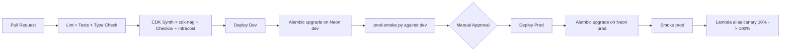

# AWS Migration Architecture: Razorpay Payment Integration

Target-state architecture for the multi-tenant Razorpay Payment Integration Layer. Implementable via AWS CDK (Python), aligned with the existing `infra/stacks/{foundation.py, payments.py}` layout.

- **Source of truth on application behavior:** `designs/DESIGN_v6.md`
- **Strategy and rationale:** `designs/MIGRATION_WRITEUP.md`
- **Cost details:** `docs/cost-analysis.md`
- **IAM policies:** `designs/iam-policies/`

This document is the **prescriptive blueprint**. Exact configurations, exact IAM scopes, exact phased matrix. The architecture deploys at ~$14/mo and scales by toggling feature flags.

---

## Stack Boundary Contract

| Stack | Owns | Does NOT own |
|---|---|---|
| **`foundation.py`** | KMS CMKs, IAM (account-local) users + roles, CloudTrail with Object Lock S3 bucket, ECR repos, ops SNS topics, Budgets, Cost Anomaly Detection, security CloudWatch alarms, Route 53 (none at start; DNS at Cloudflare), ACM certs, base tagging aspect | Application compute, queues, app secrets, dashboards, WAF |
| **`payments.py`** | SQS queues + DLQs, Lambda functions, API Gateway HTTP API, Secrets Manager entries, CloudWatch dashboards and alarms, EventBridge schedules, log-archive S3 with Object Lock, CloudFront + S3 widget. Feature-flagged: WAFv2, Inspector, AWS Config, GuardDuty, Security Hub (all off by default) | KMS root keys, audit services, IAM users |

---

## Region and Account Strategy

- **Primary region:** `ap-south-1` (Mumbai). Closest to Razorpay infra and Indian customers.
- **DR region:** None today. Snapshot copy to `ap-southeast-1` triggered if RTO < 4h becomes a requirement.
- **us-east-1:** Used only for ACM certificates fronting CloudFront (widget CDN).

Two AWS accounts, standalone (no Organizations):

| Account | Email | Notes |
|---|---|---|
| dev | `aws-dev@example.com` | Fresh account, 12-month free tier active |
| prod | `aws-prod@example.com` | ~1 week old, 12-month free tier active |

Rationale and tradeoffs documented in `MIGRATION_WRITEUP.md` §5.

---

## Pillar 1: Account Foundation and Governance

### 1.1 Two-account topology

```text
razorpay-dev   AWS account (aws-dev@example.com)
razorpay-prod  AWS account (aws-prod@example.com)
```

| Account | Purpose | What runs there |
|---|---|---|
| Dev | All non-production infrastructure | Lambdas, SQS, ECR, KMS, Secrets, CloudTrail-to-local-S3 (Object Lock), CloudWatch dashboards |
| Prod | All prod infrastructure | Same shape as dev |

### 1.2 Root user hardening (each account, identical)

| Action | Setting |
|---|---|
| MFA on root | Hardware key or virtual authenticator. Mandatory. |
| Root access keys | None. Delete if present. |
| Alternate contacts | Security, Billing, Operations all set to monitored mailbox |
| Password policy | 14-char min, complexity required, prevent reuse 24 |
| Root usage alarm | CloudTrail event `AssumeRoleByRoot` → SNS page |

### 1.3 Per-account hardening (SCP substitute)

Without AWS Organizations we cannot use Service Control Policies. CloudWatch metric filters on the local CloudTrail log group detect dangerous actions after they happen:

| Filter pattern | Alarm action |
|---|---|
| `cloudtrail:StopLogging`, `cloudtrail:DeleteTrail` | Page |
| `config:Delete*`, `config:Stop*` | Page |
| `guardduty:Delete*`, `guardduty:Disassociate*` | Page |
| `securityhub:Disable*`, `securityhub:Delete*` | Page |
| `s3:DeleteBucketPolicy` on CloudTrail or log-archive bucket | Page |
| `s3:PutBucketObjectLockConfiguration` (after initial setup) | Page |
| `iam:CreateAccessKey`, `iam:CreateLoginProfile` on IAM users | Warn |
| Any API call from `arn:aws:iam::*:root` | Page |
| Any API call outside `ap-south-1`, `ap-southeast-1`, `us-east-1` | Warn |

When the team grows, fold both accounts under AWS Organizations and convert these to true SCPs (one-day operation).

### 1.4 Operator authentication

| Use case | Mechanism |
|---|---|
| Daily console access | Per-account IAM user (`admin-dev`, `admin-prod`) with `AdministratorAccess` + MFA-enforcement policy |
| AWS CLI access | Named profiles (`razorpay-dev`, `razorpay-prod`); MFA-enforced session tokens via `aws sts get-session-token` |
| GitHub Actions deploys | OIDC trust per account, no long-lived keys |
| Breakglass | Root user with MFA; alarm fires immediately on use |

MFA-enforcement policy attached to each IAM user:

```json
{
  "Version": "2012-10-17",
  "Statement": [{
    "Sid": "DenyAllExceptListedIfNoMFA",
    "Effect": "Deny",
    "NotAction": [
      "iam:ChangePassword", "iam:CreateVirtualMFADevice",
      "iam:EnableMFADevice", "iam:GetUser", "iam:ListMFADevices",
      "iam:ListVirtualMFADevices", "iam:ResyncMFADevice",
      "sts:GetSessionToken"
    ],
    "Resource": "*",
    "Condition": { "BoolIfExists": { "aws:MultiFactorAuthPresent": "false" } }
  }]
}
```

### 1.5 Tagging standard

| Tag Key | Allowed Values |
|---|---|
| `Environment` | `dev`, `prod` |
| `Service` | `razorpay-checkout` |
| `Owner` | `akhil@<domain>` |
| `CostCenter` | `payments-platform` |
| `ManagedBy` | `cdk` |
| `DataClassification` | `pii`, `payment`, `internal` |

Enforced via CDK Aspect that fails synth on missing tags.

### 1.6 Financial safeguards (per account)

| Control | Threshold | Action |
|---|---|---|
| AWS Budget actual | 50% / 80% / 100% | Email / Slack / Page |
| AWS Budget forecasted | 100% | Email + Slack |
| Free Tier alert | 80% of any limit | Email |
| Cost Anomaly Detection | Per-service monitor on Lambda, SQS, Secrets, KMS | Anomaly >$5/day → SNS |

**Budget ceilings:** dev $30/mo, prod $50/mo. Triggers a re-evaluation if breached.

---

## Pillar 2: Network and Edge Security

### 2.1 No VPC

All six Lambdas run with default Lambda networking (public egress). Security perimeter is IAM scoping + TLS + signature verification + secrets in Secrets Manager + log redaction.

Cost of skipping VPC: $0. Cost of VPC + PrivateLink endpoints (the alternative): ~$130/mo per environment.

### 2.2 Edge ingress

```text
Razorpay -> Cloudflare DNS -> API Gateway HTTP API -> Producer Lambda -> SQS
```

| Component | Purpose | Cost |
|---|---|---|
| Cloudflare DNS | Already-managed DNS for `example.com`. CNAME records point at API Gateway custom domain + CloudFront. | $0 |
| API Gateway HTTP API | Routes to Producer Lambda; provides throttling and IP allow-list (free) | $1 per 1M requests; first 1M/mo free for 12 months |
| Producer Lambda | Signature verify + SQS publish | $0 idle, $0.20 per 1M invocations |

API Gateway throttle settings (free, equivalent to basic WAF rate-limiting):

```python
throttle_settings_per_route = {
    "POST /payments/webhook/{tenant_id}": {
        "burst_limit": 200,
        "rate_limit": 100,  # RPS sustained
    },
}
```

API Gateway resource policy IP allow-list (free, restricts the webhook endpoint to Razorpay's published IPs):

```json
{
  "Version": "2012-10-17",
  "Statement": [{
    "Effect": "Allow",
    "Principal": "*",
    "Action": "execute-api:Invoke",
    "Resource": "execute-api:/*/POST/payments/webhook/*",
    "Condition": {
      "IpAddress": { "aws:SourceIp": [
        "203.0.113.10/32", "203.0.113.11/32", "..."
      ]}
    }
  }]
}
```

Razorpay's IP range is mirrored from their documentation into an SSM parameter; updated monthly.

### 2.3 WAF (feature toggle, off by default)

WAFv2 is wired in CDK behind `waf_enabled` toggle. Off in `cdk.json`:

```json
{
  "razorpay:features": {
    "waf_enabled": false
  }
}
```

When enabled:

| Rule | Action |
|---|---|
| AWS Managed: Amazon IP Reputation | Block |
| AWS Managed: Known Bad Inputs | Block |
| AWS Managed: Core Rule Set | Block (excluding `SizeRestrictions_BODY`) |
| Razorpay IP allow-list (custom IPSet) | Allow + count |
| Rate limit per IP (500 reqs / 5 min) | Block |
| Geo-match (India, Singapore, US) | Allow |

Cost when enabled: ~$22/mo per env ($5 Web ACL + 6 rules × $1 + per-request fees).

**Triggers to enable WAF:**

- Sustained traffic exceeds 1000 payments/month (URL becomes more discoverable)
- CloudWatch alarm on Producer Lambda invocations > 1000/min for 5 min (cost-amplification attempt)
- Razorpay reports webhook anomalies

### 2.4 DNS and TLS

DNS managed at Cloudflare (already in place for `example.com`):

| Hostname | Points at | Purpose |
|---|---|---|
| `example.com` | Cloudflare-hosted website | Tenant website (prod) |
| `dev.example.com` | Cloudflare-hosted website | Tenant website (dev) |
| `api.example.com` | API Gateway custom domain (prod) | Payment API |
| `api.dev.example.com` | API Gateway custom domain (dev) | Payment API |
| `widget.example.com` | CloudFront (prod) | Widget JS |
| `widget.dev.example.com` | CloudFront (dev) | Widget JS |

ACM certificates (DNS validation, automatic renewal):

| Cert | Region | Use |
|---|---|---|
| `*.example.com` | `ap-south-1` | API Gateway |
| `*.dev.example.com` | `ap-south-1` | API Gateway dev |
| `*.example.com` | `us-east-1` | CloudFront |

Skip AWS Route 53 entirely (saves $6/year). ACM validation CNAME records are added to Cloudflare DNS by hand once per cert, then auto-renewal is silent.

---

## Pillar 3: Encryption and Key Management

### 3.1 Five KMS CMKs per environment

| Key alias | Purpose | Encrypts |
|---|---|---|
| `alias/razorpay-checkout/{env}/secrets` | Secrets | All Secrets Manager values |
| `alias/razorpay-checkout/{env}/sqs` | Queues | SQS at-rest message bodies |
| `alias/razorpay-checkout/{env}/s3-artifacts` | S3 | Widget, log archive, CloudTrail buckets |
| `alias/razorpay-checkout/{env}/cloudwatch-logs` | Logs | Per-Lambda log groups |
| `alias/razorpay-checkout/{env}/db` | DB (reserved) | Aurora storage when we migrate; unused today |

10 keys × $1/mo = $10/mo. Annual automatic rotation on all five (`enable_key_rotation=True`).

### 3.2 Producer cannot decrypt the DB key

Even today, with no AWS-hosted DB, the Producer role has an **explicit Deny** on the `db` and `s3-artifacts` CMKs. Structural discipline so the security model is in place when the DB migrates later.

```json
{
  "Sid": "AllowConsumerFulfillmentDecrypt",
  "Effect": "Allow",
  "Principal": { "AWS": [
    "arn:aws:iam::<acct>:role/razorpay-{env}-consumer",
    "arn:aws:iam::<acct>:role/razorpay-{env}-fulfillment",
    "arn:aws:iam::<acct>:role/razorpay-{env}-fulfillment-dlq-poller",
    "arn:aws:iam::<acct>:role/razorpay-{env}-webhook-events-dlq-poller",
    "arn:aws:iam::<acct>:role/razorpay-{env}-stale-paid-monitor"
  ]},
  "Action": ["kms:Decrypt", "kms:GenerateDataKey", "kms:DescribeKey"],
  "Resource": "*"
},
{
  "Sid": "ExplicitDenyProducer",
  "Effect": "Deny",
  "Principal": { "AWS": "arn:aws:iam::<acct>:role/razorpay-{env}-producer" },
  "Action": "kms:*",
  "Resource": "*"
}
```

### 3.3 At-rest encryption

| Resource | Mechanism |
|---|---|
| Neon storage | Managed by Neon |
| SQS message bodies | SSE-KMS with `sqs` CMK |
| Secrets Manager values | SSE-KMS with `secrets` CMK |
| S3 widget bucket | SSE-KMS with `s3-artifacts` CMK |
| S3 log archive bucket | SSE-KMS with `s3-artifacts` CMK, **Object Lock compliance mode, 7-year retention** |
| S3 CloudTrail bucket | SSE-KMS with `s3-artifacts` CMK, **Object Lock compliance mode, 7-year retention** |
| CloudWatch Log groups | `kms_key_id=cloudwatch_logs_cmk` |

Object Lock on the audit-relevant buckets is mandatory. Enable on day one; AWS does not allow enabling it on existing buckets.

### 3.4 Secrets bootstrap

CDK creates Secrets Manager entries with `{"placeholder": true}`. Operator pours real values in once via MFA-enforced SSO session:

```bash
aws secretsmanager put-secret-value \
    --secret-id /razorpay-checkout/prod/tenant/demo-tenant/razorpay \
    --secret-string file:///tmp/secrets.json \
    --profile razorpay-prod
```

Lambda cold start checks the value and fails closed with HTTP 503 + alarm if it sees the placeholder.

---

## Pillar 4: Database (Neon)

### 4.1 Neon free tier

| Setting | Value |
|---|---|
| Plan | Free |
| Storage | 0.5 GB included |
| Compute hours | 100/month included |
| PITR | 7 days (1-second granularity) |
| Connection pooling | Native (PgBouncer mode), free |
| Region | `aws-ap-south-1` (matches our AWS region) |

DSN is stored in Secrets Manager (`/razorpay-checkout/{env}/db/credentials` and `db/credentials-readonly`). Lambdas read DSN at cold start and cache for the warm-pool lifetime.

asyncpg pool sizing under Neon's pooler:

| Setting | Value |
|---|---|
| `pool_min_size` | 1 |
| `pool_max_size` | 5 |

### 4.2 Read-only role

New Alembic migration `0008_create_readonly_role.py` (must land before Phase 4 deploy):

```python
def upgrade():
    op.execute("""
        CREATE ROLE razorpay_ro;
        GRANT CONNECT ON DATABASE razorpay_checkout TO razorpay_ro;
        GRANT USAGE ON SCHEMA public TO razorpay_ro;
        GRANT SELECT ON ALL TABLES IN SCHEMA public TO razorpay_ro;
        ALTER DEFAULT PRIVILEGES IN SCHEMA public GRANT SELECT ON TABLES TO razorpay_ro;
    """)
```

### 4.3 Backups and DR

| Setting | Value |
|---|---|
| Neon PITR | 7 days (1-second granularity) |
| Cross-region backup | Weekly `pg_dump` to S3 (lifecycle to Glacier after 30 days) |
| Pre-deploy snapshot | Required before any Alembic upgrade |
| Drill cadence | Quarterly (restore to Neon branch + smoke test) |

| Metric | Target |
|---|---|
| RPO | 5 minutes |
| RTO | 4 hours |

### 4.4 Alembic migrations

Run from GitHub Actions runner directly against Neon (Neon is public-internet reachable, no VPC). Workflow step:

```yaml
- name: Migrate Neon
  env:
    AWS_REGION: ap-south-1
  run: |
    DSN=$(aws secretsmanager get-secret-value \
        --secret-id /razorpay-checkout/${ENV}/db/credentials \
        --query SecretString --output text | jq -r .dsn)
    cd razorpay_checkout
    DATABASE_URL="$DSN" uv run alembic upgrade head
```

On failure: auto-execute `alembic downgrade -1`. Multi-step downgrade is manual.

### 4.5 When to migrate off Neon

| Trigger | Action |
|---|---|
| Neon free tier exhausted (>400 MB storage OR >80 compute hrs/mo) | Neon Launch plan (+$19/env/mo). Connection string format unchanged. Zero code change. |
| 100k+ tx/mo sustained | Evaluate Aurora migration (one-weekend operation; brings VPC + PrivateLink + RDS Proxy) |
| PCI / compliance requirement for AWS-native data layer | Same as above |

---

## Pillar 5: Configuration and Secrets

### 5.1 Store choice

| Store | Used for | Why |
|---|---|---|
| **Secrets Manager** | Tenant Razorpay creds, DB credentials (read-write + read-only) | Rotation hooks, audit, KMS at-rest, fine IAM |
| **SSM Parameter Store (Standard)** | Region, queue URLs, feature flags, OTel exporter, Razorpay IP list | Free, simpler IAM, no rotation needed |

### 5.2 Naming convention

| Pattern | Example |
|---|---|
| Tenant Razorpay | `/razorpay-checkout/{env}/tenant/{tenant_id}/razorpay` |
| DB credentials | `/razorpay-checkout/{env}/db/credentials` |
| DB credentials read-only | `/razorpay-checkout/{env}/db/credentials-readonly` |
| Config | `/razorpay-checkout/{env}/config/{key}` |
| Feature flags | `/razorpay-checkout/{env}/features/{name}` |
| Razorpay IPs (shared) | `/razorpay-checkout/shared/config/razorpay-ips` |

### 5.3 Tenant secret cache pattern

| Setting | Value |
|---|---|
| In-Lambda cache TTL | 300 s |
| Cache impl | `cachetools.TTLCache(maxsize=128, ttl=300)` |
| On cache miss | Synchronous `GetSecretValue` |
| On throttle | Exponential backoff 100/200/400 ms, max 3 retries, then 503 |

Peak Secrets Manager API rate: 2 tenants × 50 Lambda instances / 300 s ≈ 0.33 RPS. Trivially under 5000 RPS quota.

### 5.4 Per-Lambda IAM matrix

| Lambda | Secrets Manager | KMS | SQS | Database (Neon, via DSN from secret) | SNS | CloudWatch Logs |
|---|---|---|---|---|---|---|
| **Producer** | `GetSecretValue` on `tenant/*/razorpay-*`. **Explicit Deny** on `db/credentials-*`. | `Decrypt` on `secrets` and `sqs` CMKs. **Deny** on `db` and `s3-artifacts` CMKs. | Send to `webhook-events.fifo` only | None | None | Own log group |
| **Consumer** | Tenant Razorpay + DB read-write | `Decrypt` on `secrets`, `sqs` | Receive `webhook-events.fifo`. Send `fulfillment.fifo`. No DLQ. | Connect via `db/credentials` DSN | None | Own log group |
| **Fulfillment** | Tenant Razorpay + DB read-write | Same | Receive `fulfillment.fifo`. No publish. | Connect via `db/credentials` DSN | None (until tenant hook needs it) | Own log group |
| **Fulfillment DLQ Poller** | `db/credentials-readonly-*` only | `Decrypt` on `secrets`, `sqs` | Receive `fulfillment-dlq.fifo`. No re-drive. | Read-only DSN | `Publish` to ops topic | Own log group |
| **Webhook Events DLQ Poller** | Same | Same | Receive `webhook-events-dlq.fifo`. No re-drive. | Read-only DSN | `Publish` to ops topic | Own log group |
| **Stale Paid Monitor** | `db/credentials-readonly-*` only. **Explicit Deny** on `tenant/*/razorpay-*`. | `Decrypt` on `secrets`. **Deny** on `sqs`. | None | Read-only DSN | `Publish` to ops topic | Own log group |

JSON policy files: `designs/iam-policies/{webhook-producer,webhook-consumer,fulfillment,fulfillment-dlq-poller,webhook-events-dlq-poller,stale-paid-monitor}.json`.

### 5.5 Permissions boundary

Attached to every Lambda execution role:

```json
{
  "Version": "2012-10-17",
  "Statement": [
    {
      "Sid": "AllowOnlyOurServices",
      "Effect": "Allow",
      "Action": [
        "secretsmanager:GetSecretValue", "secretsmanager:DescribeSecret",
        "kms:Decrypt", "kms:GenerateDataKey", "kms:DescribeKey",
        "sqs:SendMessage", "sqs:ReceiveMessage", "sqs:DeleteMessage",
        "sqs:ChangeMessageVisibility", "sqs:GetQueueUrl", "sqs:GetQueueAttributes",
        "sns:Publish",
        "logs:CreateLogStream", "logs:PutLogEvents", "logs:CreateLogGroup",
        "logs:DescribeLogGroups", "logs:DescribeLogStreams",
        "xray:PutTraceSegments", "xray:PutTelemetryRecords",
        "cloudwatch:PutMetricData",
        "ssm:GetParameter", "ssm:GetParameters", "ssm:GetParametersByPath"
      ],
      "Resource": "*"
    },
    {
      "Sid": "DenyDangerous",
      "Effect": "Deny",
      "Action": [
        "iam:*", "kms:ScheduleKeyDeletion", "kms:Disable*", "kms:Delete*",
        "lambda:UpdateFunctionCode", "lambda:UpdateFunctionConfiguration",
        "lambda:DeleteFunction", "lambda:InvokeFunction",
        "secretsmanager:DeleteSecret", "secretsmanager:PutSecretValue",
        "secretsmanager:UpdateSecret",
        "rds:Delete*", "rds:Stop*", "rds:Modify*",
        "s3:DeleteBucket", "s3:PutBucketPolicy",
        "sts:AssumeRole"
      ],
      "Resource": "*"
    }
  ]
}
```

---

## Pillar 6: Compute, Queues, Widget

### 6.1 Lambda configuration

| Function | Memory | Timeout | Reserved Concurrency | Provisioned Concurrency | VPC |
|---|---|---|---|---|---|
| **Webhook Producer** | 512 MB | 10 s | 50 | 0 by default; 2 when `provisioned_concurrency_enabled=true` | NO |
| **Webhook Consumer** | 768 MB | 60 s | 30 | 0 | NO |
| **Fulfillment** | 768 MB | 60 s | 30 | 0 | NO |
| **Fulfillment DLQ Poller** | 256 MB | 30 s | 5 | 0 | NO |
| **Webhook Events DLQ Poller** | 256 MB | 30 s | 5 | 0 | NO |
| **Stale Paid Monitor** | 256 MB | 30 s | 5 | 0 | NO |

Base image: `public.ecr.aws/lambda/python:3.12` (x86_64). Container image packaging (not zip) for reproducibility with `asyncpg` compiled wheels.

### 6.2 SQS FIFO queues

| Queue | Visibility Timeout | Retention | Receive Wait | MaxReceiveCount | Content-Based Dedup | High Throughput Mode |
|---|---|---|---|---|---|---|
| `webhook-events.fifo` | 180 s | 4 days | 20 s | 5 | True + `MessageDeduplicationId={tenant_id}:{event_id}` | True |
| `webhook-events-dlq.fifo` | 30 s | 14 days | 20 s | n/a | True | False |
| `fulfillment.fifo` | 180 s | 4 days | 20 s | 5 | True + `MessageDeduplicationId={order_id}:{razorpay_payment_id}` | True |
| `fulfillment-dlq.fifo` | 30 s | 14 days | 20 s | n/a | True | False |

### 6.3 Event source mapping

```python
lambda_event_sources.SqsEventSource(
    queue=webhook_queue,
    batch_size=1,
    max_batching_window=cdk.Duration.seconds(0),
    report_batch_item_failures=True,
    max_concurrency=30,
)
```

`batch_size=1` (FIFO + per-order ordering). `report_batch_item_failures=True` lets the Consumer classify events as done / failed / dead.

### 6.4 Frontend widget distribution

| Resource | Setting |
|---|---|
| S3 bucket | `razorpay-checkout-{env}-widget-<acct>`; SSE-KMS; block public access on |
| CloudFront | OAC to bucket; HTTPS only; HTTP/2 + HTTP/3; minimum TLS 1.2 |
| Path strategy | `/v{major}.{minor}.{patch}/widget.js` (immutable cache) |
| CORS | Tenant origins from SSM parameter `/razorpay-checkout/{env}/config/widget-cors-origins` |
| SRI hash | SHA-384 computed at build, published as `widget.js.sri` |

### 6.5 Tenant onboarding flow

Operator script `scripts/onboard-tenant.py`:

```bash
python scripts/onboard-tenant.py \
    --env prod \
    --tenant-id demo-tenant \
    --name "Demo Store" \
    --razorpay-key-id rzp_live_xxxxxxxx \
    --razorpay-secret-file ~/secure/dj.txt \
    --webhook-secret-file ~/secure/dj_webhook.txt \
    --tenant-origin https://example.com
```

Performs: secret create, INSERT into `tenants`, SSM CORS update, CloudFront invalidation, smoke test.

---

## Pillar 7: Observability and Dashboards

### 7.1 Two dashboards

**Application Mission Control** (existing `example/frontend/admin-dashboard.html`). Deployed alongside the API; accessible at `https://api.example.com/admin/dashboard` (gated by `X-Admin-Api-Key`). Shows business KPIs.

**CloudWatch Dashboard** (`razorpay-checkout-{env}-mission-control`). Built by CDK. Free tier covers first 3 dashboards per account. Shows infrastructure metrics.

| Mission Control widget | Source |
|---|---|
| KPI strip (today's paid / fulfilled / failed / in-flight / refunded) | `/admin/dashboard-data` aggregated endpoint |
| Payment Journey for selected order | `/admin/orders/{id}` with per-order webhook scoping |
| Queue depths (4 queues) | `/admin/dashboard-data` (calls SQS `GetQueueAttributes`) |
| Stuck paid orders (>15 min) | DB query `WHERE status='paid' AND paid_at < NOW() - INTERVAL '15 minutes'` |
| Reconciliation mismatches (7d) | `reconciliation_mismatch_count{reason}` metric |
| Stale data banner | Frontend signals failed refresh |

| CloudWatch Dashboard widget | Source |
|---|---|
| Webhook latency p50/p95/p99 | `webhook_latency_ms` metric |
| Lambda invocations + error rate per fn | Lambda built-in metrics |
| SQS queue depth + DLQ depth | SQS built-in metrics |
| KMS request count | KMS built-in metric (sanity check) |
| Cost projection (current month) | AWS Budgets actual + forecast |
| Active alarms | Composite alarm widget |

### 7.2 CloudWatch alarms

Critical (page via SNS email):

| Source | Threshold |
|---|---|
| `webhook-events-dlq.fifo` `ApproximateNumberOfMessagesVisible` | > 0 for 5 min |
| `fulfillment-dlq.fifo` `ApproximateNumberOfMessagesVisible` | > 0 for 5 min |
| `webhook_latency_ms` p95 | > 500 ms for 5 min |
| `fulfillment_duration_ms` failure rate | > 1% over 15 min |
| Stale paid orders custom metric | > 0 |
| **Producer Lambda invocations** (cost-amplification detector) | **> 1000/min for 5 min** ← trigger to enable WAF |
| Neon connection failure rate (log filter) | > 0 over 5 min |
| CloudTrail `RootApiCall` | > 0 |
| `cloudtrail:StopLogging` event | > 0 |
| `cloudtrail:DeleteTrail` event | > 0 |
| `config:Delete*` event | > 0 (when Config enabled later) |
| `guardduty:Delete*` event | > 0 (when GD enabled later) |
| `secretsmanager:DeleteSecret` event | > 0 |
| `kms:ScheduleKeyDeletion` event | > 0 |

Warn (Slack via Chatbot, or email if Slack not configured):

| Source | Threshold |
|---|---|
| `webhook_latency_ms` p95 | > 400 ms for 10 min |
| Lambda `ConcurrentExecutions` per function | > 80% of reserved |
| Secrets Manager `ThrottledCount` | > 0 |
| `iam:CreateAccessKey` event | > 0 |
| Any API call outside allowed regions | > 0 |

### 7.3 Logs

| Tier | Location | Retention |
|---|---|---|
| Hot | CloudWatch Log Groups, KMS-encrypted | 30 days |
| Warm | S3 Standard-IA (via Firehose subscription) | 90 days |
| Cold | S3 Glacier Instant Retrieval | 1 year |
| Archive | S3 Glacier Deep Archive (Object Lock 7 years) | Compliance retention |

Correlation ID propagates end-to-end via SQS MessageAttributes (DESIGN_v6 §10).

Log redaction backstop: CloudWatch Logs metric filter `RazorpayCheckoutSecretLeakage` with pattern `?key_secret ?webhook_secret rzp_live_ rzp_test_`. Alarm on any match.

### 7.4 OTel and metrics

ADOT Collector as Lambda layer. `RAZORPAY_OTEL_EXPORTER=xray` in prod, `stdout` in dev.

10 metric instruments mapped to alarms above (DESIGN_v6 §10 enumerates them).

### 7.5 Feature-toggled security services

Each toggleable in `cdk.json` context. All off by default.

| Toggle | Cost when enabled per env | Trigger to enable |
|---|---|---|
| `waf_enabled` | $11 | 1000+ tx/mo OR Producer invocations > 1000/min |
| `provisioned_concurrency_enabled` | $16.60 (prod only) | Razorpay reports timeout OR webhook p95 > 400 ms |
| `inspector_enabled` | $9 | 100+ MAU OR security audit |
| `config_enabled` | $2-5 | Compliance ask OR 100+ resources |
| `guardduty_enabled` | $3-6 | First security incident OR 100+ MAU |
| `security_hub_enabled` | $3-8 | Compliance ask OR audit |

CDK construct stub for the WAF toggle:

```python
features = self.node.try_get_context("razorpay:features") or {}
if features.get("waf_enabled", False):
    web_acl = wafv2.CfnWebACL(self, "WebACL", ...)
    wafv2.CfnWebACLAssociation(self, "WebACLAssoc",
        resource_arn=api.deployment_stage.stage_arn,
        web_acl_arn=web_acl.attr_arn)
```

---

## Pillar 8: CI/CD and Deployment

### 8.1 GitHub Actions with OIDC

Per-account IAM role assumable only from this repo + branch:

```json
{
  "Version": "2012-10-17",
  "Statement": [{
    "Effect": "Allow",
    "Principal": { "Federated": "arn:aws:iam::<acct>:oidc-provider/token.actions.githubusercontent.com" },
    "Action": "sts:AssumeRoleWithWebIdentity",
    "Condition": {
      "StringEquals": { "token.actions.githubusercontent.com:aud": "sts.amazonaws.com" },
      "StringLike": {
        "token.actions.githubusercontent.com:sub": [
          "repo:<gh-org>/razorpay-payment-integration:ref:refs/heads/main",
          "repo:<gh-org>/razorpay-payment-integration:environment:prod"
        ]
      }
    }
  }]
}
```

Dev role uses `environment:dev` + any branch.

### 8.2 Pipeline stages



### 8.3 Safety nets already wired

- `.pre-commit-config.yaml`: gitleaks + ruff + format (local + CI)
- `.gitleaks.toml`: Razorpay-specific patterns
- `.github/workflows/pr-checks.yml`: cdk-nag + Checkov + Infracost
- `renovate.json`: weekly grouped deps, auto-merge patch
- `infra/stacks/nag_suppressions.py`: cdk-nag suppressions with justification

### 8.4 Lambda canary deployment

```python
fn = lambda_.DockerImageFunction(self, "Consumer", ...)
alias = lambda_.Alias(self, "ConsumerLive", alias_name="live", version=fn.current_version)
codedeploy.LambdaDeploymentGroup(self, "ConsumerDeploy",
    alias=alias,
    deployment_config=codedeploy.LambdaDeploymentConfig.CANARY_10_PERCENT_10_MINUTES,
    alarms=[error_rate_alarm, latency_alarm])
```

### 8.5 Rollback

| Layer | Mechanism |
|---|---|
| Lambda code | Canary alias auto-rollback on alarm |
| CDK stack | CloudFormation auto-rollback on update failure |
| Alembic | Auto `downgrade -1`; multi-step manual |
| Catastrophic | Revert to previous git tag; restore Neon from PITR |

### 8.6 Artifact strategy

| Aspect | Choice |
|---|---|
| Lambda packaging | Container image |
| Base image | `public.ecr.aws/lambda/python:3.12` (x86_64) |
| Dependency lock | `uv.lock` |
| Image tagging | `git-{short-sha}` + `latest` |
| ECR scan | On push + Inspector continuous (when enabled) |
| Image lifecycle | Keep last 10 tagged, expire untagged after 7 days |

### 8.7 CDK bootstrap

```bash
npx cdk bootstrap aws://<acct>/ap-south-1 \
    --cloudformation-execution-policies arn:aws:iam::aws:policy/AdministratorAccess
```

Per workload account, once.

### 8.8 Drift detection

Scheduled CodeBuild project runs `cdk diff --all` daily at 03:00 IST. Non-empty diff publishes to warn SNS.

---

## Phased Implementation Matrix

| Phase | Prerequisites | CDK stacks deployed | Manual steps | Verification gates | Rollback | Hours |
|---|---|---|---|---|---|---|
| **1. Account hardening** | Both accounts created, root MFA on both | None | Per account: enforce root MFA, delete root keys, set alternate contacts, password policy, enable CloudTrail to local S3 with Object Lock, create CloudWatch metric filters + alarms for dangerous actions | Trigger `cloudtrail:StopLogging` from CLI, alarm fires; CloudTrail events in S3 with Object Lock | Disable services per account, remove alarms | 6 |
| **2. IAM users + OIDC + AWS CLI** | Phase 1 complete | None | Per account: create `admin-{env}` IAM user with MFA-enforcement policy, virtual MFA device, AWS CLI named profile, create GitHub OIDC IdP + per-env GHA role | `aws sts get-caller-identity --profile razorpay-{env}` works after MFA; GHA test workflow succeeds | Delete users + OIDC providers | 4 |
| **3. Foundation stack** | Phase 2; service quotas verified | `razorpay-{env}-foundation` × 2 | `cdk bootstrap` per env; add ACM cert DNS validation CNAMEs to Cloudflare; create Neon projects per env (free tier) | 5 KMS CMKs visible; ACM `ISSUED`; CloudTrail bucket has Object Lock; ECR repos exist | `cdk destroy razorpay-{env}-foundation` | 6 |
| **4. Database + migrations** | Phase 3; Neon projects created | None new (GH Actions runs migrations) | Add `0008_create_readonly_role.py` Alembic migration; populate placeholder DB credentials in Secrets Manager; GHA runs `alembic upgrade head` against Neon | Alembic at `head`; `razorpay_ro` exists; tables visible | Drop migrations, restore from Neon PITR | 4 |
| **5. Secrets bootstrap** | Phase 4 | None new | For example.com: `aws secretsmanager put-secret-value` for tenant Razorpay creds; populate SSM config + feature flag parameters (all off) | Producer smoke reads tenant secret; Consumer smoke connects to Neon | Revert secret to placeholder | 2 |
| **6. Compute + messaging** | Phase 5 | `razorpay-{env}-payments` × 2 | Subscribe operator email to SNS ops topic; verify endpoint URLs in demo-tenant config | All 6 Lambdas deployed; SQS queues created; API Gateway returns 400 to unsigned webhook; CloudWatch dashboard renders | `cdk deploy --rollback`; manually disable API Gateway route | 10 |
| **7. Frontend widget** | Phase 6 | (extends payments stack) | Upload `widget.js` to versioned S3 path; verify CloudFront cache headers; add CNAME at Cloudflare for `widget.example.com` | `curl https://widget.example.com/v1/widget.js` returns 200 with correct SRI | S3 versioning allows revert | 4 |
| **8. Observability** | Phase 6 | (extends payments stack) | Confirm email subscription to ops SNS topic; trigger test alarm and verify | Test 500 from Producer; warn alarm email arrives within 5 min; Mission Control dashboard reachable | Disable alarms; detach subscription | 6 |
| **9. Dev end-to-end with Razorpay test mode** | Phases 1-8 in dev | All dev stacks healthy | Configure Razorpay test webhook URL to `api.dev.example.com/payments/webhook/demo-tenant`; run `scripts/razorpay-simulator.py` for all 4 event types; full integration suite | All 4 event types reach correct end states; DLQ depth = 0; correlation IDs traceable; Mission Control shows orders | Pause Razorpay test webhook | 6 |
| **10. Prod cutover** | Phase 9 green for 3+ days | All prod stacks | Configure Razorpay live webhook URL to `api.example.com/payments/webhook/demo-tenant`; monitor 72 hours; first real payment | Webhook latency p95 < 500 ms; zero DLQ over 72h; reconciliation matches | Revert Razorpay webhook URL | 6 |

**Total: ~54 hours, ~9 calendar days.**

---

## Deferred Services Enablement Guide

**Everything in this section is wired in the CDK code from day one but disabled via feature toggles.** When a trigger fires, you flip the toggle, run `cdk deploy`, and the service activates. Application code never changes.

The feature toggles live in `infra/cdk.json` under `razorpay:features`:

```json
{
  "razorpay:features": {
    "waf_enabled": false,
    "provisioned_concurrency_enabled": false,
    "inspector_enabled": false,
    "config_enabled": false,
    "guardduty_enabled": false,
    "security_hub_enabled": false,
    "rds_in_vpc_enabled": false,
    "aurora_global_db_enabled": false
  }
}
```

CDK constructs read these flags and conditionally instantiate.

### Enable 1: WAFv2 (Web Application Firewall)

| Field | Value |
|---|---|
| **Trigger** | Producer Lambda invocations >1000/min for 5 min (the cost-amplification alarm), OR sustained traffic exceeds 1000 tx/mo, OR Razorpay reports webhook anomalies |
| **Cost delta** | +$11/env/mo ($22 combined; $5 Web ACL + 6 rules × $1) |
| **Change** | In `infra/cdk.json` set `razorpay:features.waf_enabled: true` for the affected env(s) |
| **Deploy** | `cd infra && uv run cdk deploy razorpay-{env}-payments` (one env at a time recommended) |
| **Verification** | AWS Console → WAF → check Web ACL `razorpay-{env}-webhook-waf` exists and is associated with API Gateway stage. `curl` from a non-allow-listed IP returns 403. |
| **Rollback** | Flip flag back to `false`, redeploy. Takes ~5 min. |
| **Runtime checks** | CloudWatch metric `AWSWAF.BlockedRequests` shows non-zero counts; `AWSWAF.AllowedRequests` shows Razorpay traffic |

### Enable 2: Lambda Provisioned Concurrency (Producer)

| Field | Value |
|---|---|
| **Trigger** | Razorpay reports webhook timeouts OR webhook p95 latency > 400 ms for 10 min |
| **Cost delta** | +$16.60/mo on prod (2 instances × 512 MB × 730 hours) |
| **Change** | `razorpay:features.provisioned_concurrency_enabled: true` for prod |
| **Deploy** | `cd infra && uv run cdk deploy razorpay-prod-payments` |
| **Verification** | AWS Console → Lambda → `razorpay-prod-webhook-producer` → Aliases tab shows `live` alias with `ProvisionedConcurrentExecutions: 2`. CloudWatch metric `ProvisionedConcurrencyInvocations` > 0 after first webhook. |
| **Rollback** | Flip flag, redeploy. Warm pool drains in <1 min. |
| **Tuning** | If 2 instances are insufficient (Producer-invocations alarm still fires), bump to 4 (+$33/mo on prod). |

### Enable 3: Inspector for Lambda

| Field | Value |
|---|---|
| **Trigger** | 100+ MAU on the platform OR security audit requested OR significant new dependency added (Inspector continuously scans for CVEs) |
| **Cost delta** | +$9/env/mo (6 functions × $1.50) |
| **Change** | `razorpay:features.inspector_enabled: true` |
| **Deploy** | `cd infra && uv run cdk deploy razorpay-{env}-foundation` (Inspector enrollment is a foundation-level service) |
| **Verification** | AWS Console → Inspector → Lambda functions enabled count = 6 (per env). First findings appear within 24h. |
| **Rollback** | Flip flag, redeploy. Inspector unenrolls; existing findings remain visible in console. |
| **Output** | Findings publish to Security Hub if `security_hub_enabled` is also on; otherwise visible in Inspector console only |

### Enable 4: AWS Config (Managed Rules)

| Field | Value |
|---|---|
| **Trigger** | Compliance audit (SOC2, ISO 27001, PCI) OR resource count exceeds 100 in any account (drift detection becomes valuable) |
| **Cost delta** | +$4-10/env/mo ($0.003 per configuration item + $0.001 per rule evaluation; depends on resource count) |
| **Change** | `razorpay:features.config_enabled: true` |
| **Deploy** | `cd infra && uv run cdk deploy razorpay-{env}-foundation` |
| **Verification** | AWS Console → Config → Configuration recorder shows `Recording: ON`. Within 5 min, ~30 managed rules appear with `Compliant`/`Noncompliant` status. |
| **Rollback** | Flip flag, redeploy. Recorder stops; historical evaluations retained in S3. |
| **Managed rule set enabled** | `encrypted-volumes`, `rds-storage-encrypted`, `secretsmanager-using-cmk`, `lambda-function-public-access-prohibited`, `s3-bucket-public-access-prohibited`, `s3-bucket-ssl-requests-only`, `s3-bucket-default-lock-enabled`, `iam-no-inline-policy-check`, `iam-user-mfa-enabled`, `mfa-enabled-for-iam-console-access`, `root-account-mfa-enabled`, `cloudtrail-enabled`, `cloudtrail-log-file-validation-enabled`, `cloud-trail-encryption-enabled`, `vpc-default-security-group-closed`, `kms-cmk-not-scheduled-for-deletion`, `sqs-queue-encrypted`, `api-gw-execution-logging-enabled`, `acm-certificate-expiration-check`. Full list in `infra/stacks/foundation.py`. |

### Enable 5: GuardDuty (Threat Detection)

| Field | Value |
|---|---|
| **Trigger** | First security incident detected anywhere OR 100+ MAU OR compliance ask |
| **Cost delta** | +$3-6/env/mo (CloudTrail event scanning at $4/M events + VPC Flow Logs scanning at $1/GB) |
| **Change** | `razorpay:features.guardduty_enabled: true` |
| **Deploy** | `cd infra && uv run cdk deploy razorpay-{env}-foundation` |
| **Verification** | AWS Console -> GuardDuty -> Detector status `Enabled`. First findings (if any) appear within 24h under Findings. |
| **Rollback** | Flip flag, redeploy. Detector disables; existing findings retained 90 days. |
| **Output** | Findings publish to Security Hub if `security_hub_enabled` is also on; SNS alert on HIGH/CRITICAL severity via `ops-page` topic. |

### Enable 6: Security Hub (Aggregated Findings)

| Field | Value |
|---|---|
| **Trigger** | Enabling 2+ of: GuardDuty, Inspector, Config (aggregated view becomes valuable) OR compliance audit |
| **Cost delta** | +$3-10/env/mo ($0.0010 per finding ingested + $0.0030 per security check; depends on rule count) |
| **Change** | `razorpay:features.security_hub_enabled: true` |
| **Deploy** | `cd infra && uv run cdk deploy razorpay-{env}-foundation` |
| **Verification** | AWS Console -> Security Hub -> Summary shows finding counts from enabled integrations. AWS Foundational Security Best Practices standard enabled by default. |
| **Rollback** | Flip flag, redeploy. Aggregation stops; underlying findings remain in source services. |
| **Standards enabled** | `AWS Foundational Security Best Practices v1.0.0` (always); `CIS AWS Foundations Benchmark v1.4.0` (opt-in via context). |

### Enable 7: RDS in VPC (Replace Neon with Managed Postgres)

| Field | Value |
|---|---|
| **Trigger** | Neon free-tier limits exceeded (>100k rows or >1 GB) OR data residency / VPC-only network posture required OR cross-region read replicas needed |
| **Cost delta** | +$25-90/env/mo (db.t4g.micro $13 + storage $5 + NAT GW $32 + Interface Endpoints $22; Free Tier covers t4g.micro for 12 months on new accounts) |
| **Change** | `razorpay:features.rds_in_vpc_enabled: true`. Triggers VPC + private subnets + NAT GW + Interface Endpoints (SQS, Secrets Manager, Logs, Monitoring). |
| **Deploy** | `cd infra && uv run cdk deploy razorpay-{env}-foundation razorpay-{env}-payments`. Migration runbook in `docs/runbooks/neon-to-rds-cutover.md`. |
| **Verification** | RDS console shows instance status `Available`. Consumer + Fulfillment Lambdas show VPC config in Lambda console. `aws lambda invoke` round-trip latency increases by ~50-80 ms (cold) due to ENI attachment. |
| **Rollback** | Documented in cutover runbook; non-trivial (data migration back to Neon). Flip flag alone removes VPC config but Lambdas lose DB access. |
| **Network posture change** | Lambdas move from public to private subnets. Egress via NAT GW. All AWS API calls via Interface Endpoints. No DB credentials over public internet. |

### Enable 8: Aurora Global Database (Multi-Region DR)

| Field | Value |
|---|---|
| **Trigger** | RPO requirement < 1 min OR multi-region active-active OR compliance ask for cross-region failover |
| **Cost delta** | +$200-400/env/mo (Aurora Serverless v2 primary + read replica in second region + cross-region replication bytes) |
| **Change** | `razorpay:features.aurora_global_db_enabled: true`. Requires `rds_in_vpc_enabled: true` as prerequisite. |
| **Deploy** | `cd infra && uv run cdk deploy razorpay-{env}-foundation razorpay-{env}-payments`. Aurora cluster replaces RDS instance. Migration runbook in `docs/runbooks/rds-to-aurora-cutover.md`. |
| **Verification** | RDS console shows Global Cluster with primary + secondary region. Replication lag metric < 1 sec. Failover test from secondary region succeeds. |
| **Rollback** | Documented in cutover runbook; non-trivial. Disable secondary region first, then promote primary, then flip flag. |
| **Network posture** | Inherits VPC posture from Enable 7. Secondary region requires its own VPC with peering or Transit Gateway. |

### Enable 9: Neon Launch Plan Upgrade (database scale, not AWS toggle)

| Field | Value |
|---|---|
| **Trigger** | Neon free tier exhausted (>400 MB storage OR >80 compute hours/mo) |
| **Cost delta** | +$19/env/mo ($38 combined) |
| **Change** | In the Neon dashboard, upgrade the project plan to Launch. No CDK change. |
| **Verification** | Neon console shows plan = Launch; storage cap raised to 10 GB; compute hours cap raised |
| **Rollback** | Downgrade plan in Neon dashboard (only possible if usage drops back below free tier limits) |
| **Effect on AWS** | None. DSN unchanged. Lambdas continue to operate. |

### Enable 10: Per-Tenant Fulfillment Hook Outbound AWS Permissions

| Field | Value |
|---|---|
| **Trigger** | A tenant's `FulfillmentHook` needs to publish to a tenant-owned SNS topic, write to a tenant S3 bucket, or call any other AWS API |
| **Cost delta** | $0 (only IAM policy expansion) |
| **Change** | Edit `designs/iam-policies/fulfillment.json` to add a per-tenant ARN scope; regenerate CDK; `cdk deploy razorpay-{env}-payments` |
| **Verification** | Fulfillment Lambda can perform the tenant action without `AccessDenied` |
| **Rollback** | Revert policy edit, redeploy |

### Enablement order if multiple triggers fire at once

Recommended ordering (some have dependencies):

1. **WAF first** (most common first trigger; cheap; no dependencies)
2. **Provisioned Concurrency** (independent; cheap)
3. **Neon Launch plan** (independent; doesn't touch CDK)
4. **GuardDuty** (independent; cheap)
5. **Security Hub** (works best with GuardDuty + Inspector + Config feeding it)
6. **Inspector** (independent)
7. **AWS Config** (independent but slow to evaluate; turn on with Security Hub)
8. **RDS/Aurora migration** (large; weekend operation; do dev first)
9. **Aurora Global DB** (depends on #8)

### Cost ladder summary

| Configuration | Combined monthly cost |
|---|---|
| Lite (today) | ~$14 |
| Lite + WAF | ~$36 |
| Lite + WAF + Provisioned Concurrency | ~$52 |
| Lite + WAF + Inspector + GuardDuty + Security Hub | ~$60 |
| Lite + WAF + all compliance services (Inspector + Config + GuardDuty + Security Hub) | ~$80-100 |
| All of the above + Neon Launch plan | ~$120-140 |
| All of the above + RDS/Aurora migration (Stage 2) | ~$400-500 |
| All of the above + Aurora Global DB | ~$500-700 |

Each step is a feature toggle and a `cdk deploy`. No code change required.

---

## Risk Register

| # | Risk | Likelihood | Impact | Mitigation |
|---|---|---|---|---|
| 1 | Razorpay rotates source IPs without notice | Medium | High | Monthly runbook check; alarm on Razorpay IP rule hit count = 0 |
| 2 | Neon free tier exhausted earlier than projected | Medium | Low | Graduate to Launch plan; trivial |
| 3 | Neon outage during business hours | Low | High | Razorpay retries cover short outages; longer triggers DR procedure |
| 4 | Producer cold start exceeds 500 ms without Provisioned Concurrency | Medium | High (SLA breach) | Cold-start budget measured at ~200 ms; if breached, flip `provisioned_concurrency_enabled` |
| 5 | OIDC trust policy misconfigured allowing unauthorized repo | Low | Critical | Trust policy `StringLike` on full repo path; cdk-nag rule; quarterly review |
| 6 | KMS key deletion by mistake | Low | Critical (data unrecoverable) | 30-day mandatory window; CloudWatch alarm on `kms:ScheduleKeyDeletion` |
| 7 | Alembic migration locks Neon for >30 s | Medium | Medium | `lock_timeout=5s` on migration session; pre-deploy validation |
| 8 | CloudFront cache poisoning of `/latest/widget.js` | Low | Critical | Versioned paths; SRI hash required; CloudFront OAC; immutable cache |
| 9 | Object Lock retention conflicts with future legal deletion need | Low | Medium | 7-year retention matches Indian payment record-keeping requirements; consult legal before changing |
| 10 | Cost-amplification attack on webhook URL | Medium | Medium | Producer Reserved Concurrency = 50 caps blast radius; alarm at 1000/min triggers WAF |

---

## Assumptions and Implementation Verification Checklist

Each assumption to be resolved before the affected phase.

| # | Item | Assumption | Where to verify | Owner |
|---|---|---|---|---|
| 1 | DLQ pollers execution model | SQS-triggered Lambdas (not EventBridge); re-drive is manual via `scripts/dlq-replay.py` | `razorpay_checkout/lambdas/*_dlq_poller.py` handler signatures | Akhil |
| 2 | Read-only PostgreSQL role | `razorpay_ro` exists or added in Alembic `0008` before Phase 4 | `razorpay_checkout/razorpay_checkout/migrations/versions/` | Akhil |
| 3 | Tenant fulfillment hook AWS perms | No per-tenant AWS API access needed | `razorpay_checkout/fulfillment.py` + any tenant hook impls | Akhil |
| 4 | Custom domain ownership | **RESOLVED:** example.com owned, DNS at Cloudflare | Cloudflare console | Akhil |
| 5 | Razorpay IP allow-list source | Razorpay publishes IP range in public docs | <https://razorpay.com/docs/webhooks/> | Akhil |
| 6 | Tenant count and growth | **RESOLVED:** 2 fixed (operator's own websites), no planned growth | Confirmed | Akhil |
| 7 | GitHub Environments configured | `dev` and `prod` Environments exist with required reviewers on prod | GitHub Settings | Akhil |
| 8 | Cost ceiling | $14/mo idle is firm; $36/mo when WAF on is firm | Confirmed | Akhil |
| 9 | DR posture | 4-hour RTO acceptable | Confirmed | Akhil |
| 10 | PCI scope | Razorpay holds cardholder data; we hold metadata only | Razorpay docs + internal compliance | Akhil |
| 11 | Stale Paid Monitor scheduling | EventBridge `Schedule.rate(Duration.minutes(5))` targets the Lambda | `infra/stacks/payments.py` after deploy | Akhil |
| 12 | Tenant secret JSON shape | `{ key_id, key_secret, webhook_secret, webhook_secret_previous? }` | `razorpay_checkout/{config,tenants}.py` | Akhil |
| 13 | SQS FIFO High Throughput Mode in ap-south-1 | Available and cost-neutral | AWS docs | Akhil |
| 14 | Lambda base image | **RESOLVED:** `public.ecr.aws/lambda/python:3.12` (x86_64) | ECR Public | Akhil |
| 15 | Razorpay 500 ms SLA behavior on timeout | Retries with backoff; may use new event_id | Razorpay docs | Akhil |
| 16 | Neon region availability | `aws-ap-south-1` available | Neon console | Akhil |
| 17 | Neon latency from ap-south-1 Lambdas | <50 ms p95 acceptable | Measure during Phase 4 smoke | Akhil |
| 18 | S3 Object Lock retention 7 years | Acceptable for compliance | Internal | Akhil |

---

## Conflict with DESIGN_v6.md: None

This architecture serves DESIGN_v6.md §11 "Free Track posture" exactly. The Producer-Consumer split, the IAM security model, the SQS FIFO contract, the correlation ID propagation, and the state machine are all preserved unchanged. Feature toggles for the deferred security services do not affect application behavior.
