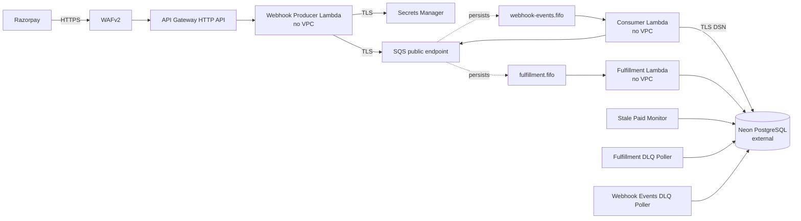
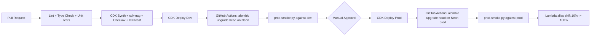

# AWS Migration Architecture: Razorpay Payment Integration (Stage 0)

Target-state architecture and phased migration plan for the multi-tenant Razorpay Payment Integration Layer. Implementable via AWS CDK (Python), aligned with the existing `infra/stacks/{foundation.py, payments.py}` layout.

Source of truth: `designs/DESIGN_v6.md`. Strategy and rationale: `designs/MIGRATION_WRITEUP.md`.

This document describes **Stage 0 (Bootstrap)**: the minimum-cost production footprint that ships today. Stage 1, Stage 2, Stage 3 upgrade paths are documented in the writeup.

---

## Stack Boundary Contract (Binding)

| Stack | Owns | Does NOT own |
|---|---|---|
| **`foundation.py`** | KMS CMKs, IAM (account-local) users + roles, CloudTrail (with Object Lock S3 bucket), AWS Config, GuardDuty, Security Hub, Inspector, Route 53 hosted zone, ACM certs, base tagging aspect, ECR repos, ops SNS topics, Budgets, Cost Anomaly Detection, security CloudWatch alarms (SCP substitutes) | Application compute, queues, app secrets, dashboards, WAF |
| **`payments.py`** | SQS queues + DLQs, Lambda functions, API Gateway HTTP API, Secrets Manager entries, WAF web ACL, CloudFront + S3 for widget, CloudWatch dashboards and alarms, EventBridge rules, log-archive S3 with Object Lock | KMS root keys, audit services, hosted zone |

**At Stage 0 the foundation stack provisions no VPC.** VPC + PrivateLink endpoints are added at Stage 2.

---

## Region and Account Strategy

- **Primary region:** `ap-south-1` (Mumbai). Closest to Razorpay infra and Indian customers.
- **DR region:** None at Stage 0. Stage 3 provisions warm standby in `ap-southeast-1`.
- **us-east-1:** Used only for ACM certificates fronting CloudFront (the widget CDN).

---

## Pillar 1: Account Foundation, Governance, Multi-Environment Strategy

### 1.1 Account Model: Two Standalone Accounts, No Organizations

```
razorpay-dev   AWS account   (all dev resources, including local CloudTrail + audit)
razorpay-prod  AWS account   (all prod resources, including local CloudTrail + audit)
```

Two independent AWS accounts. No AWS Organizations. No Management account. Single operator (Akhil) is the only user. Rationale and tradeoffs documented in `MIGRATION_WRITEUP.md` §6.

| Account | Purpose | What runs there |
|---|---|---|
| **Dev** | All dev infrastructure | Lambdas, SQS, ECR, KMS, Secrets, CloudTrail-to-local-S3 (with Object Lock), GuardDuty, Security Hub, Config |
| **Prod** | All prod infrastructure | Same shape as dev |

### 1.2 Root User Hardening (Each Account, Identical)

| Action | Setting |
|---|---|
| MFA on root | Hardware key or virtual authenticator. Mandatory. |
| Root access keys | None. Delete if present. |
| Alternate contacts | Security, Billing, Operations all set to monitored mailbox |
| Account-level password policy | 14-char min, 90-day rotation, prevent reuse 24 |
| Root usage alarm | CloudTrail `AssumeRoleByRoot` -> SNS page |

### 1.3 Per-Account Hardening (SCP Substitute)

Without AWS Organizations we cannot use Service Control Policies. The substitute is per-account configuration plus CloudWatch alarms that fire if anyone attempts a dangerous action.

**CloudWatch metric filters on the local CloudTrail log group**, in each account:

| Filter pattern (CloudTrail event) | Alarm action |
|---|---|
| `cloudtrail:StopLogging`, `cloudtrail:DeleteTrail` | Page |
| `config:DeleteConfigurationRecorder`, `config:StopConfigurationRecorder`, `config:DeleteDeliveryChannel` | Page |
| `guardduty:Delete*`, `guardduty:Disassociate*` | Page |
| `securityhub:Disable*`, `securityhub:Delete*` | Page |
| `s3:DeleteBucketPolicy` on CloudTrail or log-archive bucket | Page |
| `s3:PutBucketObjectLockConfiguration` (any change after initial setup) | Page |
| `iam:CreateAccessKey`, `iam:CreateLoginProfile` on any IAM user | Warn |
| Any API call from `arn:aws:iam::*:root` | Page |
| Any API call outside `ap-south-1`, `ap-southeast-1`, `us-east-1` | Warn |

These detect the action after it happens (whereas SCPs prevent it from happening). Less powerful but adequate at single-operator scale. If the team grows to two operators, migrate both accounts into an AWS Organization and convert these filters to real SCPs (one-day operation).

**Account-level IAM password policy (each account):**

```json
{
  "MinimumPasswordLength": 14,
  "RequireSymbols": true,
  "RequireNumbers": true,
  "RequireUppercaseCharacters": true,
  "RequireLowercaseCharacters": true,
  "MaxPasswordAge": 90,
  "PasswordReusePrevention": 24,
  "HardExpiry": false
}
```

### 1.4 Operator Authentication (No Identity Center)

Single operator, two accounts. The auth model:

| Use case | Mechanism |
|---|---|
| Daily AWS Console access | Per-account IAM user (`admin-dev`, `admin-prod`) with `AdministratorAccess` policy attached. MFA enforced via IAM policy condition. |
| AWS CLI access | Named profiles (`razorpay-dev`, `razorpay-prod`) configured with the IAM user's access key, then `aws sts get-session-token --serial-number <mfa-arn> --token-code <otp>` for short-lived MFA-enforced credentials. |
| GitHub Actions deploys | OIDC trust per account, no long-lived keys. Same as before. |
| Breakglass | Root user login with MFA, used only when IAM is broken. CloudWatch alarm fires immediately on any root API call. |

The IAM user pattern is anti-best-practice in larger orgs but is the simplest secure path at single-operator scale without Identity Center. When the team grows beyond one person, migrate both accounts into an AWS Organization and roll out IAM Identity Center (one-day operation).

Each IAM user has an attached policy with `Condition` requiring MFA:

```json
{
  "Version": "2012-10-17",
  "Statement": [
    {
      "Sid": "DenyAllExceptListedIfNoMFA",
      "Effect": "Deny",
      "NotAction": [
        "iam:ChangePassword", "iam:CreateVirtualMFADevice",
        "iam:EnableMFADevice", "iam:GetUser", "iam:ListMFADevices",
        "iam:ListVirtualMFADevices", "iam:ResyncMFADevice",
        "sts:GetSessionToken"
      ],
      "Resource": "*",
      "Condition": { "BoolIfExists": { "aws:MultiFactorAuthPresent": "false" } }
    }
  ]
}
```

### 1.5 Tagging Standard

| Tag Key | Allowed Values |
|---|---|
| `Environment` | `dev`, `prod` |
| `Service` | `razorpay-checkout` |
| `Owner` | `akhil@<domain>` or team alias |
| `CostCenter` | `payments-platform` |
| `ManagedBy` | `cdk` |
| `DataClassification` | `pii`, `payment`, `internal` |

Enforced via CDK Aspect that fails synth on missing tags.

### 1.6 Financial Safeguards (per workload account)

| Control | Threshold | Action |
|---|---|---|
| AWS Budget: monthly actual | 50%, 80%, 100% | Email, Slack, Page |
| AWS Budget: forecasted | 100% | Email + Slack |
| AWS Free Tier alert | 80% of any limit | Email |
| Cost Anomaly Detection | Per-service monitor on Lambda, SQS, Secrets, KMS | Anomaly > $5/day -> SNS |

**Budget ceilings:** dev $50/mo, prod $150/mo at 10k tx/mo. Triggers a re-evaluation at 20% over.

### 1.7 Service Quota Pre-Raises

At Stage 0, defaults are sufficient. No pre-raises needed. Service quotas to re-evaluate at Stage 2:

| Quota | Default | Note |
|---|---|---|
| Lambda concurrent executions (regional) | 1,000 | Keep at Stage 0; raise at Stage 2 if burst patterns require |
| Secrets Manager `GetSecretValue` per second | 5,000 | Default fine; we're at ~8 RPS peak |

---

## Pillar 2: Network Topology and Edge Security (Stage 0)

### 2.1 No VPC at Stage 0

All six Lambdas run with default Lambda networking (public egress). Per `DESIGN_v6.md` §11 "Free Track posture":

> All Lambdas run with default Lambda networking (public egress). Postgres lives on Neon, reachable over the public internet with TLS. SQS is reached over the same path. The security perimeter is the IAM scope per Lambda plus TLS in transit plus credentials in SSM Parameter Store SecureString, not network isolation.

**No VPC. No NAT Gateway. No PrivateLink endpoints. No RDS Proxy.** Network cost: $0.

### 2.2 Topology Diagram



### 2.3 Edge Ingress for Webhook

API Gateway HTTP API in front of the Producer. Stage: `$default`. Route: `POST /payments/webhook/{tenant_id}` integrated to Producer Lambda via AWS proxy integration. Throttling: 100 RPS sustained, 200 burst per route. Custom domain `api.razorpay-checkout.<root-domain>` with regional ACM cert. Access logging to CloudWatch with redacted payload.

**Decision: API Gateway HTTP API over CloudFront-fronted Function URL.** Lower latency overhead matters at the 500 ms SLA budget.

| Dimension | API Gateway HTTP API | Lambda Function URL + CloudFront |
|---|---|---|
| Cost per 1M requests | $1.00 | Function URL free + CloudFront $0.085/10k requests |
| WAFv2 integration | Native | Only via CloudFront |
| Custom domain | Native, ACM regional | Via CloudFront only |
| Latency overhead | ~10 ms p50, ~25 ms p99 | ~50 ms (CloudFront) + ~5 ms (Function URL) |
| 500 ms Razorpay SLA | Comfortable | Tight with CloudFront in path |

### 2.4 WAF Web ACL

Attached to the API Gateway HTTP API stage.

| Rule | Priority | Action |
|---|---|---|
| `AWSManagedRulesAmazonIpReputationList` | 10 | Block |
| `AWSManagedRulesKnownBadInputsRuleSet` | 20 | Block |
| `AWSManagedRulesCommonRuleSet` | 30 | Block (excl. `SizeRestrictions_BODY` for 32 KB webhooks) |
| `RazorpayIPAllowList` (custom IPSet) | 40 | Allow + count for audit |
| `RateLimitPerIP` | 50 | Block; 500 reqs / 5 min per source IP |
| `GeoMatch_AllowIN_SG_US` | 60 | Allow; else Block |

Razorpay IP allow-list rotation: monthly runbook check + alarm on `WAFAllowedRequestsByRule=0` for 10 min on the Razorpay rule.

### 2.5 DNS and TLS

| Hosted zone | Account | Records |
|---|---|---|
| `razorpay-checkout.<root-domain>` | Prod | `api.razorpay-checkout.<root-domain>` -> API Gateway custom domain; `widget.razorpay-checkout.<root-domain>` -> CloudFront |
| `dev.razorpay-checkout.<root-domain>` | Dev | `api.dev.razorpay-checkout.<root-domain>` -> dev API Gateway |

ACM certs (DNS validation, automatic renewal):

| Cert | Region | Use |
|---|---|---|
| `*.razorpay-checkout.<root-domain>` | `ap-south-1` | API Gateway prod |
| `*.dev.razorpay-checkout.<root-domain>` | `ap-south-1` | API Gateway dev |
| `*.razorpay-checkout.<root-domain>` | `us-east-1` | CloudFront widget distribution |

Custom domain ownership is Assumption #4.

### 2.6 Security Posture Summary

At Stage 0:

- Producer is public-facing (it must be; Razorpay calls it) but has no DB credentials.
- Consumer, Fulfillment, three Monitors are non-VPC Lambdas but with scoped IAM per function.
- All AWS API calls happen over public TLS endpoints.
- Neon connection is over public TLS.
- Trade accepted per `DESIGN_v6.md` §11: a compromised non-Producer Lambda could exfiltrate. Mitigated by IAM scope and log redaction.

### 2.7 What Adds in Stage 2

Stage 2 introduces a full VPC topology with PrivateLink endpoints. The Stage 0 architecture is intentionally absent of this. See `MIGRATION_WRITEUP.md` §15.2 for the upgrade playbook.

---

## Pillar 3: Encryption and Key Management

### 3.1 KMS Key Inventory (per environment)

Five customer-managed CMKs per workload account.

| Key alias | Purpose | Encrypts |
|---|---|---|
| `alias/razorpay-checkout/{env}/secrets` | Secrets | All Secrets Manager values |
| `alias/razorpay-checkout/{env}/sqs` | Queues | SQS at-rest message bodies |
| `alias/razorpay-checkout/{env}/s3-artifacts` | S3 | Widget bucket, log archive bucket, CloudTrail bucket |
| `alias/razorpay-checkout/{env}/cloudwatch-logs` | Logs | Per-Lambda log groups |
| `alias/razorpay-checkout/{env}/db` | DB (reserved for Stage 2) | Aurora storage when we migrate |

Five keys × two envs × $1/mo = $10/mo. The `db` key is created at Stage 0 but unused; this is intentional so the explicit `Deny` patterns and key policies are already in place.

### 3.2 Key Policies: Producer Cannot Touch the DB Key

```json
{
  "Sid": "AllowConsumerFulfillmentDecrypt",
  "Effect": "Allow",
  "Principal": { "AWS": [
    "arn:aws:iam::<acct>:role/razorpay-{env}-consumer",
    "arn:aws:iam::<acct>:role/razorpay-{env}-fulfillment",
    "arn:aws:iam::<acct>:role/razorpay-{env}-fulfillment-dlq-poller",
    "arn:aws:iam::<acct>:role/razorpay-{env}-webhook-events-dlq-poller",
    "arn:aws:iam::<acct>:role/razorpay-{env}-stale-paid-monitor"
  ]},
  "Action": ["kms:Decrypt", "kms:GenerateDataKey", "kms:DescribeKey"],
  "Resource": "*"
},
{
  "Sid": "ExplicitDenyProducer",
  "Effect": "Deny",
  "Principal": { "AWS": "arn:aws:iam::<acct>:role/razorpay-{env}-producer" },
  "Action": "kms:*",
  "Resource": "*"
}
```

Applied to the `db` and `s3-artifacts` keys. The Producer can decrypt `secrets` and `sqs` only.

### 3.3 Rotation

Annual automatic rotation on all five CMKs (`enable_key_rotation=True`). Application code never references a key version.

Secrets Manager rotation for DB credentials: at Stage 0 not configured (Neon-managed credentials; we set them manually). At Stage 2 it becomes quarterly via the AWS-managed rotation Lambda.

### 3.4 At-Rest Encryption

| Resource | Mechanism |
|---|---|
| Neon storage | Managed by Neon |
| SQS message bodies | SSE-KMS with `sqs` CMK, data-key cache 5 min |
| Secrets Manager values | SSE-KMS with `secrets` CMK |
| S3 widget bucket | Default encryption SSE-KMS with `s3-artifacts` CMK |
| S3 log archive bucket | Default encryption SSE-KMS with `s3-artifacts` CMK, **Object Lock compliance mode, 7-year retention** |
| S3 CloudTrail bucket | Default encryption SSE-KMS with `s3-artifacts` CMK, **Object Lock compliance mode, 7-year retention** |
| CloudWatch Log groups | KMS encryption with `cloudwatch-logs` CMK |

**Object Lock on the audit-relevant buckets is mandatory at Stage 0.** It substitutes for the separate Audit account that the full SRA pattern would provide. Enable on day one; AWS does not allow enabling it on an existing bucket.

### 3.5 Secrets Bootstrap Procedure

1. CDK creates Secrets Manager entries with placeholder values `{"placeholder": true}`.
2. Operator SSO logs in (MFA required), runs `aws secretsmanager put-secret-value` from a tmpfs path on their workstation.
3. Lambda cold start checks the value; fails closed with 503 if it sees the placeholder.

---

## Pillar 4: Persistent Data Layer (Stage 0: Neon)

### 4.1 Engine Choice: Neon

**Decision: Neon PostgreSQL.** Third-party managed Postgres, public-internet reachable with TLS, free tier covers Stage 0.

| Dimension | Neon free tier | RDS PostgreSQL (Stage 2) | Aurora Serverless v2 (Stage 2) |
|---|---|---|---|
| Idle cost | $0 | ~$25/mo `db.t4g.small` | ~$43/mo at 0.5 ACU floor |
| Free tier | 0.5 GB storage, 100 compute hours/mo | None | None |
| Connection pooling | Native (PgBouncer mode) | None (need RDS Proxy +$15/mo) | None (need RDS Proxy +$15/mo) |
| PITR | 7 days on free, 30 on paid | Configurable | Configurable |
| `pgcrypto`, PL/pgSQL | Native | Native | Native |
| Compatible with asyncpg | Yes | Yes | Yes |
| Branching for dev | Native (one click) | No | No |
| Public-internet TLS | Yes (default) | Optional | Optional |

PostgreSQL 16 throughout. Same schema works on any Postgres 14+; migration to Stage 2 is `pg_dump` / `pg_restore`.

### 4.2 No RDS Proxy at Stage 0

Neon's built-in PgBouncer-mode pooler handles connection multiplexing. The DSN in Secrets Manager points at the pooled endpoint (`...pooler.<region>.aws.neon.tech`).

**asyncpg pool sizing at Stage 0:**

| Setting | Value | Reason |
|---|---|---|
| `pool_min_size` | 1 | One persistent connection per Lambda is enough |
| `pool_max_size` | 5 | Headroom for burst; Neon pooler multiplexes underneath |

### 4.3 High Availability

| Environment | Topology | Failover RTO |
|---|---|---|
| Dev | Neon free tier, single project | Manual via Neon console |
| Prod | Neon free tier (or Launch from Stage 1), single project | Manual via Neon console, ~5 min |

Stage 0 accepts manual failover for both environments. Stage 2 (Aurora Multi-AZ) introduces automatic failover.

### 4.4 Backups and DR

| Setting | Stage 0 (Neon free) | Stage 1 (Neon Launch) |
|---|---|---|
| PITR retention | 7 days, 1-second granularity | 30 days |
| Cross-region backup | Weekly `pg_dump` to S3 (Glacier IR after 30 days) | Same, plus Neon's geo-redundancy |
| Pre-migration manual snapshot | Required before any Alembic upgrade | Required |

### 4.5 Disaster Recovery (Stage 0)

**Posture: Pilot light via Neon PITR + weekly S3 dump.**

| Metric | Stage 0 target | Mechanism |
|---|---|---|
| RPO | 5 minutes | Neon PITR 1-second granularity |
| RTO | 4 hours | Restore via Neon console; if Neon is down, restore S3 dump to a fresh Neon project or to RDS-as-emergency in Stage 2 mode |
| Drill cadence | Quarterly | Restore to a Neon branch + smoke test |

### 4.6 Extension Provisioning

`pgcrypto` is created by Alembic migration `0002_orders.py` via `op.execute("CREATE EXTENSION IF NOT EXISTS pgcrypto")`. Neon's default trusted extension list includes pgcrypto; no parameter group changes required.

PL/pgSQL is enabled by default. The `set_updated_at()` trigger function and `orders_updated_at` trigger are created in migration `0002`.

### 4.7 Read-Only Database Role (New Alembic Migration)

The DLQ pollers and Stale Paid Monitor connect with a `razorpay_ro` role that has `SELECT` only. Added in `0008_create_readonly_role.py` before Phase 4:

```python
def upgrade():
    op.execute("""
        CREATE ROLE razorpay_ro;
        GRANT CONNECT ON DATABASE razorpay_checkout TO razorpay_ro;
        GRANT USAGE ON SCHEMA public TO razorpay_ro;
        GRANT SELECT ON ALL TABLES IN SCHEMA public TO razorpay_ro;
        ALTER DEFAULT PRIVILEGES IN SCHEMA public GRANT SELECT ON TABLES TO razorpay_ro;
    """)
```

Two DSN values in Secrets Manager: `db/credentials` (read-write, `razorpay_app` user) and `db/credentials-readonly` (read-only, `razorpay_ro` user).

### 4.8 Alembic Migration Strategy

**Decision at Stage 0: GitHub Actions runs Alembic directly.**

| Stage | Where migrations run | Why |
|---|---|---|
| **Stage 0** | GitHub Actions runner | Neon is public-internet reachable; runner can hit it directly via DSN. Simpler and faster. |
| Stage 2 | CodeBuild project in VPC | Aurora is in a VPC; runner must be too. |

The GitHub Actions migration job:

1. Assumes a tightly-scoped AWS role via OIDC.
2. Reads the DB DSN from Secrets Manager (`db/credentials`).
3. Runs `uv run alembic upgrade head` against Neon over TLS.
4. On failure: auto-execute `alembic downgrade -1`.

### 4.9 Connection Budget Math (Stage 0)

At 200 burst EPS with 30 reserved concurrency on Consumer + 30 on Fulfillment + 5 each on three Monitors = 75 concurrent Lambdas.

```
75 Lambdas × pool_max_size=5 = 375 client connections to Neon pooler
```

Neon free tier supports 100+ concurrent connections to its pooler; bursting above that returns "too many clients" briefly but the pooler waits-then-serves. At 50 sustained EPS, actual concurrent transactions are ~10-15 simultaneous. Comfortable.

When Stage 1 upgrade triggers fire, Neon Launch plan raises the connection pool ceiling.

---

## Pillar 5: Configuration and Secrets

### 5.1 Store Choice and Split

| Store | Used for | Why |
|---|---|---|
| **Secrets Manager** | Tenant Razorpay creds, DB credentials (read-write), DB credentials-readonly | Rotation hooks, audit, KMS at-rest, fine IAM |
| **SSM Parameter Store (Standard)** | Region, queue URLs, feature flags, OTel exporter, Neon endpoint hint | Free, no rotation needed, simpler IAM |

Standard SSM is free up to 10k parameters.

### 5.2 Secret Naming Convention

| Pattern | Example |
|---|---|
| Tenant Razorpay creds | `/razorpay-checkout/{env}/tenant/{tenant_id}/razorpay` |
| DB credentials (read-write) | `/razorpay-checkout/{env}/db/credentials` |
| DB credentials (read-only) | `/razorpay-checkout/{env}/db/credentials-readonly` |
| SSM config | `/razorpay-checkout/{env}/config/{key}` |
| Razorpay IP allow-list | `/razorpay-checkout/shared/config/razorpay-ips` |

IAM policies use `arn:aws:secretsmanager:ap-south-1:<acct>:secret:/razorpay-checkout/{env}/tenant/*/razorpay-*` to grant per-tenant access. Trailing `-*` matches the random suffix.

### 5.3 TenantConfigRegistry Retrieval Pattern

| Setting | Value | Reason |
|---|---|---|
| In-Lambda cache TTL | 300 s | Balance staleness on rotation vs API rate |
| Cache implementation | `cachetools.TTLCache(maxsize=128, ttl=300)` | 2 tenants today; oversized cache for safety, no cost impact |
| On cache miss | Synchronous `GetSecretValue` | Adds ~30-50 ms to first request per tenant per warm window |
| On Secrets Manager throttle | Exponential backoff 100ms / 200ms / 400ms, max 3 retries, then 503 | Razorpay will retry |

**API rate math at peak:** 2 tenants × 50 Lambda instances / 300s = ~0.33 RPS. Trivially under 5,000 RPS quota. The operator runs two of their own websites; tenant count is fixed at 2 with no planned growth.

### 5.4 Rotation

| Secret | Cadence | Mechanism |
|---|---|---|
| Tenant Razorpay creds | Manual, on Razorpay incident | Runbook: `aws secretsmanager put-secret-value` |
| DB credentials (Stage 0) | Manual (Neon password) | Rotate in Neon dashboard, then update Secret value |
| DB credentials (Stage 2) | Quarterly | AWS-managed rotation Lambda |

### 5.5 Per-Lambda Least-Privilege IAM Matrix (Stage 0)

| Lambda | Secrets Manager | KMS | SQS | Database (Neon, via DSN from secret) | SNS | CloudWatch Logs | X-Ray |
|---|---|---|---|---|---|---|---|
| **Webhook Producer** | `GetSecretValue` on `tenant/*/razorpay-*`. **Explicit `Deny`** on `db/credentials-*`. | `Decrypt` on `secrets` and `sqs` CMKs. **Deny** on `db` and `s3-artifacts` CMKs. | `SendMessage`, `GetQueueUrl`, `GetQueueAttributes` on `webhook-events.fifo`. No receive, no DLQ. | None (no DB access at any stage). | None. | Create/Put own log group. | Put trace/metric. |
| **Webhook Consumer** | `GetSecretValue` on `tenant/*/razorpay-*` and `db/credentials-*`. | `Decrypt` on `secrets`, `sqs`, (future `db`) CMKs. | Receive/Delete/ChangeVisibility/GetAttributes on `webhook-events.fifo`. SendMessage on `fulfillment.fifo`. **No DLQ access.** | Connect via DSN from `db/credentials` secret. | None. | Own log group. | Put. |
| **Fulfillment** | Same as Consumer. | Same as Consumer. | Receive/Delete/ChangeVisibility/GetAttributes on `fulfillment.fifo`. **No publish anywhere.** | Connect via DSN from `db/credentials`. | None (until tenant hook needs it; Assumption #3). | Own log group. | Put. |
| **Fulfillment DLQ Poller** | `GetSecretValue` on `db/credentials-readonly-*` only. | `Decrypt` on `secrets`, `sqs`, `db` CMKs. | Receive/Delete/GetAttributes on `fulfillment-dlq.fifo`. No re-drive. | Connect via DSN from `db/credentials-readonly`. | `Publish` to ops topic. | Own log group. | Put. |
| **Webhook Events DLQ Poller** | Same. | Same. | Receive/Delete/GetAttributes on `webhook-events-dlq.fifo`. No re-drive. | Same (read-only). | `Publish` to ops topic. | Own log group. | Put. |
| **Stale Paid Monitor** | `GetSecretValue` on `db/credentials-readonly-*` only. **Explicit `Deny`** on `tenant/*/razorpay-*`. | `Decrypt` on `secrets`, `db` CMKs. **Deny** on `sqs` CMK. | None. | Same (read-only). | `Publish` to ops topic. | Own log group. | Put. |

**No VPC ENI permissions at Stage 0.** They are added at Stage 2 to all five non-Producer Lambdas.

**No `rds-db:connect` at Stage 0.** Lambdas authenticate to Neon via the DSN (host + user + password) loaded from Secrets Manager. `rds-db:connect` is a Stage 2 thing for IAM-authenticated RDS Proxy.

### 5.6 Permissions Boundary

Attached to every Lambda execution role:

```json
{
  "Version": "2012-10-17",
  "Statement": [
    {
      "Sid": "AllowOnlyOurServices",
      "Effect": "Allow",
      "Action": [
        "secretsmanager:GetSecretValue", "secretsmanager:DescribeSecret",
        "kms:Decrypt", "kms:GenerateDataKey", "kms:DescribeKey",
        "sqs:SendMessage", "sqs:ReceiveMessage", "sqs:DeleteMessage",
        "sqs:ChangeMessageVisibility", "sqs:GetQueueUrl", "sqs:GetQueueAttributes",
        "sns:Publish",
        "logs:CreateLogStream", "logs:PutLogEvents", "logs:CreateLogGroup",
        "logs:DescribeLogGroups", "logs:DescribeLogStreams",
        "xray:PutTraceSegments", "xray:PutTelemetryRecords",
        "cloudwatch:PutMetricData",
        "ssm:GetParameter", "ssm:GetParameters", "ssm:GetParametersByPath"
      ],
      "Resource": "*"
    },
    {
      "Sid": "DenyDangerous",
      "Effect": "Deny",
      "Action": [
        "iam:*", "kms:ScheduleKeyDeletion", "kms:Disable*", "kms:Delete*",
        "lambda:UpdateFunctionCode", "lambda:UpdateFunctionConfiguration",
        "lambda:DeleteFunction", "lambda:InvokeFunction",
        "secretsmanager:DeleteSecret", "secretsmanager:PutSecretValue",
        "secretsmanager:UpdateSecret",
        "rds:Delete*", "rds:Stop*", "rds:Modify*",
        "s3:DeleteBucket", "s3:PutBucketPolicy",
        "sts:AssumeRole"
      ],
      "Resource": "*"
    }
  ]
}
```

The boundary's `Allow` set is narrower at Stage 0 than at Stage 2: notably, `rds-db:connect`, `ec2:CreateNetworkInterface`, and similar VPC permissions are absent. They are added when we graduate.

---

## Pillar 6: Serverless Compute, Messaging, Frontend Distribution

### 6.1 Lambda Configuration (Stage 0)

| Function | Memory | Timeout | Reserved Concurrency | Provisioned Concurrency | VPC | Layers |
|---|---|---|---|---|---|---|
| **Webhook Producer** | 512 MB | 10 s | 50 | 2 (prod), 0 (dev) | NO | None (container image) |
| **Webhook Consumer** | 768 MB | 60 s | 30 | 0 | **NO** | None |
| **Fulfillment** | 768 MB | 60 s | 30 | 0 | **NO** | None |
| **Fulfillment DLQ Poller** | 256 MB | 30 s | 5 | 0 | **NO** | None |
| **Webhook Events DLQ Poller** | 256 MB | 30 s | 5 | 0 | **NO** | None |
| **Stale Paid Monitor** | 256 MB | 30 s | 5 | 0 | **NO** | None |

Rationale unchanged from the design; only the VPC column flips at Stage 2.

### 6.2 SQS FIFO Queues

| Queue | Visibility Timeout | Retention | Receive Wait | MaxReceiveCount | Content-Based Dedup | High Throughput Mode |
|---|---|---|---|---|---|---|
| `webhook-events.fifo` | 180 s | 4 days | 20 s | 5 | True + `MessageDeduplicationId={tenant_id}:{event_id}` | True |
| `webhook-events-dlq.fifo` | 30 s | 14 days | 20 s | n/a | True | False |
| `fulfillment.fifo` | 180 s | 4 days | 20 s | 5 | True + `MessageDeduplicationId={order_id}:{razorpay_payment_id}` | True |
| `fulfillment-dlq.fifo` | 30 s | 14 days | 20 s | n/a | True | False |

### 6.3 Event Source Mapping

| Field | Value | Reason |
|---|---|---|
| `batch_size` | 1 | FIFO + per-order ordering |
| `max_batching_window` | 0 s | FIFO does not batch across `MessageGroupId` |
| `report_batch_item_failures` | True | Handler classifies events as `done`/`failed`/`dead` |
| `max_concurrency` | 30 (Consumer/Fulfillment), 5 (DLQ pollers) | Caps SQS-driven scale-out per queue |

### 6.4 Cold-Start Mitigation

| Function | Strategy |
|---|---|
| **Webhook Producer (prod)** | Provisioned Concurrency = 2; absorbs cold starts within 500 ms SLA |
| **Webhook Producer (dev)** | None; SLA is informational |
| **Consumer / Fulfillment / Monitors** | None at Stage 0. Cold starts (~200-400ms non-VPC) absorbed by SQS. At Stage 2 cold starts grow to ~1-2s due to ENI attach; still absorbed by SQS. |

### 6.5 Frontend Widget Distribution

| Resource | Setting |
|---|---|
| S3 bucket | `razorpay-checkout-{env}-widget-<acct-id>`; versioning enabled; SSE-KMS with `s3-artifacts` CMK; block public access on |
| CloudFront distribution | OAC to the bucket; HTTPS only; HTTP/2 + HTTP/3; minimum TLS 1.2 |
| Path strategy | `/v{major}/widget.js` for major; `/v{major}.{minor}.{patch}/widget.js` for exact pins |
| Cache | `Cache-Control: public, max-age=31536000, immutable` on versioned paths |
| Invalidation | CDK-managed `s3deploy` on release; invalidation only on `/latest` alias |
| CORS allow-list | Tenant origins from SSM parameter `/razorpay-checkout/{env}/config/widget-cors-origins` rendered into CloudFront Response Headers Policy |
| SRI hash | Computed on build, published as `widget.js.sri`; widget docs include `integrity` attribute |

### 6.6 Tenant Onboarding Operational Flow

Semi-automated CLI tool `scripts/onboard-tenant.py`:

```bash
python scripts/onboard-tenant.py \
    --env prod \
    --tenant-id acme_corp \
    --name "Acme Corp" \
    --razorpay-key-id rzp_live_xxxxxxxx \
    --razorpay-secret-file ~/secure/acme.txt \
    --webhook-secret-file ~/secure/acme_webhook.txt \
    --tenant-origin https://acme.com
```

Steps performed:

1. `aws secretsmanager create-secret` for tenant's Razorpay creds.
2. INSERT into `tenants` table (Neon via Lambda-triggered helper or direct DSN with operator credentials).
3. Update SSM parameter `widget-cors-origins`.
4. CloudFront invalidation for `/latest/widget.js`.
5. Run `scripts/prod-smoke.py --tenant acme_corp`.

Manual gates: MFA-fresh SSO; secret files on tmpfs; runs from operator workstation, not CI.

---

## Pillar 7: Observability, Audit, Compliance

### 7.1 CloudWatch Logs

One log group per Lambda: `/aws/lambda/razorpay-{env}-{function-name}`. Retention 30 days hot. Encrypted with `cloudwatch-logs` CMK. Subscription filter forwards to a Firehose delivery stream that writes to S3 (`s3-artifacts` CMK, **Object Lock compliance mode**).

Lifecycle on the log archive bucket:

| Age | Storage class |
|---|---|
| 0-90 days | Standard-IA |
| 90-365 days | Glacier Instant Retrieval |
| 365+ days | Glacier Deep Archive |

### 7.2 Log Redaction

Structlog redaction processor (DESIGN_v6 §17.9) covers `key_secret` and `webhook_secret`. Backstop: CloudWatch Logs metric filter `RazorpayCheckoutSecretLeakage` with pattern `?key_secret ?webhook_secret rzp_live_ rzp_test_`. Alarm on count >0.

### 7.3 OTel and Metrics

ADOT Collector as a Lambda layer (`arn:aws:lambda:ap-south-1:901920570463:layer:aws-otel-python-amd64-ver-1-25-0:1`, verify latest at deploy time).

Env: `AWS_LAMBDA_EXEC_WRAPPER=/opt/otel-instrument`, `OPENTELEMETRY_COLLECTOR_CONFIG_FILE=/var/task/otel-config.yaml`.

`RAZORPAY_OTEL_EXPORTER=xray` in prod, `stdout` in dev.

### 7.4 Alarms

| Source metric | Threshold | Evaluation | SNS topic |
|---|---|---|---|
| `webhook-events-dlq.fifo` `ApproximateNumberOfMessagesVisible` | > 0 for 5 min | 1 of 1 | `razorpay-{env}-ops-page` |
| `fulfillment-dlq.fifo` `ApproximateNumberOfMessagesVisible` | > 0 for 5 min | 1 of 1 | page |
| `RazorpayCheckout/{env}/webhook_latency_ms` p95 | > 400 ms for 10 min | 2 of 2 | warn |
| `RazorpayCheckout/{env}/webhook_latency_ms` p95 | > 500 ms for 5 min | 1 of 1 | page |
| `RazorpayCheckout/{env}/fulfillment_duration_ms` failure-rate | > 1% over 15 min | 3 of 3 | page |
| Stale paid orders (custom metric) | > 0 | 1 of 1 | page |
| Lambda `ConcurrentExecutions` per function | > 80% of reserved | 3 of 3 (5 min) | warn |
| Secrets Manager `ThrottledCount` | > 0 | 1 of 1 (5 min) | warn |
| `RazorpayCheckoutSecretLeakage` log filter | > 0 | 1 of 1 | page |
| CloudTrail `RootApiCall` event | > 0 | 1 of 1 | page |
| `AssumeRoleByBreakGlass` event | > 0 | 1 of 1 | page |
| Neon connection failure rate (custom log filter) | > 0 over 5 min | 1 of 1 | page |
| `WAFAllowedRequestsByRule` for Razorpay IP rule | = 0 for 10 min | 1 of 1 | warn (likely Razorpay IP rotation) |

Two SNS topics per env: page (PagerDuty), warn (Slack via Chatbot).

### 7.5 Audit and Compliance (Foundation Stack)

| Service | Location | Configuration |
|---|---|---|
| **CloudTrail** | Each workload account | S3 bucket in same account with Object Lock; multi-region trail; file validation; KMS encryption with `s3-artifacts` CMK |
| **AWS Config** | Each workload account | Managed rules (full list below) |
| **GuardDuty** | Each workload account | S3 Protection + Malware Protection |
| **Security Hub** | Each workload account | Standards: AWS Foundational Security Best Practices, PCI DSS v3.2.1 (informational), CIS AWS Foundations Benchmark v1.4.0 |
| **Inspector** | Each workload account | Lambda function scanning |

**No cross-account aggregation at Stage 0** (no separate Audit account). Workload account holds its own audit data; Object Lock on the buckets prevents tampering.

AWS Config managed rules (mandatory list):

| Rule | Severity |
|---|---|
| `encrypted-volumes` | High |
| `rds-storage-encrypted` (Stage 2) | High |
| `secretsmanager-rotation-enabled-check` | Medium (DB creds only) |
| `secretsmanager-using-cmk` | High |
| `lambda-function-public-access-prohibited` | Critical |
| `lambda-function-settings-check` | Medium |
| `s3-bucket-public-access-prohibited` | Critical |
| `s3-bucket-ssl-requests-only` | High |
| `s3-bucket-versioning-enabled` | Medium |
| `s3-bucket-server-side-encryption-enabled` | High |
| `s3-bucket-logging-enabled` | Medium |
| `s3-bucket-default-lock-enabled` | High (CloudTrail + log archive buckets) |
| `iam-no-inline-policy-check` | Medium |
| `iam-policy-no-statements-with-admin-access` | Critical |
| `iam-user-mfa-enabled` | Critical |
| `mfa-enabled-for-iam-console-access` | Critical |
| `root-account-mfa-enabled` | Critical |
| `cloudtrail-enabled` | Critical |
| `cloudtrail-log-file-validation-enabled` | High |
| `cloud-trail-encryption-enabled` | High |
| `vpc-default-security-group-closed` | High (even with no VPC, AWS creates a default; this asserts it's locked) |
| `kms-cmk-not-scheduled-for-deletion` | Critical |
| `sqs-queue-encrypted` | High |
| `api-gw-execution-logging-enabled` | Medium |
| `acm-certificate-expiration-check` | Medium |

`lambda-inside-vpc` is **excluded** at Stage 0 (we intentionally have no VPC). Re-enabled at Stage 2.

### 7.6 Dashboards

Per-environment CloudWatch dashboard `razorpay-checkout-{env}-mission-control` mirroring `example/frontend/admin-dashboard.html`:

| Widget | Source |
|---|---|
| KPI strip | `order_state_transition_count{to=paid}` today, fulfilled, failed |
| Webhook latency | `webhook_latency_ms` p50/p95/p99 |
| Webhook duplicate rate | `webhook_duplicate_count` / total |
| Queue depth | `ApproximateNumberOfMessagesVisible` per queue + DLQ |
| Consumer duration | `webhook_consumer_duration_ms` p95 |
| Fulfillment duration | `fulfillment_duration_ms` p95 |
| Dead events | `dead_event_count` rolling 24h |
| Reconciliation mismatches | `reconciliation_mismatch_count{reason}` last 7 days |
| Lambda concurrent executions | Per function |
| Cold starts | `cold_start_ms` per function |
| Alarm summary | Composite alarm widget |

---

## Pillar 8: CI/CD and Deployment Orchestration

### 8.1 Tool Choice

**Decision: GitHub Actions with OIDC federation to AWS.** No long-lived AWS keys.

### 8.2 OIDC Trust Policy (per workload account)

```json
{
  "Version": "2012-10-17",
  "Statement": [
    {
      "Effect": "Allow",
      "Principal": { "Federated": "arn:aws:iam::<acct>:oidc-provider/token.actions.githubusercontent.com" },
      "Action": "sts:AssumeRoleWithWebIdentity",
      "Condition": {
        "StringEquals": {
          "token.actions.githubusercontent.com:aud": "sts.amazonaws.com"
        },
        "StringLike": {
          "token.actions.githubusercontent.com:sub": [
            "repo:<gh-org>/razorpay-payment-integration:ref:refs/heads/main",
            "repo:<gh-org>/razorpay-payment-integration:environment:prod"
          ]
        }
      }
    }
  ]
}
```

### 8.3 Pipeline Stages



### 8.4 Alembic Migration Step (Stage 0)

Migrations run **inside GitHub Actions runner** because Neon is reachable from anywhere over TLS. The workflow:

```yaml
- name: Migrate Neon
  env:
    AWS_REGION: ap-south-1
  run: |
    DSN=$(aws secretsmanager get-secret-value --secret-id /razorpay-checkout/${ENV}/db/credentials --query SecretString --output text | jq -r .dsn)
    cd razorpay_checkout
    DATABASE_URL="$DSN" uv run alembic upgrade head
```

The GitHub Actions role has `secretsmanager:GetSecretValue` only on the DB credentials secret in its env. No DB write access from anywhere else.

On failure: auto-execute `alembic downgrade -1`. Multi-step downgrade is manual.

### 8.5 Artifact Strategy

| Aspect | Choice |
|---|---|
| Lambda packaging | Container image (matches existing `infra/stacks/foundation.py` ECR repos) |
| Base image | `public.ecr.aws/lambda/python:3.12` (x86_64). **Not ARM64.** Operator dev machines are x86_64; matching the architecture eliminates cross-platform binary build complexity (no QEMU emulation, no separate wheel resolution, identical binaries locally and in AWS). The ~20% Lambda compute discount on Graviton is negligible at Stage 0 since Lambda is mostly within free tier. |
| Dependency lock | `uv.lock` |
| Image tagging | `git-{short-sha}` + `latest` |
| ECR scan | On push + Inspector continuous |
| Image lifecycle | Keep last 10 tagged, expire untagged after 7 days |

### 8.6 CDK Bootstrap

Per workload account:

```bash
npx cdk bootstrap aws://<acct>/ap-south-1 \
    --cloudformation-execution-policies arn:aws:iam::aws:policy/AdministratorAccess \
    --trust <management-acct-id> \
    --trust-for-lookup <management-acct-id>
```

### 8.7 Drift Detection

Scheduled CodeBuild project running `cdk diff --all` daily at 03:00 IST. Non-empty diff publishes to warn SNS topic.

### 8.8 Rollback Strategy

| Layer | Mechanism |
|---|---|
| Lambda code | Alias `live` with weighted routing. Canary 10% for 10 min. Alarm-based auto-rollback. |
| CDK stack | CloudFormation auto-rollback on update failure. |
| Alembic | Auto `downgrade -1` on migration failure in pipeline; manual beyond one step. |
| Catastrophic failure | Revert to previous git tag; restore from Neon PITR if data is corrupt. |

---

## Phased Implementation Matrix (Stage 0)

| Phase | Prerequisites | CDK stacks deployed | Manual steps | Verification gates | Rollback action | Est. hours |
|---|---|---|---|---|---|---|
| **1. Account hardening (each account, identical)** | Both AWS accounts created; root user email + MFA configured | None | For each account: enforce root MFA + delete root access keys; set alternate contacts; configure account password policy; enable CloudTrail to local S3 bucket with Object Lock 7-year; enable AWS Config; enable GuardDuty; enable Security Hub; create CloudWatch metric filters + alarms for the SCP-substitute events listed in Pillar 1.3 | In each account: CloudTrail events flow to S3 with Object Lock; trigger a test `cloudtrail:StopLogging` from CLI and verify alarm fires (then restart logging); GuardDuty + Security Hub `ENABLED` | Disable services per account; remove alarms | 6 |
| **2. IAM user + OIDC per account** | Phase 1 complete | None | In each account: create `admin-{env}` IAM user with `AdministratorAccess` + MFA-enforcement policy; create MFA device; create AWS CLI named profile (`razorpay-dev`, `razorpay-prod`); create GitHub OIDC IdP and per-env GitHub Actions role | `aws sts get-caller-identity --profile razorpay-dev` works (after MFA); GitHub Actions test workflow can `sts:GetCallerIdentity` via OIDC | Delete IAM users; delete OIDC providers | 4 |
| **3. CDK bootstrap + Foundation stack** | Phase 2 | `razorpay-{env}-foundation` in dev + prod | `cdk bootstrap`; ACM cert DNS validation; create Neon projects (one per env), record connection details | Foundation outputs visible; 5 KMS CMKs visible; Security Hub, GuardDuty, Config all `ENABLED`; ACM certs `ISSUED`; CloudTrail bucket has Object Lock | `cdk destroy razorpay-{env}-foundation` | 8 |
| **4. Database + Migrations** | Phase 3; Neon projects created | (none; migration runs via GitHub Actions) | Add `0008_create_readonly_role.py` Alembic migration; populate placeholder DB credentials in Secrets Manager; GitHub Actions runs `alembic upgrade head` against Neon | All Alembic migrations applied; `razorpay_ro` role exists in Neon; tables visible | Drop migrations in Neon; restore from PITR | 6 |
| **5. Secrets bootstrap + tenant seeding** | Phase 4 | (no new stack) | For each initial tenant: `aws secretsmanager put-secret-value`; INSERT into `tenants`; populate SSM config | Producer smoke reads tenant secret successfully; Consumer smoke connects to Neon | Revert secret to placeholder; delete tenant row | 4 |
| **6. Compute + messaging (Lambdas, SQS, APIGW, WAF)** | Phase 5 | `razorpay-{env}-payments` (full) | Subscribe ops emails to SNS topics; configure Razorpay webhook URL pointing at API Gateway custom domain (test mode initially) | All 6 Lambdas deployed; SQS queues created; APIGW returns 400 to unsigned webhook; WAF blocks unauthorized geo | `cdk deploy --rollback`; manually disable APIGW route | 14 |
| **7. Frontend distribution (CloudFront, S3 widget)** | Phase 6 | (extends payments stack) | Upload `widget.js` to versioned S3 path; verify CloudFront serves with correct cache headers | `curl https://widget.razorpay-checkout.<domain>/v1/widget.js` returns 200 with correct SRI | S3 versioning allows revert; CloudFront point at previous version | 6 |
| **8. Observability (dashboards, alarms, Firehose to S3)** | Phase 6 | (extends payments stack) | Subscribe PagerDuty service to page topic; subscribe Slack via Chatbot; configure Inspector for Lambda scan | Trigger test 500 from Producer; warn alarm fires within 5 min; log appears in S3 after Firehose buffer interval | Disable alarms; detach subscriptions | 10 |
| **9. Dev end-to-end with Razorpay test mode** | Phases 1-8 in dev | All stacks healthy | Configure Razorpay test webhook URL to dev API Gateway; run `scripts/razorpay-simulator.py` for each event type; full integration test suite | All 4 event types reach `paid`/`fulfilled`/`refunded` correctly; DLQ depth = 0; correlation IDs traceable end-to-end; admin dashboard renders | Pause Razorpay test webhook; re-run validation | 8 |
| **10. Production cutover** | Phase 9 green for 7 days | All stacks in prod | Configure Razorpay live webhook URL to prod API Gateway; monitor for 72 hours | Webhook latency p95 < 500 ms; zero DLQ messages over 72h; reconciliation mismatch count = 0 | Revert Razorpay webhook URL; investigate divergence | 8 |

**Total estimated effort at Stage 0: ~78 engineering hours.** Reduced from the original Stage 2 plan (~98 hours) because Phases 3 and 4 are smaller without VPC + Aurora + RDS Proxy + CodeBuild-in-VPC migration runner.

---

## Stage Graduation Cross-Reference

Each stage's upgrade work is documented in `MIGRATION_WRITEUP.md` §15:

| Stage | Trigger | Estimated effort |
|---|---|---|
| Stage 0 -> Stage 1 | Neon free tier limits | 5 min per env, no code |
| Stage 1 -> Stage 2 | 100k+ tx/mo or PCI need | 1 weekend (with dev dry run) |
| Stage 2 -> Stage 3 | RTO < 1 hour requirement | 1 week |

---

## Risk Register

| # | Risk | Likelihood | Impact | Mitigation | Owner |
|---|---|---|---|---|---|
| 1 | Razorpay rotates source IPs without notice | Medium | High | Monthly check + `WAFAllowedRequestsByRule=0` alarm | Akhil |
| 2 | Neon free tier exhausted earlier than projected | Medium | Low | Graduate to Stage 1 (Launch plan, $19/env) | Akhil |
| 3 | Neon outage during business hours | Low | High | Razorpay retries cover short outages; longer outage triggers RTO procedure | Akhil |
| 4 | Webhook Producer cold start exceeds 500 ms | Low | High | Provisioned Concurrency=2 measured at p99 ~80ms; bump to 4 if needed | Akhil |
| 5 | Secrets Manager throttling at scale-out | Low | High | TTL cache + jittered retry; Provisioned Concurrency keeps 2 instances warm | Akhil |
| 6 | OIDC trust policy misconfiguration allows unauthorized repo | Low | Critical | Trust policy `StringLike` on full repo path; `cdk-nag` rule; quarterly review | Akhil |
| 7 | KMS key deletion by misconfigured operator | Low | Critical | SCP denies `kms:ScheduleKeyDeletion`; 30-day window mandatory; CloudWatch alarm | Akhil |
| 8 | Alembic migration locks Neon for >30s during release | Medium | Medium | Pre-deploy load test; `lock_timeout=5s` on migration session | Akhil |
| 9 | CloudFront cache poisoning of `/latest/widget.js` | Low | Critical | Versioned paths; SRI required; CloudFront OAC | Akhil |
| 10 | Object Lock retention conflicts with future legal need to delete | Low | Medium | 7-year retention is industry standard for payment metadata; consult legal before reducing | Akhil |

---

## Assumptions and Implementation Verification Checklist

Decisions made without full certainty. Each is the working agenda for implementation.

| # | Item | Assumption made | What needs verifying | Where to verify | Impact if wrong | Owner |
|---|---|---|---|---|---|---|
| 1 | DLQ pollers execution model | Both DLQ pollers run as SQS-triggered Lambdas; re-drive is manual via `scripts/dlq-replay.py` | Read handler signatures in `razorpay_checkout/lambdas/*_dlq_poller.py` | `razorpay_checkout/razorpay_checkout/lambdas/` | If wrong, IAM policy needs `sqs:SendMessage` on live queue | Akhil |
| 2 | Read-only PostgreSQL role | A `razorpay_ro` role with SELECT-only grants exists or is added in Alembic migration `0008` | Search Alembic migrations | `razorpay_checkout/razorpay_checkout/migrations/versions/` | If absent, all monitor/poller Lambdas would use the read-write user; IAM matrix breaks | Akhil |
| 3 | Tenant fulfillment hook outbound AWS permissions | `FulfillmentHook.fulfill` does not need per-tenant AWS API access | Read `razorpay_checkout/fulfillment.py` and tenant hook implementations | `razorpay_checkout/razorpay_checkout/fulfillment.py` | If wrong, Fulfillment role needs per-tenant scoped permissions | Akhil |
| 4 | Custom domain ownership | **RESOLVED 2026-05-16:** Both tenant domains are owned by the operator. Route 53 zone setup is straightforward. | Confirmed by operator | Resolved | n/a | Akhil |
| 5 | Razorpay IP allow-list source | Razorpay publishes webhook source IP range in public docs | Open Razorpay docs | https://razorpay.com/docs/webhooks/ | If wrong source, WAF rotation runbook is incomplete | Akhil |
| 6 | Tenant count and growth | **RESOLVED 2026-05-16:** 2 tenants (operator's own websites), no planned growth | Confirmed with operator | Resolved | If growth ever resumes, revisit Secrets Manager cache TTL and Reserved Concurrency | Akhil |
| 7 | GitHub Actions as CI/CD source | GitHub Environments `dev` and `prod` with required reviewers configured | Confirm GitHub org/repo and branch protection | GitHub Settings | If wrong (e.g., GitLab), pipeline tool choice and OIDC trust policy change | Akhil |
| 8 | Cost ceiling rigidity | <$50 dev, <$150 prod is firm | Confirm with finance/budget | Internal | If ceilings lift, can defer Stage 1 upgrade longer or invest in extra capacity | Akhil |
| 9 | DR posture acceptable at 4-hour RTO | Pilot light via Neon PITR + S3 dump is enough | Confirm with stakeholder | Internal | If 1-hour RTO required, upgrade to Stage 3 (Aurora Global DB) early | Akhil |
| 10 | PCI DSS scope | System processes payment metadata; cardholder data lives at Razorpay | Confirm with Razorpay docs and compliance scope | Razorpay docs + internal | If formal cert required, scope expands materially | Akhil |
| 11 | Stale Paid Monitor scheduling | EventBridge schedule every 5 min (not SQS) | Confirm CDK definition | `infra/stacks/payments.py` | If wired to SQS, schedule never fires | Akhil |
| 12 | Tenant secret JSON shape | `{ key_id, key_secret, webhook_secret, webhook_secret_previous? }` | Read `config.py` and `tenants.py` | `razorpay_checkout/razorpay_checkout/{config,tenants}.py` | If wrong, Secrets Manager API rate changes; cache key strategy may need rework | Akhil |
| 13 | High Throughput Mode on FIFO | 3000 msg/s per queue is available and cost-neutral | Confirm in AWS console + docs | AWS SQS docs | If unavailable or cost-positive, default 300 msg/s is 1.5x our 200 burst target | Akhil |
| 14 | Lambda x86_64 base image | **RESOLVED 2026-05-16:** Using `public.ecr.aws/lambda/python:3.12` (x86_64). Matches operator's dev machine; eliminates cross-architecture build complexity. ARM64 deferred indefinitely. | Confirmed | Resolved | If Lambda compute cost ever dominates the bill (~$50+/mo on Lambda alone), revisit ARM64 for the ~20% saving | Akhil |
| 15 | Razorpay 500 ms SLA exact behaviour | Razorpay retries on timeout; retries may carry a new `event_id` for same payment | Confirm Razorpay docs | https://razorpay.com/docs/webhooks/ | If stricter (e.g., 300 ms), Provisioned Concurrency must increase | Akhil |
| 16 | Neon region availability | Neon supports `aws-ap-south-1` | Confirm in Neon console | Neon dashboard | If unavailable, use nearest available region with latency impact | Akhil |
| 17 | Neon free tier latency from ap-south-1 Lambdas | Free tier project in `ap-south-1` provides acceptable latency (~5-15ms) | Measure during Phase 4 smoke | CloudWatch latency metric | If >50ms p95, upgrade to Stage 1 paid plan immediately | Akhil |
| 18 | S3 Object Lock retention period (7 years) | 7 years is appropriate for payment metadata audit retention | Confirm legal/compliance | Internal | If too long, configure lifecycle to transition not delete; locked objects cannot be deleted before retention expires | Akhil |

Architectural choices that depend on the above carry `(see Assumption #N)` references.

---

## Conflict with DESIGN_v6.md: None

The Stage 0 architecture aligns directly with `DESIGN_v6.md` §11 "Free Track posture." The Stage 2 upgrade aligns with the same section's "Paid Track posture." The application code is identical across stages; only CDK config and the database backend change.
