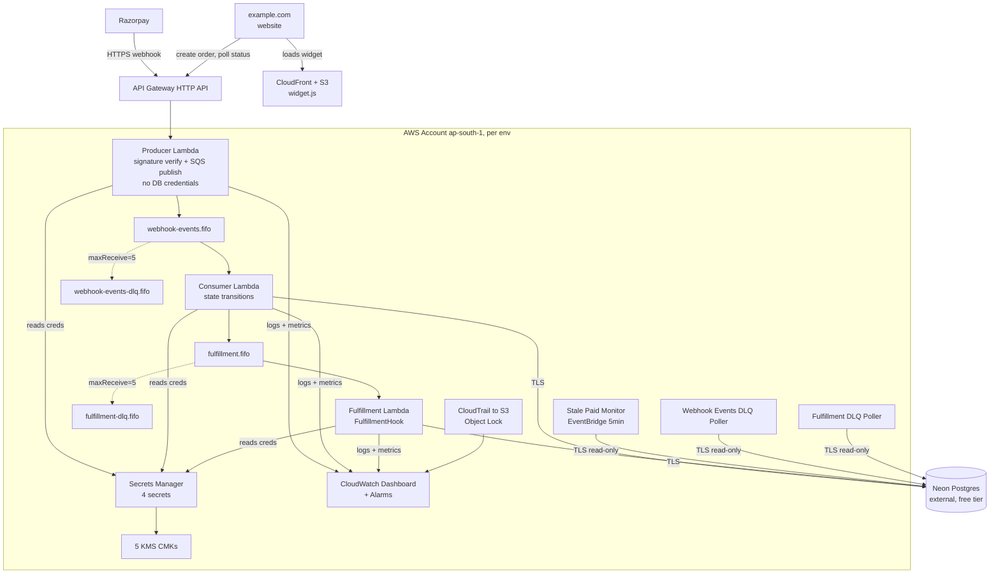
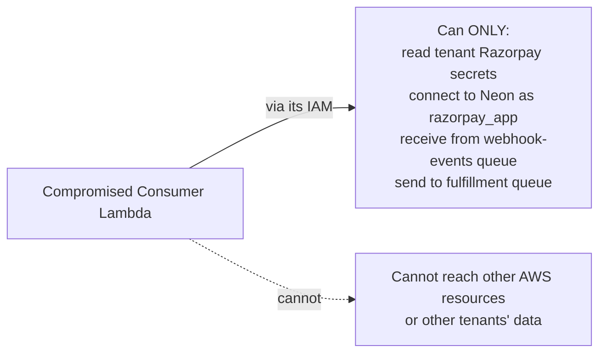
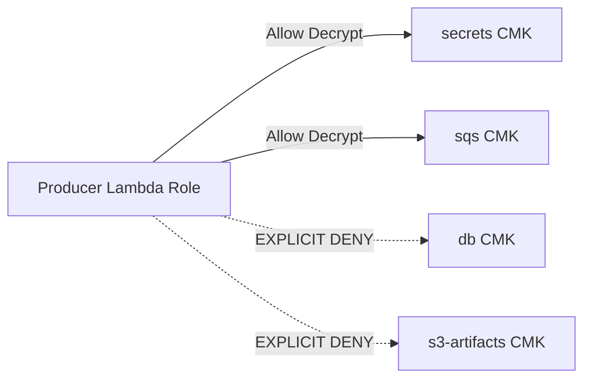
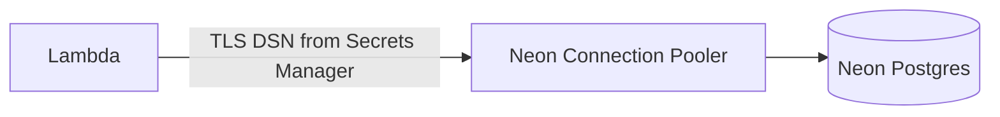
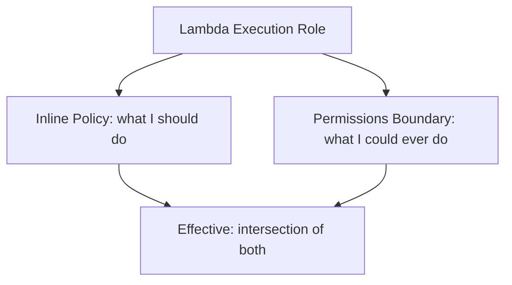
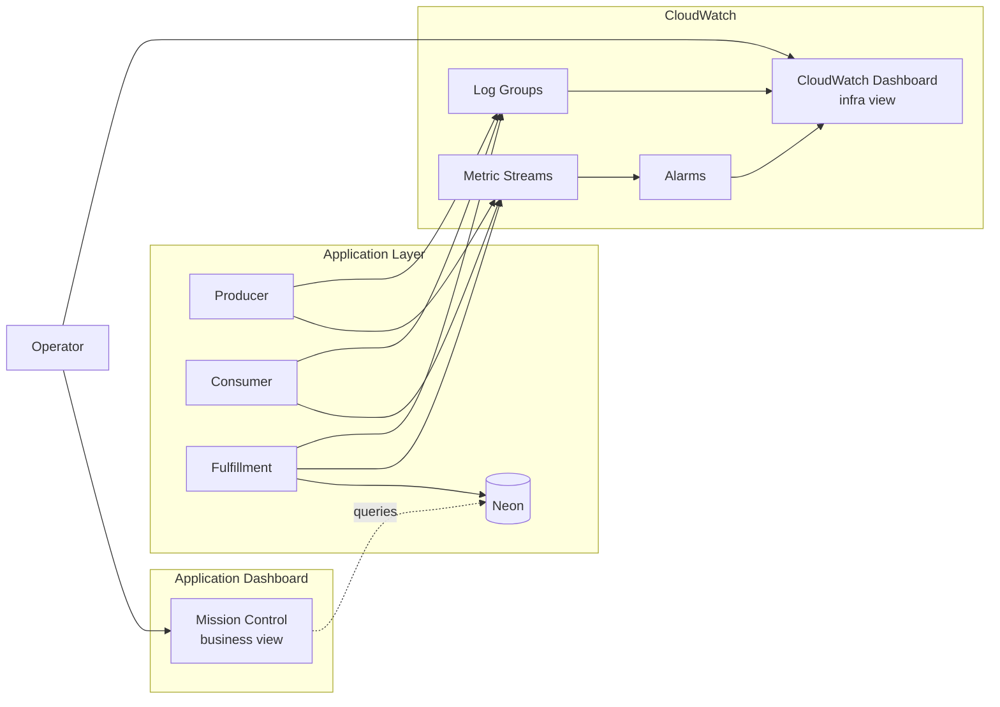
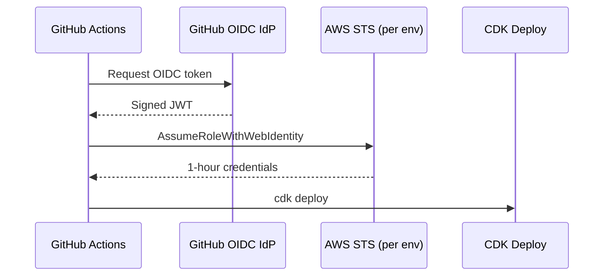
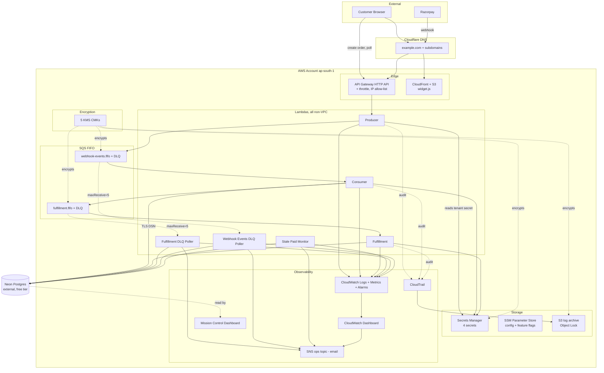

# Razorpay Payment Integration: AWS Migration Plan

A conversational explanation of how this system gets deployed to AWS. Companion to `MIGRATION_ARCHITECTURE.md` (the prescriptive blueprint with exact configs, IAM policies, phased matrix). This document explains the **why** so anyone on the team can follow the architecture without reading every line of code.

> If a decision changes during execution, update this writeup first, then the architecture doc, then the code.

---

## Table of Contents

1. [The 30-Second Summary](#1-the-30-second-summary)
2. [Why AWS](#2-why-aws)
3. [Target Architecture](#3-target-architecture)
4. [Guiding Principles](#4-guiding-principles)
5. [Pillar 1: Two-Account Topology](#5-pillar-1-two-account-topology)
6. [Pillar 2: Network and Edge Security](#6-pillar-2-network-and-edge-security)
7. [Pillar 3: Encryption and Key Management](#7-pillar-3-encryption-and-key-management)
8. [Pillar 4: Database (Neon)](#8-pillar-4-database-neon)
9. [Pillar 5: Secrets and IAM](#9-pillar-5-secrets-and-iam)
10. [Pillar 6: Compute, Queues, Frontend Widget](#10-pillar-6-compute-queues-frontend-widget)
11. [Pillar 7: Observability and Dashboards](#11-pillar-7-observability-and-dashboards)
12. [Pillar 8: CI/CD and Deployment Safety](#12-pillar-8-cicd-and-deployment-safety)
13. [The Phased Rollout](#13-the-phased-rollout)
14. [Upgrade Triggers](#14-upgrade-triggers)
15. [Tradeoff Cheat Sheet](#15-tradeoff-cheat-sheet)
16. [Appendix: Quick Reference Diagram](#16-appendix-quick-reference-diagram)

---

## 1. The 30-Second Summary

Two AWS accounts (dev and prod). All compute is serverless Lambda. Database is Neon (external Postgres, free tier). Producer Lambda outside any VPC for the 500 ms Razorpay webhook SLA; Consumer + Fulfillment Lambdas also outside any VPC at this scale. Security is enforced through IAM scoping per Lambda and the producer-consumer split, not network isolation.

**Monthly cost: ~$14 idle, ~$36 when WAF is enabled (turns on at 1000+ tx/mo or detected attack).** Most "compliance" AWS services (Inspector, GuardDuty, AWS Config, Security Hub) are deferred via feature toggles in CDK and only activated if a compliance audit demands them.

A real-time dashboard built into the architecture monitors orders, fulfillments, queue depth, and webhook latency. The cost-amplification alarm is the trigger that tells you to enable WAF.

---

## 2. Why AWS

The application runs cleanly on a developer laptop today. AWS adds three things the laptop cannot:

| What AWS gives | Why we need it |
|---|---|
| A 24/7 public HTTPS endpoint | Razorpay's webhook must reach the system regardless of whether the laptop is on |
| Durable queues (SQS FIFO) | Webhook processing decoupled from Razorpay's 500 ms response SLA; survives Lambda restarts |
| Managed secrets store with KMS encryption | Tenant Razorpay credentials must never sit in plaintext env vars |
| Managed audit trail (CloudTrail) | Every admin action is timestamped and tamper-evident for post-incident investigation |
| Lambda scale-to-zero | Pay $0 when there's no traffic, scale to 200 req/sec automatically when there is |

The cost is what we pay for these guarantees. The whole plan is calibrated to keep that cost in the **$14-36/month** range while still meeting the security baseline a payment system requires.

---

## 3. Target Architecture



**Note what is missing from this picture, intentionally:** no VPC, no NAT Gateway, no PrivateLink endpoints, no RDS Proxy, no managed AWS database, no WAF (until traffic justifies it).

The mental model:

> Producer is fast and dumb. Consumer is slow and smart. Database lives outside AWS. The security boundary is IAM, not the network.

Every other decision in this plan is a consequence of those four sentences.

---

## 4. Guiding Principles

These priorities resolve every tradeoff. Higher priority wins.

| Priority | Principle | What it forces |
|---|---|---|
| 1 | **Don't lose money** | Idempotency, durable queues, retries, reconciliation |
| 2 | **Don't leak data** | Tenant isolation, KMS per workload, IAM least privilege, log redaction |
| 3 | **Meet the 500 ms Razorpay SLA** | Producer dedicated to fast-path, lean signature-verify |
| 4 | **Stay cheap until traffic justifies more** | Feature-flag the expensive security services off by default |
| 5 | **Make ops legible** | Correlation IDs end-to-end, dashboard mirrors runtime reality |
| 6 | **Reversibility** | CDK + canary aliases + CloudFormation rollback |

Cost is priority 4. We accept the operational cost of multi-account, KMS-per-resource-type, per-Lambda IAM because these foundations scale. We defer the optional security services (WAF until traffic, Inspector / GuardDuty / Security Hub / AWS Config until compliance) because they don't matter until specific triggers fire.

---

## 5. Pillar 1: Two-Account Topology

### 5.1 The problem

Dev and prod must be impossible to confuse and impossible for one mistake to nuke both at once. Solo operator, so the full AWS Security Reference Architecture (5 accounts) is overkill.

### 5.2 The two accounts

| Account | Email | Role |
|---|---|---|
| **Dev** | `aws-dev@example.com` (fresh, 12-month free tier active) | All non-production infrastructure: Lambdas, SQS, ECR, KMS, Secrets, CloudTrail, etc. |
| **Prod** | `aws-prod@example.com` (~1 week old, 12-month free tier active) | Same shape as dev, isolated by account boundary |

No AWS Organizations. No Management account. Each account is independent.

### 5.3 Why no Organizations

The benefits of Organizations (consolidated billing, IAM Identity Center, SCPs) assume a team. For one person, the overhead is not worth it. What we lose and how we substitute:

| Lost without Org | Severity | Substitute |
|---|---|---|
| Service Control Policies | Medium | Per-account CloudWatch metric filter alarms on `cloudtrail:StopLogging`, `config:Delete*`, root API calls. Detect-after-the-fact instead of prevent. |
| IAM Identity Center (single SSO) | Low | Per-account IAM user with MFA-enforcement policy. Two AWS CLI named profiles. |
| Consolidated billing | Low | Two separate bills (small accounts, easy to track) |

When the team grows beyond one person, fold both accounts into an Organization and migrate to Identity Center. One-day operation.

### 5.4 Account hardening (per account, identical)

| Check | How |
|---|---|
| MFA on root user | Hardware key or virtual authenticator. Mandatory. |
| No root access keys | Delete if any exist. |
| Alternate contacts set | Security, Billing, Operations |
| Account password policy | 14-char min, complexity, prevent reuse 24 |
| CloudWatch alarms on dangerous actions | `cloudtrail:StopLogging`, `cloudtrail:DeleteTrail`, `config:Delete*`, `guardduty:Delete*`, root API calls |
| CloudTrail with Object Lock S3 | 7-year retention, single management trail (free), tamper-evident |

---

## 6. Pillar 2: Network and Edge Security

### 6.1 No VPC

All six Lambdas run with default Lambda networking (public egress). The security perimeter is **IAM scope per Lambda + TLS in transit + signature verification + secrets in Secrets Manager + log redaction**, not network isolation.

This is exactly DESIGN_v6 §11's "Free Track posture." We accept the tradeoff: a compromised non-producer Lambda could theoretically exfiltrate over the internet. The mitigations above shrink the value of what could be exfiltrated.



VPC isolation costs ~$130/mo per environment (PrivateLink endpoints) and provides defense against a Lambda-compromise threat that has near-zero probability at this scale. Not worth it.

### 6.2 Edge ingress

```text
Razorpay -> API Gateway HTTP API -> Producer Lambda -> SQS
```

API Gateway HTTP API is chosen over CloudFront-fronted Function URL for lower latency (~15 ms vs ~55 ms) and native custom domain support. Free for first 1M requests/month (12-month tier per account).

### 6.3 Why no WAF by default

Most WAF protections are already provided by the application or by free AWS features:

| WAF protection | Free alternative at <1000 tx/mo |
|---|---|
| Rate limit per IP | **API Gateway throttling per route**: burst 200, sustained 100 RPS. Free. |
| IP allow-list (Razorpay only) | **API Gateway resource policy** with IP allow-list. Free. |
| DDoS | **AWS Shield Standard** (free, automatic) + **Reserved Concurrency = 50** on Producer caps blast radius |
| OWASP managed rules | **HMAC signature verification** in the Producer rejects all non-Razorpay traffic in milliseconds, before any business logic runs |

The Producer Lambda's first action is HMAC verification. Anything without a valid Razorpay-signed body returns 400 immediately. The AWS Managed Rule Sets would be protecting against attacks the application already protects against.

WAF gets turned on when:

- Volume exceeds **1000 payments/month** (URL becomes more discoverable)
- **OR** the cost-amplification alarm fires (Producer invocations >1000/min for 5 min)
- **OR** Razorpay or operators report sustained webhook anomalies

When that trigger fires, WAF is one CDK config change away. Cost rises from $14/mo to ~$36/mo.

### 6.4 WAF rules (when enabled)

| Rule | Action |
|---|---|
| AWS Managed: Amazon IP Reputation | Block |
| AWS Managed: Known Bad Inputs | Block |
| AWS Managed: Core Rule Set | Block |
| Razorpay IP allow-list | Allow + count |
| Rate limit per IP (500 reqs / 5 min) | Block |
| Geo-match (India, Singapore, US) | Allow |

### 6.5 DNS and TLS

DNS for `example.com` is managed at Cloudflare (already set up by operator). Subdomains for the payment infrastructure:

| Subdomain | Purpose |
|---|---|
| `dev.example.com` | Dev tenant website |
| `example.com` | Prod tenant website |
| `api.dev.example.com` | Dev payment API (API Gateway custom domain) |
| `api.example.com` | Prod payment API |
| `widget.dev.example.com` | Dev widget JS (CloudFront) |
| `widget.example.com` | Prod widget JS |

ACM certificates issued via DNS validation (paste CNAME records into Cloudflare). Free, auto-renew. Skip AWS Route 53 entirely (saves $6/year per zone).

When the second tenant goes live and the demo-tenant branding becomes awkward, migrate to a dedicated infra domain (one weekend of DNS + ACM cert work).

---

## 7. Pillar 3: Encryption and Key Management

### 7.1 Five KMS Customer Managed Keys per environment

| Key | Encrypts |
|---|---|
| `secrets` | All Secrets Manager values (tenant Razorpay creds + DB creds) |
| `sqs` | SQS at-rest message bodies |
| `s3-artifacts` | Widget bucket, log archive bucket, CloudTrail bucket |
| `cloudwatch-logs` | Per-Lambda log groups |
| `db` | Reserved (unused until we migrate from Neon to RDS/Aurora; pre-created so the explicit Deny on Producer is structurally in place) |

10 keys total × $1/mo = $10/mo. Cheap insurance against blast-radius accidents.

### 7.2 The Producer cannot decrypt the database key

Even today with no AWS-hosted DB, the Producer role has an **explicit Deny on the `db` CMK**. This is structural discipline: when the database migrates into AWS later, the boundary is already in place.



### 7.3 Secrets bootstrap

CDK creates Secrets Manager entries with placeholder values `{"placeholder": true}`. The operator pours real values in once via MFA-enforced SSO session:

```bash
aws secretsmanager put-secret-value \
    --secret-id /razorpay-checkout/prod/tenant/demo-tenant/razorpay \
    --secret-string file:///tmp/secrets.json \
    --profile razorpay-prod
```

If a Lambda boots and finds the placeholder value, it fails closed with HTTP 503 and triggers an alarm. This prevents the scenario where a deploy goes out with no real Razorpay credentials.

---

## 8. Pillar 4: Database (Neon)

### 8.1 Why Neon

| Dimension | Neon free tier | RDS PostgreSQL (alternative) | Aurora Serverless v2 (alternative) |
|---|---|---|---|
| Idle cost | $0 | ~$25/mo | ~$43/mo at 0.5 ACU floor |
| Free tier | 0.5 GB storage, 100 compute hours/mo | None | None |
| Connection pooling | Native (PgBouncer mode) | Need RDS Proxy +$15/mo | Need RDS Proxy +$15/mo |
| PITR | 7 days free, 30 days paid | Configurable | Configurable |
| `pgcrypto`, PL/pgSQL | Native | Native | Native |
| Compatible with asyncpg | Yes | Yes | Yes |

For our scale (<100k transactions/month), Neon free tier costs $0 and gives us everything we need. The application code (asyncpg + standard SQL) doesn't care which Postgres it talks to. Migration to AWS-managed is `pg_dump` + `pg_restore`, one maintenance window.

### 8.2 Connection model



The DSN in Secrets Manager points at Neon's pooled endpoint (`...pooler.<region>.aws.neon.tech`). Neon handles connection multiplexing on their side. No RDS Proxy needed.

asyncpg pool sizing: `pool_min_size=1, pool_max_size=5`.

### 8.3 Backup and DR

Neon free tier: 7-day PITR with 1-second granularity. Plus a weekly `pg_dump` of prod to an S3 bucket (lifecycle to Glacier after 30 days). Cost: <$1/mo.

| Metric | Target |
|---|---|
| RPO | 5 minutes |
| RTO | 4 hours |
| Drill cadence | Quarterly (restore to a Neon branch + smoke test) |

### 8.4 Read-only role

DLQ pollers and Stale Paid Monitor connect with `razorpay_ro` (SELECT-only). Added in Alembic migration `0008_create_readonly_role.py` before Phase 4:

```python
op.execute("""
    CREATE ROLE razorpay_ro;
    GRANT CONNECT ON DATABASE razorpay_checkout TO razorpay_ro;
    GRANT USAGE ON SCHEMA public TO razorpay_ro;
    GRANT SELECT ON ALL TABLES IN SCHEMA public TO razorpay_ro;
    ALTER DEFAULT PRIVILEGES IN SCHEMA public GRANT SELECT ON TABLES TO razorpay_ro;
""")
```

Two DSN values in Secrets Manager: `db/credentials` (read-write) and `db/credentials-readonly`.

### 8.5 Alembic migrations

Run from GitHub Actions directly against Neon (Neon is public-internet reachable, no VPC). Auto-`downgrade -1` on failure.

### 8.6 When to migrate off Neon

| Trigger | Action |
|---|---|
| Neon free tier exhausted (>400 MB storage or >80 compute hours/mo) | Upgrade to Neon Launch plan (+$19/env/mo). Zero code change. |
| 100k+ transactions/month sustained | Evaluate migration to AWS Aurora Serverless v2. One weekend of work; documented as the v2 trigger. |
| PCI compliance requires AWS-native data layer | Migrate to Aurora; brings VPC + PrivateLink + RDS Proxy with it (~$300/mo at that point) |

---

## 9. Pillar 5: Secrets and IAM

### 9.1 Two-store strategy

| Store | What lives there |
|---|---|
| **Secrets Manager** | Tenant Razorpay credentials + DB credentials (read-write + read-only) |
| **SSM Parameter Store (Standard, free)** | Region, queue URLs, feature flags (`waf_enabled`, `gd_enabled`, etc.), OTel exporter, Neon endpoint hint |

### 9.2 Per-Lambda IAM matrix

| Lambda | DB access | Secrets read | Queue access | SNS |
|---|---|---|---|---|
| **Producer** | None | Tenant Razorpay only; explicit Deny on DB creds | Send to webhook-events | None |
| **Consumer** | Read/write (`razorpay_app`) | Tenant Razorpay + DB read-write | Receive webhook-events, send fulfillment | None |
| **Fulfillment** | Read/write | Tenant Razorpay + DB read-write | Receive fulfillment | None |
| **Fulfillment DLQ Poller** | Read-only (`razorpay_ro`) | DB read-only | Receive fulfillment-dlq | Publish to ops topic |
| **Webhook Events DLQ Poller** | Read-only | DB read-only | Receive webhook-events-dlq | Publish to ops topic |
| **Stale Paid Monitor** | Read-only | DB read-only; explicit Deny on tenant Razorpay creds | None | Publish to ops topic |

Each Lambda has only the permissions it needs. A compromised Consumer cannot escalate. A compromised Producer cannot reach the database.

### 9.3 Permissions boundary

A single boundary policy is attached to every Lambda execution role. It is the upper limit on what any role can do, regardless of how the inline policy is written.



The boundary denies: `iam:*`, `kms:Delete*`, `lambda:UpdateFunctionCode`, `secretsmanager:DeleteSecret`, `rds:Delete*`, `s3:DeleteBucket`. Even a future PR that accidentally grants admin permissions is neutered by the boundary.

### 9.4 Tenant secret cache

Producer caches tenant Razorpay credentials in-memory with 5-min TTL. At 2 tenants and 50 Lambda concurrent instances, peak Secrets Manager API rate is ~0.33 RPS. Trivially under the 5000 RPS account quota.

---

## 10. Pillar 6: Compute, Queues, Frontend Widget

### 10.1 Why six Lambdas

The split between Producer and Consumer exists for two reasons. **Latency:** Razorpay enforces 500 ms; the Producer's path (signature verify + SQS publish, ~25 ms) is decoupled from the Consumer's DB work. **Security:** the public-facing Lambda holds zero database credentials.

The other four Lambdas (Fulfillment, two DLQ pollers, Stale Paid Monitor) each have one job and one IAM role.

### 10.2 Lambda configuration

| Function | Memory | Timeout | Reserved Concurrency | Provisioned Concurrency | VPC |
|---|---|---|---|---|---|
| Webhook Producer | 512 MB | 10 s | 50 | 2 (prod when WAF/live), 0 (otherwise) | NO |
| Webhook Consumer | 768 MB | 60 s | 30 | 0 | NO |
| Fulfillment | 768 MB | 60 s | 30 | 0 | NO |
| Fulfillment DLQ Poller | 256 MB | 30 s | 5 | 0 | NO |
| Webhook Events DLQ Poller | 256 MB | 30 s | 5 | 0 | NO |
| Stale Paid Monitor | 256 MB | 30 s | 5 | 0 | NO |

Container image base: `public.ecr.aws/lambda/python:3.12` (x86_64; matches operator's dev machine, no cross-architecture build issues).

Provisioned Concurrency is **off** by default to save money. Enable on the Producer if Razorpay reports webhook timeouts or if p95 latency breaches 400 ms.

### 10.3 SQS configuration

| Queue | Visibility Timeout | Retention | MaxReceiveCount | High Throughput Mode |
|---|---|---|---|---|
| `webhook-events.fifo` | 180 s | 4 days | 5 | Yes |
| `webhook-events-dlq.fifo` | 30 s | 14 days | n/a | No |
| `fulfillment.fifo` | 180 s | 4 days | 5 | Yes |
| `fulfillment-dlq.fifo` | 30 s | 14 days | n/a | No |

### 10.4 Frontend widget

| Resource | Setting |
|---|---|
| S3 bucket | `razorpay-checkout-{env}-widget-<acct>`; SSE-KMS; block public access on |
| CloudFront | OAC to bucket; HTTPS only; HTTP/2 + HTTP/3 |
| Path strategy | `/v{major}.{minor}.{patch}/widget.js` versioned, immutable cached |
| CORS | Tenant origins (`https://example.com`, `https://dev.example.com`) from SSM parameter |
| SRI | Sub-resource Integrity hash published per build |

### 10.5 Tenant onboarding

Operator script `scripts/onboard-tenant.py` performs:

1. `aws secretsmanager create-secret` for tenant's Razorpay credentials
2. INSERT into `tenants` table on Neon
3. Update SSM parameter `widget-cors-origins` to add tenant origin
4. CloudFront invalidation for `/latest/widget.js`
5. Run `prod-smoke.py --tenant <id>`

For example.com this is run once during Phase 5. When the second tenant is built, run again.

---

## 11. Pillar 7: Observability and Dashboards

### 11.1 The dashboards

Two complementary dashboards, both included in the deploy:

**Application Mission Control (`/admin/dashboard`).** The existing dashboard from `example/frontend/admin-dashboard.html` deployed alongside the API. Shows:

- KPI strip: total today, fulfilled today, failed today, in-flight, refunded today
- Payment Journey for the most recent order (17-step state graph driven by `*_at` timestamps)
- Queue depths (webhook-events, fulfillment, both DLQs)
- Recent orders with one-click drill-in
- Stale paid orders (>15 min old) red banner
- Reconciliation mismatches over the last 7 days

This is the **business view**. You open it daily; it tells you whether payments are flowing.

**CloudWatch Dashboard (`razorpay-checkout-{env}-mission-control`).** Built by CDK. Free tier covers first 3 dashboards per account. Shows:

- Webhook latency p50/p95/p99 (the Razorpay SLA gauge)
- Lambda invocation count + error rate per function
- SQS queue depth + DLQ depth
- KMS request count (sanity check)
- Cost projection (current month run-rate via Budgets)
- All active alarms (composite widget)

This is the **infra view**. You glance at it weekly; it tells you the substrate is healthy.



### 11.2 Alarms

Critical alarms (paging via SNS email):

| Source | Threshold |
|---|---|
| `webhook-events-dlq.fifo` depth | >0 for 5 min |
| `fulfillment-dlq.fifo` depth | >0 for 5 min |
| Webhook latency p95 | >500 ms for 5 min |
| Fulfillment failure rate | >1% over 15 min |
| Stale paid orders count | >0 |
| **Producer invocations** | **>1000/min for 5 min** ← This is the trigger to enable WAF |
| Neon connection failure rate | >0 over 5 min |

Warn alarms (Slack via Chatbot, or email if Slack not set up):

| Source | Threshold |
|---|---|
| Webhook latency p95 | >400 ms for 10 min |
| Lambda concurrent executions per function | >80% of reserved |
| Razorpay IP allow-list rule hit count | =0 for 10 min (likely Razorpay rotated IPs) |

### 11.3 Logs

| Tier | Where | Retention |
|---|---|---|
| Hot | CloudWatch Log Groups, KMS-encrypted | 30 days |
| Warm | S3 Standard-IA via Firehose subscription | 90 days |
| Cold | S3 Glacier Instant Retrieval | 1 year |
| Archive | S3 Glacier Deep Archive (Object Lock) | 7 years |

Correlation ID propagates end-to-end via SQS MessageAttributes per DESIGN_v6 §10.

### 11.4 Optional security services (off by default)

Each is a feature toggle in `cdk.json`:

| Service | Toggle | Trigger to flip on |
|---|---|---|
| **WAFv2** | `waf_enabled: true` | 1000+ tx/mo OR cost-amplification alarm fires |
| **Inspector for Lambda** | `inspector_enabled: true` | 100+ MAU OR security audit |
| **AWS Config** | `config_enabled: true` | Compliance/audit requirement |
| **GuardDuty** | `guardduty_enabled: true` | First security incident OR 100+ MAU |
| **Security Hub** | `security_hub_enabled: true` | Compliance/audit requirement |

Flip flag, `cdk deploy`, service activates. ~5 minutes per service to enable.

---

## 12. Pillar 8: CI/CD and Deployment Safety

### 12.1 GitHub Actions with OIDC

No long-lived AWS keys in GitHub Secrets. Per-account IAM role assumable only from the specific repo + branch:



### 12.2 Pipeline stages

```text
PR -> Lint + Tests + Type Check
   -> CDK Synth + cdk-nag + Checkov + Infracost
   -> Deploy Dev
   -> Migrate Dev (alembic upgrade)
   -> Smoke Dev (prod-smoke.py)
   -> Manual approval gate
   -> Deploy Prod
   -> Migrate Prod
   -> Smoke Prod
   -> Lambda canary 10% -> 100%
```

### 12.3 Safety nets already wired

| Tool | Catches |
|---|---|
| `pre-commit` (gitleaks, ruff, format) | Secrets in commits |
| `cdk-nag` | AWS best-practice violations at synth time |
| `Checkov` | Static security scan on synthesized CloudFormation |
| `Infracost` | Cost delta posted as PR comment |
| `Renovate` | Weekly dependency PRs |

### 12.4 Rollback

| Layer | Mechanism |
|---|---|
| Lambda code | Alias `live` with canary 10% for 10 min; auto-rollback on alarm |
| CDK stack | CloudFormation auto-rollback on update failure |
| Alembic | Auto `downgrade -1` on migration failure |
| Catastrophic | Revert to previous git tag; restore Neon from PITR |

---

## 13. The Phased Rollout

| Phase | What lands | Verification | Hours |
|---|---|---|---|
| 1. Account hardening | Root MFA, IAM users, CloudTrail with Object Lock, password policy, security alarms | Test `cloudtrail:StopLogging` from CLI, expect alarm | 6 |
| 2. IAM users + OIDC | Daily-driver IAM user per account, GitHub OIDC IdP, named profiles | `aws sts get-caller-identity` works; GitHub Actions test workflow succeeds | 4 |
| 3. Foundation stack | KMS CMKs, ECR repos, base log groups, ACM certs, Cloudflare DNS records | 5 CMKs visible; ACM `ISSUED`; CloudTrail bucket has Object Lock | 6 |
| 4. Neon + migrations | Neon project, `0008_create_readonly_role` migration applied, DB secrets seeded | `alembic current` matches `head`; readonly role exists | 4 |
| 5. Tenant secrets | Razorpay creds seeded for example.com | Producer smoke can read tenant secret | 2 |
| 6. Compute + messaging | 6 Lambdas, 4 SQS queues, API Gateway HTTP API, dashboards, alarms | API Gateway returns 400 to unsigned webhook; first scheduled run of Stale Paid Monitor logs visible | 10 |
| 7. Frontend widget | CloudFront + S3 widget, SRI hash published | `curl widget.example.com/v1/widget.js` returns 200 with correct integrity | 4 |
| 8. Observability | Mission Control dashboard reachable; CloudWatch dashboard populated; SNS topic email subscriptions confirmed | Trigger test 500; warn alarm fires within 5 min | 6 |
| 9. Dev end-to-end with Razorpay test mode | Razorpay test webhook URL configured; all 4 event types traced through; DLQ empty | All 4 events reach correct end states; correlation IDs match across log lines | 6 |
| 10. Prod cutover | Razorpay live webhook URL configured; 72-hour parallel monitor | Webhook latency p95 < 500 ms; zero DLQ; reconciliation matches | 6 |

**Total: ~54 hours, ~9 calendar days.**

Each phase has a "go / no-go" verification gate. We do not progress until the gate passes.

---

## 14. Upgrade Triggers

The CDK code wires **every** deferred service from day one. They sit behind feature toggles in `infra/cdk.json` under `razorpay:features`. Flip a flag, `cdk deploy`, the service activates. Application code never changes.

| Trigger | Cost delta combined | Toggle |
|---|---|---|
| 1000+ payments/mo OR cost-amplification alarm fires | +$22/mo | `waf_enabled: true` |
| Razorpay reports webhook timeouts OR webhook p95 > 400 ms | +$16/mo | `provisioned_concurrency_enabled: true` (prod only) |
| Neon free tier exhausted (>400 MB or >80 compute hrs/mo) | +$38/mo | Upgrade Neon plan in dashboard (no CDK change) |
| 100+ MAU OR security audit requested | +$9/env/mo | `inspector_enabled: true` |
| First security incident OR 100+ MAU | +$3-6/env/mo | `guardduty_enabled: true` |
| Compliance audit (SOC2 / ISO / PCI) | +$3-8/env/mo | `security_hub_enabled: true` |
| Compliance audit OR 100+ resources | +$4-10/env/mo | `config_enabled: true` |
| 100k+ tx/mo sustained OR PCI requires AWS-native data layer | +$300-400/mo | `rds_in_vpc_enabled: true` (one-weekend migration; full Stage 2 architecture activates) |
| RTO < 1 hour requirement OR regulator requires geographic redundancy | +$80-200/mo | `aurora_global_db_enabled: true` (depends on RDS migration first) |

The first three triggers are operationally driven and we will hit them in order over months. The compliance triggers are event-driven. The RDS migration is multi-year horizon.

**For exact per-service enable instructions** (CDK change, deploy command, verification, rollback, runtime checks): see `MIGRATION_ARCHITECTURE.md` "Deferred Services Enablement Guide" section. Each service has its own subsection (Enable 1 through Enable 10) with copy-paste-ready commands.

### What's pre-built but turned off

| Capability | Wired in CDK | Toggle name |
|---|---|---|
| WAFv2 Web ACL + 6 rules | Yes | `waf_enabled` |
| Lambda Provisioned Concurrency on Producer | Yes | `provisioned_concurrency_enabled` |
| Inspector for Lambda continuous scanning | Yes | `inspector_enabled` |
| AWS Config with 20+ managed rules | Yes | `config_enabled` |
| GuardDuty (CloudTrail + S3 + Malware Protection) | Yes | `guardduty_enabled` |
| Security Hub (FSBP + CIS standards) | Yes | `security_hub_enabled` |
| VPC + 9 PrivateLink endpoints | Yes (synthesized but not deployed) | `rds_in_vpc_enabled` |
| RDS Proxy | Yes (in VPC stack) | `rds_in_vpc_enabled` |
| Aurora Serverless v2 cluster | Yes | `rds_in_vpc_enabled` |
| Aurora Global Database (warm DR in ap-southeast-1) | Yes | `aurora_global_db_enabled` |

Every line above is a small CDK construct gated by `if features.get(toggle_name, False):`. The cost when off is exactly $0.

---

## 15. Tradeoff Cheat Sheet

| Decision | Picked | Rejected | Why |
|---|---|---|---|
| Account model | 2 standalone accounts | Single account / Organizations | Blast-radius isolation without Org overhead |
| Region | ap-south-1 | us-east-1 | Razorpay proximity, customer location |
| VPC for internal Lambdas | None | VPC + PrivateLink | Saves $130/mo; IAM is the security boundary at this scale |
| Database | Neon | RDS / Aurora | $0 idle; portable; one-weekend migration when needed |
| Edge ingress | API Gateway HTTP API | CloudFront + Function URL | Lower latency for 500 ms SLA |
| WAF | Off by default | Always on | Application + free alternatives cover ~80% at low scale |
| Inspector / GuardDuty / Config / Security Hub | Feature toggles, off | Always on | Compliance-driven, not security-driven, at this scale |
| KMS keys | 5 CMKs per env | Single shared | Blast-radius isolation; $10/mo across 10 keys is cheap insurance |
| Lambda packaging | Container image (x86_64) | Zip / ARM64 | Matches dev machine; no cross-arch build complexity |
| Provisioned Concurrency | On Producer only, on trigger | Always on | Cold start absorbed by SQS for non-Producer; expensive when unused |
| CI/CD | GitHub Actions + OIDC | AWS CodePipeline | Source already on GitHub; no long-lived keys |
| DR | Neon PITR + weekly S3 dump | Aurora Global DB warm standby | $0 vs $80+/mo; 4h RTO acceptable at this scale |

---

## 16. Appendix: Quick Reference Diagram



This is the deployed system. Every service in this diagram is in scope for the phased rollout in §13.
