# Razorpay Payment Integration: Migration Writeup

A long-form explanation of the AWS migration plan. The companion document `MIGRATION_ARCHITECTURE.md` is the prescriptive blueprint with exact configurations, IAM policies, and the phased matrix. This document explains the **why** behind each decision in conversational form, with diagrams and tradeoff tables, so anyone on the team can follow what we're building and why.

> **This is a living document.** If we change a decision during implementation, we update this writeup first, then the prescriptive doc. A drift between the two is a defect.

---

## Table of Contents

1. [The 30-Second Summary](#1-the-30-second-summary)
2. [Why We Are Migrating](#2-why-we-are-migrating)
3. [The Three-Stage Growth Plan](#3-the-three-stage-growth-plan)
4. [Before and After: The Architectural Shift](#4-before-and-after-the-architectural-shift)
5. [Guiding Principles](#5-guiding-principles)
6. [Pillar 1: Two-Account Topology (No Organizations)](#6-pillar-1-two-account-topology-no-organizations)
7. [Pillar 2: Network Topology and Edge Security](#7-pillar-2-network-topology-and-edge-security)
8. [Pillar 3: Encryption and Key Management](#8-pillar-3-encryption-and-key-management)
9. [Pillar 4: The Database (Neon)](#9-pillar-4-the-database-neon)
10. [Pillar 5: Secrets and IAM](#10-pillar-5-secrets-and-iam)
11. [Pillar 6: Compute, Queues, and the Frontend Widget](#11-pillar-6-compute-queues-and-the-frontend-widget)
12. [Pillar 7: Observability, Audit, Compliance](#12-pillar-7-observability-audit-compliance)
13. [Pillar 8: CI/CD and Deployment Safety](#13-pillar-8-cicd-and-deployment-safety)
14. [The Phased Rollout: How the Work Actually Happens](#14-the-phased-rollout-how-the-work-actually-happens)
15. [Stage Graduation Playbook](#15-stage-graduation-playbook)
16. [Tradeoff Cheat Sheet](#16-tradeoff-cheat-sheet)
17. [What Could Change During Implementation](#17-what-could-change-during-implementation)
18. [How to Use This Document](#18-how-to-use-this-document)

---

## 1. The 30-Second Summary

We are moving the Razorpay Payment Integration Layer from local development to a production-grade AWS deployment that **ships at the lowest possible cost today** and **graduates to higher tiers as revenue justifies it**. Specifically Stage 0 (the starting point):

- Runs **two standalone AWS accounts** (dev and prod). Single-operator setup, no AWS Organizations.
- Lives in **ap-south-1** (Mumbai) for low latency to Razorpay and Indian customers.
- Uses **Neon** as the PostgreSQL database (managed, public-internet reachable with TLS, free tier covers v1).
- Runs **all six Lambdas with public egress** (no VPC, no NAT Gateway, no PrivateLink). Security is enforced by IAM scoping and the producer-consumer split, per `DESIGN_v6.md` §11.
- Costs **~$65/month combined across both environments** at 10,000 transactions per month.
- Deploys via **GitHub Actions with OIDC** (no long-lived AWS keys).
- Enforces safety with **cdk-nag, Checkov, Infracost, pre-commit hooks, and Renovate**.
- Has a documented **one-weekend upgrade path** to Stage 2 (VPC + AWS-native database) when DAU justifies it.

If you stop reading here, you know the shape of what we're building.

---

## 2. Why We Are Migrating

### 2.1 What we have today

The system today is a Python codebase with FastAPI, asyncpg, structlog, SQS-driven workers, and a PostgreSQL schema. It is fully tested, runs cleanly in LocalStack, and is operationally proven via the dev dashboard. **The application is ready. The cloud isn't.**

Specifically:

- There is no AWS account allocated to this workload yet.
- There is no production deployment of any kind.
- The CDK stacks (`infra/stacks/foundation.py`, `infra/stacks/payments.py`) exist but have never been deployed.
- Razorpay test mode is the only production-shaped thing the code has talked to.

### 2.2 What "ready for production" requires

Razorpay handles real money. A payment integration is held to a different standard than a typical SaaS feature:

| Concern | What it means here |
|---|---|
| **Reliability** | A dropped webhook means a paid customer who never gets their order. We need 99.9% uptime and durable retry semantics. |
| **Latency** | Razorpay enforces a 500 ms response time on webhook delivery. Miss it and they retry; chronic misses get the integration disabled. |
| **Idempotency** | Razorpay can retry the same event multiple times with different event IDs. Our database must never process the same payment twice. |
| **Auditability** | Every state change must be traceable end-to-end via a correlation ID, across services, weeks after the fact. |
| **Security** | Payment metadata is sensitive. Tenant Razorpay credentials must never leak. The blast radius of a compromise must be small. |
| **Cost discipline** | Idle cost matters. Most of our hours are spent at 0-1 transactions per minute. |
| **Multi-tenancy** | One Razorpay key per tenant website. Tenants must never see each other's data. |

The application code already handles idempotency, correlation IDs, and tenant isolation (`DESIGN_v6.md` is the spec). What this migration adds is the **cloud substrate** that makes those guarantees real in production.

### 2.3 The strategic question we are answering

> "What is the smallest AWS footprint that runs this payment system reliably for real customers, fits in a tight monthly budget, and has a known path to scale to 100k+ transactions per month without a re-architecture?"

The answer has two parts. **Stage 0** (now) is the minimum viable production footprint. **Stages 1, 2, 3** are pre-planned graduation points with explicit triggers and known migration paths. We do not over-build for traffic we don't have. We do build with the right shape so that scaling is a configuration change, not a rewrite.

---

## 3. The Three-Stage Growth Plan

The plan is staged. We ship Stage 0. We watch the metrics. We graduate when a specific signal fires.

| Stage | Trigger | Monthly cost (both envs) | What changes |
|---|---|---|---|
| **Stage 0: Bootstrap** | Now to ~10k tx/mo | **~$65** | Neon free tier, all Lambdas non-VPC, IAM is the security model |
| **Stage 1: Validated** | Neon free tier exhausted (>400 MB storage or >80 compute hours/mo) | **~$100** | Bump to Neon Launch plan ($19/env), everything else unchanged |
| **Stage 2: Scale-up** | 100k+ tx/mo, or PCI scope requirement, or revenue clears the $300/mo premium with margin | **~$300-400** | Move to RDS PostgreSQL or Aurora Serverless v2 in VPC; add PrivateLink endpoints; add RDS Proxy; five of six Lambdas move into the VPC |
| **Stage 3: Multi-region** | RTO requirement < 1 hour, or regulator requires geographic redundancy | **~$600-1000** | Aurora Global Database, warm DR replica in `ap-southeast-1` |

The key insight from `DESIGN_v6.md` §11: **switching tracks is a CDK diff, not a re-architecture**. The application code is identical across stages. The migration between stages is hours of work, not weeks.

### 3.1 What we lock in at every stage (the "future-proofing")

These patterns cost nothing extra at Stage 0 and make every upgrade cheap:

| Pattern | Why it matters when you scale |
|---|---|
| **Database connection string in Secrets Manager** | Stage 2 = change the secret value, restart Lambdas, done. Zero code change. |
| **Alembic-only migrations, no `metadata.create_all()`** | Schema works on Neon, RDS, Aurora identically. |
| **asyncpg + standard SQL, no Aurora-specific features** | Already true. Portable across any modern Postgres. |
| **Six separate Lambdas with separate IAM roles** | Stage 2 puts five of them in a VPC. Application code identical. |
| **Producer-consumer SQS split** | The Razorpay 500ms SLA path is already isolated. |
| **CDK stack with `track` parameter** | Flipping `track=paid` toggles VPC mode without code changes. |
| **Multi-account topology** | Already correct at Stage 0. No restructure ever. |
| **Per-Lambda IAM with explicit Denies** | Security model already at "paid grade." Network isolation is the only thing deferred. |

### 3.2 What we explicitly defer

| Deferred work | Why we can defer | Cost when needed |
|---|---|---|
| VPC isolation for the five internal Lambdas | IAM is the security boundary today | $0 (one CDK config change) |
| PrivateLink endpoints (9 of them) | Only needed when Lambdas are in a VPC | ~$132/env/mo when added |
| RDS Proxy | Only needed when we move off Neon's built-in pooler | ~$15/mo when added |
| AWS-native managed Postgres | Neon free tier handles v1 capacity | ~$40-80/env/mo when added |
| Aurora Global Database for warm DR | Pilot-light DR via snapshot copy is enough | ~$80/env/mo when added |
| Lambda Provisioned Concurrency on dev | SLA is informational in dev | $15/mo when added |

Each deferred item has a clear trigger. We do not guess at when to add them. The metrics tell us.

---

## 4. Before and After: The Architectural Shift

### 4.1 Today (local development)

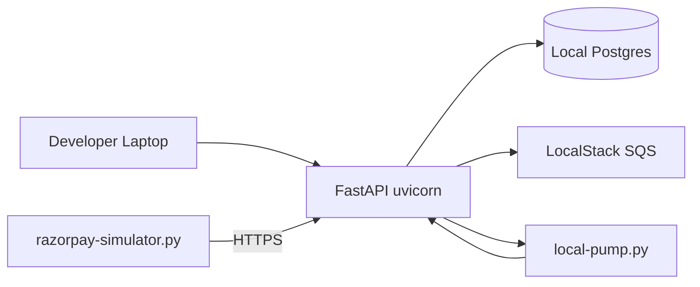

Everything is one process. The simulator mimics Razorpay. LocalStack mimics SQS.

### 4.2 Stage 0 target on AWS

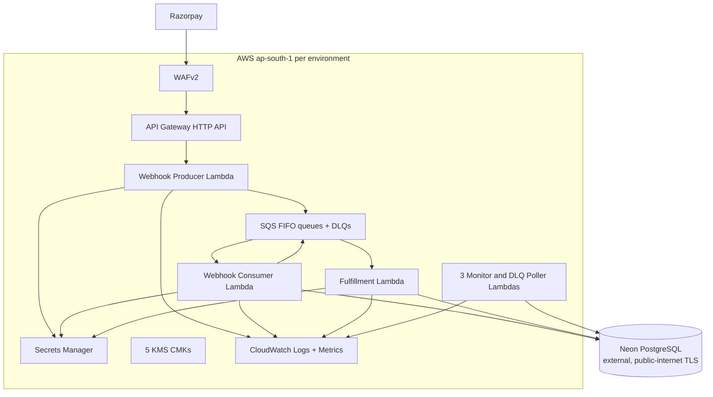

**Notice what is missing from the Stage 0 picture compared to a typical "production AWS" diagram:** no VPC boundary, no NAT Gateway, no PrivateLink endpoints, no RDS Proxy, no RDS instance. Every Lambda talks to AWS services over the public AWS APIs with TLS, and to Neon over the public internet with TLS.

### 4.3 The mental model

If you remember nothing else, remember this:

> **Producer is fast and dumb. Consumer is slow and smart. The database lives outside AWS. The security boundary is IAM, not the network.**

Every other decision at Stage 0 is a consequence of one of those four sentences.

---

## 5. Guiding Principles

These principles drive every decision below. When a tradeoff arises, we resolve it by appealing to the highest-priority principle.

| Priority | Principle | What it forces |
|---|---|---|
| 1 | **Don't lose money** | Idempotency, durable queues, retries, reconciliation, no silent data loss |
| 2 | **Don't leak data** | Tenant isolation, KMS per workload, IAM least privilege, log redaction |
| 3 | **Meet the 500 ms Razorpay SLA** | Producer dedicated to fast-path, provisioned concurrency, lean signature-verify |
| 4 | **Stay under the cost ceiling** | Stage 0 footprint, Neon free tier, no premature VPC isolation |
| 5 | **Make ops legible** | Correlation IDs end-to-end, structured logs, dashboards mirror runtime reality |
| 6 | **Reversibility on every change** | CDK + canary aliases + CloudFormation rollback |
| 7 | **Build for the next stage** | Patterns at Stage 0 must scale to Stage 2 with config-only changes |

Cost is priority 4, not priority 1. We accept the operational overhead of multi-account, KMS-per-resource-type, per-Lambda IAM, etc., because these are the foundations that scale. We defer the things that are pure scale (VPC, PrivateLink, RDS Proxy) because they only matter once traffic justifies them.

---

## 6. Pillar 1: Two-Account Topology (No Organizations)

### 6.1 The problem in one sentence

We need dev and prod to be impossible to confuse and impossible for a single mistake to nuke both at once, without paying the overhead of AWS Organizations for a single-operator setup.

### 6.2 The two accounts

| Account | Role | What lives in it |
|---|---|---|
| **Dev** | All non-production infrastructure | Dev Lambdas, SQS queues, ECR repos, KMS keys, Secrets, CloudTrail-to-local-S3 (Object Lock), GuardDuty, Security Hub, Config |
| **Prod** | All prod infrastructure | Same shape as dev, isolated by account boundary |

Two standalone AWS accounts. No AWS Organizations. No Management account. Each account is independent with its own billing, root user, and IAM.

### 6.3 Why we are not using AWS Organizations

You are the sole operator. The benefits of Organizations (consolidated billing, IAM Identity Center, SCPs across multiple workload accounts) assume a team. For one person, the overhead is not worth it. What we lose and how we substitute:

| Lost without Organizations | Severity | Substitute at this scale |
|---|---|---|
| **Service Control Policies (SCPs)** preventing "disable CloudTrail" etc | Medium | Per-account IAM denies in the operator's daily-driver role; CloudWatch alarm on `cloudtrail:StopLogging`, `config:DeleteConfigurationRecorder`, etc. |
| **IAM Identity Center** (single SSO across accounts) | Low | Two AWS CLI named profiles (`razorpay-dev`, `razorpay-prod`), each backed by an account-scoped IAM user with MFA enforced. |
| **Consolidated billing** | Low | Two separate bills. Marginally more cost-tracking work; both accounts are tagged the same so cost reports merge cleanly outside AWS if needed. |

**You revisit this when the team grows past one person.** That is the right moment to fold the two accounts under a Management account in an Org and roll out Identity Center. Migrating standalone accounts into an Org is a documented AWS procedure, ~1 day of work.

### 6.4 What we give up vs the full SRA pattern (still applies)

| What's missing | Severity | Mitigation in 2-account model |
|---|---|---|
| Separate Audit account that even prod admin cannot wipe | Medium | **S3 Object Lock** on CloudTrail buckets in compliance mode, 7-year retention. Even an admin cannot delete locked log objects until retention expires. |
| Separate Log Archive account for tamper-resistance | Medium | Same Object Lock pattern on the log archive bucket. |
| Separate Shared Services account for ECR | Low | ECR repos live in each workload account. CI pushes the same image to both during deploy. |

The Object Lock decision is critical: **enable it on day one or skip it forever.** AWS does not allow enabling Object Lock on a bucket that already exists.

### 6.5 Per-account hardening (the SCP substitute)

Without Organizations we cannot use SCPs. Instead, each account configures the same controls locally:

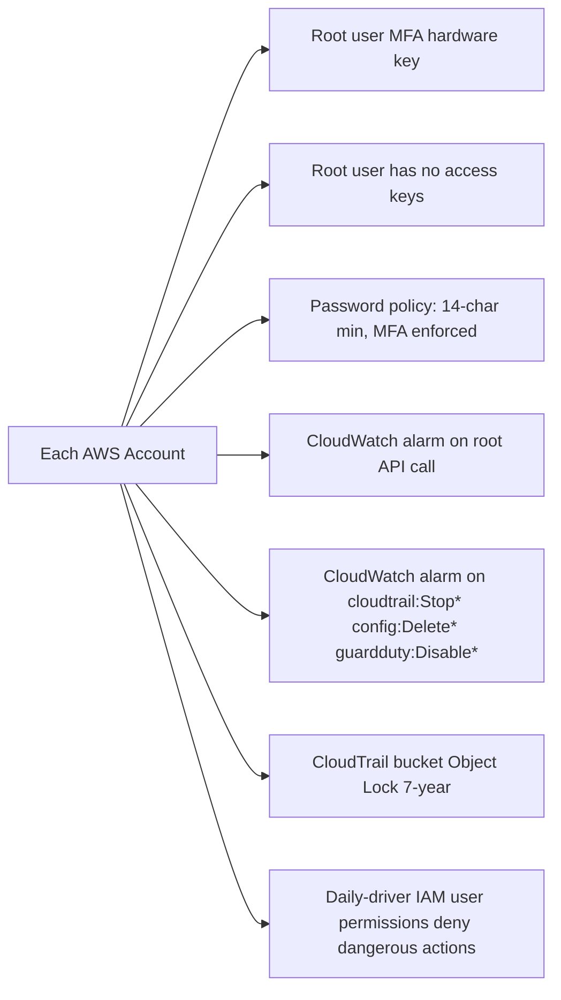

The CloudWatch alarms on "someone tried to disable security service X" are the soft-substitute for an SCP. SCPs prevent the action; CloudWatch alarms tell you it was attempted. Less powerful, but adequate at single-operator scale.

### 6.6 Account authentication (single operator)

| Use case | Mechanism |
|---|---|
| Daily console access | Per-account IAM user with admin policy + MFA enforced. AWS CLI uses `aws configure sso` if you later move to Identity Center, or named profiles with MFA-temp-token today. |
| GitHub Actions deploys | OIDC federation per account. No long-lived AWS keys in GitHub. Same as before. |
| Breakglass | Root user login (MFA required). Used only when IAM is broken. |
| Billing review | Root login per account, once a month. |

The IAM user pattern is an anti-pattern in any larger setting. At single-operator scale it is the simplest path that beats access keys on a laptop.

### 6.7 What changes during implementation?

If the team grows past one person: fold both accounts under AWS Organizations, enable Identity Center in a new Management account, migrate auth to permission sets. Estimated effort: 1 day.

---

## 7. Pillar 2: Network Topology and Edge Security

### 7.1 The Stage 0 stance

**No VPC for any Lambda.** All six Lambdas run with default Lambda networking (public egress). This is `DESIGN_v6.md` §11's "Free Track posture" exactly.

The security perimeter at Stage 0 is:

- **IAM scope per Lambda** (each has only the permissions it needs)
- **TLS in transit** (every AWS API call, every Neon connection, every Razorpay call)
- **Secrets in Secrets Manager** encrypted with KMS
- **The producer-consumer split** (the public-facing Lambda has no DB credentials)
- **Log redaction** (no secret value ever lands in CloudWatch Logs)

We do **not** rely on network isolation at Stage 0. We accept the trade: a compromised non-producer Lambda could exfiltrate over the internet. The mitigations above shrink the value of what could be exfiltrated.

### 7.2 Why this is fine for now

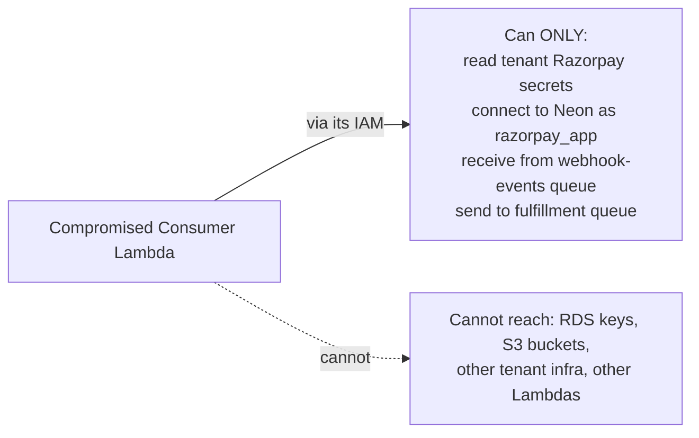

If a Consumer Lambda gets compromised, the attacker has the privileges of one IAM role. They can read tenant Razorpay credentials (bad), connect to Neon and query (bad), receive from one queue and send to one queue. They **cannot** escalate to other AWS resources or reach other tenants' data not already accessible to this role.

For Stage 0, this is the right tradeoff. The probability of a Lambda compromise is low (managed runtime, scoped IAM, code review). The cost of preventing the exfiltration path with VPC isolation is $130+/mo per environment. We are accepting the residual risk.

### 7.3 Edge ingress for the webhook

When Razorpay hits us:

```
Razorpay -> WAFv2 -> API Gateway HTTP API -> Producer Lambda -> SQS
```

| Layer | Purpose |
|---|---|
| **WAFv2** | Blocks malicious requests, rate-limits, enforces IP allow-list for Razorpay sources |
| **API Gateway HTTP API** | Routes to Producer, handles custom domain + TLS, adds ~10ms |
| **Producer Lambda** | Verifies HMAC signature, fast-parses payload, publishes to SQS |
| **SQS FIFO** | Durable buffer; decouples Producer's 500ms SLA from Consumer's processing time |

We picked HTTP API over CloudFront-fronted Function URL because the latency overhead matters at the 500 ms budget.

### 7.4 WAF rules

Five rule groups attached to API Gateway:

| Rule | What it blocks |
|---|---|
| AWS Managed: Amazon IP Reputation | Known-bad IPs |
| AWS Managed: Known Bad Inputs | SQL injection, log4j patterns |
| AWS Managed: Core Rule Set | XSS, generic web attacks |
| Razorpay IP allow-list | Anything not from Razorpay's published source IPs |
| Rate limit per IP | 500 requests per 5 minutes |
| Geo-match | Allow India, Singapore, US; block everything else |

The Razorpay IP allow-list is the most fragile rule. If Razorpay rotates their source IPs without warning (which they sometimes do), our WAF will start blocking legitimate webhooks silently. Two safeguards:

1. **Monthly runbook check** of Razorpay's documented IP ranges.
2. **Alarm on metric `WAFAllowedRequestsByRule` going to zero for the Razorpay rule for 10 minutes.** If we see this, we either lost all traffic or Razorpay rotated IPs.

### 7.5 What changes when we graduate to Stage 2

Adding VPC isolation is the bulk of the Stage 2 work. The diff:

| Change | Cost / Effort |
|---|---|
| Provision VPC, subnets, route tables | One CDK deploy |
| Provision 9 PrivateLink endpoints | ~$132/env/mo |
| Move Consumer, Fulfillment, 3 Monitors into VPC | CDK config flag |
| Add VPC Flow Logs | Few cents/mo |
| Update IAM to add `ec2:CreateNetworkInterface` etc | One IAM policy edit |

The application code does not change. The same Lambda image runs in or out of a VPC.

---

## 8. Pillar 3: Encryption and Key Management

### 8.1 KMS strategy

Five customer-managed CMKs per workload account. Same at every stage:

| Key | Encrypts | Why separate |
|---|---|---|
| `secrets` | All Secrets Manager values | Tenant secrets + DB creds; isolated from log/queue access |
| `sqs` | SQS messages at rest | Queue access isolated from secret access |
| `s3-artifacts` | Widget bucket, log archive bucket | Different principals can touch S3 vs queues |
| `cloudwatch-logs` | Per-Lambda log groups | Log access has its own audit trail and lifecycle |
| `db` | Reserved for Stage 2 (RDS/Aurora encryption); unused at Stage 0 since Neon manages its own encryption | Pre-allocated for Stage 2 migration |

10 keys total at $1/mo each = $10/month. Cheap insurance against blast-radius accidents.

### 8.2 The Producer cannot touch the database key

Even at Stage 0 where there is no RDS, we maintain the explicit `Deny` pattern on the Producer for the `db` CMK. This is structural discipline: when Stage 2 moves DB into AWS, the boundary is already in place.

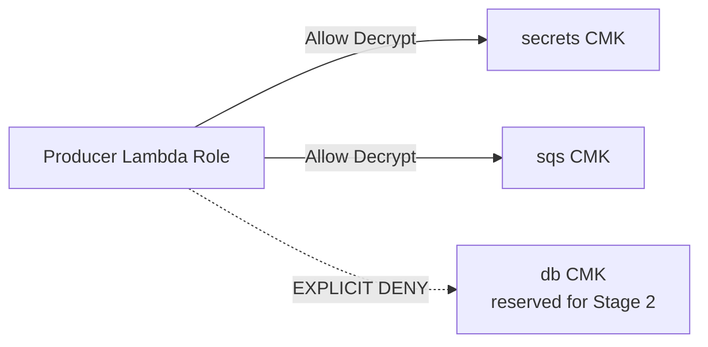

### 8.3 The secrets bootstrap dance

CDK creates Secrets Manager entries with placeholder values. Real values are filled in manually via an MFA-enforced SSO session. Same procedure as before:

```mermaid
sequenceDiagram
    participant CDK as cdk deploy
    participant SM as Secrets Manager
    participant Op as Operator
    participant Lambda

    CDK->>SM: CreateSecret value={"placeholder":true}
    Op->>Op: SSO login with MFA
    Op->>Op: Receive creds from Razorpay or Neon
    Op->>SM: aws secretsmanager put-secret-value
    SM-->>Op: VersionStage=AWSCURRENT
    Lambda->>SM: GetSecretValue on cold start
    Lambda->>Lambda: assert value != placeholder; proceed
```

If a Lambda boots and finds the placeholder, it fails closed with HTTP 503 and triggers an alarm.

### 8.4 What changes when we graduate to Stage 2

The fifth `db` CMK starts being used by Aurora storage encryption. No new keys needed.

---

## 9. Pillar 4: The Database (Neon)

### 9.1 The problem

We need a PostgreSQL database that:

- Supports `pgcrypto` and PL/pgSQL triggers
- Costs $0/month when idle
- Handles 200 webhook events per second when bursting
- Backs up daily, supports PITR
- Tolerates Lambda's connection-open pattern
- Has a clean migration path to AWS-native managed Postgres later

### 9.2 Why Neon

[Neon](https://neon.tech) is a managed PostgreSQL service designed for serverless workloads. It is **not** an AWS service; it is a third-party provider with its infrastructure on AWS underneath.

| Capability | Neon (Stage 0) | AWS RDS PostgreSQL | Aurora Serverless v2 |
|---|---|---|---|
| **Free tier** | 0.5 GB storage, 100 compute hours/mo | None | None |
| **Idle cost** | $0 (free tier) | ~$25/mo `db.t4g.small` Single-AZ | ~$43/mo at 0.5 ACU floor |
| **Connection pooling** | Native (PgBouncer mode included) | None (need RDS Proxy +$15/mo) | None (need RDS Proxy +$15/mo) |
| **PITR** | 7 days on free, 30 on paid | Configurable | Configurable |
| **`pgcrypto`, PL/pgSQL** | Native | Native | Native |
| **Public-internet TLS** | Yes (default) | Optional (we'd disable for prod) | Optional |
| **Branching for dev** | Native (one click) | No | No |
| **Compatible with asyncpg** | Yes | Yes | Yes |

For Stage 0, Neon costs $0 and gives us everything we need. The application code (asyncpg + standard SQL) does not care which Postgres it talks to. Migration to AWS-managed is `pg_dump` + `pg_restore`, one maintenance window.

### 9.3 The connection model

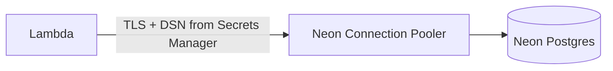

The DSN in Secrets Manager points at Neon's pooled endpoint (`...pooler.region.aws.neon.tech`). Neon handles connection multiplexing on their side. **We do not need RDS Proxy at Stage 0.**

asyncpg pool sizing at Stage 0:

| Setting | Value |
|---|---|
| `pool_min_size` | 1 |
| `pool_max_size` | 5 |

Neon's pooler handles the multiplexing to the backend. Per-Lambda pool can be small.

### 9.4 Backups and DR

Neon free tier: 7-day PITR with 1-second granularity.

For DR posture at Stage 0, we accept Neon's built-in PITR plus a weekly `pg_dump` to an S3 bucket in our prod account. The dump is encrypted with `s3-artifacts` CMK and lifecycle-transitions to Glacier after 30 days. Cost: <$1/mo.

| Metric | Stage 0 target | Mechanism |
|---|---|---|
| RPO | 5 minutes | Neon PITR (1-second granularity) |
| RTO | 4 hours | Restore via Neon console + redeploy CDK |
| Drill cadence | Quarterly | Full restore to a Neon branch + smoke test |

### 9.5 Migrations: where they run

At Stage 0, Alembic migrations run from CI/CD inside **GitHub Actions** (not CodeBuild-in-VPC). Reason: Neon is reachable over the public internet; GitHub Actions runners can talk to it directly.

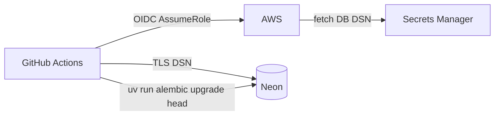

The GitHub Actions job assumes a tightly-scoped AWS role to read the DB DSN from Secrets Manager. Then it runs `alembic upgrade head` against Neon over TLS. Simpler and faster than CodeBuild.

On failure: auto-execute `alembic downgrade -1`. Beyond one revision is manual.

When we graduate to Stage 2, migrations move to **CodeBuild in VPC** because the database becomes private.

### 9.6 The read-only DB role (required before Phase 4)

The DLQ pollers and Stale Paid Monitor connect with a `razorpay_ro` role that has `SELECT` only. We add this in Alembic migration `0008_create_readonly_role.py` before deploying Phase 4:

```sql
CREATE ROLE razorpay_ro LOGIN PASSWORD :'ro_password';
GRANT CONNECT ON DATABASE razorpay_checkout TO razorpay_ro;
GRANT USAGE ON SCHEMA public TO razorpay_ro;
GRANT SELECT ON ALL TABLES IN SCHEMA public TO razorpay_ro;
ALTER DEFAULT PRIVILEGES IN SCHEMA public GRANT SELECT ON TABLES TO razorpay_ro;
```

Two DSNs in Secrets Manager: `db/credentials` (read-write) and `db/credentials-readonly` (read-only).

### 9.7 What changes when we graduate to Stage 1

Neon Launch plan ($19/env/mo): 10 GB storage, 300 compute hours, 30-day PITR. Connection string format unchanged. Lambdas restart on Stage 1 secret value update; zero code change.

### 9.8 What changes when we graduate to Stage 2

The big one. The migration:

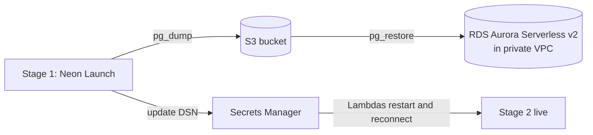

Estimated downtime: 30-60 minutes for the cutover. Estimated effort: one weekend including testing in dev first.

---

## 10. Pillar 5: Secrets and IAM

### 10.1 The two-store strategy

| Store | Used for | Why |
|---|---|---|
| **AWS Secrets Manager** | Tenant Razorpay creds, DB creds, DB read-only creds | Auto-rotation, audit, fine IAM |
| **AWS Systems Manager Parameter Store (Standard tier)** | Region, queue URLs, feature flags, OTel exporter | Free, simpler IAM, no rotation needed |

### 10.2 The IAM matrix at Stage 0

Each of the six Lambdas has its **own IAM execution role**. No sharing. No VPC ENI permissions at Stage 0 (added at Stage 2).

| Lambda | DB access | Secrets it can read | Queue access | SNS access |
|---|---|---|---|---|
| **Producer** | None | Tenant Razorpay only; explicit Deny on DB creds | Send to webhook-events only | None |
| **Consumer** | Read/write (`razorpay_app`) via Neon DSN | Tenant Razorpay + DB read/write | Receive webhook-events, send fulfillment | None |
| **Fulfillment** | Read/write via Neon DSN | Tenant Razorpay + DB read/write | Receive fulfillment only | None |
| **Fulfillment DLQ Poller** | Read-only (`razorpay_ro`) via Neon read-only DSN | DB read-only only | Receive fulfillment-dlq only | Publish to ops topic |
| **Webhook Events DLQ Poller** | Read-only via Neon read-only DSN | DB read-only only | Receive webhook-events-dlq only | Publish to ops topic |
| **Stale Paid Monitor** | Read-only via Neon read-only DSN | DB read-only only; explicit Deny on Razorpay secrets | None | Publish to ops topic |

This is the security model in one image. **Each Lambda has only the keys it needs to do its specific job.**

### 10.3 The permissions boundary

A single boundary policy is attached to every Lambda execution role. It is the **upper limit** on what any role can do, no matter how its inline policy is written:

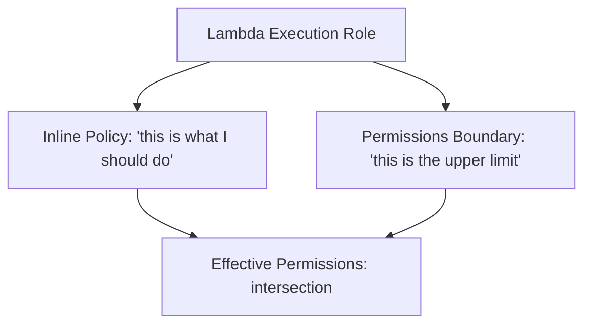

The boundary denies: `iam:*`, `kms:Delete*`, `kms:ScheduleKeyDeletion`, `lambda:UpdateFunctionCode`, `secretsmanager:DeleteSecret`, `s3:DeleteBucket`, `rds:Delete*`. Even if a future PR accidentally grants a Lambda admin permissions, the boundary blocks the dangerous actions.

### 10.4 The tenant secret cache

The Producer caches tenant Razorpay credentials in-memory with a 5-minute TTL. Same pattern at every stage.

API rate math: 2 tenants × 50 Lambda instances / 300 seconds = ~0.33 requests per second to Secrets Manager. Trivially under the 5,000 RPS account quota. (At Stage 0 the operator runs two of their own websites; tenant count is not expected to grow.)

### 10.5 What changes when we graduate to Stage 2

Five IAM policies (Consumer, Fulfillment, both DLQ Pollers, Stale Paid Monitor) gain a VPC ENI block:

```json
{
  "Sid": "AllowVpcEni",
  "Effect": "Allow",
  "Action": [
    "ec2:CreateNetworkInterface",
    "ec2:DescribeNetworkInterfaces",
    "ec2:DeleteNetworkInterface",
    "ec2:AssignPrivateIpAddresses",
    "ec2:UnassignPrivateIpAddresses"
  ],
  "Resource": "*"
}
```

The DB DSN value in Secrets Manager changes to point at the new RDS Proxy endpoint. That is the only secret value that changes.

---

## 11. Pillar 6: Compute, Queues, and the Frontend Widget

### 11.1 Why six Lambdas

| If everything were one Lambda | Why it would break |
|---|---|
| Single Lambda with Razorpay webhook + DB write | One has to fit in 500ms; the other might take 30s |
| Shared IAM role | Webhook handler would have DB credentials it doesn't need |
| Single error mode | Consumer failure cascades to Razorpay 5xx responses |

We split for latency, security, and failure isolation. SQS in the middle is the firebreak.

### 11.2 The six functions at Stage 0

| Function | Memory | Timeout | Reserved Concurrency | Provisioned Concurrency | VPC at Stage 0 | One-line job |
|---|---|---|---|---|---|---|
| **Webhook Producer** | 512 MB | 10 s | 50 | 2 (prod) / 0 (dev) | No | Verify signature, push to SQS |
| **Webhook Consumer** | 768 MB | 60 s | 30 | 0 | **No** | Apply state transition, publish fulfillment |
| **Fulfillment** | 768 MB | 60 s | 30 | 0 | **No** | Call FulfillmentHook, mark order fulfilled |
| **Fulfillment DLQ Poller** | 256 MB | 30 s | 5 | 0 | **No** | Move failed orders to `fulfillment_failed` |
| **Webhook Events DLQ Poller** | 256 MB | 30 s | 5 | 0 | **No** | Mark dead webhook events |
| **Stale Paid Monitor** | 256 MB | 30 s | 5 | 0 | **No** | Detect orders stuck in `paid` for 5+ min |

Memory and timeout values are unchanged from the Stage 2 design. The only Stage-dependent column is VPC (No at Stage 0, Yes at Stage 2 for the bottom five).

### 11.3 The SQS configuration

Same at every stage. Two queue pairs:

| Queue | Visibility Timeout | Retention | MaxReceiveCount | High Throughput Mode |
|---|---|---|---|---|
| `webhook-events.fifo` | 180 s | 4 days | 5 | Yes |
| `webhook-events-dlq.fifo` | 30 s | 14 days | n/a | No |
| `fulfillment.fifo` | 180 s | 4 days | 5 | Yes |
| `fulfillment-dlq.fifo` | 30 s | 14 days | n/a | No |

### 11.4 The frontend widget

CloudFront + S3, versioned paths, immutable caching, SRI hash per build. Same at every stage. Free tier on CloudFront covers v1.

### 11.5 Tenant onboarding flow

Operator script `scripts/onboard-tenant.py` performs:

1. `aws secretsmanager create-secret` for tenant Razorpay creds
2. INSERT into `tenants` table on Neon (via Lambda or direct DSN with operator credentials)
3. Update SSM parameter for widget CORS allow-list
4. CloudFront invalidation for `/latest/widget.js`
5. Run smoke test

Same at every stage.

### 11.6 What changes when we graduate to Stage 2

Five Lambdas move into the VPC. Their CDK construct gains `vpc=vpc, vpc_subnets=private_app_subnets, security_groups=[lambda_sg]`. Their cold start increases by ~1 second (ENI attach). No other code change.

---

## 12. Pillar 7: Observability, Audit, Compliance

### 12.1 Correlation ID end-to-end

Unchanged across stages. Every log line in every service carries one UUIDv4 that ties together the whole request lifecycle. Searchable in CloudWatch Logs Insights.

### 12.2 Logs: hot, warm, archived

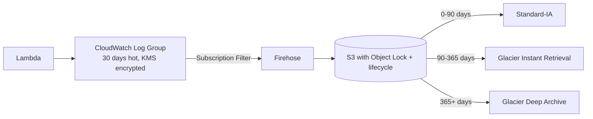

The Object Lock on the S3 log bucket is essential: it means even a compromised admin in the workload account cannot delete logs during the retention window. This is the substitute for a separate Log Archive account.

### 12.3 Metrics that matter

Ten metric instruments mapped to alarms. Same as the original plan:

| Metric | Alarm threshold | Page or warn |
|---|---|---|
| `webhook_latency_ms` p95 | >400 ms for 10 min | Warn |
| `webhook_latency_ms` p95 | >500 ms for 5 min | Page |
| `fulfillment_duration_ms` failure rate | >1% over 15 min | Page |
| Stale paid orders | >0 | Page |
| Webhook DLQ depth | >0 for 5 min | Page |
| Fulfillment DLQ depth | >0 for 5 min | Page |
| Lambda concurrent executions | >80% of reserved | Warn |
| Secrets Manager throttle | >0 | Warn |
| Neon connection failures (from Lambda logs filter) | >0 over 5 min | Page |
| Razorpay webhook response p95 (from Razorpay dashboard, manual check) | >3s for 10 min | Warn |

### 12.4 Audit and compliance services

| Service | Where it runs | What it does |
|---|---|---|
| **CloudTrail** | Each workload account, S3 in same account with Object Lock | Records every API call; tamper-evident |
| **AWS Config** | Each workload account | Continuous compliance checks (~30 managed rules) |
| **GuardDuty** | Each workload account | ML threat detection |
| **Security Hub** | Each workload account | Aggregates findings; standards: AWS FSBP, CIS, PCI DSS (informational) |

No cross-account aggregation at Stage 0. If you want the prod audit, you log into the prod account.

### 12.5 What changes when we graduate to Stage 2

Add **VPC Flow Logs** to CloudWatch. Useful for proving "no Lambda traffic ever reached the public internet." Cost: a few dollars per month.

---

## 13. Pillar 8: CI/CD and Deployment Safety

### 13.1 Pipeline overview

GitHub Actions with OIDC to AWS. No long-lived AWS keys. Same at every stage.

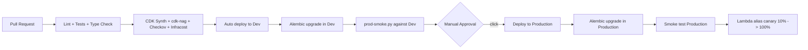

### 13.2 The OIDC trust model

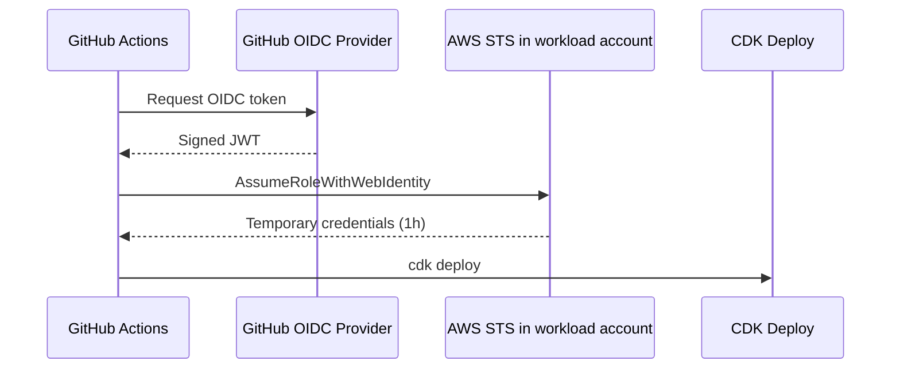

The trust policy in AWS allows assume-role only from `repo:<gh-org>/razorpay-payment-integration:ref:refs/heads/main` (prod) or any branch (dev). Dev role and prod role live in their respective accounts.

### 13.3 Safety nets already wired

| Tool | What it catches |
|---|---|
| **pre-commit (gitleaks, ruff, format)** | Secrets in commits, lint regressions |
| **cdk-nag** | AWS best-practice violations |
| **Checkov** | Static security scan on synthesized CloudFormation |
| **Infracost** | Cost delta posted as PR comment |
| **Renovate** | Weekly dependency PRs |

These are in `pr-checks.yml` and `.pre-commit-config.yaml`. They run today.

### 13.4 Lambda canary deployment

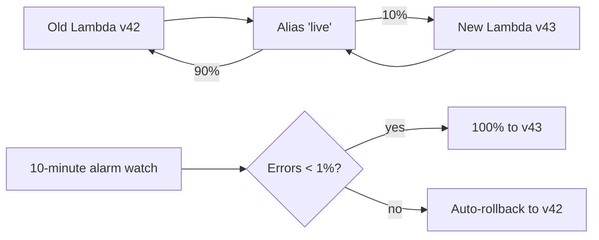

CodeDeploy with `CANARY_10_PERCENT_10_MINUTES`. Auto-rollback on alarm.

### 13.5 What changes when we graduate to Stage 2

Alembic migration runner moves from GitHub Actions (Stage 0, talks to Neon over public internet) to a CodeBuild project in VPC (Stage 2, talks to RDS Proxy in private subnets). The pipeline stage is the same; the runner is different.

---

## 14. The Phased Rollout: How the Work Actually Happens

Stage 0 deployment in eight phases (down from ten in the original Stage 2 plan because we skip the VPC and Aurora work):

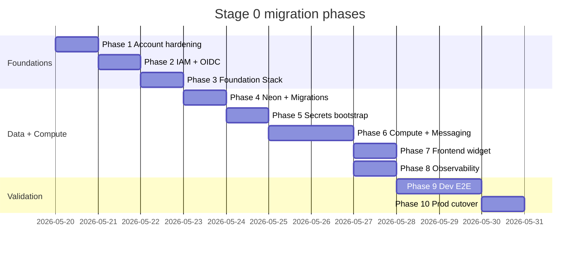

**Estimated effort at Stage 0: ~70 engineering hours, ~11 calendar days.** Reduced from the Stage 2 estimate of 98 hours because:

- Phase 3 is smaller (no VPC, no PrivateLink endpoints)
- Phase 4 is much smaller (no Aurora, no RDS Proxy, no CodeBuild-in-VPC migration runner)

Per-phase verification gates and exact commands are in `MIGRATION_ARCHITECTURE.md`.

---

## 15. Stage Graduation Playbook

When to climb the ladder, what triggers it, and what the work looks like.

### 15.1 Stage 0 to Stage 1

**Signals to watch:**

| Signal | Where to look | Threshold |
|---|---|---|
| Neon storage | Neon dashboard or `SELECT pg_database_size(current_database())` | > 400 MB |
| Neon compute hours per month | Neon dashboard | > 80 hours |
| Transaction rate sustained | CloudWatch metric `order_state_transition_count` p95 | > 5/sec |

**The work:**

1. Upgrade Neon project to Launch plan ($19/env/mo). One click in the Neon dashboard.
2. Update billing email on Neon.

That's it. No code changes, no CDK changes, no Lambda restarts. Total time: 5 minutes per environment.

**New monthly cost:** ~$100/mo combined.

### 15.2 Stage 1 to Stage 2

**Signals to watch:**

| Signal | Where to look | Threshold |
|---|---|---|
| Neon Launch plan limits | Neon dashboard | > 8 GB storage or > 250 compute hours/mo |
| PCI compliance scope | Legal / customer contracts | Any formal requirement |
| Monthly revenue from platform | Internal | Sustainably > $1000/mo for 3 months |
| Sustained transaction rate | CloudWatch | > 100k tx/mo |

**The work (one weekend, with dev dry run first):**

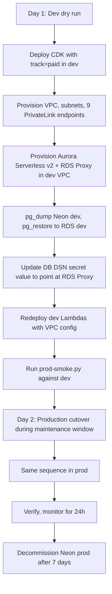

**Estimated downtime in prod cutover:** 30-60 minutes during the `pg_dump`/`pg_restore` window. Done in a 2 AM IST maintenance window.

**Pre-cutover checklist:**

- Manual Neon snapshot taken
- RDS Proxy verified accepting connections
- Dev dry run complete and green
- Rollback runbook reviewed (revert DSN value, redeploy with `track=free`)
- Ops on standby

**New monthly cost:** ~$300-400/mo combined.

### 15.3 Stage 2 to Stage 3

**Signals to watch:**

| Signal | Threshold |
|---|---|
| Business RTO requirement | < 1 hour |
| Regulator requires geographic redundancy | Any formal requirement |
| Sustained transaction rate | > 500k tx/mo (cost of warm DR amortizes) |

**The work:**

1. Enable Aurora Global Database (converts the existing Aurora cluster).
2. Provision DR-region foundation stack in `ap-southeast-1`.
3. Provision warm read replica.
4. Document failover runbook.
5. Run DR failover drill quarterly.

**New monthly cost:** ~$600-1000/mo combined.

### 15.4 The principle behind all of this

We do not pre-build. We do not over-engineer. We watch the metrics, we listen to customers, and we climb when the signal is unambiguous. Every climb is documented before we need it so the playbook is ready when the time comes.

---

## 16. Tradeoff Cheat Sheet

A consolidated view of every "we picked X over Y" decision at Stage 0.

| Decision | Picked | Rejected | Why |
|---|---|---|---|
| Account model | 2 standalone accounts (Dev + Prod), no Organizations | Single account | Blast radius isolation; quota isolation |
| Account model | 2 standalone accounts | Organizations with Mgmt + Dev + Prod | Solo operator; SCPs replaced by per-account CloudWatch alarms |
| Region | ap-south-1 | us-east-1 / eu-west-1 | Razorpay proximity, customer location |
| VPC for internal Lambdas | None at Stage 0 | VPC + PrivateLink | Saves $264/mo; IAM is the security model per DESIGN_v6 §11 |
| Database | Neon | RDS / Aurora | $0 idle cost at Stage 0; portable; one-weekend migration when needed |
| RDS Proxy | None at Stage 0 | RDS Proxy | Neon's built-in pooler handles it |
| Edge ingress | API Gateway HTTP API | CloudFront + Function URL | Lower latency for the 500ms SLA |
| KMS keys | 5 CMKs per env | Single shared CMK | Blast radius; $10/mo across 10 keys is cheap insurance |
| Lambda packaging | Container image | Zip + Layers | Reproducible build; matches existing ECR setup |
| Producer | Outside VPC at every stage | Inside VPC | Cold-start budget for 500ms SLA; no DB credentials needed |
| Provisioned Concurrency | Producer only (prod) | All Lambdas | Cold start absorbed by SQS for non-Producer |
| SQS | FIFO + High Throughput Mode | Standard SQS | Ordering guarantee per `MessageGroupId`; idempotency contract |
| Tenant secret cache TTL | 5 min | 1 min | Balance staleness on rotation vs API rate |
| CI/CD | GitHub Actions + OIDC | AWS CodePipeline | Source already on GitHub; no long-lived keys |
| DR posture (Stage 0) | Neon PITR + weekly S3 dump | Aurora Global Database | Cost; PITR is sufficient for v1 |
| Backup retention | Neon free tier 7 days | Longer hot retention | Stage 1 Launch plan extends to 30 days; sufficient until then |
| WAF | Enable | Skip | Razorpay IP allow-list; rate limiting |
| Permissions boundary | Apply to every role | Per-role inline only | Catches future IAM mistakes |
| Alembic migration runner | GitHub Actions | CodeBuild-in-VPC | At Stage 0 Neon is reachable from anywhere; simpler |
| CloudTrail destination | S3 in same workload account with Object Lock | Separate Audit account | Object Lock substitutes for account separation |

---

## 17. What Could Change During Implementation

| Change | Probability | What we do |
|---|---|---|
| **Neon free tier capacity exhausted earlier than expected** | Medium | Graduate to Stage 1 (Neon Launch). Trivial. |
| **Razorpay rotates source IPs without notice** | Medium | Monthly runbook + alarm on `WAFAllowedRequestsByRule` zero |
| **Producer cold start exceeds 500ms** | Low | Bump Provisioned Concurrency to 4; +$15/mo |
| **Secrets Manager throttling** | Very low | Cache hits prevent it; pre-warm if needed |
| **Read-only PostgreSQL role doesn't exist in current migrations** | High (likely true now) | Add `0008_create_readonly_role.py` before Phase 4 |
| **DLQ pollers turn out to be EventBridge-scheduled not SQS-triggered** | Medium | Adjust IAM matrix |
| **Custom domain ownership unclear** | High (verify before Phase 3) | Coordinate registrar access |
| **Neon US-East-2 / Singapore latency to ap-south-1** | Medium | Move to Neon's `aws-ap-south-1` region (available) |
| **Object Lock on CloudTrail bucket conflicts with lifecycle rules** | Low | Test in dev first; adjust retention if needed |

When any of these happens, we update this writeup (the why), then `MIGRATION_ARCHITECTURE.md` (the what), then the code. In that order.

---

## 18. How to Use This Document

### 18.1 Before starting a phase

Read the relevant Pillar section. Then go to `MIGRATION_ARCHITECTURE.md` for exact configurations.

### 18.2 When you see a metric crossing a Stage threshold

Go to Section 15 (Stage Graduation Playbook). The work is pre-documented.

### 18.3 When a decision needs to change mid-implementation

1. Update Section 17.
2. Update the relevant Pillar's tradeoff table.
3. Update `MIGRATION_ARCHITECTURE.md`.
4. Update the code.

Always: writeup, architecture doc, code. Do not invert this order.

### 18.4 Onboarding a new engineer

Read order: this writeup, `MIGRATION_ARCHITECTURE.md`, `DESIGN_v6.md`. By the time they're on the design, every section should make sense.

### 18.5 Quarterly architecture reviews

Walk Section 16 (Tradeoff Cheat Sheet). For each row, ask: "Is the picked option still the right answer at our current stage?" If yes, no change. If something shifted (costs, traffic, regulation), update Section 17 and the relevant pillar.

---

## Appendix A: Glossary

| Term | Plain meaning |
|---|---|
| **Aurora Serverless v2** | AWS managed PostgreSQL that scales by ACU. Stage 2 candidate. |
| **CDK** | AWS Cloud Development Kit. Infrastructure as code in Python. |
| **CMK** | Customer Managed Key. A KMS key we own. |
| **Cold start** | A Lambda invocation that spins up a new instance. Adds latency. |
| **DLQ** | Dead Letter Queue. Where messages go after SQS exhausts retries. |
| **FIFO queue** | SQS queue with ordering within a MessageGroupId. |
| **HMAC** | How we verify Razorpay webhook signatures. |
| **HTTP API** | A type of API Gateway. Cheaper, faster than REST API. |
| **Idempotency** | Doing the same operation twice produces the same result as once. |
| **KMS** | AWS Key Management Service. |
| **NAT Gateway** | Lets VPC resources reach the public internet. **We do not use it.** |
| **Neon** | Third-party managed PostgreSQL. Our Stage 0 database. |
| **OIDC** | Identity protocol GitHub Actions uses to authenticate to AWS without keys. |
| **PITR** | Point-In-Time Recovery. Restore DB to any second within retention. |
| **PrivateLink** | AWS-private connection to AWS services. Stage 2 only. |
| **RDS Proxy** | Managed connection pooler. Stage 2 only. |
| **Reserved Concurrency** | Cap on simultaneous Lambda instances of one function. |
| **Provisioned Concurrency** | Floor of pre-warmed Lambda instances. |
| **RPO** | Recovery Point Objective. Data loss budget in a disaster. Target 5 min. |
| **RTO** | Recovery Time Objective. Time to be back up. Target 4 hours. |
| **SCP** | Service Control Policy. Org-wide IAM ceiling. |
| **SRI** | Subresource Integrity. Hash on a `<script>` tag for tamper detection. |
| **VPC** | Virtual Private Cloud. **No Lambdas in VPC at Stage 0.** |
| **WAF** | Web Application Firewall. Sits in front of API Gateway. |

---

## Appendix B: Stage 0 Quick Reference Diagram

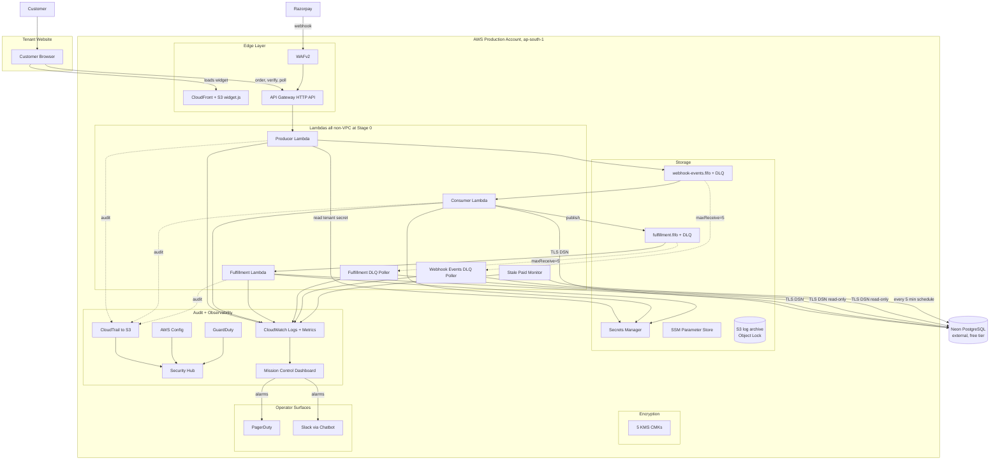

This is the complete Stage 0 runtime in one image. **No VPC, no NAT, no PrivateLink, no RDS Proxy, no Aurora.** That is the whole point of Stage 0.
