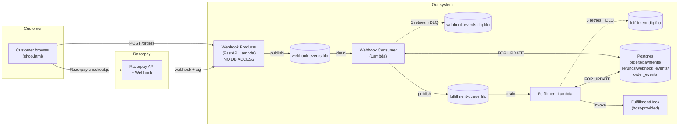

# Architecture

System overview for the Razorpay payment integration. One-pager. Deeper specifics live in [`../designs/DESIGN_v6.md`](../designs/DESIGN_v6.md); diagrams in [`./diagrams/`](./diagrams/); AWS deployment plan in [`../designs/MIGRATION_ARCHITECTURE.md`](../designs/MIGRATION_ARCHITECTURE.md).

## The system in one diagram



## Three Lambdas, two queues, one DB

**Webhook Producer** receives `POST /payments/webhook/{tenant_id}` from Razorpay. It:

1. Looks up the tenant from `TenantConfigRegistry` (loaded from SSM at cold start).
2. Verifies `X-Razorpay-Signature` against `webhook_secret` (with fallback to `webhook_secret_previous` during rotation).
3. Parses the body, builds a canonical envelope including a fresh `correlation_id`.
4. Publishes to `webhook-events.fifo` with `MessageGroupId = razorpay_order_id` (FIFO ordering per order).
5. Returns `200 queued` in under 500 ms to satisfy Razorpay's SLA.

**Webhook Producer holds zero database credentials.** This is enforced in IAM (deny on `rds:*` and on the DB secret ARN) and asserted in tests (`test_webhook_producer.py::test_producer_does_not_use_asyncpg_pool`).

**Webhook Consumer** drains `webhook-events.fifo` with batch size 1. For each message:

1. Fast-path dedup: `INSERT INTO webhook_events (...) ON CONFLICT (tenant_id, event_id) DO NOTHING`. If the row already exists, this is a re-delivery — mark `done` and return.
2. Begin transaction. `SELECT * FROM orders WHERE razorpay_order_id = ? FOR UPDATE`.
3. **Primary idempotency guard (event-type aware).** Skip if the order is already at or past the target state. See `webhook-idempotency.md`.
4. **Amount assertion** for capture/authorize events. On mismatch, mark event `failed`, return 200 (so Razorpay does not retry).
5. Transition order via `OrderService.transition`. Insert `payments` row only on `payment.captured` (`is_authoritative=TRUE`) or `payment.failed` (`is_authoritative=FALSE`). Insert `refunds` on `refund.processed`.
6. Commit transaction.
7. **After commit:** publish to `fulfillment-queue.fifo` on `paid` transitions. DB-before-side-effects is Critical Invariant 8.

**Fulfillment Lambda** drains `fulfillment-queue.fifo`. For each message:

1. `SELECT ... FOR UPDATE` on the order.
2. Short-circuit if the order is already `fulfilled` (idempotent at-least-once delivery).
3. Invoke the host's `FulfillmentHook.fulfill(...)`.
4. Transition to `fulfilled` (or `fulfillment_failed` on exception).
5. Commit.

## The 10 Critical Invariants

Source: [`../CLAUDE.md`](../CLAUDE.md). Every one is tested and at least one was hard-earned during development (see DESIGN_v6 Section 17).

1. **Tenant isolation.** Every query against `orders`, `payments`, `refunds`, `webhook_events`, `order_events` filters by `tenant_id`. The logical FK to `tenants.id` is unconstrained at the DB level for performance; correctness is the application's responsibility.
2. **Tenant ID source.** Extracted from the URL path parameter. Never from request body, query string, or header.
3. **Webhook secret lookup.** Verify `X-Razorpay-Signature` against `webhook_secret` first, fall back to `webhook_secret_previous` if set. Both checks use `hmac.compare_digest`. Verification precedes payload deserialization.
4. **Producer has no DB credentials.** IAM-enforced, test-asserted. The role has explicit `Deny` on `rds:*` and on the DB secret ARN.
5. **Event-type-aware primary idempotency.** Inside the consumer's DB transaction, after `SELECT ... FOR UPDATE`, check whether the event's target state has already been reached. Rules per event type live in DESIGN_v6 Section 2.1 step 10.
6. **State transition ordering.** Acquire `SELECT ... FOR UPDATE` before any state change. Assert `event_amount == order.amount` on capture and authorize events.
7. **Order creation sequence.** Insert local `orders` row with `status=initializing` before calling Razorpay. Razorpay is never ahead of the DB.
8. **DB commit before side effects.** The consumer's DB transaction commits before any `fulfillment-queue.fifo` publish, log, or external call.
9. **Correlation ID propagation.** Generate a UUIDv4 at the Producer entry. Carry through `webhook-events.fifo` MessageAttributes, persist on `webhook_events`, `orders`, `order_events`. Re-bind from MessageAttributes at the Consumer and Fulfillment Lambda entries (Section 17.12).
10. **`received_at` is producer-set.** The Consumer takes `received_at` from the SQS message envelope, not `NOW()`. This preserves Razorpay-perceived receipt time across the producer-to-consumer hop.

## State machine

```text
initializing → created
created → attempted | failed
attempted → authorized | paid | failed
authorized → paid | failed
failed → attempted     (recovery)
paid → fulfilled | fulfillment_failed | refunded
fulfilled → refunded
fulfillment_failed → fulfilled | refunded
```

Any other edge raises `IllegalTransitionError`. Special case: `payment.failed` on `paid`/`fulfilled`/`fulfillment_failed` is a no-op (`STALE_NO_OP`).

Two **auto-hops** in `handle_payment_authorized` and `handle_payment_captured` cover the case where a webhook arrives on a `created` order (server-to-server flow or verify-callback-less integration): the consumer inserts the missing `created → attempted` transition silently with `metadata.auto_attempted=true`. See DESIGN_v6 Section 17 + `webhook_handlers.py`.

Full transition table: DESIGN_v6 Section 4 and the `payment-state-machine` skill. Visual: [`./diagrams/state-machine.md`](./diagrams/state-machine.md).

## Webhook event routing

| Event | Action |
|---|---|
| `payment.authorized` | `attempted → authorized`. No `payments` row. No SQS publish. Auto-hops from `created`. |
| `payment.captured` | Transition to `paid`. INSERT `payments`, `is_authoritative=TRUE`. Publish to fulfillment queue. Auto-hops from `created`. |
| `payment.failed` | Transition to `failed`. INSERT `payments`, `is_authoritative=FALSE`. No SQS publish. |
| `refund.processed` | Transition to `refunded`. UPDATE captured `payments.status='refunded'`. INSERT `refunds`. No SQS publish. |
| `order.paid` | Log only. No state change. |

## Why this architecture

**Why split producer from consumer?** Two reasons:

1. Razorpay's 500 ms response SLA. The producer must return 200 fast; DB transitions can be slow.
2. **Security boundary.** The public-facing function holds zero database credentials. A compromise of the producer cannot reach the DB.

**Why FIFO queues?** Ordering per `razorpay_order_id` matters: a `payment.authorized` arriving before its `payment.captured` for the same order would otherwise produce a different end state. FIFO with `MessageGroupId = razorpay_order_id` guarantees within-order ordering while still allowing parallel processing across orders.

**Why server-set `received_at`?** Razorpay's webhook retry semantics measure latency from the producer's wall clock at entry. If the consumer re-stamped with `NOW()`, the time spent in the queue would be invisible.

## Network posture

**Free Track (default):** all Lambdas public, no VPC, no Interface Endpoints, $0 network cost. Producer behind a Function URL. Consumer + Fulfillment have public egress to the DB (Neon serverless Postgres) over its public TLS endpoint.

**Paid Track (gated on `track="paid"` context):** Consumer + Fulfillment move into private subnets with SQS / Secrets Manager / Logs / Monitoring VPC Interface Endpoints. RDS in private subnet. ~$32/month minimum NAT-less because Interface Endpoints replace NAT for in-VPC egress.

Switching is a CDK context flip + a redeploy. Application code is identical between tracks.

## Tooling map

| Need | Tool |
|---|---|
| Run all tests | `uv run pytest` |
| Run dev backend | `uvicorn main:app --reload --port 8000` |
| Drain SQS locally (consumer simulation) | `scripts/local-pump.py` |
| Seed/purge/reset DB + queues | `scripts/local-fixtures.py` |
| Fire a synthetic Razorpay webhook | `scripts/razorpay-simulator.py` |
| Investigate DLQ | `scripts/dlq-replay.py` |
| AWS deploy | `cdk deploy` (Phase 17, optional) |

Full command reference: [`COMMANDS.md`](COMMANDS.md).

## Related

- [`./diagrams/`](./diagrams/) — visual references (system, sequence, state, deployment).
- [`./runbooks/`](./runbooks/) — operator playbooks per incident type.
- [`./cloud/`](./cloud/) — AWS account setup, IAM patterns, cost controls.
- [`../designs/DESIGN_v6.md`](../designs/DESIGN_v6.md) — formal spec. Section 17 captures hard-won lessons learned.
- [`.claude/rules/`](../.claude/rules/) — invariant-enforcing rules consumed by AI agents working on this repo.
