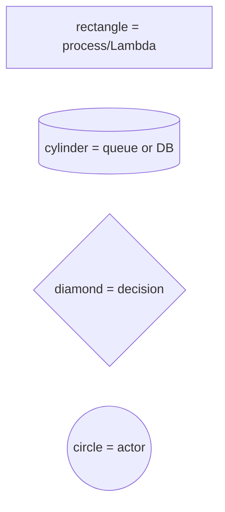

# Diagrams

Mermaid diagrams describing the system. All render on GitHub directly. Each diagram is a separate file so you can flip through them quickly.

| Diagram | Shows |
|---|---|
| [system-architecture.md](system-architecture.md) | Components + queues + DB at a glance |
| [webhook-flow.md](webhook-flow.md) | Sequence diagram of one `payment.captured` event end to end |
| [state-machine.md](state-machine.md) | Order status graph + valid transitions |
| [deployment-topology.md](deployment-topology.md) | AWS resources + connections (Phase 17+) |

## Mermaid quick reference

If you want to edit these, the Mermaid live editor is at https://mermaid.live. Copy-paste a block, edit, paste back.

Common shapes used in these diagrams:

Arrow styles:

- `-->` solid (synchronous call)
- `-.->` dashed (async / failure path)
- `<-->` bidirectional (read/write)
