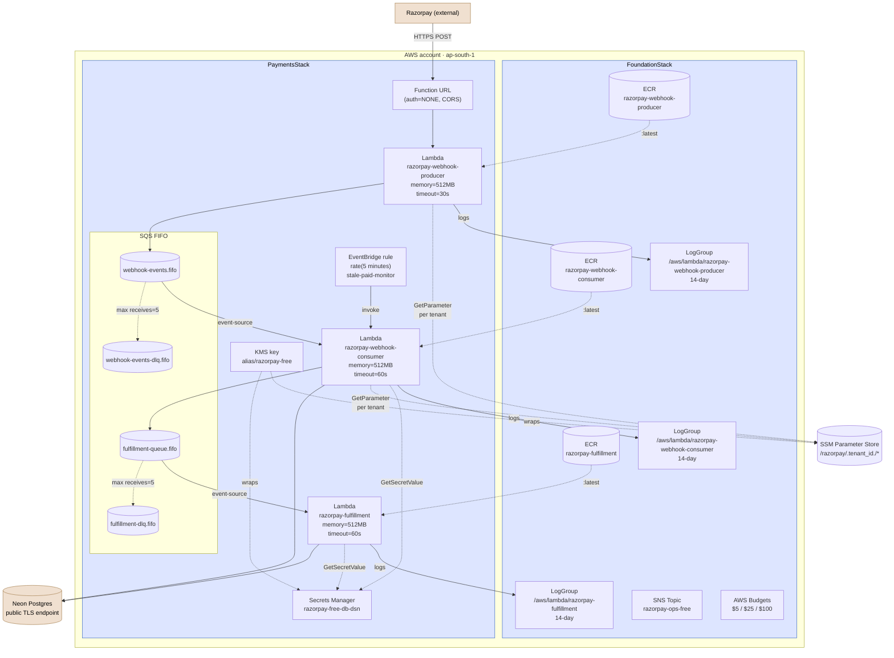
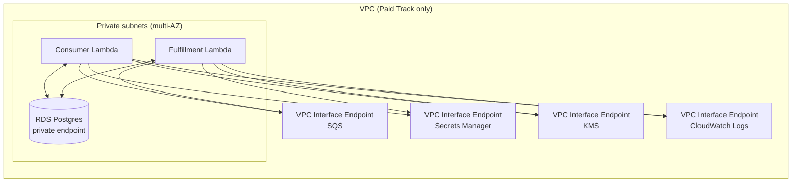

# Deployment topology

AWS resources provisioned by `FoundationStack` (Phase 15) and `PaymentsStack` (Phase 16). What gets deployed where, and who can talk to whom.

## Free Track (default)

No VPC, all Lambdas public, ~$0/month idle.

## Network posture (Free Track)

- **Producer Function URL** is public HTTPS. Razorpay's webhook senders POST to it directly. No API Gateway.
- **Consumer and Fulfillment Lambdas** have AWS public egress (no VPC). They talk to Neon over its public TLS endpoint. Cost = $0 ingress + standard egress.
- **Inside AWS:** Lambda → SQS / SSM / Secrets Manager / KMS / CloudWatch all stays inside AWS's network. No public hops.
- **No NAT Gateway.** This is the single biggest cost saver. Adding one would add ~$32/month minimum even with zero traffic.

## Network posture (Paid Track)

Conditional on `track="paid"` context. Same Lambdas + queues, but Consumer and Fulfillment move into private subnets with Interface Endpoints for SQS, Secrets Manager, KMS, Logs, Monitoring. RDS in the same VPC's private subnet.

**Paid Track delta:** ~$7/month per Interface Endpoint × 4 endpoints × 2 AZs = ~$56/month minimum, plus RDS reserved instance ~$15/month at the smallest size. Compare to Free Track's ~$2/month at idle.

## IAM model

Three Lambda execution roles, each scoped to the minimum:

| Role | Allowed | Explicit Deny |
|---|---|---|
| `WebhookProducerRole` | `sqs:SendMessage` on webhook-events.fifo; `ssm:GetParameter` on `/razorpay/*`; `kms:Decrypt` | `rds:*`, `rds-db:*`; `secretsmanager:GetSecretValue` on DB secret ARN |
| `WebhookConsumerRole` | `sqs:Receive/Delete` on webhook-events.fifo; `sqs:SendMessage` on fulfillment-queue.fifo; `ssm:GetParameter`; `kms:Decrypt`; `secretsmanager:GetSecretValue` on DB secret | — |
| `FulfillmentRole` | `sqs:Receive/Delete` on fulfillment-queue.fifo; `secretsmanager:GetSecretValue` on DB secret; `kms:Decrypt`; `sns:Publish` on ops topic | — |

**Critical Invariant 4 enforcement:** the producer's explicit Deny on `rds:*` and the DB secret ARN means a leaked producer credential cannot reach the DB even if the application code has a bug.

## Read next

- [system-architecture.md](system-architecture.md) — what each Lambda *does*.
- [webhook-flow.md](webhook-flow.md) — sequence of one event through this topology.
- [docs/cloud/iam-bootstrap.md](../cloud/iam-bootstrap.md) — IAM role + policy patterns.
- `infra/stacks/foundation.py` and `infra/stacks/payments.py` — the actual CDK code.
