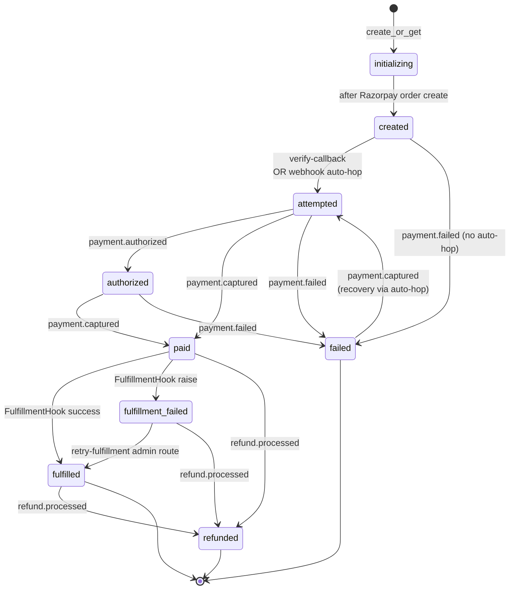

# Order state machine

Every valid edge an order can traverse.

Any edge not in this graph raises `IllegalTransitionError`. Special cases:

- **`payment.failed` arriving on `paid` / `fulfilled` / `fulfillment_failed`** is treated as **stale data, not a real transition**: marked `STALE_NO_OP` in `webhook_events.processing_status` and ignored.
- **`order.paid` webhook is log-only**: it doesn't drive any state change. Useful for forensics.

## Auto-hops

Two cases where the consumer inserts an implicit intermediate transition:

| Trigger | Path | Why |
|---|---|---|
| `payment.captured` on `created` | `created → attempted → paid` | Server-to-server flows or hosts that don't call verify-callback. Metadata `auto_attempted: true`. |
| `payment.captured` on `failed` | `failed → attempted → paid` | Razorpay recovered a previously-failed payment. Metadata `recovery: true`. |

Both preserve the strict external state machine — every order still visits `attempted` — while accepting real production webhook patterns.

## Terminal states

Per CLAUDE.md and Section 17.4 — "terminal" has two senses:

- **`LIFECYCLE_TERMINAL`** = states where the order's business lifecycle is done: `fulfilled`, `failed`, `refunded`.
- **`NON_TERMINAL`** = everything else, including `paid` and `fulfillment_failed` (they're terminal for *payment* but not for *fulfillment*).

The reconciliation query filters on `NON_TERMINAL` to find work needing attention. The stale-paid monitor filters on `status = 'paid' AND paid_at < NOW() - INTERVAL '15 minutes'`.

## Read next

- [system-architecture.md](system-architecture.md) — where transitions happen.
- [webhook-flow.md](webhook-flow.md) — sequence diagram of one transition.
- [ARCHITECTURE.md](../ARCHITECTURE.md#state-machine) — text version.
- [DESIGN_v6.md Section 4](../../designs/DESIGN_v6.md) — formal spec.
