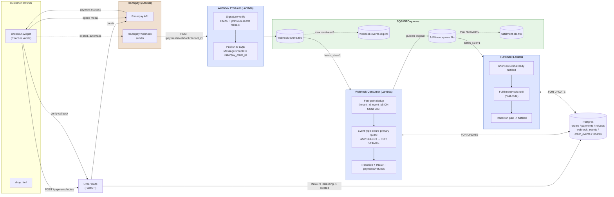

# System architecture

Components, queues, and the database in one picture.

## What this picture says

**Two security boundaries.** The Producer (left of `WQ`) holds zero database credentials. Even if the public endpoint is compromised, the DB is unreachable. The Consumer + Fulfillment (right of `WQ`) hold credentials but only handle messages that have already passed signature verification.

**Two queues, two retry budgets.** Each main queue has its own DLQ with `maxReceiveCount=5`. The DLQs are inspected with `scripts/dlq-replay.py`; alarms fire on `ApproximateNumberOfMessages > 0`.

**One database, five tenant-scoped tables.** Every query against the five tables filters by `tenant_id`. The logical FK to `tenants.id` is unconstrained at the DB level for performance.

## Read next

- [webhook-flow.md](webhook-flow.md) — what happens *inside* this picture during one `payment.captured` event.
- [state-machine.md](state-machine.md) — the order status graph.
- [ARCHITECTURE.md](../../ARCHITECTURE.md) — full system overview in prose.
