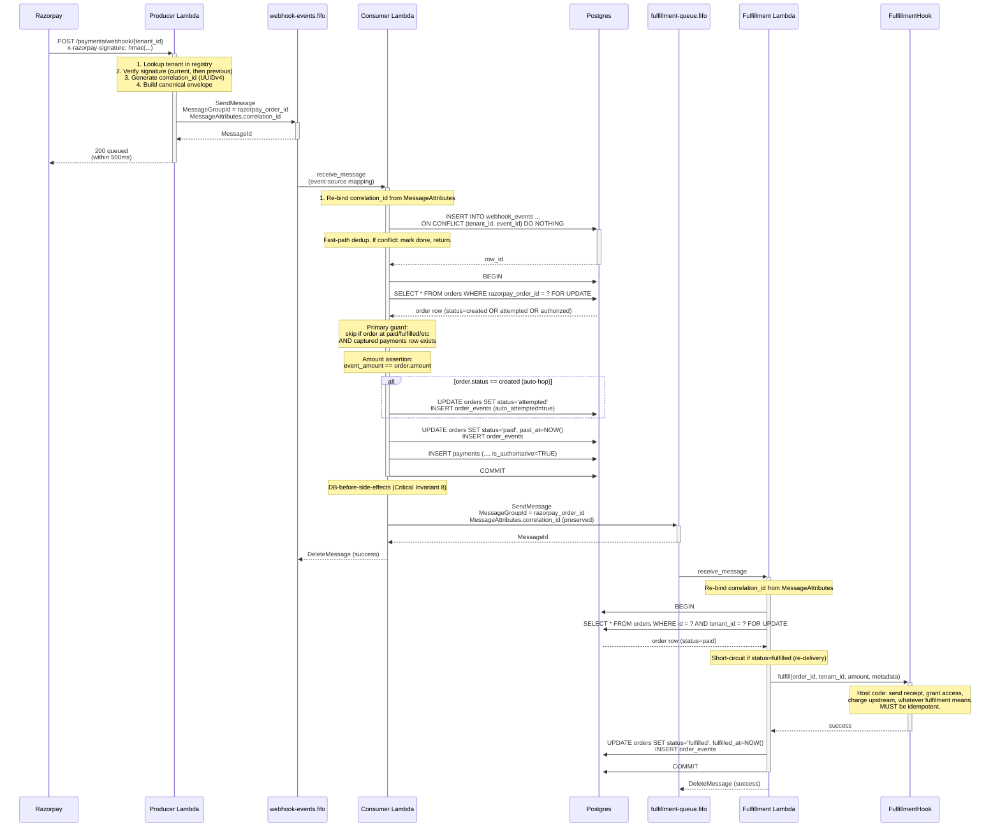

# Webhook flow

Sequence diagram for one happy-path `payment.captured` event end to end.

## Critical points

- **Producer ack is unconditional 200** as long as signature is valid. Even if SQS publish fails, we publish to OPS topic for ops to investigate.
- **Consumer commits before publishing to fulfillment-queue.** If publish errors after commit, the order is stranded in `paid`. The stale-paid monitor sweeps every 5 minutes for these.
- **Fulfillment's transaction wraps the hook call.** If the hook raises, the transaction rolls back and SQS will retry (up to `maxReceiveCount=5`). After 5 failures, DLQ.
- **Correlation_id survives both SQS hops** via MessageAttributes. Critical Invariant 9, was broken in early Phase 13 and fixed (Section 17.12).
- **Auto-hop** for `created → attempted` lives in the consumer, not the state machine. Lets server-to-server flows land cleanly without weakening the external state machine.

## Read next

- [system-architecture.md](system-architecture.md) — components view.
- [state-machine.md](state-machine.md) — the full status graph.
- [`.claude/rules/webhook-idempotency.md`](../../.claude/rules/webhook-idempotency.md) — formal idempotency contract.
